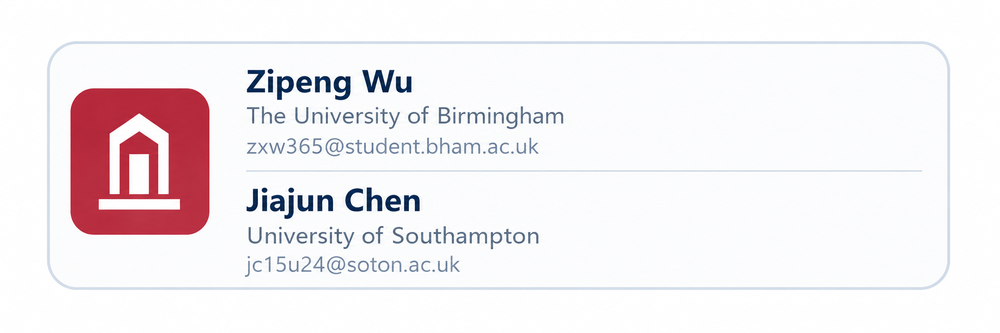
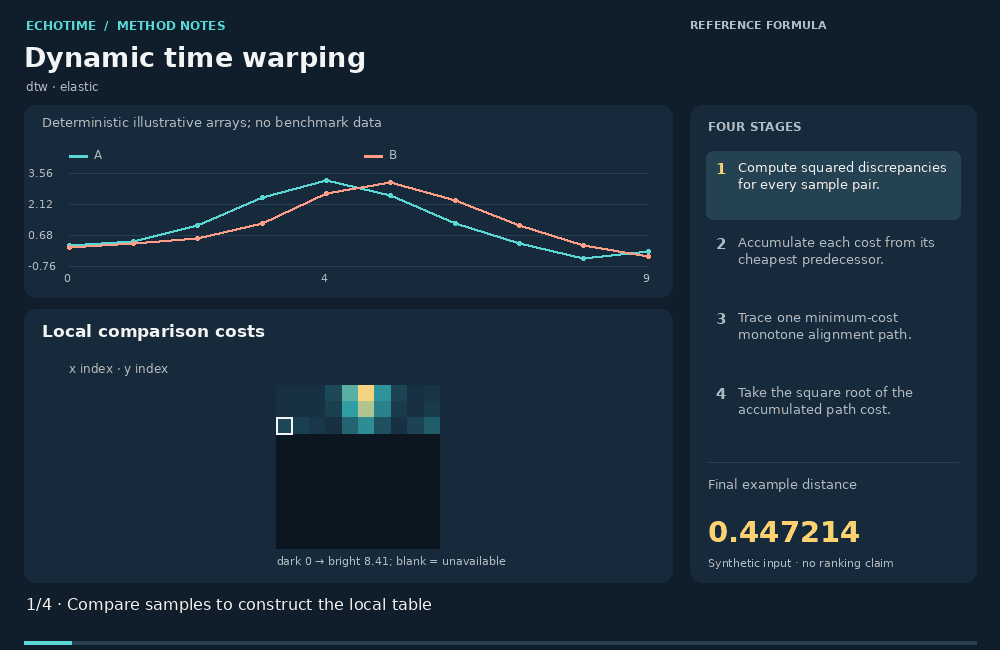
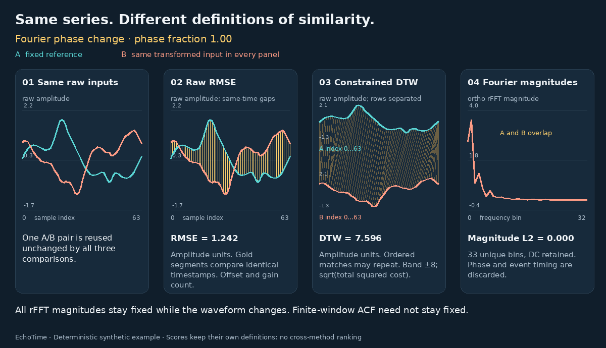

# EchoTime

> **Compare time series and datasets with explainable structural similarity.**

[](https://pypi.org/project/echotime/)
[](https://pypi.org/project/echotime/)
[](LICENSE)
[](https://github.com/ZipengWu365/EchoTime)
[](https://zipengwu.me/EchoTime/)
[](https://github.com/ZipengWu365/EchoTime)
[](https://www.birmingham.ac.uk/)




**EchoTime** is an **explainable time-series similarity package for humans and agents.** It is built for the moment when a raw distance score is not enough: compare trajectories, compare datasets at the structural level, and hand the result to another person or another agent.

**What it is:** EchoTime compares time series and time-series datasets, explains why they match or differ, and emits compact JSON plus shareable HTML reports.

**Scope:** exploratory pairwise and dataset comparison, component diagnostics, and report export. Use the linked specialist libraries for estimator training, indexed retrieval, or motif discovery.

## Project snapshot

- **Package name:** `echotime`
- **Core promise:** EchoTime compares time series and time-series datasets, explains why they match or differ, and emits compact JSON plus shareable HTML reports.
- **Best for:** analog search, regime comparison, irregular longitudinal data, and dataset-level similarity handoff
- **Primary outputs:** plain-English summaries, shareable HTML reports, and compact agent-ready JSON
- **Live docs and homepage:** https://zipengwu.me/EchoTime/
- **Repository:** https://github.com/ZipengWu365/EchoTime


## Choose a similarity method

Start with the object you need to compare, the differences that matter, and the
changes you are prepared to ignore.

| Question | Reading route |
|---|---|
| Do two complete signals agree in level, shape, timing, or rhythm? | [Method selection guide](docs/articles/time-series-similarity-guide.en.md) · [中文](docs/articles/time-series-similarity-guide.zh-CN.md) |
| Do I need DTW, matrix profiles, learned representations, or a Python library? | [Task and software comparison](docs/articles/README.md) |
| Which papers support a method, and what did they actually evaluate? | [Verified reading list](docs/references/time-series-similarity-literature.md) · [BibTeX](docs/references/time-series-similarity-literature.bib) · [JSON](docs/references/time-series-similarity-literature.json) |
| Which methods are implemented in this package? | [Implementation atlas](SIMILARITY_METHOD_ATLAS.md) |
| How does each method work, step by step? | [137 animated explanations · 动图详解](docs/method-animations/README.md) |
| What information does each comparison retain or ignore? | [Mechanism-level tour of distances, alignments and representations](docs/articles/what-time-series-similarity-measures.en.md) |
| How do methods respond to the same changed curve? | [Interactive similarity lab](https://zipengwu.me/EchoTime/guide/similarity-lab.html) |

The [web reading guide](https://zipengwu.me/EchoTime/articles/) includes both languages.
EchoTime's aggregate score is a weighted diagnostic summary. It is not a calibrated
probability of a shared mechanism or successful transfer. `compare_series` uses a
resampled, standardized representation (256 points by default); inspect the
component metrics and preprocessing before interpreting a match.

<details>
<summary>Watch a calculation: DTW alignment / 查看 DTW 对齐动图</summary>



Each entry in the [animated method guide](docs/method-animations/README.md) includes
its inputs, mathematical convention, four stages, limitations and definition
sources, with English and Chinese explanations. The [existing Methods Atlas](https://zipengwu.me/EchoTime/guide/methods.html#method-animations)
offers static previews, click-to-play GIFs and method search.

</details>

<details>
<summary>Compare mechanisms on the same input pair / 同一组曲线的方法对照</summary>

[](https://zipengwu.me/EchoTime/guide/similarity-lab.html)

The [interactive lab](https://zipengwu.me/EchoTime/guide/similarity-lab.html) lets you
change offset, gain, timing, local events, phase and order while comparing eleven
explicit method definitions. Inspect the actual alignments, features and numeric
contributions, or [open the overview GIF](src/echotime/data/similarity_lab/mechanism-comparison.gif).
The [mechanism tour](docs/articles/what-time-series-similarity-measures.en.md)
connects these experiments to the original papers.
[Discuss the methods and suggest examples](https://github.com/ZipengWu365/EchoTime/discussions).

</details>

## 60-second quickstart

The current source checkout requires **Python 3.10 or later**. Numerical fixes in
`main` are documented in [CHANGELOG.md](CHANGELOG.md); a repository update does not
change an existing PyPI release.

```bash
pip install echotime
python -c "import numpy as np; from echotime import compare_series; x=np.sin(np.linspace(0,8*np.pi,128)); y=np.sin(np.linspace(0,8*np.pi,128)+0.2); print(compare_series(x,y).to_summary_card_markdown())"
```

Expected output starts like this:

```text
# EchoTime similarity summary

**Compared:** left vs right

## Headline
```

## Use your own data

If you already have a file, start by matching it to one of these shapes:

| your data | what EchoTime expects | first API |
|---|---|---|
| one numeric series | a 1D array or one numeric pandas column | `profile_series(...)` |
| wide table | one `timestamp` column plus one or more numeric columns | `profile_dataset(df, domain=...)` |
| irregular long table | `subject`, `timestamp`, `channel`, `value` columns | `profile_dataset(df, domain=...)` |
| two series to compare | two arrays or two numeric columns | `compare_series(left, right)` |

Tabular inputs are auto-detected from names such as `timestamp` / `time`, `value` / `measurement`, `channel` / `sensor` / `metric`, and `subject` / `patient` / `participant`. If your file uses different names, rename them first. Sparse event tables can also use `timestamp`, `event_type`, `value`, and optional `subject`.

### 1) One CSV column -> first report

```python
from pathlib import Path

import pandas as pd
from echotime import profile_series

df = pd.read_csv("my_signal.csv")
series = pd.to_numeric(df["load_kw"], errors="coerce").dropna().to_numpy()

profile = profile_series(series, domain="energy")
print(profile.to_summary_card_markdown())
Path("my_signal_report.html").write_text(profile.to_html_report(), encoding="utf-8")
```

### 2) Wide DataFrame -> profile your own dataset

```python
from pathlib import Path

import pandas as pd
from echotime import profile_dataset

df = pd.read_csv("my_timeseries.csv")
df = df.rename(columns={"date": "timestamp"})  # only needed if your time column has a different name

profile = profile_dataset(df, domain="energy")
print(profile.to_summary_card_markdown())
Path("my_dataset_report.html").write_text(profile.to_html_report(), encoding="utf-8")
```

All remaining numeric columns are treated as channels or measurements in the same dataset.

### 3) Long irregular table -> keep timestamps honest

```python
from pathlib import Path

import pandas as pd
from echotime import profile_dataset

df = pd.read_csv("patient_vitals.csv")
df = df.rename(columns={
    "patient_id": "subject",
    "charttime": "timestamp",
    "lab_name": "channel",
    "lab_value": "value",
})

profile = profile_dataset(df, domain="clinical")
print(profile.to_summary_card_markdown())
Path("patient_vitals_report.html").write_text(profile.to_html_report(), encoding="utf-8")
```

Each `(subject, channel)` stream can stay irregular; EchoTime keeps the gaps instead of forcing a fake regular grid.

### 4) Compare two columns from your own file

```python
from pathlib import Path

import pandas as pd
from echotime import compare_series

df = pd.read_csv("load_by_region.csv")
report = compare_series(df["north_load_mw"], df["south_load_mw"])
print(report.to_summary_card_markdown())
Path("north_vs_south_similarity.html").write_text(report.to_html_report(), encoding="utf-8")
```

If you want a file you can edit in place, start with `examples/integrations/pandas_notebook_template.py`.


## Why teams use this before or beside a model

Because many time-series teams do not just need a distance score. They need to know whether two curves are similar enough to compare, whether two datasets are structurally similar enough to transfer intuition, and why the package thinks that.

## What you get right away

- plain-English similarity summaries
- time-series and dataset-level structural comparison
- shareable HTML reports with visuals
- rolling similarity and component breakdowns
- compact agent JSON with stable envelopes
- starter datasets, notebooks, and GitHub Pages-ready similarity demos
- a local live demo server for pasted arrays and quick comparisons
- compatibility presets and environment doctor guidance for mixed scientific stacks

## Low-level elastic shortcuts

The extracted elastic similarity functions now support two operating modes:

- `mode="exact"` keeps the full scoring behavior and remains the default for final reporting.
- `mode="fast"` is for screening and shortlist workflows where speed matters more than exact-path fidelity.
- `edr_distance`, `erp_distance`, and `twed_distance` also accept `window` so you can bound the dynamic-programming path when needed.
- A practical pattern is: run `mode="fast"` across many candidate pairs, then rerun only the shortlist with `mode="exact"` before you publish or defend the result.
- If you already know the alignment should stay local, pass `window=...` so the elastic path does not wander across the whole grid.

## Zero-install and low-friction entry points

- **Static playground** - Preview similarity reports, visuals, and flagship cases without installing Python or starting a server.
- **Colab quickstart** - Open a starter notebook in a hosted notebook environment.
- **uvx CLI** - Run the CLI in an isolated ephemeral environment when packaging allows it.
- **Local demo server** - Run a tiny local web app that turns pasted values into similarity verdicts on your own machine.

- **GitHub Pages-ready showcase** - open `docs/index.html` or publish the included Pages bundle.
- **Local live demo server** - run `echotime-demo --open-browser` for real similarity analysis on pasted arrays.
- **Local static preview** - open `playground.html` locally and switch between flagship similarity cases.
- **Compatibility presets** - export a constraints file before installing into a mixed scientific stack.

## Beginner examples

- **Single-column CSV -> similarity-ready signal** - Show that one numeric column is enough to try the package.
- **Timestamps + missingness -> why irregularity matters** - Show why explicit timestamps and gaps can change a similarity verdict.
- **Two curves -> similarity verdict** - Show the simplest possible similarity workflow without ontology jargon.
- **Inflation + search interest -> regime similarity** - Show a macro-adjacent beginner case without assuming a finance background.
- **Single sensor drift -> structural watchouts** - Show how slow drift changes what a meaningful analog looks like in engineering data.
- **Daily survey sentiment -> irregularity and burstiness** - Show how sparse observational signals differ from smooth telemetry.

## Flagship demos

- **Compare DeepSeek and Threads pageview trajectories** - Inspect cumulative Wikimedia pageviews for DeepSeek and Threads across their selected attention windows.
- **Compare BTC and VIX in 2024** - Inspect whole-window and rolling similarity between the BTC price and VIX series in the bundled 2024 data.
- **Compare Phoenix and Las Vegas temperatures** - Profile daily maximum temperatures in Phoenix and Las Vegas over the selected 2024 heatwave window.

## Three copy-paste entry points

```python
import numpy as np
from echotime import compare_series, explain_similarity, ts_compare

x = np.sin(np.linspace(0, 8*np.pi, 128))
y = np.sin(np.linspace(0, 8*np.pi, 128) + 0.2)

print(compare_series(x, y).to_summary_card_markdown())
print(explain_similarity(x, y))
print(ts_compare(x, y))
```

## Example outputs in this repo

- [Weekly website traffic HTML report](examples/outputs/weekly_website_traffic_report.html)
- [Irregular patient vitals HTML report](examples/outputs/irregular_patient_vitals_report.html)
- [GitHub breakout similarity HTML report](examples/outputs/github_breakout_similarity.html)
- [BTC vs gold similarity HTML report](examples/outputs/btc_vs_gold_similarity.html)
- [Energy load vs heatwave HTML report](examples/outputs/energy_load_heatwave_report.html)
- [Wearable recovery HTML report](examples/outputs/wearable_recovery_report.html)

## Author

- **Maintainer:** Zipeng Wu
- **Email:** zxw365@student.bham.ac.uk
- **Affiliation:** The University of Birmingham
- **Repository:** https://github.com/ZipengWu365/EchoTime
- **Documentation:** https://zipengwu.me/EchoTime/

## Starter datasets, notebooks, and integration templates

- [Starter datasets](STARTER_DATASETS.md)
- [Compatibility guide](COMPATIBILITY.md)
- [Environment doctor](DOCTOR.md)
- [Example gallery](EXAMPLES_GALLERY.md)
- [Similarity method atlas](SIMILARITY_METHOD_ATLAS.md)
- [Notebooks](examples/notebooks)
- [Integration templates](INTEGRATIONS.md)
- [Decision stories](CASE_STUDIES.md)
- [Static playground](playground.html)
- [Local live demo guide](LIVE_DEMO.md)
- [Routing contracts](ROUTING_CONTRACTS.md)

## Agent-ready by design

This version exposes compare-first stable wrappers:

- `ts_profile`
- `ts_compare`
- `ts_route`

All wrappers ship an explicit input contract and a stable success/error envelope. They are meant to be the smallest useful tool surface for function calling, MCP, and multi-agent handoff.

See:

- [Agent schemas](AGENT_SCHEMAS.md)
- [OpenAI function schemas](OPENAI_FUNCTION_SCHEMAS.json)
- [MCP tool descriptors](MCP_TOOL_DESCRIPTORS.json)
- [Agent input contract](AGENT_INPUT_CONTRACT.md)

## Zero-install and deployment docs

- [Zero-install guide](ZERO_INSTALL.md)
- [GitHub Pages deployment](PAGES_DEPLOYMENT.md)
- [Playground guide](PLAYGROUND.md)
- [Local live demo guide](LIVE_DEMO.md)
- [PyPI long description](PYPI_LONG_DESCRIPTION.md)

<!-- Where EchoTime fits in the ecosystem -->
## Where EchoTime fits in the ecosystem

Use EchoTime first when you need **explainable structural similarity and comparison**.

Pair it with other libraries when you move into:

- feature extraction (`tsfresh`)
- forecasting (`Darts`, `sktime`, `aeon`, `Kats`)
- learning pipelines (`aeon`, `sktime`, `tslearn`)
- whole-series and subsequence search (`aeon`)
- DTW alignment (`DTAIDistance`)
- motif / discord mining (`STUMPY`)

## Capability coverage

- **Primary:** series similarity, dataset similarity, similarity reports, agent context
- **Complementary:** structural profiling, benchmark curation, modelling handoff
- **Out of scope:** estimator training, backtesting, low-level DTW paths, subsequence mining

## Integrations

- pandas / parquet pipelines
- xarray-style data
- Jupyter notebooks
- CLI batch workflows
- OpenAI function calling
- MCP tool wrappers
- GitHub Pages static showcase

## Trust layer

- [LICENSE](LICENSE)
- [CONTRIBUTING.md](CONTRIBUTING.md)
- [CODE_OF_CONDUCT.md](CODE_OF_CONDUCT.md)
- [SECURITY.md](SECURITY.md)
- [CITATION.cff](CITATION.cff)
- beta-level agent schemas
- beginner and flagship notebooks
- Pages-ready demo bundle
- social cards and GIFs
- reproducible decision-impact benchmark

## License

MIT.
