# Elastic alignment and edit operations / 弹性对齐与编辑操作

[All animation families](README.md) · [Existing web Methods Atlas](https://zipengwu.me/EchoTime/guide/methods.html#method-animations)

The values below belong to the documented synthetic example. Animation coverage and EchoTime API coverage are separate.

- [Dynamic time warping](#dtw)
- [DTW with a path band](#cdtw)
- [DTW with slope constraints](#itakura_dtw)
- [Weighted dynamic time warping](#wdtw)
- [DTW on first differences](#ddtw)
- [Weighted DTW on differences](#wddtw)
- [Soft dynamic time warping](#soft_dtw)
- [Soft-DTW divergence](#soft_dtw_divergence)
- [LCSS matched fraction](#lcss_similarity)
- [One minus LCSS similarity](#lcss_distance)
- [Edit distance on real sequences](#edr)
- [SWALE rewards and gap costs](#swale_similarity)
- [Edit distance with a real gap](#erp)
- [Move, split and merge](#msm)
- [Time warp edit distance](#twed)
- [Discrete Frechet bottleneck](#discrete_frechet)
- [Global sequence alignment](#needleman_wunsch_similarity)
- [Local sequence alignment](#smith_waterman_similarity)
- [DTW on local shape descriptors](#shape_dtw)
- [Independent-channel DTW](#independent_dtw)
- [Independent-channel CDTW](#independent_cdtw)
- [Independent-channel WDTW](#independent_wdtw)
- [Independent-channel DDTW](#independent_ddtw)
- [Independent-channel ERP](#independent_erp)

<a id="dtw"></a>
## Dynamic time warping · `dtw`

**Demonstration:** Reference-formula demonstration / 参考公式演示

**EchoTime coverage:** Conceptually covered · `dtw_similarity`


[Static image](../../src/echotime/data/method_animations/media/dtw.png) · [Inputs and full calculation trace](../../src/echotime/data/method_animations/traces/dtw.json) · [Open in the website](https://zipengwu.me/EchoTime/guide/methods.html#animation-dtw)

DTW compares ordered series while allowing repeated matches along a monotone alignment path. The animation builds squared pointwise costs, fills the dynamic-programming table, and traces a minimum-cost path. This reference example returns the square root of the total cost; EchoTime's composite dtw_similarity uses a different local cost and scaling.

DTW 在保持先后顺序的前提下，允许同一个观测与多个观测匹配。动图依次展示平方局部误差、动态规划累计表和最低代价路径。本例返回累计代价的平方根；EchoTime 的复合 dtw_similarity 使用不同的局部代价与缩放。

### Calculation / 计算

```text
DTW(x,y) = sqrt(min_path sum_(i,j) (x_i-y_j)^2)
```

1. Choose raw observations and any neighborhood descriptor.
   选择原始观测以及需要的邻域描述符。
2. Compute local squared discrepancies; apply the indicated weights or admissibility mask.
   计算局部平方误差，并施加指定权重或允许匹配的掩码。
3. At each admissible cell, add its local cost to the smallest predecessor cost.
   在每个允许单元格，把局部代价加到三个前驱的最小累计代价上。
4. Trace one minimizing path and take the square root of its accumulated objective.
   回溯一条最小化目标的路径，并对其累计目标值取平方根。

**Example distance:** `0.4472136`. The explicit definition and parameters shown on this card.

**Parameters:**

```json
{
  "local_cost": "squared Euclidean",
  "final_square_root": true,
  "normalization": "none"
}
```

### Interpretation and limits / 解释与边界

- Unrestricted warping can align events that should remain distinct; the output is not generally a metric. 无限制扭曲可能对齐本应区分的事件；该输出一般不满足全部度量公理。
- Signal scale, path constraints and final normalization must match before distances from different tools are compared. 比较不同工具的数值之前，须统一信号尺度、路径约束和最终归一化。

### Definition sources / 定义来源

- [tslearn: DTW definitions and path constraints](https://tslearn.readthedocs.io/en/stable/user_guide/dtw.html)
- [EchoTime imported atlas: named formula conventions](https://github.com/ZipengWu365/EchoTime/blob/main/src/echotime/data/ts_similarity_package_v2_registry.csv)

<a id="cdtw"></a>
## DTW with a path band · `cdtw`

**Demonstration:** Reference-formula demonstration / 参考公式演示

**EchoTime coverage:** Conceptually covered · `dtw_similarity`

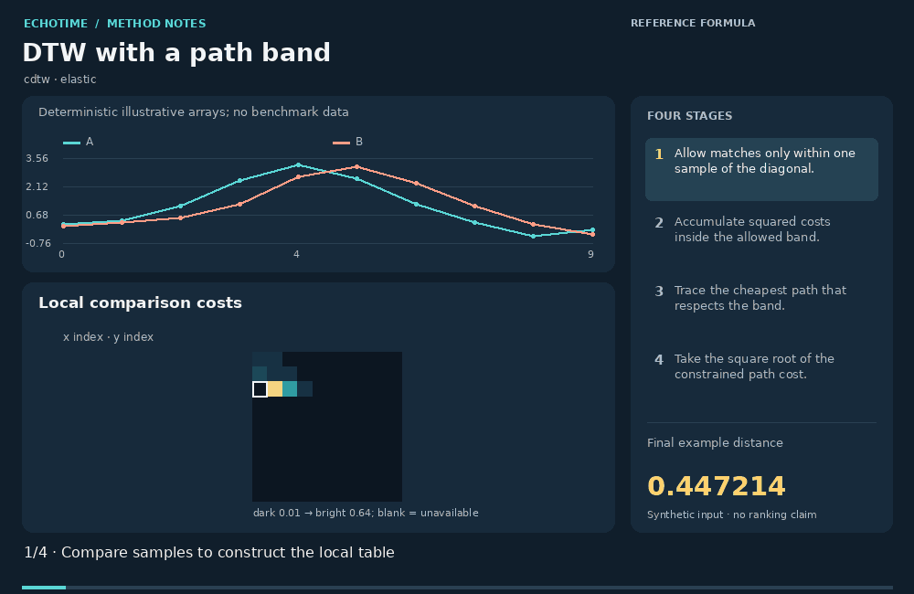

[Static image](../../src/echotime/data/method_animations/media/cdtw.png) · [Inputs and full calculation trace](../../src/echotime/data/method_animations/traces/cdtw.json) · [Open in the website](https://zipengwu.me/EchoTime/guide/methods.html#animation-cdtw)

Constrained DTW restricts the allowed correspondences before optimizing their cumulative cost. Here only cells at most one sample from the diagonal are admissible. Empty cells in the animation are forbidden states, not zero-cost matches; the same recurrence operates on the remaining band.

约束 DTW 先限制允许匹配的位置，再优化累计误差。本例只允许偏离对角线不超过一个采样点的单元格。动图中的空格表示禁止状态，不能当作零代价；其余带状区域采用相同的递推。

### Calculation / 计算

```text
cDTW = sqrt(min_path sum (x_i-y_j)^2), with |i-j| <= 1
```

1. Choose raw observations and any neighborhood descriptor.
   选择原始观测以及需要的邻域描述符。
2. Compute local squared discrepancies; apply the indicated weights or admissibility mask.
   计算局部平方误差，并施加指定权重或允许匹配的掩码。
3. At each admissible cell, add its local cost to the smallest predecessor cost.
   在每个允许单元格，把局部代价加到三个前驱的最小累计代价上。
4. Trace one minimizing path and take the square root of its accumulated objective.
   回溯一条最小化目标的路径，并对其累计目标值取平方根。

**Example distance:** `0.4472136`. The explicit definition and parameters shown on this card.

**Parameters:**

```json
{
  "local_cost": "squared Euclidean",
  "final_square_root": true,
  "normalization": "none",
  "window": 1
}
```

### Interpretation and limits / 解释与边界

- A narrow band can exclude the desired alignment. Unequal-length inputs require an endpoint-aware constraint. 窄窗口可能排除希望找到的匹配；长度不同时还须确保约束允许连接两端。
- Signal scale, path constraints and final normalization must match before distances from different tools are compared. 比较不同工具的数值之前，须统一信号尺度、路径约束和最终归一化。

### Definition sources / 定义来源

- [tslearn: DTW definitions and path constraints](https://tslearn.readthedocs.io/en/stable/user_guide/dtw.html)
- [EchoTime imported atlas: named formula conventions](https://github.com/ZipengWu365/EchoTime/blob/main/src/echotime/data/ts_similarity_package_v2_registry.csv)

<a id="itakura_dtw"></a>
## DTW with slope constraints · `itakura_dtw`

**Demonstration:** Reference-formula demonstration / 参考公式演示

**EchoTime coverage:** Possible addition

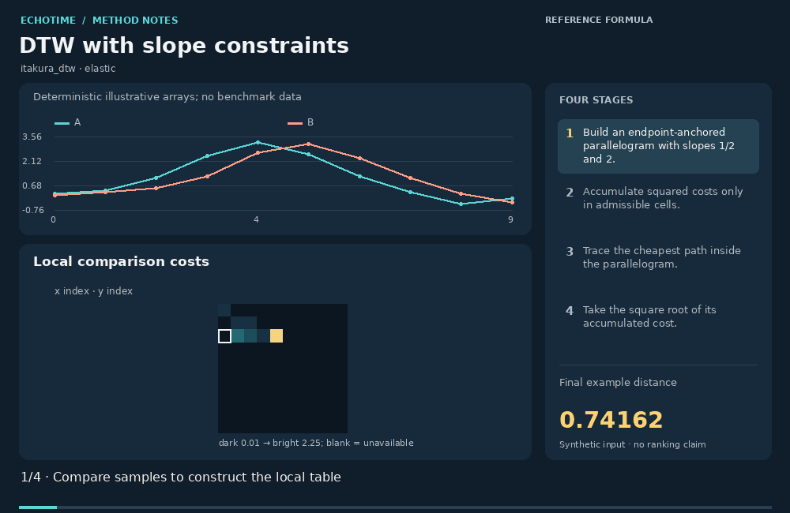

[Static image](../../src/echotime/data/method_animations/media/itakura_dtw.png) · [Inputs and full calculation trace](../../src/echotime/data/method_animations/traces/itakura_dtw.json) · [Open in the website](https://zipengwu.me/EchoTime/guide/methods.html#animation-itakura_dtw)

An Itakura-style parallelogram limits how strongly an alignment can stretch near either endpoint. This equal-length illustration uses slopes one half and two, anchored at the first and last samples. Dynamic programming then finds the least-cost path inside that explicitly shown region.

Itakura 型平行四边形限制对齐路径在两端附近的伸缩程度。本例长度相等，允许斜率范围为二分之一至二，并同时锚定首尾观测。动态规划在图示允许区域内寻找最低代价路径。

### Calculation / 计算

```text
Allowed: i/2 <= j <= 2i and (n-1-i)/2 <= n-1-j <= 2(n-1-i)
```

1. Choose raw observations and any neighborhood descriptor.
   选择原始观测以及需要的邻域描述符。
2. Compute local squared discrepancies; apply the indicated weights or admissibility mask.
   计算局部平方误差，并施加指定权重或允许匹配的掩码。
3. At each admissible cell, add its local cost to the smallest predecessor cost.
   在每个允许单元格，把局部代价加到三个前驱的最小累计代价上。
4. Trace one minimizing path and take the square root of its accumulated objective.
   回溯一条最小化目标的路径，并对其累计目标值取平方根。

**Example distance:** `0.74161985`. The explicit definition and parameters shown on this card.

**Parameters:**

```json
{
  "local_cost": "squared Euclidean",
  "final_square_root": true,
  "normalization": "none",
  "itakura": true
}
```

### Interpretation and limits / 解释与边界

- Mask discretization and unequal-length slope conventions differ across libraries; this card specifies an equal-length integer-grid example. 不同库的离散掩码和异长斜率约定可能不同；本卡明确采用等长整数网格示例。
- Signal scale, path constraints and final normalization must match before distances from different tools are compared. 比较不同工具的数值之前，须统一信号尺度、路径约束和最终归一化。

### Definition sources / 定义来源

- [tslearn: DTW definitions and path constraints](https://tslearn.readthedocs.io/en/stable/user_guide/dtw.html)
- [EchoTime imported atlas: named formula conventions](https://github.com/ZipengWu365/EchoTime/blob/main/src/echotime/data/ts_similarity_package_v2_registry.csv)

<a id="wdtw"></a>
## Weighted dynamic time warping · `wdtw`

**Demonstration:** Reference-formula demonstration / 参考公式演示

**EchoTime coverage:** Possible addition

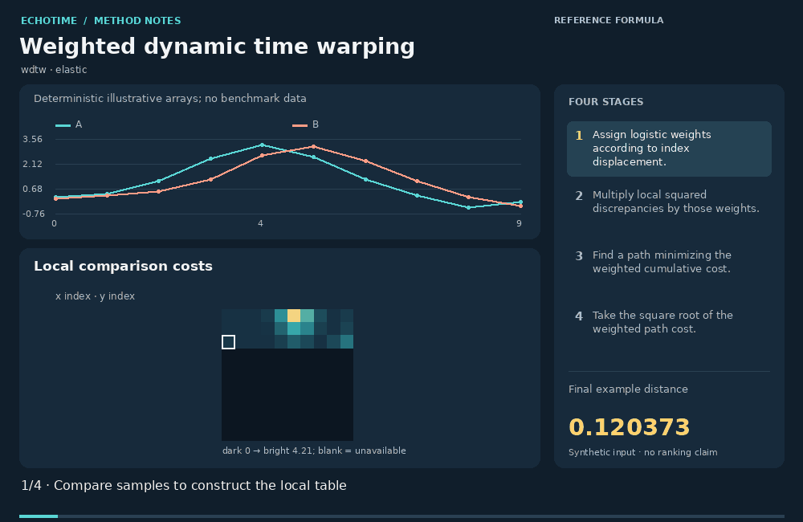

[Static image](../../src/echotime/data/method_animations/media/wdtw.png) · [Inputs and full calculation trace](../../src/echotime/data/method_animations/traces/wdtw.json) · [Open in the website](https://zipengwu.me/EchoTime/guide/methods.html#animation-wdtw)

Weighted DTW changes the price of a match according to its displacement from the diagonal. The local squared discrepancy is multiplied by a logistic weight that increases with displacement. The animation then optimizes those weighted costs and displays the resulting path, without imposing a hard band.

加权 DTW 根据匹配位置偏离对角线的程度改变代价。局部平方误差乘以随位移增加的逻辑函数权重，再对这些加权代价求最优路径。本例不施加硬窗口。

### Calculation / 计算

```text
w(k)=1/(1+exp(-0.6*(k-L/2))); d=sqrt(min_path sum w(|i-j|)*(x_i-y_j)^2)
```

1. Choose raw observations and any neighborhood descriptor.
   选择原始观测以及需要的邻域描述符。
2. Compute local squared discrepancies; apply the indicated weights or admissibility mask.
   计算局部平方误差，并施加指定权重或允许匹配的掩码。
3. At each admissible cell, add its local cost to the smallest predecessor cost.
   在每个允许单元格，把局部代价加到三个前驱的最小累计代价上。
4. Trace one minimizing path and take the square root of its accumulated objective.
   回溯一条最小化目标的路径，并对其累计目标值取平方根。

**Example distance:** `0.12037329`. The explicit definition and parameters shown on this card.

**Parameters:**

```json
{
  "local_cost": "squared Euclidean",
  "final_square_root": true,
  "normalization": "none",
  "weighted": true,
  "g": 0.6
}
```

### Interpretation and limits / 解释与边界

- These weights are at most one: the penalty is relative across displacements, not an added nonnegative surcharge to ordinary DTW. 这里的权重不超过一；所谓惩罚表示不同位移之间的相对权重，不是给普通 DTW 额外增加非负费用。
- Signal scale, path constraints and final normalization must match before distances from different tools are compared. 比较不同工具的数值之前，须统一信号尺度、路径约束和最终归一化。

### Definition sources / 定义来源

- [aeon: logistic weighted DTW](https://www.aeon-toolkit.org/en/stable/api_reference/auto_generated/aeon.distances.wdtw_distance.html)
- [EchoTime imported atlas: named formula conventions](https://github.com/ZipengWu365/EchoTime/blob/main/src/echotime/data/ts_similarity_package_v2_registry.csv)

<a id="ddtw"></a>
## DTW on first differences · `ddtw`

**Demonstration:** Reference-formula demonstration / 参考公式演示

**EchoTime coverage:** Conceptually covered · `dtw_similarity`

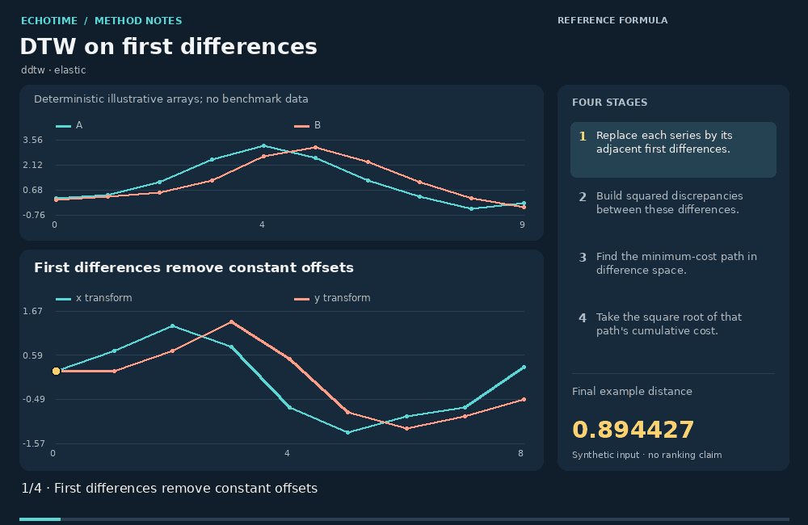

[Static image](../../src/echotime/data/method_animations/media/ddtw.png) · [Inputs and full calculation trace](../../src/echotime/data/method_animations/traces/ddtw.json) · [Open in the website](https://zipengwu.me/EchoTime/guide/methods.html#animation-ddtw)

This atlas entry applies DTW to first differences, so the alignment responds to changes rather than absolute levels. The first frames expose the transformed series before the local table is accumulated. It is an explicit first-difference variant; other DDTW implementations use a smoothed derivative estimator.

本条目对一阶差分使用 DTW，因此匹配依据是变化而非绝对水平。动图先展示变换后的序列，再构造累计表。本例明确使用一阶差分；其他 DDTW 实现可能采用平滑导数估计。

### Calculation / 计算

```text
Delta x_i=x_(i+1)-x_i; d=DTW(Delta x,Delta y), squared costs then square root
```

1. Take first differences with the stated convention.
   按明确约定计算一阶差分。
2. Compute local squared discrepancies; apply the indicated weights or admissibility mask.
   计算局部平方误差，并施加指定权重或允许匹配的掩码。
3. At each admissible cell, add its local cost to the smallest predecessor cost.
   在每个允许单元格，把局部代价加到三个前驱的最小累计代价上。
4. Trace one minimizing path and take the square root of its accumulated objective.
   回溯一条最小化目标的路径，并对其累计目标值取平方根。

**Example distance:** `0.89442719`. The explicit definition and parameters shown on this card.

**Parameters:**

```json
{
  "local_cost": "squared Euclidean",
  "final_square_root": true,
  "normalization": "none",
  "derivative": "adjacent first differences; n-1 outputs"
}
```

### Interpretation and limits / 解释与边界

- Differencing removes constant offsets and amplifies high-frequency noise. The result depends on the derivative estimator. 差分消除常数偏移，也会放大高频噪声；结果取决于导数估计方法。
- Signal scale, path constraints and final normalization must match before distances from different tools are compared. 比较不同工具的数值之前，须统一信号尺度、路径约束和最终归一化。

### Definition sources / 定义来源

- [tslearn: DTW definitions and path constraints](https://tslearn.readthedocs.io/en/stable/user_guide/dtw.html)
- [EchoTime imported atlas: named formula conventions](https://github.com/ZipengWu365/EchoTime/blob/main/src/echotime/data/ts_similarity_package_v2_registry.csv)

<a id="wddtw"></a>
## Weighted DTW on differences · `wddtw`

**Demonstration:** Reference-formula demonstration / 参考公式演示

**EchoTime coverage:** Possible addition

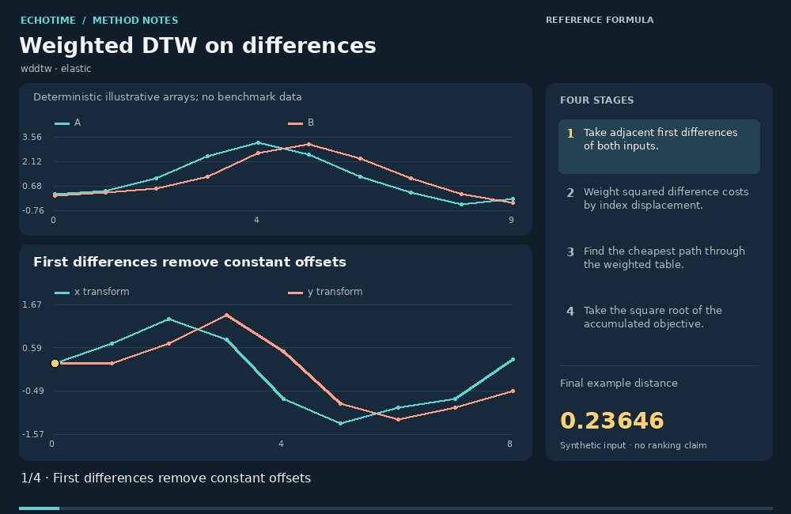

[Static image](../../src/echotime/data/method_animations/media/wddtw.png) · [Inputs and full calculation trace](../../src/echotime/data/method_animations/traces/wddtw.json) · [Open in the website](https://zipengwu.me/EchoTime/guide/methods.html#animation-wddtw)

This variant first takes adjacent differences and then uses displacement-weighted DTW. It combines sensitivity to local changes with a preference for smaller index displacement. The displayed derivative table and weighted path belong to that stated composition, which need not equal every library's WDDTW convention.

该变体先计算相邻差分，再进行位移加权 DTW，结合局部变化比较与较小索引位移偏好。图中导数表和加权路径对应这里明确给出的组合，不保证与所有库的 WDDTW 约定相同。

### Calculation / 计算

```text
d=sqrt(min_path sum w(|i-j|)*(Delta x_i-Delta y_j)^2), g=0.6
```

1. Take first differences with the stated convention.
   按明确约定计算一阶差分。
2. Compute local squared discrepancies; apply the indicated weights or admissibility mask.
   计算局部平方误差，并施加指定权重或允许匹配的掩码。
3. At each admissible cell, add its local cost to the smallest predecessor cost.
   在每个允许单元格，把局部代价加到三个前驱的最小累计代价上。
4. Trace one minimizing path and take the square root of its accumulated objective.
   回溯一条最小化目标的路径，并对其累计目标值取平方根。

**Example distance:** `0.23646036`. The explicit definition and parameters shown on this card.

**Parameters:**

```json
{
  "local_cost": "squared Euclidean",
  "final_square_root": true,
  "normalization": "none",
  "derivative": "adjacent first differences; n-1 outputs",
  "weighted": true,
  "g": 0.6
}
```

### Interpretation and limits / 解释与边界

- Both derivative estimation and the logistic slope change the answer; offset tolerance does not imply robustness to arbitrary noise. 导数估计和逻辑权重斜率都会改变结果；容忍水平偏移并不意味着对任意噪声稳健。
- Signal scale, path constraints and final normalization must match before distances from different tools are compared. 比较不同工具的数值之前，须统一信号尺度、路径约束和最终归一化。

### Definition sources / 定义来源

- [aeon: logistic weighted DTW](https://www.aeon-toolkit.org/en/stable/api_reference/auto_generated/aeon.distances.wdtw_distance.html)
- [EchoTime imported atlas: named formula conventions](https://github.com/ZipengWu365/EchoTime/blob/main/src/echotime/data/ts_similarity_package_v2_registry.csv)

<a id="soft_dtw"></a>
## Soft dynamic time warping · `soft_dtw`

**Demonstration:** Reference-formula demonstration / 参考公式演示

**EchoTime coverage:** Possible addition

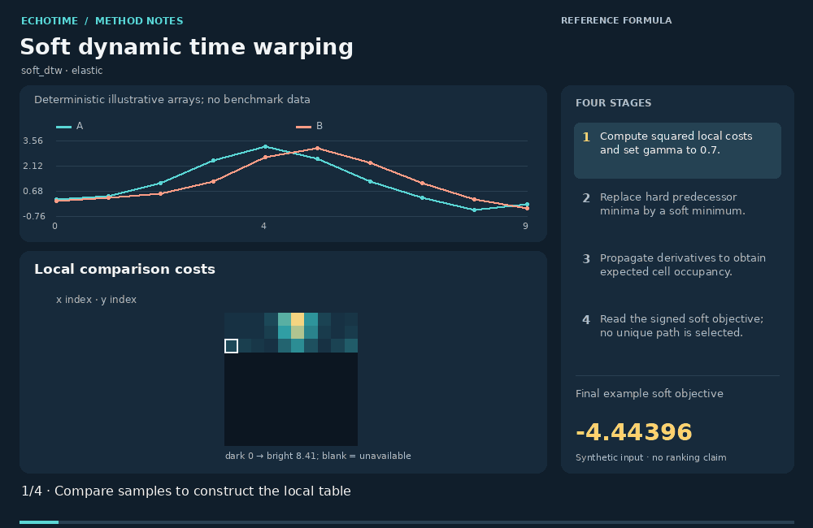

[Static image](../../src/echotime/data/method_animations/media/soft_dtw.png) · [Inputs and full calculation trace](../../src/echotime/data/method_animations/traces/soft_dtw.json) · [Open in the website](https://zipengwu.me/EchoTime/guide/methods.html#animation-soft_dtw)

Soft-DTW replaces the hard minimum over alignment alternatives with a log-sum-exp soft minimum. Many paths contribute to the result, and the gradient with respect to local costs gives expected cell occupancy. The score is a smooth objective and may be negative or favor a point different from the input itself.

Soft-DTW 用 log-sum-exp 软最小值替代路径选择中的硬最小值。多个路径共同贡献目标值，对局部代价求导得到每个单元格的期望占据权重。它是平滑目标，可以为负，也可能不在输入自身处取得最小值。

### Calculation / 计算

```text
R_ij=(x_i-y_j)^2-gamma*log(sum_predecessors exp(-R/gamma))
```

1. Form the squared local discrepancy table and choose gamma=0.7.
   构造平方局部误差表，设平滑参数 gamma=0.7。
2. Use -gamma*log(sum(exp(-previous/gamma))) in each DP update.
   每步动态规划使用 -gamma*log(sum(exp(-previous/gamma)))。
3. Propagate derivatives backward to display expected alignment occupancy across multiple paths.
   反向传播导数，显示多个路径共同形成的期望对齐占据权重。
4. Read the signed soft objective without choosing a unique path.
   读取有符号的软目标值，不选择唯一对齐路径。

**Example soft objective:** `-4.4439633`. The explicit definition and parameters shown on this card.

**Parameters:**

```json
{
  "gamma": 0.7,
  "local_cost": "squared Euclidean",
  "self_x": -4.542304721573488,
  "self_y": -4.93660871304499,
  "cross": -4.4439633238876635
}
```

### Interpretation and limits / 解释与边界

- Gamma controls the spread over alignments; this example uses squared local costs and no path band. Gamma 控制路径权重的分散程度；本例使用平方局部代价，不加路径窗口。
- Raw soft-DTW can be negative and has an entropic self-bias; do not treat it as a conventional nonnegative distance. 原始 soft-DTW 可以为负并具有熵正则化自偏差，不能直接作为普通非负距离理解。

### Definition sources / 定义来源

- [Cuturi and Blondel (2017): Soft-DTW](https://proceedings.mlr.press/v70/cuturi17a.html)
- [Blondel, Mensch and Vert (2021): corrected divergences](https://proceedings.mlr.press/v130/blondel21a.html)

<a id="soft_dtw_divergence"></a>
## Soft-DTW divergence · `soft_dtw_divergence`

**Demonstration:** Reference-formula demonstration / 参考公式演示

**EchoTime coverage:** Possible addition

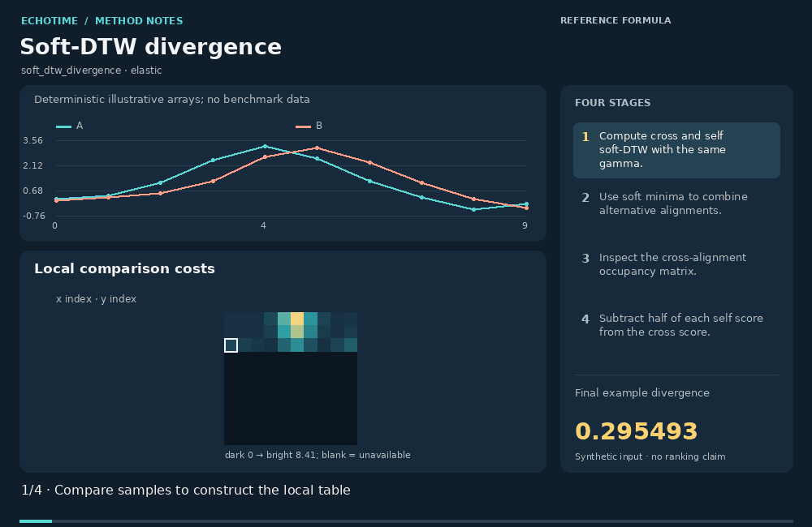

[Static image](../../src/echotime/data/method_animations/media/soft_dtw_divergence.png) · [Inputs and full calculation trace](../../src/echotime/data/method_animations/traces/soft_dtw_divergence.json) · [Open in the website](https://zipengwu.me/EchoTime/guide/methods.html#animation-soft_dtw_divergence)

The corrected soft-DTW divergence subtracts self-alignment terms from the cross-series soft score. This removes its nonzero self-cost by construction. The animation shows both the diffuse alignment occupancy and the three-term correction; theoretical nonnegativity and identification results depend on the ground-cost assumptions.

修正 soft-DTW 散度从交叉序列分数中扣除两个自对齐项，因此相同输入的自代价按构造归零。动图展示分散的对齐占据权重和三项修正；非负性与可识别性的理论结论依赖局部代价条件。

### Calculation / 计算

```text
D_gamma(x,y)=sDTW_gamma(x,y)-0.5*sDTW_gamma(x,x)-0.5*sDTW_gamma(y,y)
```

1. Form the squared local discrepancy table and choose gamma=0.7.
   构造平方局部误差表，设平滑参数 gamma=0.7。
2. Use -gamma*log(sum(exp(-previous/gamma))) in each DP update.
   每步动态规划使用 -gamma*log(sum(exp(-previous/gamma)))。
3. Propagate derivatives backward to display expected alignment occupancy across multiple paths.
   反向传播导数，显示多个路径共同形成的期望对齐占据权重。
4. Subtract half of softDTW(x,x) and half of softDTW(y,y).
   分别扣除 softDTW(x,x) 和 softDTW(y,y) 的一半。

**Example divergence:** `0.29549339`. The explicit definition and parameters shown on this card.

**Parameters:**

```json
{
  "gamma": 0.7,
  "local_cost": "squared Euclidean",
  "self_x": -4.542304721573488,
  "self_y": -4.93660871304499,
  "cross": -4.4439633238876635
}
```

### Interpretation and limits / 解释与边界

- Gamma controls the spread over alignments; this example uses squared local costs and no path band. Gamma 控制路径权重的分散程度；本例使用平方局部代价，不加路径窗口。
- A divergence is not automatically a metric; its properties depend on the ground cost and it need not satisfy the triangle inequality. 散度并不自动成为度量；其性质依赖局部代价，也不必满足三角不等式。

### Definition sources / 定义来源

- [Cuturi and Blondel (2017): Soft-DTW](https://proceedings.mlr.press/v70/cuturi17a.html)
- [Blondel, Mensch and Vert (2021): corrected divergences](https://proceedings.mlr.press/v130/blondel21a.html)

<a id="lcss_similarity"></a>
## LCSS matched fraction · `lcss_similarity`

**Demonstration:** Checked against EchoTime / 已与 EchoTime 计算核对

**EchoTime coverage:** Implemented in EchoTime · `lcss_similarity`

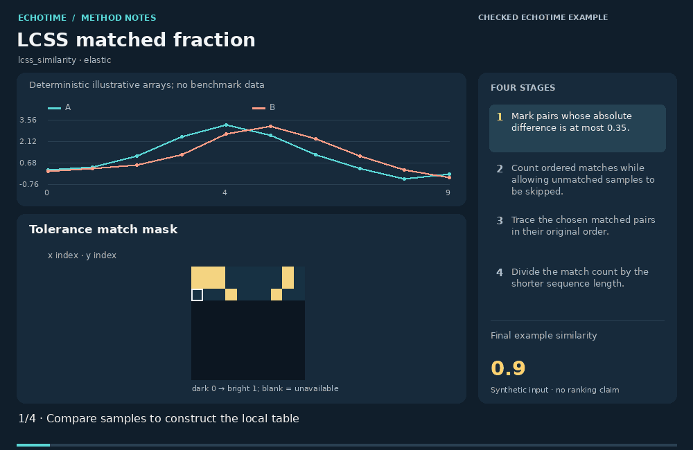

[Static image](../../src/echotime/data/method_animations/media/lcss_similarity.png) · [Inputs and full calculation trace](../../src/echotime/data/method_animations/traces/lcss_similarity.json) · [Open in the website](https://zipengwu.me/EchoTime/guide/methods.html#animation-lcss_similarity)

LCSS counts an order-preserving set of sufficiently close sample pairs. Unmatched samples may be skipped, so the result describes matched coverage rather than the magnitude of every residual. The animation uses a tolerance of 0.35 and divides the match count by the shorter sequence length.

LCSS 寻找保持先后顺序且足够接近的观测配对。未匹配点可以跳过，因此结果反映匹配覆盖率，不累加全部数值误差。本例容差为 0.35，并以较短序列长度归一化匹配数量。

### Calculation / 计算

```text
L_ij=L_(i-1,j-1)+1 if |x_i-y_j|<=epsilon, else max(L_(i-1,j),L_(i,j-1)); s=L_nm/min(n,m)
```

1. Set the stated local scoring rule, tolerance and boundary conditions.
   设置明确的局部计分规则、容差与边界条件。
2. Count tolerance matches and carry forward the larger match count when skipping.
   累计容差内匹配，跳过观测时保留较大的匹配计数。
3. Trace the selected predecessor operations from the complete-prefix state.
   从完整前缀状态沿选定的前驱操作回溯。
4. Read the final score with the normalization explicitly stated below.
   按下方明确的归一化约定读取最终分数。

**Example similarity:** `0.9`. The explicit definition and parameters shown on this card.

**Parameters:**

```json
{
  "normalization": "match count / min(n,m)",
  "local_norm": "absolute difference",
  "epsilon": 0.35
}
```

### Interpretation and limits / 解释与边界

- Tolerance changes which pairs count as matches. Missing subsequences may be ignored by the shorter-length normalization. 容差改变哪些配对算匹配；以较短长度归一化可能忽略较长序列中未匹配的部分。
- The small arrays are an algorithm illustration, not evidence of retrieval or classification quality. 这些小数组用于解释计算过程，不构成检索或分类性能证据。

### Definition sources / 定义来源

- [tslearn: Longest Common Subsequence](https://tslearn.readthedocs.io/en/stable/user_guide/lcss.html)
- [EchoTime low-level similarity implementations](https://github.com/ZipengWu365/EchoTime/blob/main/src/echotime/similarity_methods.py)

<a id="lcss_distance"></a>
## One minus LCSS similarity · `lcss_distance`

**Demonstration:** Checked against EchoTime / 已与 EchoTime 计算核对

**EchoTime coverage:** Implemented in EchoTime · `lcss_distance`

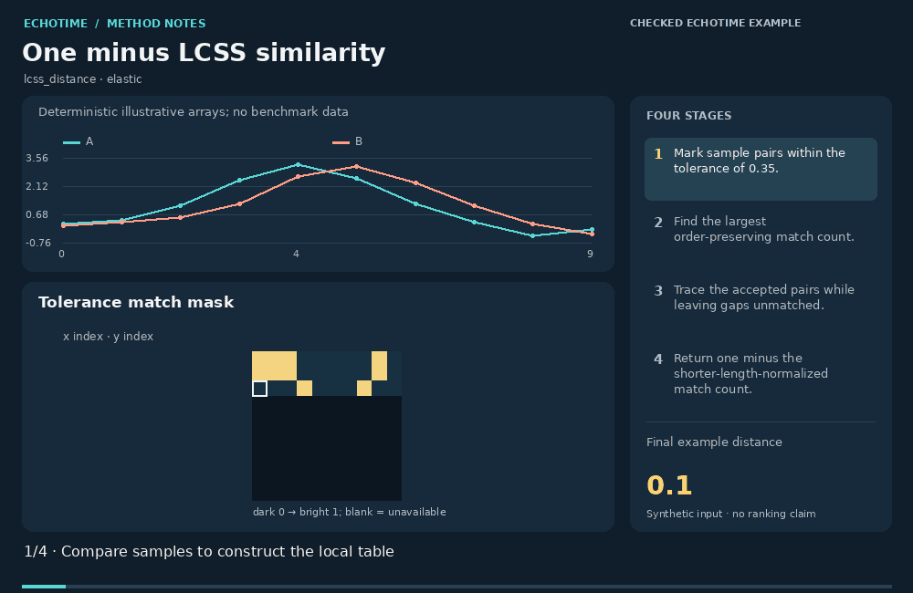

[Static image](../../src/echotime/data/method_animations/media/lcss_distance.png) · [Inputs and full calculation trace](../../src/echotime/data/method_animations/traces/lcss_distance.json) · [Open in the website](https://zipengwu.me/EchoTime/guide/methods.html#animation-lcss_distance)

This distance-like transform is one minus the normalized LCSS match count. It retains the order-preserving, tolerance-based matching rule. The final conversion reverses the direction of the score without restoring information discarded by skipped points or thresholding; different sequences can therefore receive zero distance.

该距离形式等于一减归一化 LCSS 匹配数量，仍采用保持顺序的容差匹配。最后的变换只反转分数方向，无法恢复跳过观测或阈值判断丢失的信息，因此不同序列也可能得到零距离。

### Calculation / 计算

```text
d_LCSS=1-LCSS_epsilon(x,y)/min(n,m)
```

1. Set the stated local scoring rule, tolerance and boundary conditions.
   设置明确的局部计分规则、容差与边界条件。
2. Count tolerance matches and carry forward the larger match count when skipping.
   累计容差内匹配，跳过观测时保留较大的匹配计数。
3. Trace the selected predecessor operations from the complete-prefix state.
   从完整前缀状态沿选定的前驱操作回溯。
4. Convert the count to one minus its shorter-length-normalized value.
   将匹配数量除以较短长度，再用一减去该比例。

**Example distance:** `0.1`. The explicit definition and parameters shown on this card.

**Parameters:**

```json
{
  "normalization": "match count / min(n,m)",
  "local_norm": "absolute difference",
  "epsilon": 0.35
}
```

### Interpretation and limits / 解释与边界

- One minus a similarity need not satisfy metric axioms. Zero here means full tolerance-based coverage of the shorter sequence. 一减相似度不保证满足度量公理；这里的零值表示较短序列在容差内被完全覆盖。
- The small arrays are an algorithm illustration, not evidence of retrieval or classification quality. 这些小数组用于解释计算过程，不构成检索或分类性能证据。

### Definition sources / 定义来源

- [tslearn: Longest Common Subsequence](https://tslearn.readthedocs.io/en/stable/user_guide/lcss.html)
- [EchoTime low-level similarity implementations](https://github.com/ZipengWu365/EchoTime/blob/main/src/echotime/similarity_methods.py)

<a id="edr"></a>
## Edit distance on real sequences · `edr`

**Demonstration:** Checked against EchoTime / 已与 EchoTime 计算核对

**EchoTime coverage:** Implemented in EchoTime · `edr_distance`

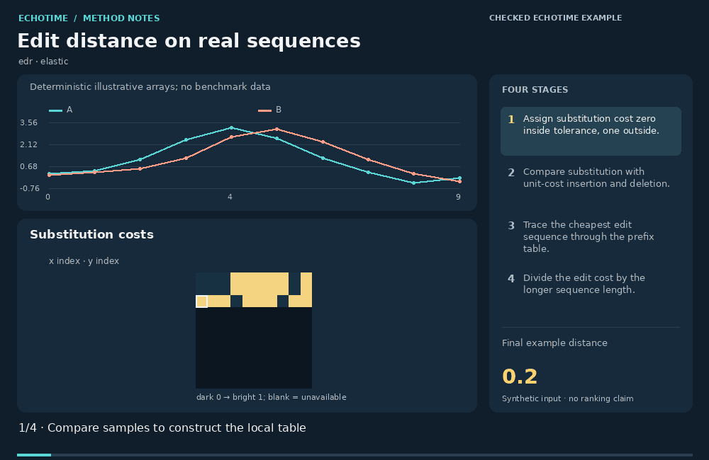

[Static image](../../src/echotime/data/method_animations/media/edr.png) · [Inputs and full calculation trace](../../src/echotime/data/method_animations/traces/edr.json) · [Open in the website](https://zipengwu.me/EchoTime/guide/methods.html#animation-edr)

EDR replaces the size of a sample discrepancy with a thresholded substitution cost. A nearby pair costs zero, a mismatching substitution costs one, and insertions or deletions cost one. Dynamic programming finds the least expensive edit sequence; this example reports EchoTime's length-normalized default.

EDR 把观测差异转成阈值替换代价：相近配对为零，不匹配替换为一，插入和删除也为一。动态规划寻找费用最低的编辑序列；本例采用 EchoTime 默认的长度归一化输出。

### Calculation / 计算

```text
D_ij=min(D_(i-1,j)+1,D_(i,j-1)+1,D_(i-1,j-1)+1[|x_i-y_j|>epsilon]); d=D_nm/max(n,m)
```

1. Set the stated local scoring rule, tolerance and boundary conditions.
   设置明确的局部计分规则、容差与边界条件。
2. Choose the cheapest substitution, insertion or deletion for each prefix.
   逐个前缀选择费用最低的替换、插入或删除。
3. Trace the selected predecessor operations from the complete-prefix state.
   从完整前缀状态沿选定的前驱操作回溯。
4. Read the final score with the normalization explicitly stated below.
   按下方明确的归一化约定读取最终分数。

**Example distance:** `0.2`. The explicit definition and parameters shown on this card.

**Parameters:**

```json
{
  "normalization": "edit count / max(n,m)",
  "local_norm": "absolute difference",
  "epsilon": 0.35
}
```

### Interpretation and limits / 解释与边界

- The amplitude of a mismatch beyond epsilon is discarded. Normalization and epsilon must be specified when comparing implementations. 超过 epsilon 后的误差幅度被丢弃；比较不同实现时须明确容差与归一化。
- The small arrays are an algorithm illustration, not evidence of retrieval or classification quality. 这些小数组用于解释计算过程，不构成检索或分类性能证据。

### Definition sources / 定义来源

- [EchoTime low-level similarity implementations](https://github.com/ZipengWu365/EchoTime/blob/main/src/echotime/similarity_methods.py)
- [EchoTime imported atlas: named formula conventions](https://github.com/ZipengWu365/EchoTime/blob/main/src/echotime/data/ts_similarity_package_v2_registry.csv)

<a id="swale_similarity"></a>
## SWALE rewards and gap costs · `swale_similarity`

**Demonstration:** Reference-formula demonstration / 参考公式演示

**EchoTime coverage:** Possible addition

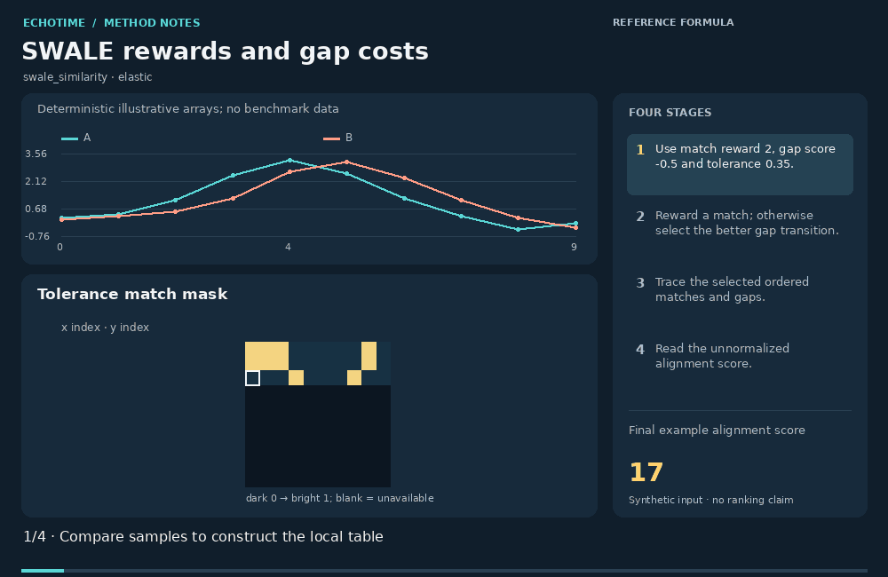

[Static image](../../src/echotime/data/method_animations/media/swale_similarity.png) · [Inputs and full calculation trace](../../src/echotime/data/method_animations/traces/swale_similarity.json) · [Open in the website](https://zipengwu.me/EchoTime/guide/methods.html#animation-swale_similarity)

SWALE scores tolerance-based matches with a reward and unmatched observations with a gap penalty. Its recurrence combines the number of accepted matches with the price of omitted observations. This example uses reward 2, gap score -0.5 and epsilon 0.35; the raw score is not normalized to a probability.

SWALE 对容差内的匹配给奖励，对未匹配的观测施加间隙惩罚。递推同时考虑接受的匹配数量与省略观测的费用。本例奖励为 2、间隙分数为 -0.5、容差为 0.35；原始分数没有归一化为概率。

### Calculation / 计算

```text
S_ij=2+S_(i-1,j-1) for a tolerance match; otherwise max(S_(i-1,j)-0.5,S_(i,j-1)-0.5)
```

1. Set the stated local scoring rule, tolerance and boundary conditions.
   设置明确的局部计分规则、容差与边界条件。
2. Reward a tolerance match; otherwise choose the less costly gap transition.
   对容差匹配给予奖励，否则选择费用较低的间隙转移。
3. Trace the selected predecessor operations from the complete-prefix state.
   从完整前缀状态沿选定的前驱操作回溯。
4. Read the final score with the normalization explicitly stated below.
   按下方明确的归一化约定读取最终分数。

**Example alignment score:** `17`. The explicit definition and parameters shown on this card.

**Parameters:**

```json
{
  "normalization": "none",
  "local_norm": "absolute difference",
  "epsilon": 0.35,
  "match_reward": 2.0,
  "gap_score": -0.5
}
```

### Interpretation and limits / 解释与边界

- Rewards, gap penalties and sequence length influence the score scale. This implements the paper's scoring recurrence, not its FTSE acceleration. 奖励、间隙惩罚和序列长度都会影响分数量级；本例演示论文的计分递推，没有实现 FTSE 加速。
- The small arrays are an algorithm illustration, not evidence of retrieval or classification quality. 这些小数组用于解释计算过程，不构成检索或分类性能证据。

### Definition sources / 定义来源

- [Morse and Patel (2007), Definition 5.1](https://dbgroup.eecs.umich.edu/files/sigmod07timeseries.pdf)

<a id="erp"></a>
## Edit distance with a real gap · `erp`

**Demonstration:** Checked against EchoTime / 已与 EchoTime 计算核对

**EchoTime coverage:** Implemented in EchoTime · `erp_distance`

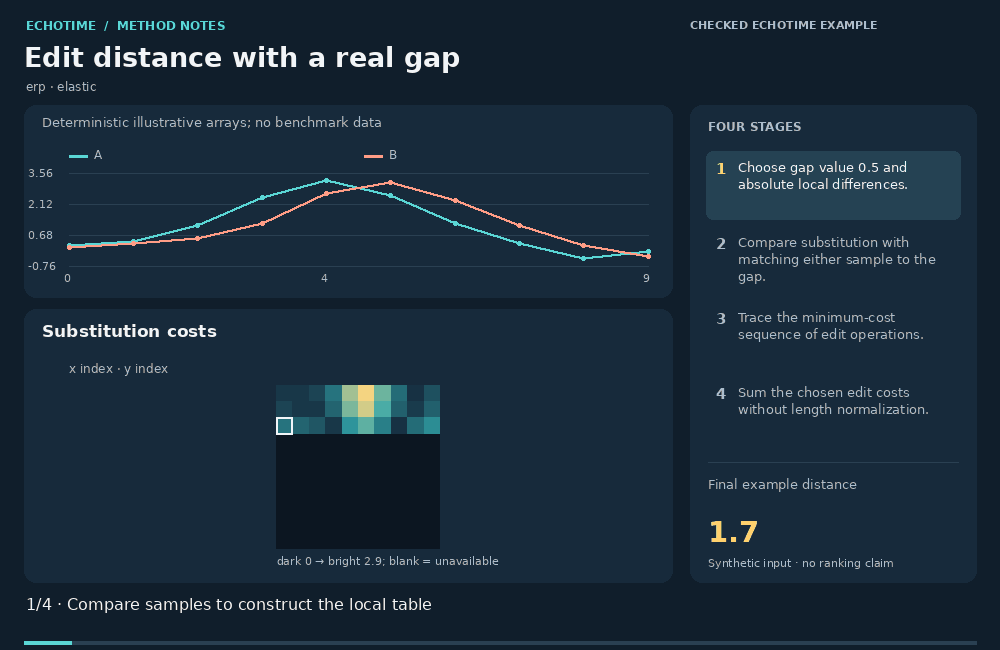

[Static image](../../src/echotime/data/method_animations/media/erp.png) · [Inputs and full calculation trace](../../src/echotime/data/method_animations/traces/erp.json) · [Open in the website](https://zipengwu.me/EchoTime/guide/methods.html#animation-erp)

ERP charges the numerical cost of matching observations or matching one observation to a fixed gap value. The animation compares substitution with deletion and insertion at each prefix. Here the gap is 0.5 and the univariate local norm is absolute difference, matching EchoTime's explicit low-level calculation.

ERP 对观测之间的替换以及观测与固定间隙值之间的匹配收取数值代价。动图逐个前缀比较替换、删除与插入。本例间隙值为 0.5，单变量局部范数为绝对差，与 EchoTime 底层计算一致。

### Calculation / 计算

```text
D_ij=min(D_(i-1,j-1)+|x_i-y_j|,D_(i-1,j)+|x_i-g|,D_(i,j-1)+|y_j-g|)
```

1. Set the stated local scoring rule, tolerance and boundary conditions.
   设置明确的局部计分规则、容差与边界条件。
2. Compare matching x to y with matching either observation to gap g=0.5.
   比较 x 与 y 的匹配，以及任一观测与间隙 g=0.5 的匹配。
3. Trace the selected predecessor operations from the complete-prefix state.
   从完整前缀状态沿选定的前驱操作回溯。
4. Read the final score with the normalization explicitly stated below.
   按下方明确的归一化约定读取最终分数。

**Example distance:** `1.7`. The explicit definition and parameters shown on this card.

**Parameters:**

```json
{
  "normalization": "none",
  "local_norm": "absolute difference",
  "gap_value": 0.5
}
```

### Interpretation and limits / 解释与边界

- Gap choice changes the cost. If the gap value is also a valid observation, distinct raw lists can have zero ERP distance. 间隙值选择会改变代价；若间隙值也属于合法观测，不同原始列表可以得到零 ERP 距离。
- The small arrays are an algorithm illustration, not evidence of retrieval or classification quality. 这些小数组用于解释计算过程，不构成检索或分类性能证据。

### Definition sources / 定义来源

- [EchoTime low-level similarity implementations](https://github.com/ZipengWu365/EchoTime/blob/main/src/echotime/similarity_methods.py)
- [EchoTime imported atlas: named formula conventions](https://github.com/ZipengWu365/EchoTime/blob/main/src/echotime/data/ts_similarity_package_v2_registry.csv)

<a id="msm"></a>
## Move, split and merge · `msm`

**Demonstration:** Reference-formula demonstration / 参考公式演示

**EchoTime coverage:** Possible addition

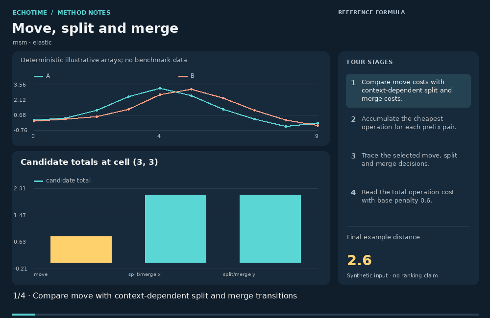

[Static image](../../src/echotime/data/method_animations/media/msm.png) · [Inputs and full calculation trace](../../src/echotime/data/method_animations/traces/msm.json) · [Open in the website](https://zipengwu.me/EchoTime/guide/methods.html#animation-msm)

MSM transforms one ordered sequence through move, split and merge operations. Moving costs the absolute change in value. Split/merge costs depend on a base cost and neighboring values, so the recurrence uses local context instead of a fixed gap symbol. The animation displays its cumulative operation costs.

MSM 通过移动、分裂和合并操作变换有序序列。移动费用是数值的绝对变化；分裂与合并费用取决于基础费用和邻近数值，因此递推使用局部上下文而非固定间隙符号。动图展示这些操作的累计费用。

### Calculation / 计算

```text
C(v,a,b)=c if v lies between a,b; else c+min(|v-a|,|v-b|); D=min(move,split,merge)
```

1. Set the stated local scoring rule, tolerance and boundary conditions.
   设置明确的局部计分规则、容差与边界条件。
2. Compare a move with context-dependent split and merge costs.
   比较移动费用与依赖上下文的分裂、合并费用。
3. Trace the selected predecessor operations from the complete-prefix state.
   从完整前缀状态沿选定的前驱操作回溯。
4. Read the final score with the normalization explicitly stated below.
   按下方明确的归一化约定读取最终分数。

**Example distance:** `2.6`. The explicit definition and parameters shown on this card.

**Parameters:**

```json
{
  "normalization": "none",
  "local_norm": "absolute difference",
  "c": 0.6
}
```

### Interpretation and limits / 解释与边界

- This is a univariate definition with c=0.6. Multivariate dependent and independent generalizations require separate conventions. 本例是 c=0.6 的单变量定义；多变量的联合式与独立式推广须另行指定。
- The small arrays are an algorithm illustration, not evidence of retrieval or classification quality. 这些小数组用于解释计算过程，不构成检索或分类性能证据。

### Definition sources / 定义来源

- [aeon: Move-Split-Merge recurrence](https://www.aeon-toolkit.org/en/stable/api_reference/auto_generated/aeon.distances.msm_distance.html)

<a id="twed"></a>
## Time warp edit distance · `twed`

**Demonstration:** Checked against EchoTime / 已与 EchoTime 计算核对

**EchoTime coverage:** Implemented in EchoTime · `twed_distance`

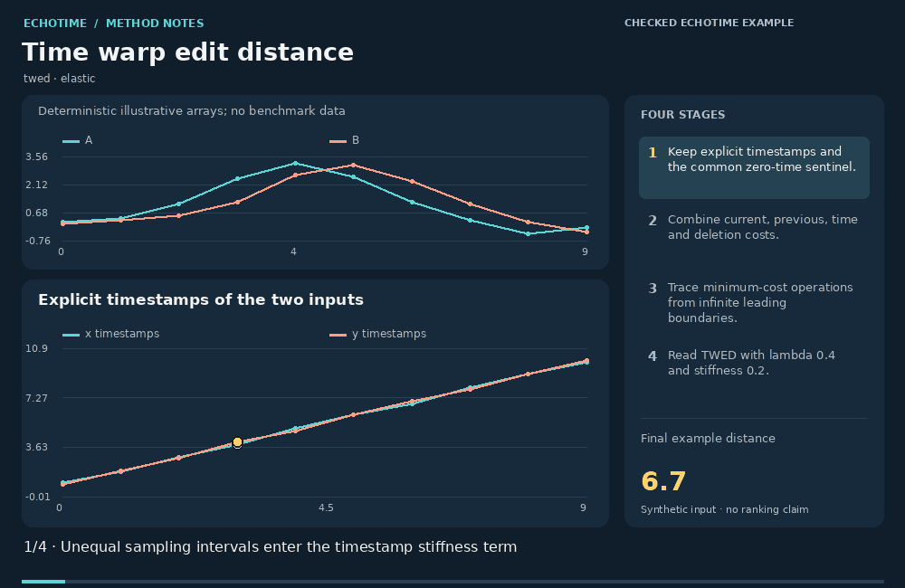

[Static image](../../src/echotime/data/method_animations/media/twed.png) · [Inputs and full calculation trace](../../src/echotime/data/method_animations/traces/twed.json) · [Open in the website](https://zipengwu.me/EchoTime/guide/methods.html#animation-twed)

TWED combines edit penalties, consecutive-value changes and timestamp discrepancies. A match compares both the current pair and the preceding pair; deletions also include elapsed-time stiffness. The animation uses the zero-value, zero-time sentinel and infinite leading boundaries from EchoTime's corrected recurrence.

TWED 联合考虑编辑惩罚、相邻数值变化和时间戳差异。匹配同时比较当前配对与前一个配对；删除还包括经过时间的刚度代价。动图使用 EchoTime 修正递推中的零值零时刻哨兵及无穷边界。

### Calculation / 计算

```text
D=min(Dprev+|x_i-y_j|+|x_(i-1)-y_(j-1)|+nu*(|t_i-s_j|+|t_(i-1)-s_(j-1)|),delete_x,delete_y)
```

1. Set the stated local scoring rule, tolerance and boundary conditions.
   设置明确的局部计分规则、容差与边界条件。
2. Combine value changes, time stiffness and deletion penalties in the minimum-cost recurrence.
   在最小代价递推中结合数值变化、时间刚度和删除惩罚。
3. Trace the selected predecessor operations from the complete-prefix state.
   从完整前缀状态沿选定的前驱操作回溯。
4. Read the final score with the normalization explicitly stated below.
   按下方明确的归一化约定读取最终分数。

**Example distance:** `6.7`. The explicit definition and parameters shown on this card.

**Parameters:**

```json
{
  "normalization": "none",
  "local_norm": "absolute difference",
  "lambda_": 0.4,
  "nu": 0.2,
  "t_x": [
    1.0,
    1.8,
    2.9000000000000004,
    3.8000000000000003,
    5.0,
    6.0,
    6.8,
    8.0,
    9.0,
    9.9
  ],
  "t_y": [
    0.9,
    1.9,
    2.8,
    4.0,
    4.8,
    6.0,
    7.0,
    7.9,
    9.0,
    10.0
  ],
  "sentinel": [
    0,
    0
  ],
  "boundary": "D00=0; other leading states infinite"
}
```

### Interpretation and limits / 解释与边界

- Positive stiffness, timestamps, the sentinel and boundary conventions matter to metric claims. A constrained or resampled approximation does not automatically inherit them. 正刚度、时间戳、哨兵和边界约定都是度量结论的条件；加约束或重采样近似不自动继承这些性质。
- The small arrays are an algorithm illustration, not evidence of retrieval or classification quality. 这些小数组用于解释计算过程，不构成检索或分类性能证据。

### Definition sources / 定义来源

- [Marteau: TWED recurrence and stiffness](https://arxiv.org/pdf/cs/0703033)
- [EchoTime low-level similarity implementations](https://github.com/ZipengWu365/EchoTime/blob/main/src/echotime/similarity_methods.py)

<a id="discrete_frechet"></a>
## Discrete Frechet bottleneck · `discrete_frechet`

**Demonstration:** Reference-formula demonstration / 参考公式演示

**EchoTime coverage:** Possible addition

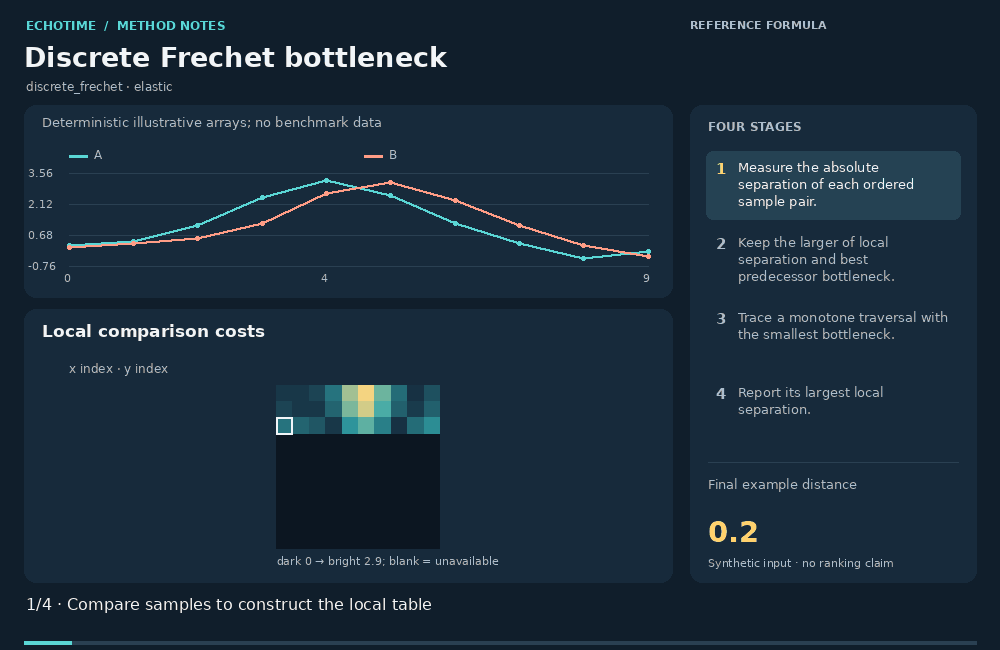

[Static image](../../src/echotime/data/method_animations/media/discrete_frechet.png) · [Inputs and full calculation trace](../../src/echotime/data/method_animations/traces/discrete_frechet.json) · [Open in the website](https://zipengwu.me/EchoTime/guide/methods.html#animation-discrete_frechet)

Discrete Frechet comparison minimizes the largest local separation along a monotone traversal. This differs from objectives that add every local mismatch: one difficult pair can determine the bottleneck. Here observations are points on the value axis, with order preserved and no extra time coordinate in the local norm.

离散 Fréchet 比较最小化单调遍历过程中最大的局部距离。单个困难配对可能决定最终瓶颈。本例将观测视为数值轴上的点，保留其顺序，但局部范数不额外包含时间坐标。

### Calculation / 计算

```text
F_ij=max(|x_i-y_j|,min(F_(i-1,j),F_(i,j-1),F_(i-1,j-1)))
```

1. Set the stated local scoring rule, tolerance and boundary conditions.
   设置明确的局部计分规则、容差与边界条件。
2. Keep the larger of the present separation and the smallest predecessor bottleneck.
   在当前距离和最小前驱瓶颈之间取较大者。
3. Trace the selected predecessor operations from the complete-prefix state.
   从完整前缀状态沿选定的前驱操作回溯。
4. Read the final score with the normalization explicitly stated below.
   按下方明确的归一化约定读取最终分数。

**Example distance:** `0.2`. The explicit definition and parameters shown on this card.

**Parameters:**

```json
{
  "normalization": "none",
  "local_norm": "absolute difference"
}
```

### Interpretation and limits / 解释与边界

- Repeated vertices can make distinct raw vertex lists indistinguishable. Adding time as a coordinate changes the geometry and its scale. 重复顶点可能使不同原始顶点列表无法区分；加入时间坐标会改变几何与尺度。
- The small arrays are an algorithm illustration, not evidence of retrieval or classification quality. 这些小数组用于解释计算过程，不构成检索或分类性能证据。

### Definition sources / 定义来源

- [Eiter and Mannila (1994): discrete Frechet distance](https://www.kr.tuwien.ac.at/staff/eiter/et-archive/files/cdtr9464.pdf)

<a id="needleman_wunsch_similarity"></a>
## Global sequence alignment · `needleman_wunsch_similarity`

**Demonstration:** Reference-formula demonstration / 参考公式演示

**EchoTime coverage:** Possible addition

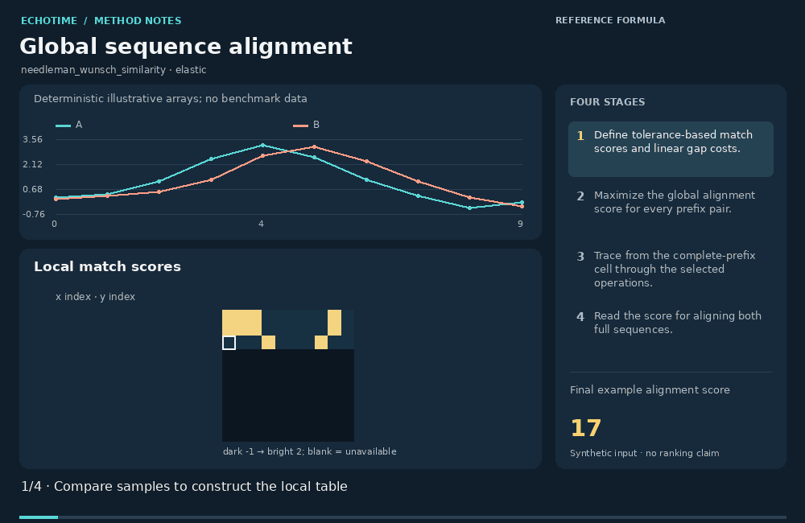

[Static image](../../src/echotime/data/method_animations/media/needleman_wunsch_similarity.png) · [Inputs and full calculation trace](../../src/echotime/data/method_animations/traces/needleman_wunsch_similarity.json) · [Open in the website](https://zipengwu.me/EchoTime/guide/methods.html#animation-needleman_wunsch_similarity)

This numerical Needleman-Wunsch illustration aligns both full sequences using an explicit match/mismatch rule and linear gap costs. The entire prefix table contributes to a global solution ending at its bottom-right cell. The time-series scoring rule is specified here, rather than implied by the algorithm name.

该数值 Needleman-Wunsch 示例使用明确的匹配／不匹配规则与线性间隙费用，对齐两条完整序列。全局解终止于前缀表右下角。本卡明确指定时间序列的计分规则，不将其视为算法名称隐含的唯一选择。

### Calculation / 计算

```text
S_ij=max(S_(i-1,j-1)+s_ij,S_(i-1,j)-0.5,S_(i,j-1)-0.5); s_ij=2 if close else -1
```

1. Set the stated local scoring rule, tolerance and boundary conditions.
   设置明确的局部计分规则、容差与边界条件。
2. Maximize the global score with a match/mismatch or a linear gap transition.
   使用匹配／不匹配或线性间隙转移，最大化全局分数。
3. Trace the selected predecessor operations from the complete-prefix state.
   从完整前缀状态沿选定的前驱操作回溯。
4. Read the final score with the normalization explicitly stated below.
   按下方明确的归一化约定读取最终分数。

**Example alignment score:** `17`. The explicit definition and parameters shown on this card.

**Parameters:**

```json
{
  "normalization": "none",
  "local_norm": "absolute difference",
  "epsilon": 0.35,
  "match_reward": 2.0,
  "gap_score": -0.5,
  "mismatch_score": -1.0
}
```

### Interpretation and limits / 解释与边界

- The biological algorithm does not fix a numerical time-series substitution score. This educational adaptation uses epsilon=0.35 and linear, not affine, gaps. 原始序列算法不规定数值时间序列的替换分数；本教学改写使用 epsilon=0.35 和线性间隙，不使用仿射间隙。
- The small arrays are an algorithm illustration, not evidence of retrieval or classification quality. 这些小数组用于解释计算过程，不构成检索或分类性能证据。

### Definition sources / 定义来源

- [Biopython: global and local sequence alignment](https://biopython.org/docs/latest/Tutorial/chapter_pairwise.html)
- [EchoTime imported atlas: named formula conventions](https://github.com/ZipengWu365/EchoTime/blob/main/src/echotime/data/ts_similarity_package_v2_registry.csv)

<a id="smith_waterman_similarity"></a>
## Local sequence alignment · `smith_waterman_similarity`

**Demonstration:** Reference-formula demonstration / 参考公式演示

**EchoTime coverage:** Possible addition

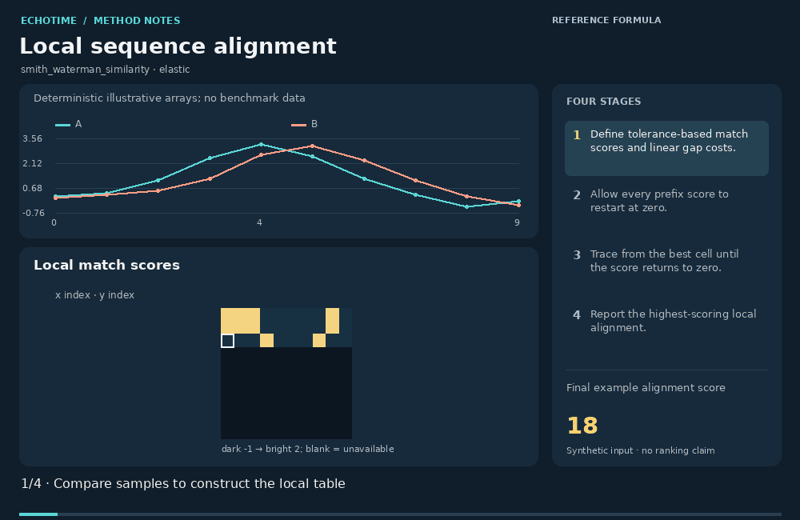

[Static image](../../src/echotime/data/method_animations/media/smith_waterman_similarity.png) · [Inputs and full calculation trace](../../src/echotime/data/method_animations/traces/smith_waterman_similarity.json) · [Open in the website](https://zipengwu.me/EchoTime/guide/methods.html#animation-smith_waterman_similarity)

Smith-Waterman allows an alignment to restart at zero, so it can select matching internal subsequences while leaving unrelated ends unused. This explicit numerical example uses the same threshold substitution scores as the global card. The best cell may occur anywhere, and traceback stops when the score returns to zero.

Smith-Waterman 允许分数从零重新开始，因此能选择内部匹配子序列，并不使用无关的两端。本数值示例采用与全局卡片相同的阈值替换计分。最优单元格可以位于任意位置，回溯在零分处停止。

### Calculation / 计算

```text
S_ij=max(0,S_(i-1,j-1)+s_ij,S_(i-1,j)-0.5,S_(i,j-1)-0.5); result=max_ij S_ij
```

1. Set the stated local scoring rule, tolerance and boundary conditions.
   设置明确的局部计分规则、容差与边界条件。
2. Maximize the score with an additional zero restart option at every cell.
   在每个单元格增加从零开始选项，并最大化分数。
3. Start at the maximum score and stop traceback at zero.
   从最大分数处开始回溯，在零分处停止。
4. Read the final score with the normalization explicitly stated below.
   按下方明确的归一化约定读取最终分数。

**Example alignment score:** `18`. The explicit definition and parameters shown on this card.

**Parameters:**

```json
{
  "normalization": "none",
  "local_norm": "absolute difference",
  "epsilon": 0.35,
  "match_reward": 2.0,
  "gap_score": -0.5,
  "mismatch_score": -1.0
}
```

### Interpretation and limits / 解释与边界

- A high local alignment score does not establish whole-series similarity. Substitution and gap choices determine which segment wins. 较高的局部对齐分数不能证明整段序列相似；替换与间隙设定决定获选片段。
- The small arrays are an algorithm illustration, not evidence of retrieval or classification quality. 这些小数组用于解释计算过程，不构成检索或分类性能证据。

### Definition sources / 定义来源

- [Biopython: global and local sequence alignment](https://biopython.org/docs/latest/Tutorial/chapter_pairwise.html)
- [EchoTime imported atlas: named formula conventions](https://github.com/ZipengWu365/EchoTime/blob/main/src/echotime/data/ts_similarity_package_v2_registry.csv)

<a id="shape_dtw"></a>
## DTW on local shape descriptors · `shape_dtw`

**Demonstration:** Reference-formula demonstration / 参考公式演示

**EchoTime coverage:** Possible addition

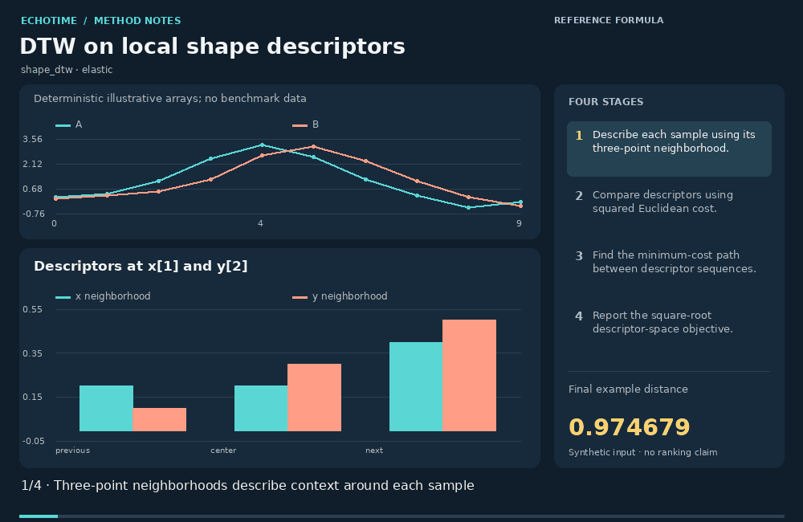

[Static image](../../src/echotime/data/method_animations/media/shape_dtw.png) · [Inputs and full calculation trace](../../src/echotime/data/method_animations/traces/shape_dtw.json) · [Open in the website](https://zipengwu.me/EchoTime/guide/methods.html#animation-shape_dtw)

shapeDTW compares short neighborhoods around samples so that a match reflects local context. Here each descriptor contains three raw values with edge repetition, and DTW minimizes squared descriptor differences. The animation reports the descriptor-space objective, an explicit variant rather than a raw-signal score recomputed along its path.

shapeDTW 用观测周围的短邻域描述局部形状。本例将三个原始数值组成描述符，边界使用重复填充，然后最小化描述符之间的平方差。动图报告描述符空间的目标值，不是沿该路径重新计算的原始信号距离。

### Calculation / 计算

```text
phi(x_i)=[x_(i-1),x_i,x_(i+1)] with edge repetition; d=DTW(phi(x),phi(y))
```

1. Construct a three-sample raw neighborhood descriptor at each index, repeating edge values.
   逐点构造三个采样值的原始邻域描述符，在边界重复端点数值。
2. Compute local squared discrepancies; apply the indicated weights or admissibility mask.
   计算局部平方误差，并施加指定权重或允许匹配的掩码。
3. At each admissible cell, add its local cost to the smallest predecessor cost.
   在每个允许单元格，把局部代价加到三个前驱的最小累计代价上。
4. Trace one minimizing path and take the square root of its accumulated objective.
   回溯一条最小化目标的路径，并对其累计目标值取平方根。

**Example distance:** `0.97467943`. The explicit definition and parameters shown on this card.

**Parameters:**

```json
{
  "local_cost": "squared Euclidean",
  "final_square_root": true,
  "normalization": "none",
  "descriptor": true,
  "descriptor_radius": 1,
  "padding": "edge repetition",
  "reported_cost": "descriptor-space"
}
```

### Interpretation and limits / 解释与边界

- Descriptor radius, scaling and the choice to rescore the final path in raw space all change the method. No trained descriptor is used here. 邻域半径、缩放以及是否在原空间重新计分都会改变结果；本例没有训练描述符。
- Signal scale, path constraints and final normalization must match before distances from different tools are compared. 比较不同工具的数值之前，须统一信号尺度、路径约束和最终归一化。

### Definition sources / 定义来源

- [Zhao and Itti: shapeDTW](https://arxiv.org/abs/1606.01601)
- [EchoTime imported atlas: named formula conventions](https://github.com/ZipengWu365/EchoTime/blob/main/src/echotime/data/ts_similarity_package_v2_registry.csv)

<a id="independent_dtw"></a>
## Independent-channel DTW · `independent_dtw`

**Demonstration:** Reference-formula demonstration / 参考公式演示

**EchoTime coverage:** Possible addition

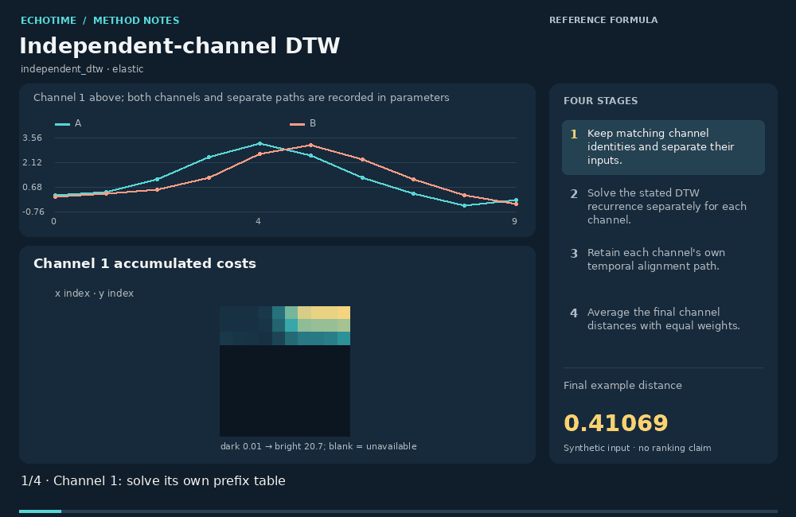

[Static image](../../src/echotime/data/method_animations/media/independent_dtw.png) · [Inputs and full calculation trace](../../src/echotime/data/method_animations/traces/independent_dtw.json) · [Open in the website](https://zipengwu.me/EchoTime/guide/methods.html#animation-independent_dtw)

Independent DTW computes a separate alignment problem for every channel, then averages the resulting distances. The two channels in this example prefer different correspondences. Their paths are shown separately, making explicit that averaging final scores does not impose a shared multivariate warping path.

独立通道 DTW 为每个通道分别求解对齐问题，再平均最终距离。本例两个通道偏好的配对不同，动图分别显示各自路径，因此可直接看到平均分数不等于施加共享的多变量扭曲路径。

### Calculation / 计算

```text
d_independent(X,Y) = (d_base(X_channel1,Y_channel1)+d_base(X_channel2,Y_channel2))/2
```

1. Keep matching channel identities and define channelwise preprocessing.
   保持通道对应关系，并明确各通道预处理。
2. Solve the stated DTW problem independently for channel one and channel two.
   分别求解通道一和通道二的 DTW 问题。
3. Retain each channel's own alignment; different channels may select different time matches.
   保留各通道自身的对齐；不同通道可以选择不同时间匹配。
4. Take the arithmetic mean of channel distances, with equal weights in this example.
   对通道距离取算术平均；本例使用相等权重。

**Example distance:** `0.41068967`. The explicit definition and parameters shown on this card.

**Parameters:**

```json
{
  "channels_x": [
    [
      0.2,
      0.4,
      1.1,
      2.4,
      3.2,
      2.5,
      1.2,
      0.3,
      -0.4,
      -0.1
    ],
    [
      0.2,
      0.5,
      1.2,
      2.2,
      2.9,
      2.1,
      1.1,
      0.1,
      -0.2,
      0.1
    ]
  ],
  "channels_y": [
    [
      0.1,
      0.3,
      0.5,
      1.2,
      2.6,
      3.1,
      2.3,
      1.1,
      0.2,
      -0.3
    ],
    [
      0.4,
      1.1,
      2.3,
      3.0,
      2.0,
      1.0,
      0.2,
      -0.1,
      0.0,
      0.2
    ]
  ],
  "base": "dtw",
  "aggregation": "arithmetic mean",
  "channel_values": [
    0.4472135954999581,
    0.37416573867739417
  ]
}
```

### Interpretation and limits / 解释与边界

- Independent warping can break simultaneity across channels; use a shared-path definition when simultaneous events must remain coupled. 各通道独立扭曲可能破坏通道间同时性；要求同步事件保持耦合时，应选择共享路径定义。
- Channel scale and aggregation convention matter. This atlas uses a mean; some libraries use a sum. 通道尺度和聚合约定会影响结果；本图谱使用平均值，有些库使用求和。

### Definition sources / 定义来源

- [tslearn: DTW definitions and path constraints](https://tslearn.readthedocs.io/en/stable/user_guide/dtw.html)
- [EchoTime imported atlas: named formula conventions](https://github.com/ZipengWu365/EchoTime/blob/main/src/echotime/data/ts_similarity_package_v2_registry.csv)

<a id="independent_cdtw"></a>
## Independent-channel CDTW · `independent_cdtw`

**Demonstration:** Reference-formula demonstration / 参考公式演示

**EchoTime coverage:** Possible addition

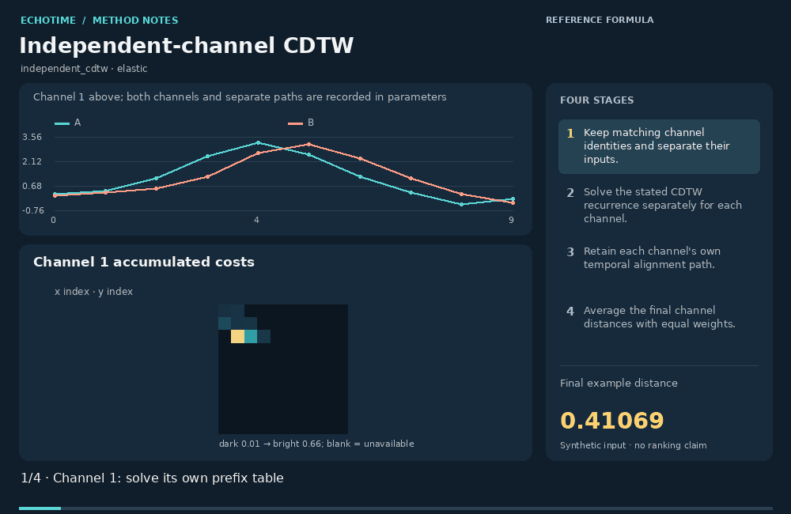

[Static image](../../src/echotime/data/method_animations/media/independent_cdtw.png) · [Inputs and full calculation trace](../../src/echotime/data/method_animations/traces/independent_cdtw.json) · [Open in the website](https://zipengwu.me/EchoTime/guide/methods.html#animation-independent_cdtw)

Independent CDTW computes a separate alignment problem for every channel, then averages the resulting distances. The two channels in this example prefer different correspondences. Their paths are shown separately, making explicit that averaging final scores does not impose a shared multivariate warping path.

独立通道 CDTW 为每个通道分别求解对齐问题，再平均最终距离。本例两个通道偏好的配对不同，动图分别显示各自路径，因此可直接看到平均分数不等于施加共享的多变量扭曲路径。

### Calculation / 计算

```text
d_independent(X,Y) = (d_base(X_channel1,Y_channel1)+d_base(X_channel2,Y_channel2))/2
```

1. Keep matching channel identities and define channelwise preprocessing.
   保持通道对应关系，并明确各通道预处理。
2. Solve the stated CDTW problem independently for channel one and channel two.
   分别求解通道一和通道二的 CDTW 问题。
3. Retain each channel's own alignment; different channels may select different time matches.
   保留各通道自身的对齐；不同通道可以选择不同时间匹配。
4. Take the arithmetic mean of channel distances, with equal weights in this example.
   对通道距离取算术平均；本例使用相等权重。

**Example distance:** `0.41068967`. The explicit definition and parameters shown on this card.

**Parameters:**

```json
{
  "channels_x": [
    [
      0.2,
      0.4,
      1.1,
      2.4,
      3.2,
      2.5,
      1.2,
      0.3,
      -0.4,
      -0.1
    ],
    [
      0.2,
      0.5,
      1.2,
      2.2,
      2.9,
      2.1,
      1.1,
      0.1,
      -0.2,
      0.1
    ]
  ],
  "channels_y": [
    [
      0.1,
      0.3,
      0.5,
      1.2,
      2.6,
      3.1,
      2.3,
      1.1,
      0.2,
      -0.3
    ],
    [
      0.4,
      1.1,
      2.3,
      3.0,
      2.0,
      1.0,
      0.2,
      -0.1,
      0.0,
      0.2
    ]
  ],
  "base": "cdtw",
  "aggregation": "arithmetic mean",
  "channel_values": [
    0.4472135954999581,
    0.37416573867739417
  ],
  "window": 1
}
```

### Interpretation and limits / 解释与边界

- Independent warping can break simultaneity across channels; use a shared-path definition when simultaneous events must remain coupled. 各通道独立扭曲可能破坏通道间同时性；要求同步事件保持耦合时，应选择共享路径定义。
- Channel scale and aggregation convention matter. This atlas uses a mean; some libraries use a sum. 通道尺度和聚合约定会影响结果；本图谱使用平均值，有些库使用求和。

### Definition sources / 定义来源

- [tslearn: DTW definitions and path constraints](https://tslearn.readthedocs.io/en/stable/user_guide/dtw.html)
- [EchoTime imported atlas: named formula conventions](https://github.com/ZipengWu365/EchoTime/blob/main/src/echotime/data/ts_similarity_package_v2_registry.csv)

<a id="independent_wdtw"></a>
## Independent-channel WDTW · `independent_wdtw`

**Demonstration:** Reference-formula demonstration / 参考公式演示

**EchoTime coverage:** Possible addition

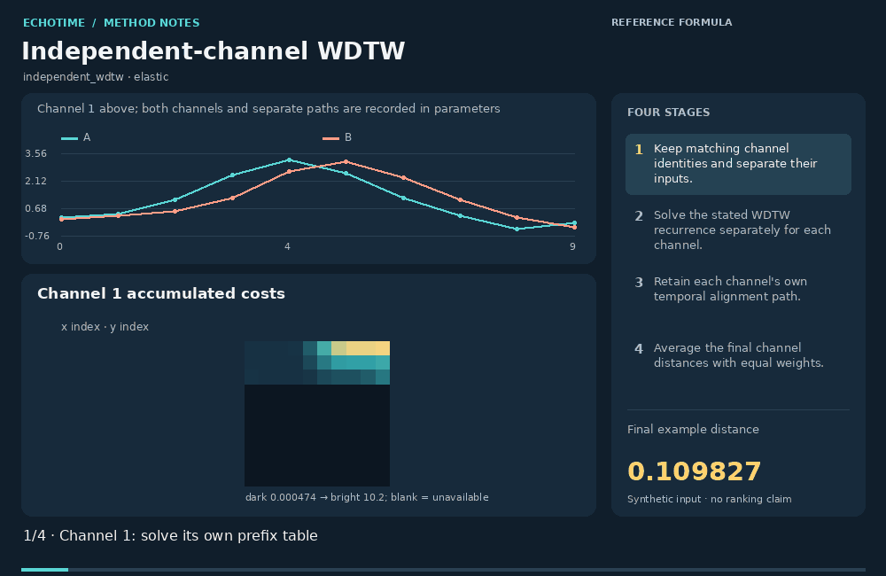

[Static image](../../src/echotime/data/method_animations/media/independent_wdtw.png) · [Inputs and full calculation trace](../../src/echotime/data/method_animations/traces/independent_wdtw.json) · [Open in the website](https://zipengwu.me/EchoTime/guide/methods.html#animation-independent_wdtw)

Independent WDTW computes a separate alignment problem for every channel, then averages the resulting distances. The two channels in this example prefer different correspondences. Their paths are shown separately, making explicit that averaging final scores does not impose a shared multivariate warping path.

独立通道 WDTW 为每个通道分别求解对齐问题，再平均最终距离。本例两个通道偏好的配对不同，动图分别显示各自路径，因此可直接看到平均分数不等于施加共享的多变量扭曲路径。

### Calculation / 计算

```text
d_independent(X,Y) = (d_base(X_channel1,Y_channel1)+d_base(X_channel2,Y_channel2))/2
```

1. Keep matching channel identities and define channelwise preprocessing.
   保持通道对应关系，并明确各通道预处理。
2. Solve the stated WDTW problem independently for channel one and channel two.
   分别求解通道一和通道二的 WDTW 问题。
3. Retain each channel's own alignment; different channels may select different time matches.
   保留各通道自身的对齐；不同通道可以选择不同时间匹配。
4. Take the arithmetic mean of channel distances, with equal weights in this example.
   对通道距离取算术平均；本例使用相等权重。

**Example distance:** `0.10982745`. The explicit definition and parameters shown on this card.

**Parameters:**

```json
{
  "channels_x": [
    [
      0.2,
      0.4,
      1.1,
      2.4,
      3.2,
      2.5,
      1.2,
      0.3,
      -0.4,
      -0.1
    ],
    [
      0.2,
      0.5,
      1.2,
      2.2,
      2.9,
      2.1,
      1.1,
      0.1,
      -0.2,
      0.1
    ]
  ],
  "channels_y": [
    [
      0.1,
      0.3,
      0.5,
      1.2,
      2.6,
      3.1,
      2.3,
      1.1,
      0.2,
      -0.3
    ],
    [
      0.4,
      1.1,
      2.3,
      3.0,
      2.0,
      1.0,
      0.2,
      -0.1,
      0.0,
      0.2
    ]
  ],
  "base": "wdtw",
  "aggregation": "arithmetic mean",
  "channel_values": [
    0.12037329396424752,
    0.09928160123271255
  ],
  "weighted": true,
  "g": 0.6
}
```

### Interpretation and limits / 解释与边界

- Independent warping can break simultaneity across channels; use a shared-path definition when simultaneous events must remain coupled. 各通道独立扭曲可能破坏通道间同时性；要求同步事件保持耦合时，应选择共享路径定义。
- Channel scale and aggregation convention matter. This atlas uses a mean; some libraries use a sum. 通道尺度和聚合约定会影响结果；本图谱使用平均值，有些库使用求和。

### Definition sources / 定义来源

- [aeon: logistic weighted DTW](https://www.aeon-toolkit.org/en/stable/api_reference/auto_generated/aeon.distances.wdtw_distance.html)
- [EchoTime imported atlas: named formula conventions](https://github.com/ZipengWu365/EchoTime/blob/main/src/echotime/data/ts_similarity_package_v2_registry.csv)

<a id="independent_ddtw"></a>
## Independent-channel DDTW · `independent_ddtw`

**Demonstration:** Reference-formula demonstration / 参考公式演示

**EchoTime coverage:** Possible addition

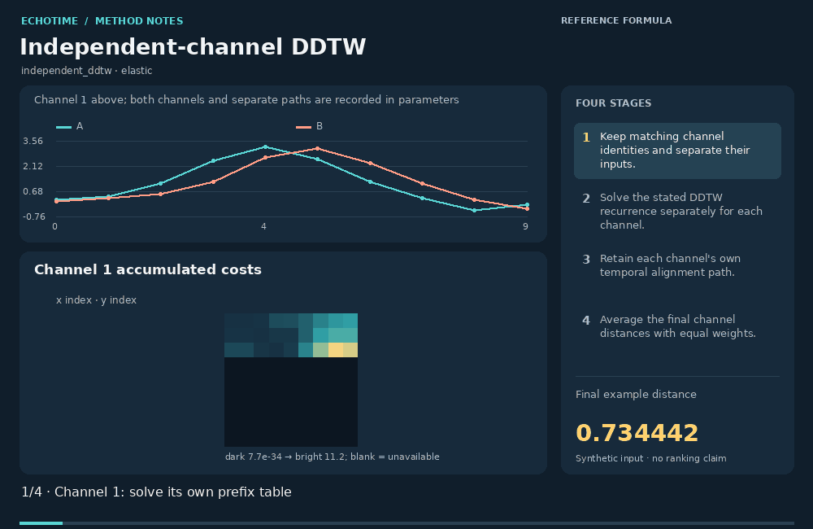

[Static image](../../src/echotime/data/method_animations/media/independent_ddtw.png) · [Inputs and full calculation trace](../../src/echotime/data/method_animations/traces/independent_ddtw.json) · [Open in the website](https://zipengwu.me/EchoTime/guide/methods.html#animation-independent_ddtw)

Independent DDTW computes a separate alignment problem for every channel, then averages the resulting distances. The two channels in this example prefer different correspondences. Their paths are shown separately, making explicit that averaging final scores does not impose a shared multivariate warping path.

独立通道 DDTW 为每个通道分别求解对齐问题，再平均最终距离。本例两个通道偏好的配对不同，动图分别显示各自路径，因此可直接看到平均分数不等于施加共享的多变量扭曲路径。

### Calculation / 计算

```text
d_independent(X,Y) = (d_base(X_channel1,Y_channel1)+d_base(X_channel2,Y_channel2))/2
```

1. Keep matching channel identities and define channelwise preprocessing.
   保持通道对应关系，并明确各通道预处理。
2. Solve the stated DDTW problem independently for channel one and channel two.
   分别求解通道一和通道二的 DDTW 问题。
3. Retain each channel's own alignment; different channels may select different time matches.
   保留各通道自身的对齐；不同通道可以选择不同时间匹配。
4. Take the arithmetic mean of channel distances, with equal weights in this example.
   对通道距离取算术平均；本例使用相等权重。

**Example distance:** `0.73444173`. The explicit definition and parameters shown on this card.

**Parameters:**

```json
{
  "channels_x": [
    [
      0.2,
      0.4,
      1.1,
      2.4,
      3.2,
      2.5,
      1.2,
      0.3,
      -0.4,
      -0.1
    ],
    [
      0.2,
      0.5,
      1.2,
      2.2,
      2.9,
      2.1,
      1.1,
      0.1,
      -0.2,
      0.1
    ]
  ],
  "channels_y": [
    [
      0.1,
      0.3,
      0.5,
      1.2,
      2.6,
      3.1,
      2.3,
      1.1,
      0.2,
      -0.3
    ],
    [
      0.4,
      1.1,
      2.3,
      3.0,
      2.0,
      1.0,
      0.2,
      -0.1,
      0.0,
      0.2
    ]
  ],
  "base": "ddtw",
  "aggregation": "arithmetic mean",
  "channel_values": [
    0.8944271909999162,
    0.5744562646538028
  ],
  "derivative": true,
  "derivative_convention": "adjacent first differences"
}
```

### Interpretation and limits / 解释与边界

- Independent warping can break simultaneity across channels; use a shared-path definition when simultaneous events must remain coupled. 各通道独立扭曲可能破坏通道间同时性；要求同步事件保持耦合时，应选择共享路径定义。
- Channel scale and aggregation convention matter. This atlas uses a mean; some libraries use a sum. 通道尺度和聚合约定会影响结果；本图谱使用平均值，有些库使用求和。

### Definition sources / 定义来源

- [tslearn: DTW definitions and path constraints](https://tslearn.readthedocs.io/en/stable/user_guide/dtw.html)
- [EchoTime imported atlas: named formula conventions](https://github.com/ZipengWu365/EchoTime/blob/main/src/echotime/data/ts_similarity_package_v2_registry.csv)

<a id="independent_erp"></a>
## Independent-channel ERP · `independent_erp`

**Demonstration:** Reference-formula demonstration / 参考公式演示

**EchoTime coverage:** Possible addition

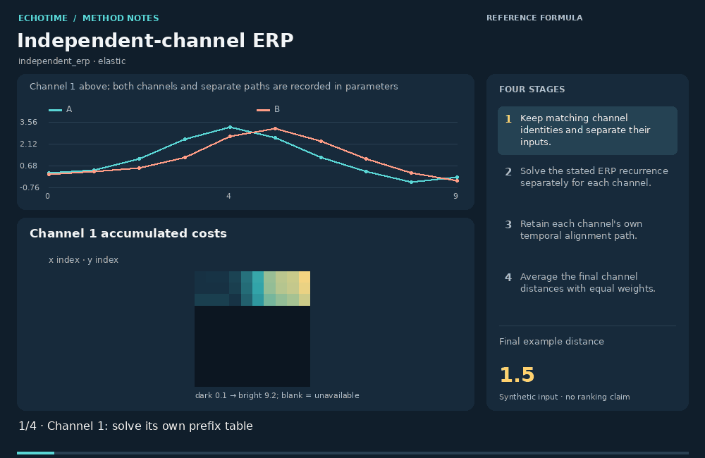

[Static image](../../src/echotime/data/method_animations/media/independent_erp.png) · [Inputs and full calculation trace](../../src/echotime/data/method_animations/traces/independent_erp.json) · [Open in the website](https://zipengwu.me/EchoTime/guide/methods.html#animation-independent_erp)

Independent ERP computes a separate alignment problem for every channel, then averages the resulting distances. The two channels in this example prefer different correspondences. Their paths are shown separately, making explicit that averaging final scores does not impose a shared multivariate warping path.

独立通道 ERP 为每个通道分别求解对齐问题，再平均最终距离。本例两个通道偏好的配对不同，动图分别显示各自路径，因此可直接看到平均分数不等于施加共享的多变量扭曲路径。

### Calculation / 计算

```text
d_independent(X,Y) = (d_base(X_channel1,Y_channel1)+d_base(X_channel2,Y_channel2))/2
```

1. Keep matching channel identities and define channelwise preprocessing.
   保持通道对应关系，并明确各通道预处理。
2. Solve the stated ERP problem independently for channel one and channel two.
   分别求解通道一和通道二的 ERP 问题。
3. Retain each channel's own alignment; different channels may select different time matches.
   保留各通道自身的对齐；不同通道可以选择不同时间匹配。
4. Take the arithmetic mean of channel distances, with equal weights in this example.
   对通道距离取算术平均；本例使用相等权重。

**Example distance:** `1.5`. The explicit definition and parameters shown on this card.

**Parameters:**

```json
{
  "channels_x": [
    [
      0.2,
      0.4,
      1.1,
      2.4,
      3.2,
      2.5,
      1.2,
      0.3,
      -0.4,
      -0.1
    ],
    [
      0.2,
      0.5,
      1.2,
      2.2,
      2.9,
      2.1,
      1.1,
      0.1,
      -0.2,
      0.1
    ]
  ],
  "channels_y": [
    [
      0.1,
      0.3,
      0.5,
      1.2,
      2.6,
      3.1,
      2.3,
      1.1,
      0.2,
      -0.3
    ],
    [
      0.4,
      1.1,
      2.3,
      3.0,
      2.0,
      1.0,
      0.2,
      -0.1,
      0.0,
      0.2
    ]
  ],
  "base": "erp",
  "aggregation": "arithmetic mean",
  "channel_values": [
    1.7000000000000002,
    1.2999999999999996
  ],
  "gap_value": 0.5
}
```

### Interpretation and limits / 解释与边界

- Independent warping can break simultaneity across channels; use a shared-path definition when simultaneous events must remain coupled. 各通道独立扭曲可能破坏通道间同时性；要求同步事件保持耦合时，应选择共享路径定义。
- Channel scale and aggregation convention matter. This atlas uses a mean; some libraries use a sum. 通道尺度和聚合约定会影响结果；本图谱使用平均值，有些库使用求和。

### Definition sources / 定义来源

- [EchoTime low-level similarity implementations](https://github.com/ZipengWu365/EchoTime/blob/main/src/echotime/similarity_methods.py)
- [EchoTime imported atlas: named formula conventions](https://github.com/ZipengWu365/EchoTime/blob/main/src/echotime/data/ts_similarity_package_v2_registry.csv)
