# Representation and comparison / 表示与比较

[All animation families](README.md) · [Existing web Methods Atlas](https://zipengwu.me/EchoTime/guide/methods.html#method-animations)

The values below belong to the documented synthetic example. Animation coverage and EchoTime API coverage are separate.

- [Specified encoder protocol embedding distance](#embedding_distance)
- [Specified encoder protocol embedding similarity](#embedding_similarity)
- [PAA block means embedding distance](#paa_embedding_distance)
- [PAA block means embedding similarity](#paa_embedding_similarity)
- [DFT magnitudes embedding distance](#dft_embedding_distance)
- [DFT magnitudes embedding similarity](#dft_embedding_similarity)
- [Basic statistics embedding distance](#stats_embedding_distance)
- [Basic statistics embedding similarity](#stats_embedding_similarity)
- [Robust statistics embedding distance](#robust_stats_embedding_distance)
- [Robust statistics embedding similarity](#robust_stats_embedding_similarity)
- [Autocorrelation features embedding distance](#acf_embedding_distance)
- [Autocorrelation features embedding similarity](#acf_embedding_similarity)
- [Coarse Haar coefficients embedding distance](#wavelet_embedding_distance)
- [Coarse Haar coefficients embedding similarity](#wavelet_embedding_similarity)
- [Value histograms embedding distance](#histogram_embedding_distance)
- [Value histograms embedding similarity](#histogram_embedding_similarity)
- [Normalized FFT-bin powers embedding distance](#periodogram_embedding_distance)
- [Normalized FFT-bin powers embedding similarity](#periodogram_embedding_similarity)
- [Linear trend features embedding distance](#trend_embedding_distance)
- [Linear trend features embedding similarity](#trend_embedding_similarity)
- [Fixed Gaussian projection embedding distance](#random_projection_embedding_distance)
- [Fixed Gaussian projection embedding similarity](#random_projection_embedding_similarity)
- [Identity-resample features embedding distance](#identity_embedding_distance)
- [Identity-resample features embedding similarity](#identity_embedding_similarity)

<a id="embedding_distance"></a>
## Specified encoder protocol embedding distance · `embedding_distance`

**Demonstration:** Specified illustrative protocol / 明确设定的流程示例

**EchoTime coverage:** Low-priority addition

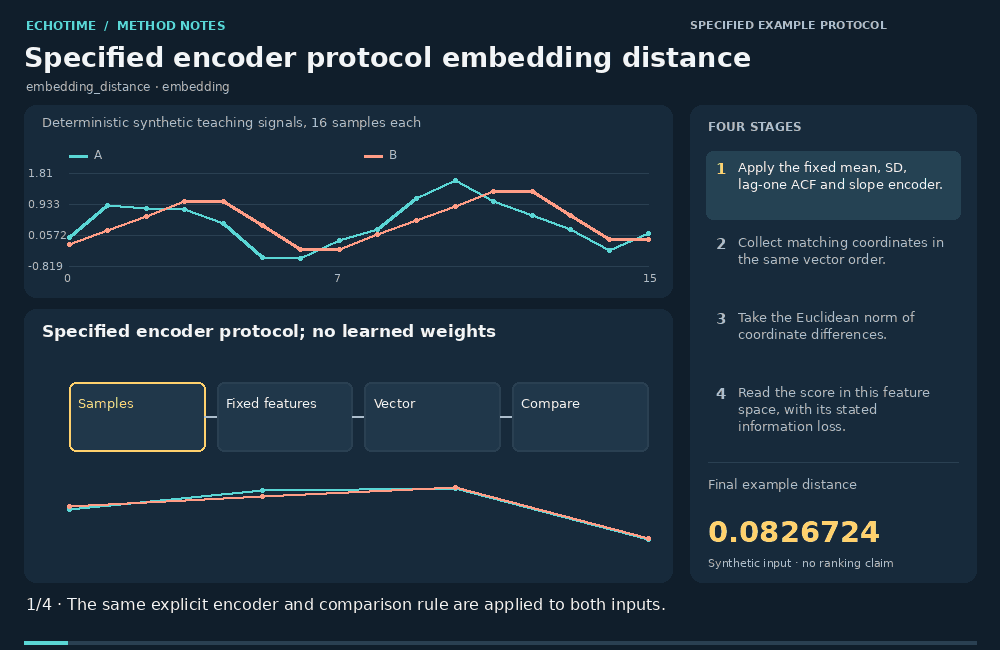

[Static image](../../src/echotime/data/method_animations/media/embedding_distance.png) · [Inputs and full calculation trace](../../src/echotime/data/method_animations/traces/embedding_distance.json) · [Open in the website](https://zipengwu.me/EchoTime/guide/methods.html#animation-embedding_distance)

An embedding comparison first specifies an encoder, then a distance or similarity on its output. This diagram instantiates that protocol with the fixed vector [mean, population SD, adjusted lag-one ACF, linear slope]. It demonstrates the interface with actual numbers; no learned or pretrained representation is used. Euclidean distance retains differences in both vector scale and coordinates.

嵌入比较先指定编码器，再指定输出空间的距离或相似度。本图使用固定的 [均值、总体标准差、调整后一阶自相关、线性斜率] 向量，以真实计算演示接口；未使用学习得到的表示或预训练模型。 欧氏距离同时保留向量尺度与坐标差异。

### Calculation / 计算

```text
d(x,y) = sqrt(sum_j (phi_j(x)-phi_j(y))^2)
```

1. Apply the explicitly specified four-statistic encoder identically to both inputs.
   对两条输入使用完全相同、明确指定的四统计量编码器。
2. Collect the computed coordinates in the same fixed order for both inputs.
   把计算得到的坐标按同一个固定顺序组成两个向量。
3. Take the Euclidean norm of the coordinate differences.
   对坐标差计算欧氏范数。
4. Interpret the score in this representation, accounting for the information it discards.
   结合表示所舍弃的信息，在该表示空间中解释分数。

**Example distance:** `0.082672381`. Computed from the explicitly defined illustrative encoder; no learned weights.

**Parameters:**

```json
{
  "encoder": [
    "mean",
    "std_ddof0",
    "adjusted_ACF_lag1",
    "OLS_slope"
  ],
  "learned_weights": false,
  "coordinate_scaling": "none",
  "comparison": "euclidean"
}
```

### Interpretation and limits / 解释与边界

- This name is an interface pattern, not one uniquely defined algorithm; another encoder can produce entirely different neighbors. 该名称描述接口模式，不对应唯一算法；换用其他编码器会改变近邻关系。
- The illustrative coordinates have different units and receive no scaling. No semantic, causal or task-transfer guarantee follows from a small score. 示例坐标单位不同且未缩放；较小分数不蕴含语义、因果或任务迁移保证。
- A metric on these feature vectors can be only a pseudometric on the original series when the representation loses information. 当表示损失信息时，特征空间中的度量在原序列空间上可能只是伪度量。

### Definition sources / 定义来源

- [Exact illustrative inputs and encoder definitions](https://github.com/ZipengWu365/EchoTime/blob/main/tools/method_animation_data/feature_model_embedding.py)
- [Imported registry: named feature and comparison conventions](https://github.com/ZipengWu365/EchoTime/blob/main/src/echotime/data/ts_similarity_package_v2_registry.csv)

<a id="embedding_similarity"></a>
## Specified encoder protocol embedding similarity · `embedding_similarity`

**Demonstration:** Specified illustrative protocol / 明确设定的流程示例

**EchoTime coverage:** Low-priority addition

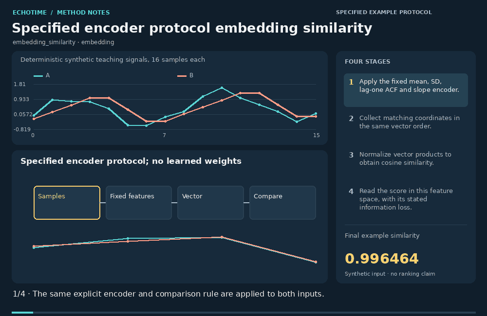

[Static image](../../src/echotime/data/method_animations/media/embedding_similarity.png) · [Inputs and full calculation trace](../../src/echotime/data/method_animations/traces/embedding_similarity.json) · [Open in the website](https://zipengwu.me/EchoTime/guide/methods.html#animation-embedding_similarity)

An embedding comparison first specifies an encoder, then a distance or similarity on its output. This diagram instantiates that protocol with the fixed vector [mean, population SD, adjusted lag-one ACF, linear slope]. It demonstrates the interface with actual numbers; no learned or pretrained representation is used. Cosine compares vector direction and is defined here for nonzero feature vectors.

嵌入比较先指定编码器，再指定输出空间的距离或相似度。本图使用固定的 [均值、总体标准差、调整后一阶自相关、线性斜率] 向量，以真实计算演示接口；未使用学习得到的表示或预训练模型。 余弦比较向量方向，本例特征向量均非零。

### Calculation / 计算

```text
s(x,y) = dot(phi(x),phi(y)) / (norm(phi(x))*norm(phi(y)))
```

1. Apply the explicitly specified four-statistic encoder identically to both inputs.
   对两条输入使用完全相同、明确指定的四统计量编码器。
2. Collect the computed coordinates in the same fixed order for both inputs.
   把计算得到的坐标按同一个固定顺序组成两个向量。
3. Normalize by both vector lengths and sum coordinate products to obtain cosine similarity.
   用两个向量的长度归一化坐标乘积之和，得到余弦相似度。
4. Interpret the score in this representation, accounting for the information it discards.
   结合表示所舍弃的信息，在该表示空间中解释分数。

**Example similarity:** `0.99646416`. Computed from the explicitly defined illustrative encoder; no learned weights.

**Parameters:**

```json
{
  "encoder": [
    "mean",
    "std_ddof0",
    "adjusted_ACF_lag1",
    "OLS_slope"
  ],
  "learned_weights": false,
  "coordinate_scaling": "none",
  "comparison": "cosine"
}
```

### Interpretation and limits / 解释与边界

- This name is an interface pattern, not one uniquely defined algorithm; another encoder can produce entirely different neighbors. 该名称描述接口模式，不对应唯一算法；换用其他编码器会改变近邻关系。
- The illustrative coordinates have different units and receive no scaling. No semantic, causal or task-transfer guarantee follows from a small score. 示例坐标单位不同且未缩放；较小分数不蕴含语义、因果或任务迁移保证。
- Cosine ignores positive rescaling of the entire feature vector; 1-cosine is generally not a metric, and zero vectors require an explicit policy. 余弦忽略整个特征向量的正比例缩放；1-cosine 通常不满足度量公理，零向量还需明确处理规则。

### Definition sources / 定义来源

- [Exact illustrative inputs and encoder definitions](https://github.com/ZipengWu365/EchoTime/blob/main/tools/method_animation_data/feature_model_embedding.py)
- [Imported registry: named feature and comparison conventions](https://github.com/ZipengWu365/EchoTime/blob/main/src/echotime/data/ts_similarity_package_v2_registry.csv)

<a id="paa_embedding_distance"></a>
## PAA block means embedding distance · `paa_embedding_distance`

**Demonstration:** Reference-formula demonstration / 参考公式演示

**EchoTime coverage:** Low-priority addition


[Static image](../../src/echotime/data/method_animations/media/paa_embedding_distance.png) · [Inputs and full calculation trace](../../src/echotime/data/method_animations/traces/paa_embedding_distance.json) · [Open in the website](https://zipengwu.me/EchoTime/guide/methods.html#animation-paa_embedding_distance)

Split the 16 observations into four equal, consecutive blocks and replace each block by its mean. Comparing these ordered block averages emphasizes coarse temporal structure. The animation highlights the exact observations contributing to each coordinate. Euclidean distance retains differences in both vector scale and coordinates.

把 16 个观测分成四个连续等长区间，每个区间用均值表示。比较这些有序均值可突出较粗的时间结构；动图逐块高亮每个坐标所使用的观测。 欧氏距离同时保留向量尺度与坐标差异。

### Calculation / 计算

```text
d(x,y) = sqrt(sum_j (phi_j(x)-phi_j(y))^2)
```

1. Average each consecutive block of four observations to obtain four coordinates.
   每四个连续观测求一次均值，得到四个坐标。
2. Collect the computed coordinates in the same fixed order for both inputs.
   把计算得到的坐标按同一个固定顺序组成两个向量。
3. Take the Euclidean norm of the coordinate differences.
   对坐标差计算欧氏范数。
4. Interpret the score in this representation, accounting for the information it discards.
   结合表示所舍弃的信息，在该表示空间中解释分数。

**Example distance:** `0.61269408`. Computed from the explicitly defined illustrative encoder; no learned weights.

**Parameters:**

```json
{
  "n_segments": 4,
  "block_size": 4,
  "z_normalization": false,
  "distance_length_scaling": false,
  "comparison": "euclidean"
}
```

### Interpretation and limits / 解释与边界

- The displayed Euclidean feature distance is unscaled; the usual length-scaled PAA lower bound additionally multiplies it by sqrt(n/w). 图中欧氏特征距离未经长度缩放；常用 PAA 下界还需乘以 sqrt(n/w)。
- Short events within a block can cancel, and moving a block boundary can alter the representation. 区间内的短暂事件可能互相抵消，改变分段边界也会改变表示。
- A metric on these feature vectors can be only a pseudometric on the original series when the representation loses information. 当表示损失信息时，特征空间中的度量在原序列空间上可能只是伪度量。

### Definition sources / 定义来源

- [tslearn: piecewise aggregate approximation](https://tslearn.readthedocs.io/en/stable/gen_modules/piecewise/tslearn.piecewise.PiecewiseAggregateApproximation.html)
- [Imported registry: named feature and comparison conventions](https://github.com/ZipengWu365/EchoTime/blob/main/src/echotime/data/ts_similarity_package_v2_registry.csv)
- [Exact illustrative inputs and encoder definitions](https://github.com/ZipengWu365/EchoTime/blob/main/tools/method_animation_data/feature_model_embedding.py)

<a id="paa_embedding_similarity"></a>
## PAA block means embedding similarity · `paa_embedding_similarity`

**Demonstration:** Reference-formula demonstration / 参考公式演示

**EchoTime coverage:** Low-priority addition

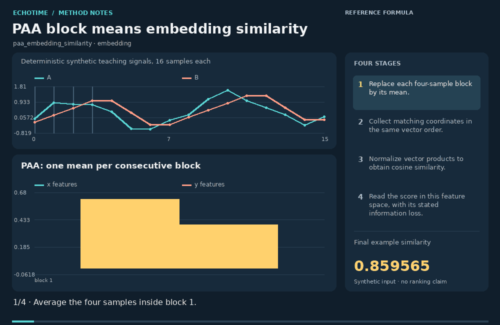

[Static image](../../src/echotime/data/method_animations/media/paa_embedding_similarity.png) · [Inputs and full calculation trace](../../src/echotime/data/method_animations/traces/paa_embedding_similarity.json) · [Open in the website](https://zipengwu.me/EchoTime/guide/methods.html#animation-paa_embedding_similarity)

Split the 16 observations into four equal, consecutive blocks and replace each block by its mean. Comparing these ordered block averages emphasizes coarse temporal structure. The animation highlights the exact observations contributing to each coordinate. Cosine compares vector direction and is defined here for nonzero feature vectors.

把 16 个观测分成四个连续等长区间，每个区间用均值表示。比较这些有序均值可突出较粗的时间结构；动图逐块高亮每个坐标所使用的观测。 余弦比较向量方向，本例特征向量均非零。

### Calculation / 计算

```text
s(x,y) = dot(phi(x),phi(y)) / (norm(phi(x))*norm(phi(y)))
```

1. Average each consecutive block of four observations to obtain four coordinates.
   每四个连续观测求一次均值，得到四个坐标。
2. Collect the computed coordinates in the same fixed order for both inputs.
   把计算得到的坐标按同一个固定顺序组成两个向量。
3. Normalize by both vector lengths and sum coordinate products to obtain cosine similarity.
   用两个向量的长度归一化坐标乘积之和，得到余弦相似度。
4. Interpret the score in this representation, accounting for the information it discards.
   结合表示所舍弃的信息，在该表示空间中解释分数。

**Example similarity:** `0.85956485`. Computed from the explicitly defined illustrative encoder; no learned weights.

**Parameters:**

```json
{
  "n_segments": 4,
  "block_size": 4,
  "z_normalization": false,
  "distance_length_scaling": false,
  "comparison": "cosine"
}
```

### Interpretation and limits / 解释与边界

- The displayed Euclidean feature distance is unscaled; the usual length-scaled PAA lower bound additionally multiplies it by sqrt(n/w). 图中欧氏特征距离未经长度缩放；常用 PAA 下界还需乘以 sqrt(n/w)。
- Short events within a block can cancel, and moving a block boundary can alter the representation. 区间内的短暂事件可能互相抵消，改变分段边界也会改变表示。
- Cosine ignores positive rescaling of the entire feature vector; 1-cosine is generally not a metric, and zero vectors require an explicit policy. 余弦忽略整个特征向量的正比例缩放；1-cosine 通常不满足度量公理，零向量还需明确处理规则。

### Definition sources / 定义来源

- [tslearn: piecewise aggregate approximation](https://tslearn.readthedocs.io/en/stable/gen_modules/piecewise/tslearn.piecewise.PiecewiseAggregateApproximation.html)
- [Imported registry: named feature and comparison conventions](https://github.com/ZipengWu365/EchoTime/blob/main/src/echotime/data/ts_similarity_package_v2_registry.csv)
- [Exact illustrative inputs and encoder definitions](https://github.com/ZipengWu365/EchoTime/blob/main/tools/method_animation_data/feature_model_embedding.py)

<a id="dft_embedding_distance"></a>
## DFT magnitudes embedding distance · `dft_embedding_distance`

**Demonstration:** Reference-formula demonstration / 参考公式演示

**EchoTime coverage:** Low-priority addition

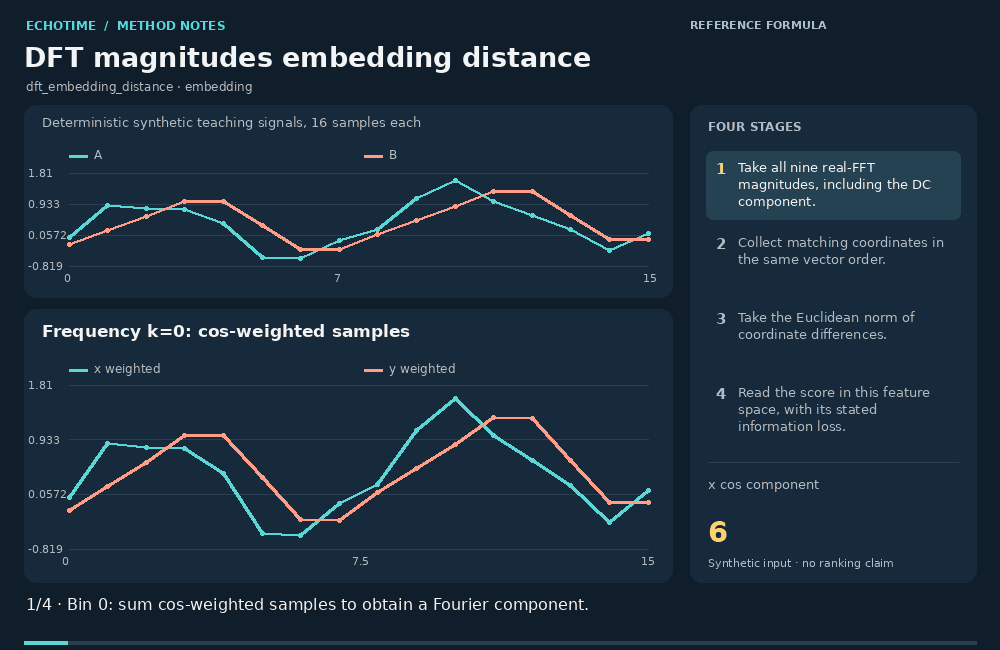

[Static image](../../src/echotime/data/method_animations/media/dft_embedding_distance.png) · [Inputs and full calculation trace](../../src/echotime/data/method_animations/traces/dft_embedding_distance.json) · [Open in the website](https://zipengwu.me/EchoTime/guide/methods.html#animation-dft_embedding_distance)

Project the series onto sine and cosine bases, combine the real and imaginary parts into magnitudes, and compare the resulting frequency bins. The example retains all nine nonnegative-frequency bins of a length-16 real transform, including the DC bin. Euclidean distance retains differences in both vector scale and coordinates.

把序列投影到正弦、余弦基上，将实部和虚部合成为幅值，再比较频率坐标。本例保留长度 16 实数变换的全部九个非负频率坐标，包括直流分量。 欧氏距离同时保留向量尺度与坐标差异。

### Calculation / 计算

```text
d(x,y) = sqrt(sum_j (phi_j(x)-phi_j(y))^2)
```

1. Compute the unnormalized real FFT and retain the magnitude of each bin.
   计算未归一化的实数 FFT，保留各频率坐标的模。
2. Collect the computed coordinates in the same fixed order for both inputs.
   把计算得到的坐标按同一个固定顺序组成两个向量。
3. Take the Euclidean norm of the coordinate differences.
   对坐标差计算欧氏范数。
4. Interpret the score in this representation, accounting for the information it discards.
   结合表示所舍弃的信息，在该表示空间中解释分数。

**Example distance:** `1.9042105`. Computed from the explicitly defined illustrative encoder; no learned weights.

**Parameters:**

```json
{
  "fft": "rfft",
  "normalization": "backward",
  "n_bins": 9,
  "include_DC": true,
  "comparison": "euclidean"
}
```

### Interpretation and limits / 解释与边界

- Magnitude discards phase; a circular shift changes Fourier phase while preserving these magnitudes. 幅值表示舍弃相位；循环平移改变傅里叶相位，却保留这些幅值。
- The DC coordinate reflects the mean, and raw magnitudes depend on record length and amplitude. Matching sampling rates and frequency grids is required. 直流坐标反映均值，原始幅值依赖记录长度与振幅；比较时需要一致的采样率和频率网格。
- This example compares unweighted nonnegative-frequency rFFT magnitudes. Comparing a full FFT, or weighting interior rFFT magnitudes by sqrt(2), gives a different distance/cosine convention. 本例比较未加权的非负频率 rFFT 幅值。比较完整 FFT 或将内部 rFFT 幅值乘 sqrt(2)，对应不同的距离与余弦约定。
- A metric on these feature vectors can be only a pseudometric on the original series when the representation loses information. 当表示损失信息时，特征空间中的度量在原序列空间上可能只是伪度量。

### Definition sources / 定义来源

- [NumPy: real-input discrete Fourier transform](https://numpy.org/doc/stable/reference/generated/numpy.fft.rfft.html)
- [Imported registry: named feature and comparison conventions](https://github.com/ZipengWu365/EchoTime/blob/main/src/echotime/data/ts_similarity_package_v2_registry.csv)
- [Exact illustrative inputs and encoder definitions](https://github.com/ZipengWu365/EchoTime/blob/main/tools/method_animation_data/feature_model_embedding.py)

<a id="dft_embedding_similarity"></a>
## DFT magnitudes embedding similarity · `dft_embedding_similarity`

**Demonstration:** Reference-formula demonstration / 参考公式演示

**EchoTime coverage:** Low-priority addition

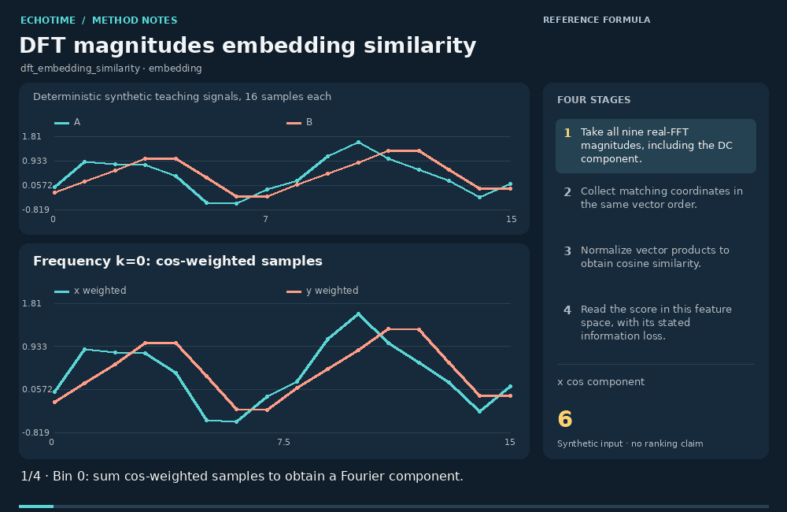

[Static image](../../src/echotime/data/method_animations/media/dft_embedding_similarity.png) · [Inputs and full calculation trace](../../src/echotime/data/method_animations/traces/dft_embedding_similarity.json) · [Open in the website](https://zipengwu.me/EchoTime/guide/methods.html#animation-dft_embedding_similarity)

Project the series onto sine and cosine bases, combine the real and imaginary parts into magnitudes, and compare the resulting frequency bins. The example retains all nine nonnegative-frequency bins of a length-16 real transform, including the DC bin. Cosine compares vector direction and is defined here for nonzero feature vectors.

把序列投影到正弦、余弦基上，将实部和虚部合成为幅值，再比较频率坐标。本例保留长度 16 实数变换的全部九个非负频率坐标，包括直流分量。 余弦比较向量方向，本例特征向量均非零。

### Calculation / 计算

```text
s(x,y) = dot(phi(x),phi(y)) / (norm(phi(x))*norm(phi(y)))
```

1. Compute the unnormalized real FFT and retain the magnitude of each bin.
   计算未归一化的实数 FFT，保留各频率坐标的模。
2. Collect the computed coordinates in the same fixed order for both inputs.
   把计算得到的坐标按同一个固定顺序组成两个向量。
3. Normalize by both vector lengths and sum coordinate products to obtain cosine similarity.
   用两个向量的长度归一化坐标乘积之和，得到余弦相似度。
4. Interpret the score in this representation, accounting for the information it discards.
   结合表示所舍弃的信息，在该表示空间中解释分数。

**Example similarity:** `0.97817876`. Computed from the explicitly defined illustrative encoder; no learned weights.

**Parameters:**

```json
{
  "fft": "rfft",
  "normalization": "backward",
  "n_bins": 9,
  "include_DC": true,
  "comparison": "cosine"
}
```

### Interpretation and limits / 解释与边界

- Magnitude discards phase; a circular shift changes Fourier phase while preserving these magnitudes. 幅值表示舍弃相位；循环平移改变傅里叶相位，却保留这些幅值。
- The DC coordinate reflects the mean, and raw magnitudes depend on record length and amplitude. Matching sampling rates and frequency grids is required. 直流坐标反映均值，原始幅值依赖记录长度与振幅；比较时需要一致的采样率和频率网格。
- This example compares unweighted nonnegative-frequency rFFT magnitudes. Comparing a full FFT, or weighting interior rFFT magnitudes by sqrt(2), gives a different distance/cosine convention. 本例比较未加权的非负频率 rFFT 幅值。比较完整 FFT 或将内部 rFFT 幅值乘 sqrt(2)，对应不同的距离与余弦约定。
- Cosine ignores positive rescaling of the entire feature vector; 1-cosine is generally not a metric, and zero vectors require an explicit policy. 余弦忽略整个特征向量的正比例缩放；1-cosine 通常不满足度量公理，零向量还需明确处理规则。

### Definition sources / 定义来源

- [NumPy: real-input discrete Fourier transform](https://numpy.org/doc/stable/reference/generated/numpy.fft.rfft.html)
- [Imported registry: named feature and comparison conventions](https://github.com/ZipengWu365/EchoTime/blob/main/src/echotime/data/ts_similarity_package_v2_registry.csv)
- [Exact illustrative inputs and encoder definitions](https://github.com/ZipengWu365/EchoTime/blob/main/tools/method_animation_data/feature_model_embedding.py)

<a id="stats_embedding_distance"></a>
## Basic statistics embedding distance · `stats_embedding_distance`

**Demonstration:** Reference-formula demonstration / 参考公式演示

**EchoTime coverage:** Low-priority addition

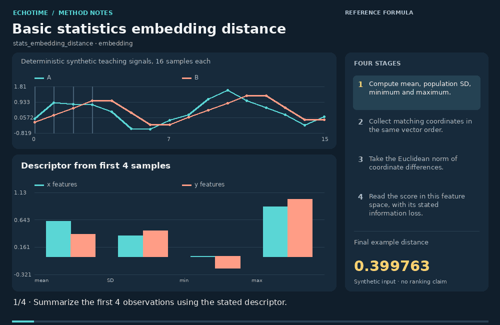

[Static image](../../src/echotime/data/method_animations/media/stats_embedding_distance.png) · [Inputs and full calculation trace](../../src/echotime/data/method_animations/traces/stats_embedding_distance.json) · [Open in the website](https://zipengwu.me/EchoTime/guide/methods.html#animation-stats_embedding_distance)

Represent each series by its mean, population standard deviation, minimum and maximum. These four coordinates summarize level, spread and range; their order in the vector is fixed, while the original temporal order is discarded. Euclidean distance retains differences in both vector scale and coordinates.

把每条序列表示为均值、总体标准差、最小值和最大值四个坐标。它们概括水平、波动和范围，坐标顺序固定，但原始时间顺序被舍弃。 欧氏距离同时保留向量尺度与坐标差异。

### Calculation / 计算

```text
d(x,y) = sqrt(sum_j (phi_j(x)-phi_j(y))^2)
```

1. Compute mean, population SD, minimum and maximum in that order.
   按均值、总体标准差、最小值、最大值的顺序提取特征。
2. Collect the computed coordinates in the same fixed order for both inputs.
   把计算得到的坐标按同一个固定顺序组成两个向量。
3. Take the Euclidean norm of the coordinate differences.
   对坐标差计算欧氏范数。
4. Interpret the score in this representation, accounting for the information it discards.
   结合表示所舍弃的信息，在该表示空间中解释分数。

**Example distance:** `0.3997628`. Computed from the explicitly defined illustrative encoder; no learned weights.

**Parameters:**

```json
{
  "features": [
    "mean",
    "std_ddof0",
    "min",
    "max"
  ],
  "coordinate_scaling": "none",
  "comparison": "euclidean"
}
```

### Interpretation and limits / 解释与边界

- Permuting observations leaves this vector unchanged, even when temporal behavior changes completely. 任意重排序列不会改变该向量，即使时间行为发生显著变化。
- Features have different scales; this example uses no coordinate weighting. A production scaler must be fitted without test-data leakage. 各坐标尺度不同；本例不加权。实际使用的缩放器应避免测试数据泄漏。
- A metric on these feature vectors can be only a pseudometric on the original series when the representation loses information. 当表示损失信息时，特征空间中的度量在原序列空间上可能只是伪度量。

### Definition sources / 定义来源

- [NumPy: summary-statistic definitions](https://numpy.org/doc/stable/reference/routines.statistics.html)
- [Imported registry: named feature and comparison conventions](https://github.com/ZipengWu365/EchoTime/blob/main/src/echotime/data/ts_similarity_package_v2_registry.csv)
- [Exact illustrative inputs and encoder definitions](https://github.com/ZipengWu365/EchoTime/blob/main/tools/method_animation_data/feature_model_embedding.py)

<a id="stats_embedding_similarity"></a>
## Basic statistics embedding similarity · `stats_embedding_similarity`

**Demonstration:** Reference-formula demonstration / 参考公式演示

**EchoTime coverage:** Low-priority addition


[Static image](../../src/echotime/data/method_animations/media/stats_embedding_similarity.png) · [Inputs and full calculation trace](../../src/echotime/data/method_animations/traces/stats_embedding_similarity.json) · [Open in the website](https://zipengwu.me/EchoTime/guide/methods.html#animation-stats_embedding_similarity)

Represent each series by its mean, population standard deviation, minimum and maximum. These four coordinates summarize level, spread and range; their order in the vector is fixed, while the original temporal order is discarded. Cosine compares vector direction and is defined here for nonzero feature vectors.

把每条序列表示为均值、总体标准差、最小值和最大值四个坐标。它们概括水平、波动和范围，坐标顺序固定，但原始时间顺序被舍弃。 余弦比较向量方向，本例特征向量均非零。

### Calculation / 计算

```text
s(x,y) = dot(phi(x),phi(y)) / (norm(phi(x))*norm(phi(y)))
```

1. Compute mean, population SD, minimum and maximum in that order.
   按均值、总体标准差、最小值、最大值的顺序提取特征。
2. Collect the computed coordinates in the same fixed order for both inputs.
   把计算得到的坐标按同一个固定顺序组成两个向量。
3. Normalize by both vector lengths and sum coordinate products to obtain cosine similarity.
   用两个向量的长度归一化坐标乘积之和，得到余弦相似度。
4. Interpret the score in this representation, accounting for the information it discards.
   结合表示所舍弃的信息，在该表示空间中解释分数。

**Example similarity:** `0.99306157`. Computed from the explicitly defined illustrative encoder; no learned weights.

**Parameters:**

```json
{
  "features": [
    "mean",
    "std_ddof0",
    "min",
    "max"
  ],
  "coordinate_scaling": "none",
  "comparison": "cosine"
}
```

### Interpretation and limits / 解释与边界

- Permuting observations leaves this vector unchanged, even when temporal behavior changes completely. 任意重排序列不会改变该向量，即使时间行为发生显著变化。
- Features have different scales; this example uses no coordinate weighting. A production scaler must be fitted without test-data leakage. 各坐标尺度不同；本例不加权。实际使用的缩放器应避免测试数据泄漏。
- Cosine ignores positive rescaling of the entire feature vector; 1-cosine is generally not a metric, and zero vectors require an explicit policy. 余弦忽略整个特征向量的正比例缩放；1-cosine 通常不满足度量公理，零向量还需明确处理规则。

### Definition sources / 定义来源

- [NumPy: summary-statistic definitions](https://numpy.org/doc/stable/reference/routines.statistics.html)
- [Imported registry: named feature and comparison conventions](https://github.com/ZipengWu365/EchoTime/blob/main/src/echotime/data/ts_similarity_package_v2_registry.csv)
- [Exact illustrative inputs and encoder definitions](https://github.com/ZipengWu365/EchoTime/blob/main/tools/method_animation_data/feature_model_embedding.py)

<a id="robust_stats_embedding_distance"></a>
## Robust statistics embedding distance · `robust_stats_embedding_distance`

**Demonstration:** Reference-formula demonstration / 参考公式演示

**EchoTime coverage:** Low-priority addition


[Static image](../../src/echotime/data/method_animations/media/robust_stats_embedding_distance.png) · [Inputs and full calculation trace](../../src/echotime/data/method_animations/traces/robust_stats_embedding_distance.json) · [Open in the website](https://zipengwu.me/EchoTime/guide/methods.html#animation-robust_stats_embedding_distance)

Replace extrema and moments with the lower quartile, median, upper quartile and median absolute deviation. This explicit descriptor emphasizes the central distribution and reduces the influence of isolated extreme values. It does not preserve the timing of those values. Euclidean distance retains differences in both vector scale and coordinates.

使用下四分位数、中位数、上四分位数和中位绝对偏差构成明确的描述向量。它强调分布的中心部分，降低孤立极端值的影响，同时舍弃这些数值出现的时刻。 欧氏距离同时保留向量尺度与坐标差异。

### Calculation / 计算

```text
d(x,y) = sqrt(sum_j (phi_j(x)-phi_j(y))^2)
```

1. Calculate Q25, median, Q75 and unscaled median absolute deviation.
   计算 Q25、中位数、Q75 和未经常数缩放的中位绝对偏差。
2. Collect the computed coordinates in the same fixed order for both inputs.
   把计算得到的坐标按同一个固定顺序组成两个向量。
3. Take the Euclidean norm of the coordinate differences.
   对坐标差计算欧氏范数。
4. Interpret the score in this representation, accounting for the information it discards.
   结合表示所舍弃的信息，在该表示空间中解释分数。

**Example distance:** `0.12641944`. Computed from the explicitly defined illustrative encoder; no learned weights.

**Parameters:**

```json
{
  "features": [
    "q25",
    "median",
    "q75",
    "unscaled_MAD"
  ],
  "quantile_method": "linear",
  "comparison": "euclidean"
}
```

### Interpretation and limits / 解释与边界

- Robustness concerns these particular statistics, not immunity to arbitrary contamination or distribution shift. 稳健性针对所选统计量，并不表示可抵抗任意污染或分布变化。
- Quantiles use linear interpolation and MAD is unscaled; alternative conventions produce different vectors. 本例分位数采用线性插值，MAD 不乘缩放常数；其他约定会产生不同向量。
- A metric on these feature vectors can be only a pseudometric on the original series when the representation loses information. 当表示损失信息时，特征空间中的度量在原序列空间上可能只是伪度量。

### Definition sources / 定义来源

- [NumPy: summary-statistic definitions](https://numpy.org/doc/stable/reference/routines.statistics.html)
- [Imported registry: named feature and comparison conventions](https://github.com/ZipengWu365/EchoTime/blob/main/src/echotime/data/ts_similarity_package_v2_registry.csv)
- [Exact illustrative inputs and encoder definitions](https://github.com/ZipengWu365/EchoTime/blob/main/tools/method_animation_data/feature_model_embedding.py)

<a id="robust_stats_embedding_similarity"></a>
## Robust statistics embedding similarity · `robust_stats_embedding_similarity`

**Demonstration:** Reference-formula demonstration / 参考公式演示

**EchoTime coverage:** Low-priority addition

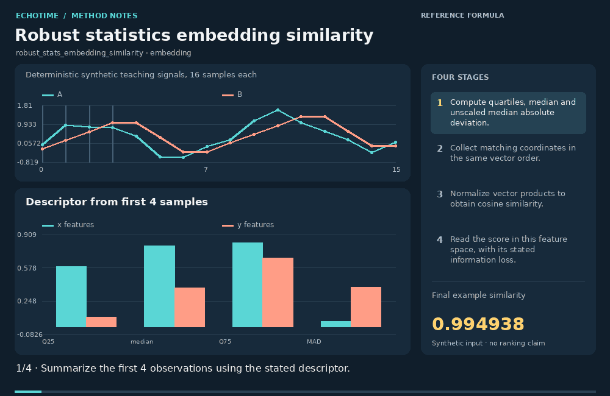

[Static image](../../src/echotime/data/method_animations/media/robust_stats_embedding_similarity.png) · [Inputs and full calculation trace](../../src/echotime/data/method_animations/traces/robust_stats_embedding_similarity.json) · [Open in the website](https://zipengwu.me/EchoTime/guide/methods.html#animation-robust_stats_embedding_similarity)

Replace extrema and moments with the lower quartile, median, upper quartile and median absolute deviation. This explicit descriptor emphasizes the central distribution and reduces the influence of isolated extreme values. It does not preserve the timing of those values. Cosine compares vector direction and is defined here for nonzero feature vectors.

使用下四分位数、中位数、上四分位数和中位绝对偏差构成明确的描述向量。它强调分布的中心部分，降低孤立极端值的影响，同时舍弃这些数值出现的时刻。 余弦比较向量方向，本例特征向量均非零。

### Calculation / 计算

```text
s(x,y) = dot(phi(x),phi(y)) / (norm(phi(x))*norm(phi(y)))
```

1. Calculate Q25, median, Q75 and unscaled median absolute deviation.
   计算 Q25、中位数、Q75 和未经常数缩放的中位绝对偏差。
2. Collect the computed coordinates in the same fixed order for both inputs.
   把计算得到的坐标按同一个固定顺序组成两个向量。
3. Normalize by both vector lengths and sum coordinate products to obtain cosine similarity.
   用两个向量的长度归一化坐标乘积之和，得到余弦相似度。
4. Interpret the score in this representation, accounting for the information it discards.
   结合表示所舍弃的信息，在该表示空间中解释分数。

**Example similarity:** `0.9949377`. Computed from the explicitly defined illustrative encoder; no learned weights.

**Parameters:**

```json
{
  "features": [
    "q25",
    "median",
    "q75",
    "unscaled_MAD"
  ],
  "quantile_method": "linear",
  "comparison": "cosine"
}
```

### Interpretation and limits / 解释与边界

- Robustness concerns these particular statistics, not immunity to arbitrary contamination or distribution shift. 稳健性针对所选统计量，并不表示可抵抗任意污染或分布变化。
- Quantiles use linear interpolation and MAD is unscaled; alternative conventions produce different vectors. 本例分位数采用线性插值，MAD 不乘缩放常数；其他约定会产生不同向量。
- Cosine ignores positive rescaling of the entire feature vector; 1-cosine is generally not a metric, and zero vectors require an explicit policy. 余弦忽略整个特征向量的正比例缩放；1-cosine 通常不满足度量公理，零向量还需明确处理规则。

### Definition sources / 定义来源

- [NumPy: summary-statistic definitions](https://numpy.org/doc/stable/reference/routines.statistics.html)
- [Imported registry: named feature and comparison conventions](https://github.com/ZipengWu365/EchoTime/blob/main/src/echotime/data/ts_similarity_package_v2_registry.csv)
- [Exact illustrative inputs and encoder definitions](https://github.com/ZipengWu365/EchoTime/blob/main/tools/method_animation_data/feature_model_embedding.py)

<a id="acf_embedding_distance"></a>
## Autocorrelation features embedding distance · `acf_embedding_distance`

**Demonstration:** Reference-formula demonstration / 参考公式演示

**EchoTime coverage:** Low-priority addition


[Static image](../../src/echotime/data/method_animations/media/acf_embedding_distance.png) · [Inputs and full calculation trace](../../src/echotime/data/method_animations/traces/acf_embedding_distance.json) · [Open in the website](https://zipengwu.me/EchoTime/guide/methods.html#animation-acf_embedding_distance)

Center each series and compare it with delayed versions of itself. Six lag coordinates summarize repeated linear dependence. This example follows EchoTime's adjusted denominator, (n-lag) times the population variance, and omits the always-one lag-zero coordinate. Euclidean distance retains differences in both vector scale and coordinates.

先对序列去均值，再与自身的延迟版本比较。六个滞后坐标描述重复出现的线性依赖。本例采用 EchoTime 的调整分母，即 (n-lag) 乘总体方差，并省略恒为一的零滞后坐标。 欧氏距离同时保留向量尺度与坐标差异。

### Calculation / 计算

```text
d(x,y) = sqrt(sum_j (phi_j(x)-phi_j(y))^2)
```

1. At each lag, sum centered lagged products and divide by (n-lag) times variance.
   逐个滞后累加去均值后的乘积，除以 (n-lag) 乘方差。
2. Collect the computed coordinates in the same fixed order for both inputs.
   把计算得到的坐标按同一个固定顺序组成两个向量。
3. Take the Euclidean norm of the coordinate differences.
   对坐标差计算欧氏范数。
4. Interpret the score in this representation, accounting for the information it discards.
   结合表示所舍弃的信息，在该表示空间中解释分数。

**Example distance:** `0.36880413`. Computed from the explicitly defined illustrative encoder; no learned weights.

**Parameters:**

```json
{
  "max_lag": 6,
  "denominator": "(n-lag)*population_variance",
  "lag_zero": "omitted",
  "comparison": "euclidean"
}
```

### Interpretation and limits / 解释与边界

- Adjusted high-lag sample estimates need not remain inside [-1,1]; estimates are less reliable with fewer overlapping pairs. 经过样本数调整的高滞后估计不一定落在 [-1,1]，重叠点越少估计越不稳定。
- ACF drops the mean and amplitude scale and cannot fully identify nonlinear dependence or the original waveform. ACF 舍弃均值和振幅尺度，无法完整识别非线性依赖或恢复原波形。
- A metric on these feature vectors can be only a pseudometric on the original series when the representation loses information. 当表示损失信息时，特征空间中的度量在原序列空间上可能只是伪度量。

### Definition sources / 定义来源

- [EchoTime low-level implementation](https://github.com/ZipengWu365/EchoTime/blob/main/src/echotime/similarity_methods.py)
- [statsmodels: ACF denominator and adjusted convention](https://www.statsmodels.org/stable/generated/statsmodels.tsa.stattools.acf.html)
- [Exact illustrative inputs and encoder definitions](https://github.com/ZipengWu365/EchoTime/blob/main/tools/method_animation_data/feature_model_embedding.py)

<a id="acf_embedding_similarity"></a>
## Autocorrelation features embedding similarity · `acf_embedding_similarity`

**Demonstration:** Reference-formula demonstration / 参考公式演示

**EchoTime coverage:** Low-priority addition

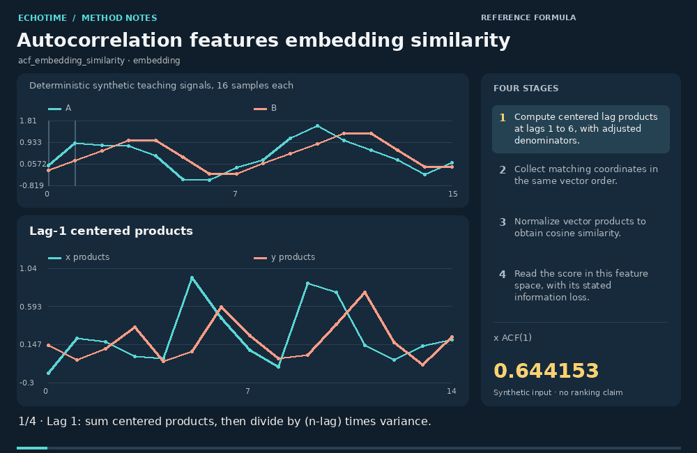

[Static image](../../src/echotime/data/method_animations/media/acf_embedding_similarity.png) · [Inputs and full calculation trace](../../src/echotime/data/method_animations/traces/acf_embedding_similarity.json) · [Open in the website](https://zipengwu.me/EchoTime/guide/methods.html#animation-acf_embedding_similarity)

Center each series and compare it with delayed versions of itself. Six lag coordinates summarize repeated linear dependence. This example follows EchoTime's adjusted denominator, (n-lag) times the population variance, and omits the always-one lag-zero coordinate. Cosine compares vector direction and is defined here for nonzero feature vectors.

先对序列去均值，再与自身的延迟版本比较。六个滞后坐标描述重复出现的线性依赖。本例采用 EchoTime 的调整分母，即 (n-lag) 乘总体方差，并省略恒为一的零滞后坐标。 余弦比较向量方向，本例特征向量均非零。

### Calculation / 计算

```text
s(x,y) = dot(phi(x),phi(y)) / (norm(phi(x))*norm(phi(y)))
```

1. At each lag, sum centered lagged products and divide by (n-lag) times variance.
   逐个滞后累加去均值后的乘积，除以 (n-lag) 乘方差。
2. Collect the computed coordinates in the same fixed order for both inputs.
   把计算得到的坐标按同一个固定顺序组成两个向量。
3. Normalize by both vector lengths and sum coordinate products to obtain cosine similarity.
   用两个向量的长度归一化坐标乘积之和，得到余弦相似度。
4. Interpret the score in this representation, accounting for the information it discards.
   结合表示所舍弃的信息，在该表示空间中解释分数。

**Example similarity:** `0.97144913`. Computed from the explicitly defined illustrative encoder; no learned weights.

**Parameters:**

```json
{
  "max_lag": 6,
  "denominator": "(n-lag)*population_variance",
  "lag_zero": "omitted",
  "comparison": "cosine"
}
```

### Interpretation and limits / 解释与边界

- Adjusted high-lag sample estimates need not remain inside [-1,1]; estimates are less reliable with fewer overlapping pairs. 经过样本数调整的高滞后估计不一定落在 [-1,1]，重叠点越少估计越不稳定。
- ACF drops the mean and amplitude scale and cannot fully identify nonlinear dependence or the original waveform. ACF 舍弃均值和振幅尺度，无法完整识别非线性依赖或恢复原波形。
- Cosine ignores positive rescaling of the entire feature vector; 1-cosine is generally not a metric, and zero vectors require an explicit policy. 余弦忽略整个特征向量的正比例缩放；1-cosine 通常不满足度量公理，零向量还需明确处理规则。

### Definition sources / 定义来源

- [EchoTime low-level implementation](https://github.com/ZipengWu365/EchoTime/blob/main/src/echotime/similarity_methods.py)
- [statsmodels: ACF denominator and adjusted convention](https://www.statsmodels.org/stable/generated/statsmodels.tsa.stattools.acf.html)
- [Exact illustrative inputs and encoder definitions](https://github.com/ZipengWu365/EchoTime/blob/main/tools/method_animation_data/feature_model_embedding.py)

<a id="wavelet_embedding_distance"></a>
## Coarse Haar coefficients embedding distance · `wavelet_embedding_distance`

**Demonstration:** Reference-formula demonstration / 参考公式演示

**EchoTime coverage:** Low-priority addition


[Static image](../../src/echotime/data/method_animations/media/wavelet_embedding_distance.png) · [Inputs and full calculation trace](../../src/echotime/data/method_animations/traces/wavelet_embedding_distance.json) · [Open in the website](https://zipengwu.me/EchoTime/guide/methods.html#animation-wavelet_embedding_distance)

Recursively average and difference adjacent pairs with orthonormal Haar scaling. Keep the coarsest average and the next three detail levels: eight of the 16 coefficients. Comparing this vector emphasizes retained scales while deliberately discarding the finest eight detail coefficients. Euclidean distance retains differences in both vector scale and coordinates.

对相邻点反复计算带正交归一化的和与差。本例保留最粗近似及随后三级细节，共 16 个系数中的八个；比较这些坐标强调所保留尺度，并主动舍弃最细的八个细节系数。 欧氏距离同时保留向量尺度与坐标差异。

### Calculation / 计算

```text
d(x,y) = sqrt(sum_j (phi_j(x)-phi_j(y))^2)
```

1. Apply Haar pair averages/differences recursively and retain [A4,D4,D3,D2].
   递归计算 Haar 相邻点和差，保留 [A4,D4,D3,D2]。
2. Collect the computed coordinates in the same fixed order for both inputs.
   把计算得到的坐标按同一个固定顺序组成两个向量。
3. Take the Euclidean norm of the coordinate differences.
   对坐标差计算欧氏范数。
4. Interpret the score in this representation, accounting for the information it discards.
   结合表示所舍弃的信息，在该表示空间中解释分数。

**Example distance:** `1.586823`. Computed from the explicitly defined illustrative encoder; no learned weights.

**Parameters:**

```json
{
  "wavelet": "orthonormal Haar",
  "length": 16,
  "coefficient_order": "A4,D4,D3,D2,D1",
  "retained": 8,
  "boundary": "no padding",
  "comparison": "euclidean"
}
```

### Interpretation and limits / 解释与边界

- This is a truncated transform; different high-frequency details can produce exactly the same retained vector. 这里使用截断变换；不同的高频细节可能产生完全相同的保留向量。
- Haar coefficients depend on alignment and boundary handling. Here the length is a power of two and no padding is needed. Haar 系数依赖对齐与边界处理。本例长度为二的幂，因此无需填充。
- A metric on these feature vectors can be only a pseudometric on the original series when the representation loses information. 当表示损失信息时，特征空间中的度量在原序列空间上可能只是伪度量。

### Definition sources / 定义来源

- [PyWavelets: Haar approximation and detail coefficients](https://pywavelets.readthedocs.io/en/latest/ref/dwt-discrete-wavelet-transform.html)
- [Imported registry: named feature and comparison conventions](https://github.com/ZipengWu365/EchoTime/blob/main/src/echotime/data/ts_similarity_package_v2_registry.csv)
- [Exact illustrative inputs and encoder definitions](https://github.com/ZipengWu365/EchoTime/blob/main/tools/method_animation_data/feature_model_embedding.py)

<a id="wavelet_embedding_similarity"></a>
## Coarse Haar coefficients embedding similarity · `wavelet_embedding_similarity`

**Demonstration:** Reference-formula demonstration / 参考公式演示

**EchoTime coverage:** Low-priority addition

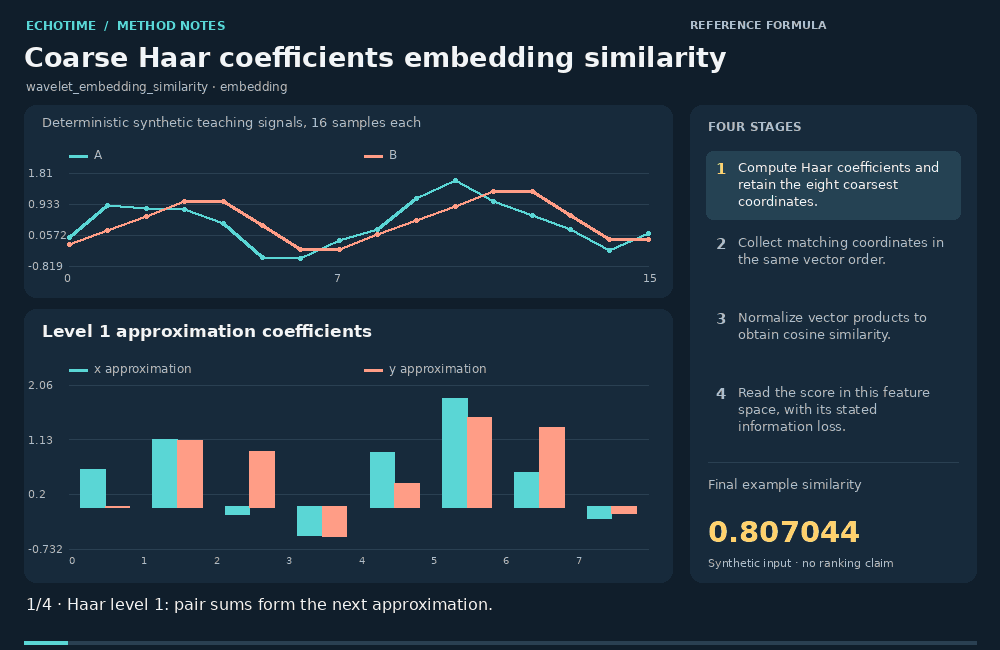

[Static image](../../src/echotime/data/method_animations/media/wavelet_embedding_similarity.png) · [Inputs and full calculation trace](../../src/echotime/data/method_animations/traces/wavelet_embedding_similarity.json) · [Open in the website](https://zipengwu.me/EchoTime/guide/methods.html#animation-wavelet_embedding_similarity)

Recursively average and difference adjacent pairs with orthonormal Haar scaling. Keep the coarsest average and the next three detail levels: eight of the 16 coefficients. Comparing this vector emphasizes retained scales while deliberately discarding the finest eight detail coefficients. Cosine compares vector direction and is defined here for nonzero feature vectors.

对相邻点反复计算带正交归一化的和与差。本例保留最粗近似及随后三级细节，共 16 个系数中的八个；比较这些坐标强调所保留尺度，并主动舍弃最细的八个细节系数。 余弦比较向量方向，本例特征向量均非零。

### Calculation / 计算

```text
s(x,y) = dot(phi(x),phi(y)) / (norm(phi(x))*norm(phi(y)))
```

1. Apply Haar pair averages/differences recursively and retain [A4,D4,D3,D2].
   递归计算 Haar 相邻点和差，保留 [A4,D4,D3,D2]。
2. Collect the computed coordinates in the same fixed order for both inputs.
   把计算得到的坐标按同一个固定顺序组成两个向量。
3. Normalize by both vector lengths and sum coordinate products to obtain cosine similarity.
   用两个向量的长度归一化坐标乘积之和，得到余弦相似度。
4. Interpret the score in this representation, accounting for the information it discards.
   结合表示所舍弃的信息，在该表示空间中解释分数。

**Example similarity:** `0.80704365`. Computed from the explicitly defined illustrative encoder; no learned weights.

**Parameters:**

```json
{
  "wavelet": "orthonormal Haar",
  "length": 16,
  "coefficient_order": "A4,D4,D3,D2,D1",
  "retained": 8,
  "boundary": "no padding",
  "comparison": "cosine"
}
```

### Interpretation and limits / 解释与边界

- This is a truncated transform; different high-frequency details can produce exactly the same retained vector. 这里使用截断变换；不同的高频细节可能产生完全相同的保留向量。
- Haar coefficients depend on alignment and boundary handling. Here the length is a power of two and no padding is needed. Haar 系数依赖对齐与边界处理。本例长度为二的幂，因此无需填充。
- Cosine ignores positive rescaling of the entire feature vector; 1-cosine is generally not a metric, and zero vectors require an explicit policy. 余弦忽略整个特征向量的正比例缩放；1-cosine 通常不满足度量公理，零向量还需明确处理规则。

### Definition sources / 定义来源

- [PyWavelets: Haar approximation and detail coefficients](https://pywavelets.readthedocs.io/en/latest/ref/dwt-discrete-wavelet-transform.html)
- [Imported registry: named feature and comparison conventions](https://github.com/ZipengWu365/EchoTime/blob/main/src/echotime/data/ts_similarity_package_v2_registry.csv)
- [Exact illustrative inputs and encoder definitions](https://github.com/ZipengWu365/EchoTime/blob/main/tools/method_animation_data/feature_model_embedding.py)

<a id="histogram_embedding_distance"></a>
## Value histograms embedding distance · `histogram_embedding_distance`

**Demonstration:** Reference-formula demonstration / 参考公式演示

**EchoTime coverage:** Low-priority addition


[Static image](../../src/echotime/data/method_animations/media/histogram_embedding_distance.png) · [Inputs and full calculation trace](../../src/echotime/data/method_animations/traces/histogram_embedding_distance.json) · [Open in the website](https://zipengwu.me/EchoTime/guide/methods.html#animation-histogram_embedding_distance)

Count observations in seven shared, fixed value intervals and divide by the sample count. The two probability vectors describe how often values occur. Shared edges make the coordinates comparable; all temporal ordering is intentionally removed. Euclidean distance retains differences in both vector scale and coordinates.

在七个共享、固定的数值区间中计数，再除以样本数。两个概率向量描述数值出现的频率。共享边界保证坐标可比较，同时有意舍弃全部时间顺序。 欧氏距离同时保留向量尺度与坐标差异。

### Calculation / 计算

```text
d(x,y) = sqrt(sum_j (phi_j(x)-phi_j(y))^2)
```

1. Use identical bin edges for both inputs and normalize counts into bin probabilities.
   对两条序列使用相同分箱边界，将计数归一化为概率。
2. Collect the computed coordinates in the same fixed order for both inputs.
   把计算得到的坐标按同一个固定顺序组成两个向量。
3. Take the Euclidean norm of the coordinate differences.
   对坐标差计算欧氏范数。
4. Interpret the score in this representation, accounting for the information it discards.
   结合表示所舍弃的信息，在该表示空间中解释分数。

**Example distance:** `0.33071891`. Computed from the explicitly defined illustrative encoder; no learned weights.

**Parameters:**

```json
{
  "edges": [
    -1.5,
    -1.0,
    -0.5,
    0.0,
    0.5,
    1.0,
    1.5,
    2.0
  ],
  "normalization": "probability mass, not density",
  "comparison": "euclidean"
}
```

### Interpretation and limits / 解释与边界

- Separate automatic binning can make coordinate-wise comparison invalid; the edges must be shared. 分别自动分箱可能导致坐标不可比，因此必须共享边界。
- Values within one bin are indistinguishable, and permuted sequences have identical histograms. 同一区间内的数值无法区分，重排序列也具有相同直方图。
- A metric on these feature vectors can be only a pseudometric on the original series when the representation loses information. 当表示损失信息时，特征空间中的度量在原序列空间上可能只是伪度量。

### Definition sources / 定义来源

- [NumPy: histogram bins and normalization](https://numpy.org/doc/stable/reference/generated/numpy.histogram.html)
- [Imported registry: named feature and comparison conventions](https://github.com/ZipengWu365/EchoTime/blob/main/src/echotime/data/ts_similarity_package_v2_registry.csv)
- [Exact illustrative inputs and encoder definitions](https://github.com/ZipengWu365/EchoTime/blob/main/tools/method_animation_data/feature_model_embedding.py)

<a id="histogram_embedding_similarity"></a>
## Value histograms embedding similarity · `histogram_embedding_similarity`

**Demonstration:** Reference-formula demonstration / 参考公式演示

**EchoTime coverage:** Low-priority addition

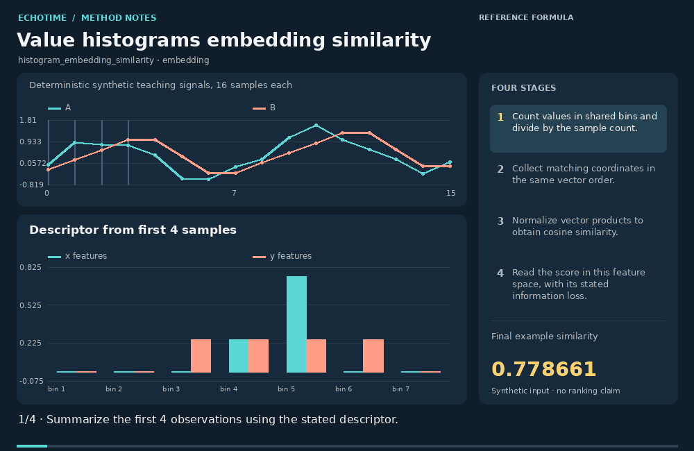

[Static image](../../src/echotime/data/method_animations/media/histogram_embedding_similarity.png) · [Inputs and full calculation trace](../../src/echotime/data/method_animations/traces/histogram_embedding_similarity.json) · [Open in the website](https://zipengwu.me/EchoTime/guide/methods.html#animation-histogram_embedding_similarity)

Count observations in seven shared, fixed value intervals and divide by the sample count. The two probability vectors describe how often values occur. Shared edges make the coordinates comparable; all temporal ordering is intentionally removed. Cosine compares vector direction and is defined here for nonzero feature vectors.

在七个共享、固定的数值区间中计数，再除以样本数。两个概率向量描述数值出现的频率。共享边界保证坐标可比较，同时有意舍弃全部时间顺序。 余弦比较向量方向，本例特征向量均非零。

### Calculation / 计算

```text
s(x,y) = dot(phi(x),phi(y)) / (norm(phi(x))*norm(phi(y)))
```

1. Use identical bin edges for both inputs and normalize counts into bin probabilities.
   对两条序列使用相同分箱边界，将计数归一化为概率。
2. Collect the computed coordinates in the same fixed order for both inputs.
   把计算得到的坐标按同一个固定顺序组成两个向量。
3. Normalize by both vector lengths and sum coordinate products to obtain cosine similarity.
   用两个向量的长度归一化坐标乘积之和，得到余弦相似度。
4. Interpret the score in this representation, accounting for the information it discards.
   结合表示所舍弃的信息，在该表示空间中解释分数。

**Example similarity:** `0.77866111`. Computed from the explicitly defined illustrative encoder; no learned weights.

**Parameters:**

```json
{
  "edges": [
    -1.5,
    -1.0,
    -0.5,
    0.0,
    0.5,
    1.0,
    1.5,
    2.0
  ],
  "normalization": "probability mass, not density",
  "comparison": "cosine"
}
```

### Interpretation and limits / 解释与边界

- Separate automatic binning can make coordinate-wise comparison invalid; the edges must be shared. 分别自动分箱可能导致坐标不可比，因此必须共享边界。
- Values within one bin are indistinguishable, and permuted sequences have identical histograms. 同一区间内的数值无法区分，重排序列也具有相同直方图。
- Cosine ignores positive rescaling of the entire feature vector; 1-cosine is generally not a metric, and zero vectors require an explicit policy. 余弦忽略整个特征向量的正比例缩放；1-cosine 通常不满足度量公理，零向量还需明确处理规则。

### Definition sources / 定义来源

- [NumPy: histogram bins and normalization](https://numpy.org/doc/stable/reference/generated/numpy.histogram.html)
- [Imported registry: named feature and comparison conventions](https://github.com/ZipengWu365/EchoTime/blob/main/src/echotime/data/ts_similarity_package_v2_registry.csv)
- [Exact illustrative inputs and encoder definitions](https://github.com/ZipengWu365/EchoTime/blob/main/tools/method_animation_data/feature_model_embedding.py)

<a id="periodogram_embedding_distance"></a>
## Normalized FFT-bin powers embedding distance · `periodogram_embedding_distance`

**Demonstration:** Reference-formula demonstration / 参考公式演示

**EchoTime coverage:** Low-priority addition

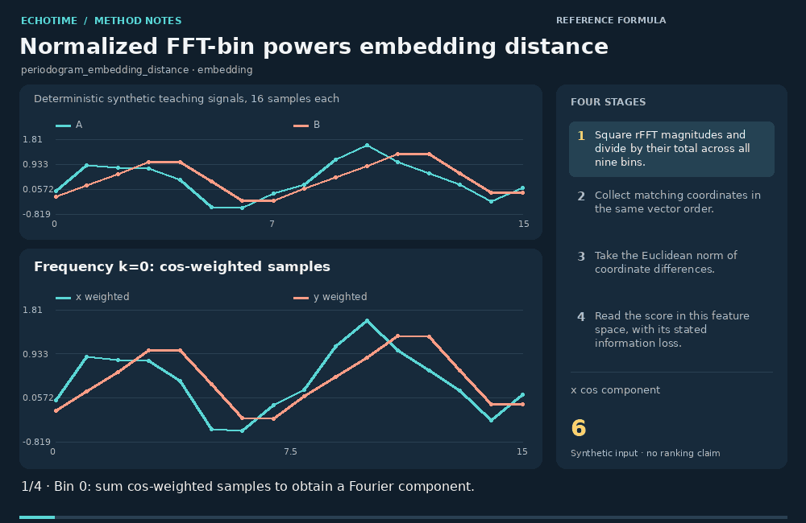

[Static image](../../src/echotime/data/method_animations/media/periodogram_embedding_distance.png) · [Inputs and full calculation trace](../../src/echotime/data/method_animations/traces/periodogram_embedding_distance.json) · [Open in the website](https://zipengwu.me/EchoTime/guide/methods.html#animation-periodogram_embedding_distance)

Square the real-FFT magnitudes and normalize their sum to one. EchoTime compares these power-share vectors with Euclidean distance. The example retains all nine bins and the mean-related DC component, so every coordinate represents a share of this particular discrete power convention. Euclidean distance retains differences in both vector scale and coordinates.

将实数 FFT 幅值平方，再除以总和得到功率占比向量。EchoTime 使用欧氏距离比较该向量。本例保留全部九个频点和与均值相关的直流项，因此每个坐标都是这一离散功率约定下的占比。 欧氏距离同时保留向量尺度与坐标差异。

### Calculation / 计算

```text
d(x,y) = sqrt(sum_j (phi_j(x)-phi_j(y))^2)
```

1. Square each rFFT magnitude, then divide by the sum over all retained nonnegative-frequency bins.
   对 rFFT 幅值逐点平方，再除以全部非负频点功率的总和。
2. Collect the computed coordinates in the same fixed order for both inputs.
   把计算得到的坐标按同一个固定顺序组成两个向量。
3. Take the Euclidean norm of the coordinate differences.
   对坐标差计算欧氏范数。
4. Interpret the score in this representation, accounting for the information it discards.
   结合表示所舍弃的信息，在该表示空间中解释分数。

**Example distance:** `0.13173288`. Computed from the explicitly defined illustrative encoder; no learned weights.

**Parameters:**

```json
{
  "n_coeffs": 9,
  "normalization": "divide rFFT squared magnitudes by their sum",
  "detrend": false,
  "one_sided_doubling": false,
  "comparison": "euclidean"
}
```

### Interpretation and limits / 解释与边界

- This is EchoTime's normalized rFFT-bin convention: no detrending, window, or one-sided interior-bin doubling. It is not a physical-density PSD estimate. 这是 EchoTime 的归一化 rFFT 频点约定：不去趋势、不加窗，也不把单边谱内部频点乘二；它不等于具有物理单位的功率谱密度估计。
- Normalization discards total power and phase; positive amplitude rescaling alone leaves this representation unchanged. 归一化舍弃总功率和相位；单纯的正振幅缩放不会改变此表示。
- A metric on these feature vectors can be only a pseudometric on the original series when the representation loses information. 当表示损失信息时，特征空间中的度量在原序列空间上可能只是伪度量。

### Definition sources / 定义来源

- [EchoTime low-level implementation](https://github.com/ZipengWu365/EchoTime/blob/main/src/echotime/similarity_methods.py)
- [NumPy: real-input discrete Fourier transform](https://numpy.org/doc/stable/reference/generated/numpy.fft.rfft.html)
- [Exact illustrative inputs and encoder definitions](https://github.com/ZipengWu365/EchoTime/blob/main/tools/method_animation_data/feature_model_embedding.py)

<a id="periodogram_embedding_similarity"></a>
## Normalized FFT-bin powers embedding similarity · `periodogram_embedding_similarity`

**Demonstration:** Reference-formula demonstration / 参考公式演示

**EchoTime coverage:** Low-priority addition

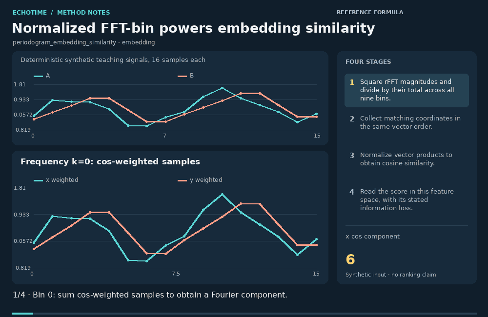

[Static image](../../src/echotime/data/method_animations/media/periodogram_embedding_similarity.png) · [Inputs and full calculation trace](../../src/echotime/data/method_animations/traces/periodogram_embedding_similarity.json) · [Open in the website](https://zipengwu.me/EchoTime/guide/methods.html#animation-periodogram_embedding_similarity)

Square the real-FFT magnitudes and normalize their sum to one. EchoTime compares these power-share vectors with Euclidean distance. The example retains all nine bins and the mean-related DC component, so every coordinate represents a share of this particular discrete power convention. Cosine compares vector direction and is defined here for nonzero feature vectors.

将实数 FFT 幅值平方，再除以总和得到功率占比向量。EchoTime 使用欧氏距离比较该向量。本例保留全部九个频点和与均值相关的直流项，因此每个坐标都是这一离散功率约定下的占比。 余弦比较向量方向，本例特征向量均非零。

### Calculation / 计算

```text
s(x,y) = dot(phi(x),phi(y)) / (norm(phi(x))*norm(phi(y)))
```

1. Square each rFFT magnitude, then divide by the sum over all retained nonnegative-frequency bins.
   对 rFFT 幅值逐点平方，再除以全部非负频点功率的总和。
2. Collect the computed coordinates in the same fixed order for both inputs.
   把计算得到的坐标按同一个固定顺序组成两个向量。
3. Normalize by both vector lengths and sum coordinate products to obtain cosine similarity.
   用两个向量的长度归一化坐标乘积之和，得到余弦相似度。
4. Interpret the score in this representation, accounting for the information it discards.
   结合表示所舍弃的信息，在该表示空间中解释分数。

**Example similarity:** `0.9816434`. Computed from the explicitly defined illustrative encoder; no learned weights.

**Parameters:**

```json
{
  "n_coeffs": 9,
  "normalization": "divide rFFT squared magnitudes by their sum",
  "detrend": false,
  "one_sided_doubling": false,
  "comparison": "cosine"
}
```

### Interpretation and limits / 解释与边界

- This is EchoTime's normalized rFFT-bin convention: no detrending, window, or one-sided interior-bin doubling. It is not a physical-density PSD estimate. 这是 EchoTime 的归一化 rFFT 频点约定：不去趋势、不加窗，也不把单边谱内部频点乘二；它不等于具有物理单位的功率谱密度估计。
- Normalization discards total power and phase; positive amplitude rescaling alone leaves this representation unchanged. 归一化舍弃总功率和相位；单纯的正振幅缩放不会改变此表示。
- Cosine ignores positive rescaling of the entire feature vector; 1-cosine is generally not a metric, and zero vectors require an explicit policy. 余弦忽略整个特征向量的正比例缩放；1-cosine 通常不满足度量公理，零向量还需明确处理规则。

### Definition sources / 定义来源

- [EchoTime low-level implementation](https://github.com/ZipengWu365/EchoTime/blob/main/src/echotime/similarity_methods.py)
- [NumPy: real-input discrete Fourier transform](https://numpy.org/doc/stable/reference/generated/numpy.fft.rfft.html)
- [Exact illustrative inputs and encoder definitions](https://github.com/ZipengWu365/EchoTime/blob/main/tools/method_animation_data/feature_model_embedding.py)

<a id="trend_embedding_distance"></a>
## Linear trend features embedding distance · `trend_embedding_distance`

**Demonstration:** Reference-formula demonstration / 参考公式演示

**EchoTime coverage:** Low-priority addition

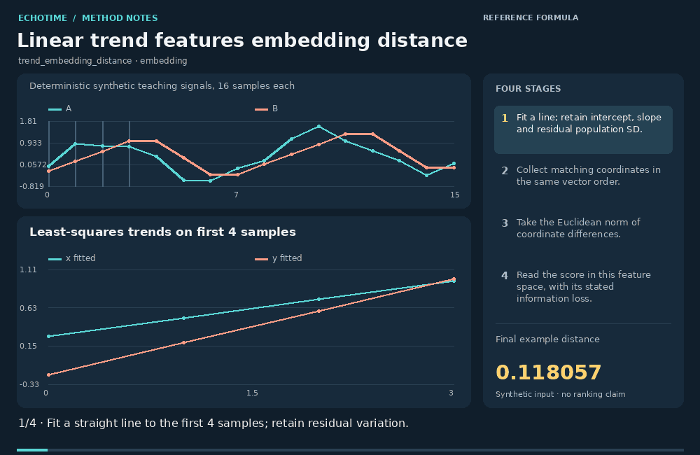

[Static image](../../src/echotime/data/method_animations/media/trend_embedding_distance.png) · [Inputs and full calculation trace](../../src/echotime/data/method_animations/traces/trend_embedding_distance.json) · [Open in the website](https://zipengwu.me/EchoTime/guide/methods.html#animation-trend_embedding_distance)

Fit an ordinary least-squares line to each series on the sample-index axis. Compare the intercept, slope and population standard deviation of residuals. This is EchoTime's three-coordinate trend description; it retains overall direction and unexplained variation while compressing local structure. Euclidean distance retains differences in both vector scale and coordinates.

以样本索引为时间轴，对每条序列拟合普通最小二乘直线，再比较截距、斜率和残差的总体标准差。这是 EchoTime 的三坐标趋势描述，保留总体方向与未解释波动，同时压缩局部结构。 欧氏距离同时保留向量尺度与坐标差异。

### Calculation / 计算

```text
d(x,y) = sqrt(sum_j (phi_j(x)-phi_j(y))^2)
```

1. Fit x_t = intercept + slope*t and append the residual population SD.
   拟合 x_t = 截距 + 斜率*t，并加入残差总体标准差。
2. Collect the computed coordinates in the same fixed order for both inputs.
   把计算得到的坐标按同一个固定顺序组成两个向量。
3. Take the Euclidean norm of the coordinate differences.
   对坐标差计算欧氏范数。
4. Interpret the score in this representation, accounting for the information it discards.
   结合表示所舍弃的信息，在该表示空间中解释分数。

**Example distance:** `0.11805668`. Computed from the explicitly defined illustrative encoder; no learned weights.

**Parameters:**

```json
{
  "time_axis": "sample index 0..15",
  "fit": "ordinary least squares",
  "residual_std_ddof": 0,
  "features": [
    "intercept",
    "slope",
    "residual_std"
  ],
  "comparison": "euclidean"
}
```

### Interpretation and limits / 解释与边界

- The slope uses sample index, so changing the sampling interval changes its interpretation; physical-time comparisons require consistent units. 斜率使用样本索引，改变采样间隔会改变其含义；按物理时间比较需要统一单位。
- Intercept, slope and residual SD have different scales. Curved trends and different residual patterns can share the same vector. 截距、斜率与残差标准差尺度不同；弯曲趋势或不同残差结构可能共享同一向量。
- A metric on these feature vectors can be only a pseudometric on the original series when the representation loses information. 当表示损失信息时，特征空间中的度量在原序列空间上可能只是伪度量。

### Definition sources / 定义来源

- [EchoTime low-level implementation](https://github.com/ZipengWu365/EchoTime/blob/main/src/echotime/similarity_methods.py)
- [Exact illustrative inputs and encoder definitions](https://github.com/ZipengWu365/EchoTime/blob/main/tools/method_animation_data/feature_model_embedding.py)

<a id="trend_embedding_similarity"></a>
## Linear trend features embedding similarity · `trend_embedding_similarity`

**Demonstration:** Reference-formula demonstration / 参考公式演示

**EchoTime coverage:** Low-priority addition

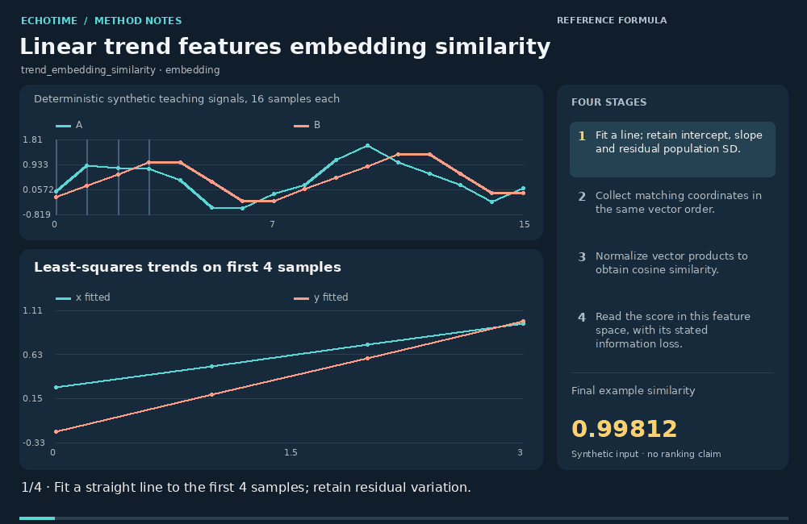

[Static image](../../src/echotime/data/method_animations/media/trend_embedding_similarity.png) · [Inputs and full calculation trace](../../src/echotime/data/method_animations/traces/trend_embedding_similarity.json) · [Open in the website](https://zipengwu.me/EchoTime/guide/methods.html#animation-trend_embedding_similarity)

Fit an ordinary least-squares line to each series on the sample-index axis. Compare the intercept, slope and population standard deviation of residuals. This is EchoTime's three-coordinate trend description; it retains overall direction and unexplained variation while compressing local structure. Cosine compares vector direction and is defined here for nonzero feature vectors.

以样本索引为时间轴，对每条序列拟合普通最小二乘直线，再比较截距、斜率和残差的总体标准差。这是 EchoTime 的三坐标趋势描述，保留总体方向与未解释波动，同时压缩局部结构。 余弦比较向量方向，本例特征向量均非零。

### Calculation / 计算

```text
s(x,y) = dot(phi(x),phi(y)) / (norm(phi(x))*norm(phi(y)))
```

1. Fit x_t = intercept + slope*t and append the residual population SD.
   拟合 x_t = 截距 + 斜率*t，并加入残差总体标准差。
2. Collect the computed coordinates in the same fixed order for both inputs.
   把计算得到的坐标按同一个固定顺序组成两个向量。
3. Normalize by both vector lengths and sum coordinate products to obtain cosine similarity.
   用两个向量的长度归一化坐标乘积之和，得到余弦相似度。
4. Interpret the score in this representation, accounting for the information it discards.
   结合表示所舍弃的信息，在该表示空间中解释分数。

**Example similarity:** `0.99811962`. Computed from the explicitly defined illustrative encoder; no learned weights.

**Parameters:**

```json
{
  "time_axis": "sample index 0..15",
  "fit": "ordinary least squares",
  "residual_std_ddof": 0,
  "features": [
    "intercept",
    "slope",
    "residual_std"
  ],
  "comparison": "cosine"
}
```

### Interpretation and limits / 解释与边界

- The slope uses sample index, so changing the sampling interval changes its interpretation; physical-time comparisons require consistent units. 斜率使用样本索引，改变采样间隔会改变其含义；按物理时间比较需要统一单位。
- Intercept, slope and residual SD have different scales. Curved trends and different residual patterns can share the same vector. 截距、斜率与残差标准差尺度不同；弯曲趋势或不同残差结构可能共享同一向量。
- Cosine ignores positive rescaling of the entire feature vector; 1-cosine is generally not a metric, and zero vectors require an explicit policy. 余弦忽略整个特征向量的正比例缩放；1-cosine 通常不满足度量公理，零向量还需明确处理规则。

### Definition sources / 定义来源

- [EchoTime low-level implementation](https://github.com/ZipengWu365/EchoTime/blob/main/src/echotime/similarity_methods.py)
- [Exact illustrative inputs and encoder definitions](https://github.com/ZipengWu365/EchoTime/blob/main/tools/method_animation_data/feature_model_embedding.py)

<a id="random_projection_embedding_distance"></a>
## Fixed Gaussian projection embedding distance · `random_projection_embedding_distance`

**Demonstration:** Reference-formula demonstration / 参考公式演示

**EchoTime coverage:** Low-priority addition

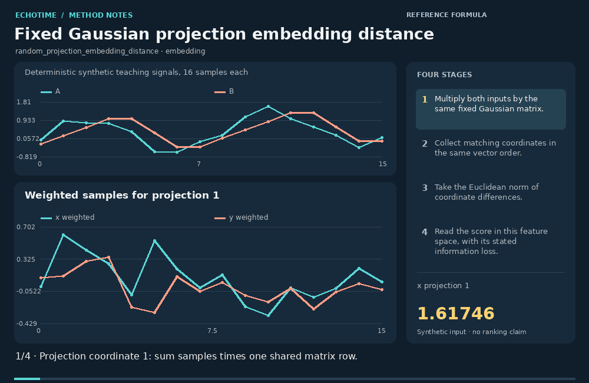

[Static image](../../src/echotime/data/method_animations/media/random_projection_embedding_distance.png) · [Inputs and full calculation trace](../../src/echotime/data/method_animations/traces/random_projection_embedding_distance.json) · [Open in the website](https://zipengwu.me/EchoTime/guide/methods.html#animation-random_projection_embedding_distance)

Multiply both 16-coordinate inputs by the same six-by-16 Gaussian matrix. Each output coordinate is a weighted sum of all observations. The matrix is fixed by an explicit random seed, allowing the comparison to be reproduced without fitting a neural encoder. Euclidean distance retains differences in both vector scale and coordinates.

将两个 16 维输入乘以同一个六乘十六高斯矩阵。每个输出坐标都是全部观测的加权和。矩阵由明确的随机种子固定，因此无需拟合神经编码器也可复现比较。 欧氏距离同时保留向量尺度与坐标差异。

### Calculation / 计算

```text
d(x,y) = sqrt(sum_j (phi_j(x)-phi_j(y))^2)
```

1. Use the same fixed matrix with entries N(0,1/6) to project both inputs to six dimensions.
   使用同一个元素分布为 N(0,1/6) 的固定矩阵，把两条输入投影到六维。
2. Collect the computed coordinates in the same fixed order for both inputs.
   把计算得到的坐标按同一个固定顺序组成两个向量。
3. Take the Euclidean norm of the coordinate differences.
   对坐标差计算欧氏范数。
4. Interpret the score in this representation, accounting for the information it discards.
   结合表示所舍弃的信息，在该表示空间中解释分数。

**Example distance:** `2.1747811`. Computed from the explicitly defined illustrative encoder; no learned weights.

**Parameters:**

```json
{
  "seed": 20261029,
  "matrix_shape": [
    6,
    16
  ],
  "entry_variance": 0.16666666666666666,
  "matrix": [
    [
      -0.5194508388046408,
      0.6925531409100528,
      0.5276738178253589,
      0.3421103162417348,
      -0.24189739800758292,
      -0.9318042670330671,
      -0.34699445019019953,
      0.14895157038933,
      0.6577606001663231,
      -0.21587247502476686,
      -0.2105641686898666,
      -0.015183263110597449,
      -0.20443004209346777,
      -0.10526240498773033,
      -0.5486230062454652,
      0.4718299455848165
    ],
    [
      0.2327057158176952,
      0.6454625109247026,
      -0.12318259251046923,
      0.25288704457474365,
      0.5299530066457878,
      0.14748919107826164,
      -0.5529611921267462,
      -0.7973348966527448,
      -0.08858696791282737,
      0.3087051680423722,
      -0.007836755555181388,
      0.019690312134448135,
      0.006657913594121614,
      0.3019453761132193,
      -0.19151184428095228,
      -0.13148287000823003
    ],
    [
      0.21955486202821017,
      0.48781296520432166,
      0.07854972933328519,
      0.02919957197589381,
      0.6884227119244153,
      -0.09857667067434531,
      -0.5437985569677152,
      -0.4491742559455326,
      0.08120241246922642,
      0.3630345341848169,
      0.30908359446022704,
      -0.7365370367941714,
      0.15527484782427062,
      -0.4016272660891914,
      -0.12859587242424278,
      -0.5582775404109902
    ],
    [
      -0.44441214068371343,
      -0.6466959020726512,
      -0.08407162511751691,
      0.03746271400150741,
      0.6884879939914507,
      0.22936749259862166,
      -0.019760913537307537,
      0.2904130430090459,
      0.15322119753002061,
      -0.225364493051222,
      0.49494073969284363,
      -0.2821395369092543,
      0.41034750400122044,
      -0.16927341099846036,
      -0.07673290479639887,
      0.12944873559450343
    ],
    [
      -0.51820184901937,
      -0.25613690547027307,
      0.6864569705061614,
      0.11672156402718992,
      0.12811765966664293,
      0.4888237591453126,
      0.6243619724292387,
      0.10779096348337862,
      -0.24638569673590888,
      0.35934223480128535,
      0.31266069712623906,
      0.42222017603534623,
      -0.42806978292645914,
      0.6200435544376961,
      -0.32300884834046717,
      0.31090852239967715
    ],
    [
      -1.0255688097145366,
      0.006464660794459475,
      0.037491746873668665,
      -0.2758645415506253,
      -0.17787689637825516,
      -0.1919426644991183,
      -0.23769543055234207,
      -0.16238956597387602,
      0.05048832099679738,
      -0.24592874184414845,
      0.007701695534513878,
      0.07873697208976303,
      -0.4160840825154048,
      0.5885124515203,
      0.18272399200616546,
      0.17656027328524054
    ]
  ],
  "comparison": "euclidean"
}
```

### Interpretation and limits / 解释与边界

- The six-dimensional example has no asserted distortion guarantee. Johnson-Lindenstrauss guarantees require dimensions and probability assumptions tied to a finite point set. 本例六维投影不声称满足给定失真保证。Johnson-Lindenstrauss 保证需要维数、概率与有限样本集等条件。
- Changing the random seed changes the representation; a shared matrix and identical input length/order are essential. 改变随机种子会改变表示；必须共享矩阵并保持输入长度及顺序一致。
- A metric on these feature vectors can be only a pseudometric on the original series when the representation loses information. 当表示损失信息时，特征空间中的度量在原序列空间上可能只是伪度量。

### Definition sources / 定义来源

- [scikit-learn: Gaussian random projection](https://scikit-learn.org/stable/modules/random_projection.html)
- [Exact illustrative inputs and encoder definitions](https://github.com/ZipengWu365/EchoTime/blob/main/tools/method_animation_data/feature_model_embedding.py)

<a id="random_projection_embedding_similarity"></a>
## Fixed Gaussian projection embedding similarity · `random_projection_embedding_similarity`

**Demonstration:** Reference-formula demonstration / 参考公式演示

**EchoTime coverage:** Low-priority addition


[Static image](../../src/echotime/data/method_animations/media/random_projection_embedding_similarity.png) · [Inputs and full calculation trace](../../src/echotime/data/method_animations/traces/random_projection_embedding_similarity.json) · [Open in the website](https://zipengwu.me/EchoTime/guide/methods.html#animation-random_projection_embedding_similarity)

Multiply both 16-coordinate inputs by the same six-by-16 Gaussian matrix. Each output coordinate is a weighted sum of all observations. The matrix is fixed by an explicit random seed, allowing the comparison to be reproduced without fitting a neural encoder. Cosine compares vector direction and is defined here for nonzero feature vectors.

将两个 16 维输入乘以同一个六乘十六高斯矩阵。每个输出坐标都是全部观测的加权和。矩阵由明确的随机种子固定，因此无需拟合神经编码器也可复现比较。 余弦比较向量方向，本例特征向量均非零。

### Calculation / 计算

```text
s(x,y) = dot(phi(x),phi(y)) / (norm(phi(x))*norm(phi(y)))
```

1. Use the same fixed matrix with entries N(0,1/6) to project both inputs to six dimensions.
   使用同一个元素分布为 N(0,1/6) 的固定矩阵，把两条输入投影到六维。
2. Collect the computed coordinates in the same fixed order for both inputs.
   把计算得到的坐标按同一个固定顺序组成两个向量。
3. Normalize by both vector lengths and sum coordinate products to obtain cosine similarity.
   用两个向量的长度归一化坐标乘积之和，得到余弦相似度。
4. Interpret the score in this representation, accounting for the information it discards.
   结合表示所舍弃的信息，在该表示空间中解释分数。

**Example similarity:** `0.68863331`. Computed from the explicitly defined illustrative encoder; no learned weights.

**Parameters:**

```json
{
  "seed": 20261029,
  "matrix_shape": [
    6,
    16
  ],
  "entry_variance": 0.16666666666666666,
  "matrix": [
    [
      -0.5194508388046408,
      0.6925531409100528,
      0.5276738178253589,
      0.3421103162417348,
      -0.24189739800758292,
      -0.9318042670330671,
      -0.34699445019019953,
      0.14895157038933,
      0.6577606001663231,
      -0.21587247502476686,
      -0.2105641686898666,
      -0.015183263110597449,
      -0.20443004209346777,
      -0.10526240498773033,
      -0.5486230062454652,
      0.4718299455848165
    ],
    [
      0.2327057158176952,
      0.6454625109247026,
      -0.12318259251046923,
      0.25288704457474365,
      0.5299530066457878,
      0.14748919107826164,
      -0.5529611921267462,
      -0.7973348966527448,
      -0.08858696791282737,
      0.3087051680423722,
      -0.007836755555181388,
      0.019690312134448135,
      0.006657913594121614,
      0.3019453761132193,
      -0.19151184428095228,
      -0.13148287000823003
    ],
    [
      0.21955486202821017,
      0.48781296520432166,
      0.07854972933328519,
      0.02919957197589381,
      0.6884227119244153,
      -0.09857667067434531,
      -0.5437985569677152,
      -0.4491742559455326,
      0.08120241246922642,
      0.3630345341848169,
      0.30908359446022704,
      -0.7365370367941714,
      0.15527484782427062,
      -0.4016272660891914,
      -0.12859587242424278,
      -0.5582775404109902
    ],
    [
      -0.44441214068371343,
      -0.6466959020726512,
      -0.08407162511751691,
      0.03746271400150741,
      0.6884879939914507,
      0.22936749259862166,
      -0.019760913537307537,
      0.2904130430090459,
      0.15322119753002061,
      -0.225364493051222,
      0.49494073969284363,
      -0.2821395369092543,
      0.41034750400122044,
      -0.16927341099846036,
      -0.07673290479639887,
      0.12944873559450343
    ],
    [
      -0.51820184901937,
      -0.25613690547027307,
      0.6864569705061614,
      0.11672156402718992,
      0.12811765966664293,
      0.4888237591453126,
      0.6243619724292387,
      0.10779096348337862,
      -0.24638569673590888,
      0.35934223480128535,
      0.31266069712623906,
      0.42222017603534623,
      -0.42806978292645914,
      0.6200435544376961,
      -0.32300884834046717,
      0.31090852239967715
    ],
    [
      -1.0255688097145366,
      0.006464660794459475,
      0.037491746873668665,
      -0.2758645415506253,
      -0.17787689637825516,
      -0.1919426644991183,
      -0.23769543055234207,
      -0.16238956597387602,
      0.05048832099679738,
      -0.24592874184414845,
      0.007701695534513878,
      0.07873697208976303,
      -0.4160840825154048,
      0.5885124515203,
      0.18272399200616546,
      0.17656027328524054
    ]
  ],
  "comparison": "cosine"
}
```

### Interpretation and limits / 解释与边界

- The six-dimensional example has no asserted distortion guarantee. Johnson-Lindenstrauss guarantees require dimensions and probability assumptions tied to a finite point set. 本例六维投影不声称满足给定失真保证。Johnson-Lindenstrauss 保证需要维数、概率与有限样本集等条件。
- Changing the random seed changes the representation; a shared matrix and identical input length/order are essential. 改变随机种子会改变表示；必须共享矩阵并保持输入长度及顺序一致。
- Cosine ignores positive rescaling of the entire feature vector; 1-cosine is generally not a metric, and zero vectors require an explicit policy. 余弦忽略整个特征向量的正比例缩放；1-cosine 通常不满足度量公理，零向量还需明确处理规则。

### Definition sources / 定义来源

- [scikit-learn: Gaussian random projection](https://scikit-learn.org/stable/modules/random_projection.html)
- [Exact illustrative inputs and encoder definitions](https://github.com/ZipengWu365/EchoTime/blob/main/tools/method_animation_data/feature_model_embedding.py)

<a id="identity_embedding_distance"></a>
## Identity-resample features embedding distance · `identity_embedding_distance`

**Demonstration:** Reference-formula demonstration / 参考公式演示

**EchoTime coverage:** Low-priority addition

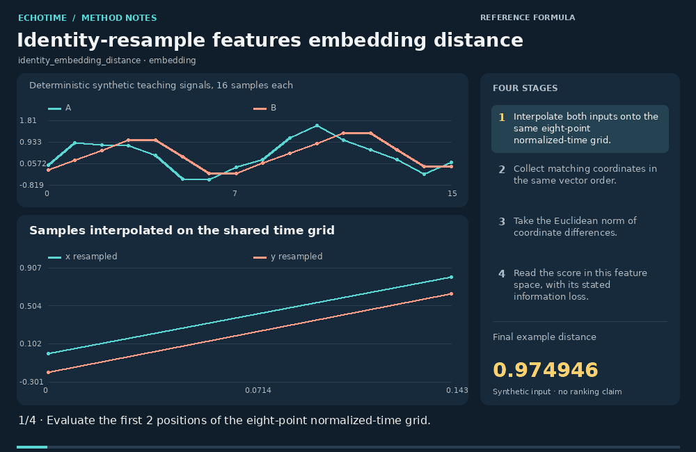

[Static image](../../src/echotime/data/method_animations/media/identity_embedding_distance.png) · [Inputs and full calculation trace](../../src/echotime/data/method_animations/traces/identity_embedding_distance.json) · [Open in the website](https://zipengwu.me/EchoTime/guide/methods.html#animation-identity_embedding_distance)

Linearly interpolate each series onto the same eight-point normalized-time grid and use the samples themselves as coordinates. This explicit identity-resample adapter aligns the representation length without learning a latent model or aligning local events. Euclidean distance retains differences in both vector scale and coordinates.

将每条序列线性插值到同一个八点归一化时间网格，直接把重采样值作为坐标。这个明确的恒等重采样适配器统一表示长度，无需学习潜在模型，也不进行局部事件对齐。 欧氏距离同时保留向量尺度与坐标差异。

### Calculation / 计算

```text
d(x,y) = sqrt(sum_j (phi_j(x)-phi_j(y))^2)
```

1. Map each span to [0,1] and linearly interpolate at eight shared grid positions.
   把各自时间跨度映射到 [0,1]，在八个共享位置进行线性插值。
2. Collect the computed coordinates in the same fixed order for both inputs.
   把计算得到的坐标按同一个固定顺序组成两个向量。
3. Take the Euclidean norm of the coordinate differences.
   对坐标差计算欧氏范数。
4. Interpret the score in this representation, accounting for the information it discards.
   结合表示所舍弃的信息，在该表示空间中解释分数。

**Example distance:** `0.9749464`. Computed from the explicitly defined illustrative encoder; no learned weights.

**Parameters:**

```json
{
  "n_points": 8,
  "interpolation": "linear",
  "grid": "independent normalized spans [0,1]",
  "comparison": "euclidean"
}
```

### Interpretation and limits / 解释与边界

- Normalizing time spans discards absolute duration unless it is retained separately. 分别归一化时间跨度会舍弃绝对持续时间，除非另行保留。
- Interpolation can miss or smooth brief events; it provides no invariance to arbitrary local timing changes. 插值可能遗漏或平滑短暂事件，也不提供任意局部时间变化下的不变性。
- A metric on these feature vectors can be only a pseudometric on the original series when the representation loses information. 当表示损失信息时，特征空间中的度量在原序列空间上可能只是伪度量。

### Definition sources / 定义来源

- [Imported registry: named feature and comparison conventions](https://github.com/ZipengWu365/EchoTime/blob/main/src/echotime/data/ts_similarity_package_v2_registry.csv)
- [NumPy: one-dimensional linear interpolation](https://numpy.org/doc/stable/reference/generated/numpy.interp.html)
- [Exact illustrative inputs and encoder definitions](https://github.com/ZipengWu365/EchoTime/blob/main/tools/method_animation_data/feature_model_embedding.py)

<a id="identity_embedding_similarity"></a>
## Identity-resample features embedding similarity · `identity_embedding_similarity`

**Demonstration:** Reference-formula demonstration / 参考公式演示

**EchoTime coverage:** Low-priority addition

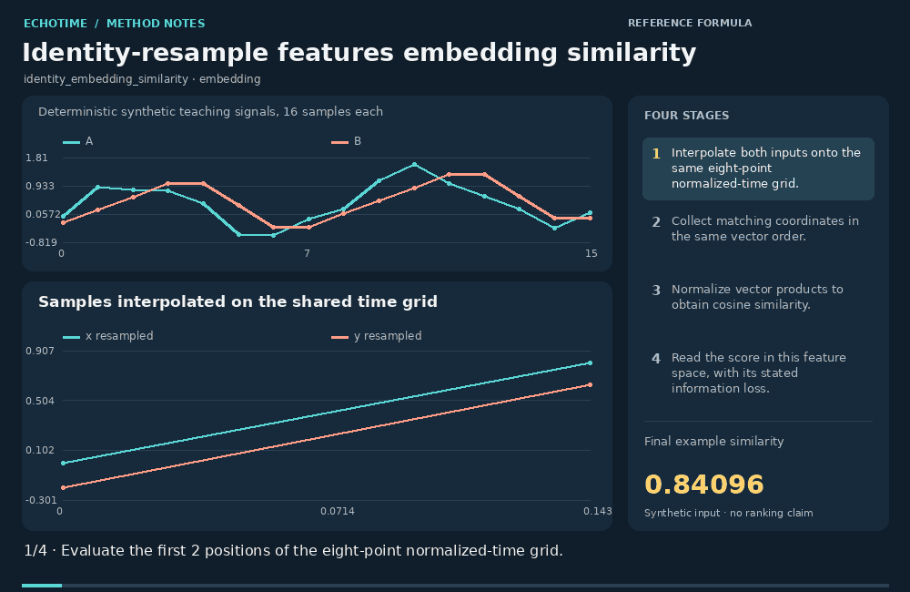

[Static image](../../src/echotime/data/method_animations/media/identity_embedding_similarity.png) · [Inputs and full calculation trace](../../src/echotime/data/method_animations/traces/identity_embedding_similarity.json) · [Open in the website](https://zipengwu.me/EchoTime/guide/methods.html#animation-identity_embedding_similarity)

Linearly interpolate each series onto the same eight-point normalized-time grid and use the samples themselves as coordinates. This explicit identity-resample adapter aligns the representation length without learning a latent model or aligning local events. Cosine compares vector direction and is defined here for nonzero feature vectors.

将每条序列线性插值到同一个八点归一化时间网格，直接把重采样值作为坐标。这个明确的恒等重采样适配器统一表示长度，无需学习潜在模型，也不进行局部事件对齐。 余弦比较向量方向，本例特征向量均非零。

### Calculation / 计算

```text
s(x,y) = dot(phi(x),phi(y)) / (norm(phi(x))*norm(phi(y)))
```

1. Map each span to [0,1] and linearly interpolate at eight shared grid positions.
   把各自时间跨度映射到 [0,1]，在八个共享位置进行线性插值。
2. Collect the computed coordinates in the same fixed order for both inputs.
   把计算得到的坐标按同一个固定顺序组成两个向量。
3. Normalize by both vector lengths and sum coordinate products to obtain cosine similarity.
   用两个向量的长度归一化坐标乘积之和，得到余弦相似度。
4. Interpret the score in this representation, accounting for the information it discards.
   结合表示所舍弃的信息，在该表示空间中解释分数。

**Example similarity:** `0.84096008`. Computed from the explicitly defined illustrative encoder; no learned weights.

**Parameters:**

```json
{
  "n_points": 8,
  "interpolation": "linear",
  "grid": "independent normalized spans [0,1]",
  "comparison": "cosine"
}
```

### Interpretation and limits / 解释与边界

- Normalizing time spans discards absolute duration unless it is retained separately. 分别归一化时间跨度会舍弃绝对持续时间，除非另行保留。
- Interpolation can miss or smooth brief events; it provides no invariance to arbitrary local timing changes. 插值可能遗漏或平滑短暂事件，也不提供任意局部时间变化下的不变性。
- Cosine ignores positive rescaling of the entire feature vector; 1-cosine is generally not a metric, and zero vectors require an explicit policy. 余弦忽略整个特征向量的正比例缩放；1-cosine 通常不满足度量公理，零向量还需明确处理规则。

### Definition sources / 定义来源

- [Imported registry: named feature and comparison conventions](https://github.com/ZipengWu365/EchoTime/blob/main/src/echotime/data/ts_similarity_package_v2_registry.csv)
- [NumPy: one-dimensional linear interpolation](https://numpy.org/doc/stable/reference/generated/numpy.interp.html)
- [Exact illustrative inputs and encoder definitions](https://github.com/ZipengWu365/EchoTime/blob/main/tools/method_animation_data/feature_model_embedding.py)
