# Explicit features / 显式特征

[All animation families](README.md) · [Existing web Methods Atlas](https://zipengwu.me/EchoTime/guide/methods.html#method-animations)

The values below belong to the documented synthetic example. Animation coverage and EchoTime API coverage are separate.

- [Basic statistics distance](#stats_distance)
- [Robust statistics distance](#robust_stats_distance)
- [Autocorrelation features distance](#acf_distance)
- [Fourier-magnitude cosine similarity](#spectral_cosine_similarity)
- [Fourier-magnitude cosine distance](#spectral_distance)
- [Normalized FFT-bin powers distance](#periodogram_distance)
- [PAA block means distance](#paa_distance)
- [Full Haar coefficient distance](#dwt_distance)
- [Value histograms distance](#histogram_distance)
- [Permutation-entropy distance](#permutation_entropy_distance)
- [Ordinal-pattern JS distance](#ordinal_pattern_js_distance)
- [Linear trend features distance](#trend_distance)
- [SAX Hamming distance](#sax_hamming_distance)
- [SAX MINDIST lower bound](#sax_mindist)
- [Bag-of-patterns cosine similarity](#bag_of_patterns_cosine_similarity)
- [Bag-of-patterns cosine distance](#bag_of_patterns_distance)
- [Independent-channel basic statistics distance](#independent_stats_distance)
- [Independent-channel paa block means distance](#independent_paa_distance)

<a id="stats_distance"></a>
## Basic statistics distance · `stats_distance`

**Demonstration:** Reference-formula demonstration / 参考公式演示

**EchoTime coverage:** Possible addition

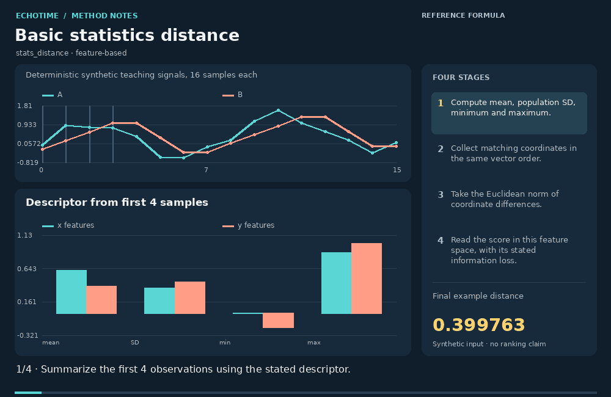

[Static image](../../src/echotime/data/method_animations/media/stats_distance.png) · [Inputs and full calculation trace](../../src/echotime/data/method_animations/traces/stats_distance.json) · [Open in the website](https://zipengwu.me/EchoTime/guide/methods.html#animation-stats_distance)

Represent each series by its mean, population standard deviation, minimum and maximum. These four coordinates summarize level, spread and range; their order in the vector is fixed, while the original temporal order is discarded. Euclidean distance retains differences in both vector scale and coordinates.

把每条序列表示为均值、总体标准差、最小值和最大值四个坐标。它们概括水平、波动和范围，坐标顺序固定，但原始时间顺序被舍弃。 欧氏距离同时保留向量尺度与坐标差异。

### Calculation / 计算

```text
d(x,y) = sqrt(sum_j (phi_j(x)-phi_j(y))^2)
```

1. Compute mean, population SD, minimum and maximum in that order.
   按均值、总体标准差、最小值、最大值的顺序提取特征。
2. Collect the computed coordinates in the same fixed order for both inputs.
   把计算得到的坐标按同一个固定顺序组成两个向量。
3. Take the Euclidean norm of the coordinate differences.
   对坐标差计算欧氏范数。
4. Interpret the score in this representation, accounting for the information it discards.
   结合表示所舍弃的信息，在该表示空间中解释分数。

**Example distance:** `0.3997628`. Computed from the explicitly defined illustrative encoder; no learned weights.

**Parameters:**

```json
{
  "features": [
    "mean",
    "std_ddof0",
    "min",
    "max"
  ],
  "coordinate_scaling": "none",
  "comparison": "euclidean"
}
```

### Interpretation and limits / 解释与边界

- Permuting observations leaves this vector unchanged, even when temporal behavior changes completely. 任意重排序列不会改变该向量，即使时间行为发生显著变化。
- Features have different scales; this example uses no coordinate weighting. A production scaler must be fitted without test-data leakage. 各坐标尺度不同；本例不加权。实际使用的缩放器应避免测试数据泄漏。
- A metric on these feature vectors can be only a pseudometric on the original series when the representation loses information. 当表示损失信息时，特征空间中的度量在原序列空间上可能只是伪度量。

### Definition sources / 定义来源

- [NumPy: summary-statistic definitions](https://numpy.org/doc/stable/reference/routines.statistics.html)
- [Imported registry: named feature and comparison conventions](https://github.com/ZipengWu365/EchoTime/blob/main/src/echotime/data/ts_similarity_package_v2_registry.csv)
- [Exact illustrative inputs and encoder definitions](https://github.com/ZipengWu365/EchoTime/blob/main/tools/method_animation_data/feature_model_embedding.py)

<a id="robust_stats_distance"></a>
## Robust statistics distance · `robust_stats_distance`

**Demonstration:** Reference-formula demonstration / 参考公式演示

**EchoTime coverage:** Possible addition

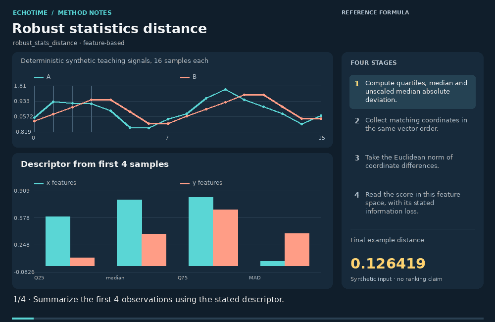

[Static image](../../src/echotime/data/method_animations/media/robust_stats_distance.png) · [Inputs and full calculation trace](../../src/echotime/data/method_animations/traces/robust_stats_distance.json) · [Open in the website](https://zipengwu.me/EchoTime/guide/methods.html#animation-robust_stats_distance)

Replace extrema and moments with the lower quartile, median, upper quartile and median absolute deviation. This explicit descriptor emphasizes the central distribution and reduces the influence of isolated extreme values. It does not preserve the timing of those values. Euclidean distance retains differences in both vector scale and coordinates.

使用下四分位数、中位数、上四分位数和中位绝对偏差构成明确的描述向量。它强调分布的中心部分，降低孤立极端值的影响，同时舍弃这些数值出现的时刻。 欧氏距离同时保留向量尺度与坐标差异。

### Calculation / 计算

```text
d(x,y) = sqrt(sum_j (phi_j(x)-phi_j(y))^2)
```

1. Calculate Q25, median, Q75 and unscaled median absolute deviation.
   计算 Q25、中位数、Q75 和未经常数缩放的中位绝对偏差。
2. Collect the computed coordinates in the same fixed order for both inputs.
   把计算得到的坐标按同一个固定顺序组成两个向量。
3. Take the Euclidean norm of the coordinate differences.
   对坐标差计算欧氏范数。
4. Interpret the score in this representation, accounting for the information it discards.
   结合表示所舍弃的信息，在该表示空间中解释分数。

**Example distance:** `0.12641944`. Computed from the explicitly defined illustrative encoder; no learned weights.

**Parameters:**

```json
{
  "features": [
    "q25",
    "median",
    "q75",
    "unscaled_MAD"
  ],
  "quantile_method": "linear",
  "comparison": "euclidean"
}
```

### Interpretation and limits / 解释与边界

- Robustness concerns these particular statistics, not immunity to arbitrary contamination or distribution shift. 稳健性针对所选统计量，并不表示可抵抗任意污染或分布变化。
- Quantiles use linear interpolation and MAD is unscaled; alternative conventions produce different vectors. 本例分位数采用线性插值，MAD 不乘缩放常数；其他约定会产生不同向量。
- A metric on these feature vectors can be only a pseudometric on the original series when the representation loses information. 当表示损失信息时，特征空间中的度量在原序列空间上可能只是伪度量。

### Definition sources / 定义来源

- [NumPy: summary-statistic definitions](https://numpy.org/doc/stable/reference/routines.statistics.html)
- [Imported registry: named feature and comparison conventions](https://github.com/ZipengWu365/EchoTime/blob/main/src/echotime/data/ts_similarity_package_v2_registry.csv)
- [Exact illustrative inputs and encoder definitions](https://github.com/ZipengWu365/EchoTime/blob/main/tools/method_animation_data/feature_model_embedding.py)

<a id="acf_distance"></a>
## Autocorrelation features distance · `acf_distance`

**Demonstration:** Checked against EchoTime / 已与 EchoTime 计算核对

**EchoTime coverage:** Implemented in EchoTime · `acf_distance`

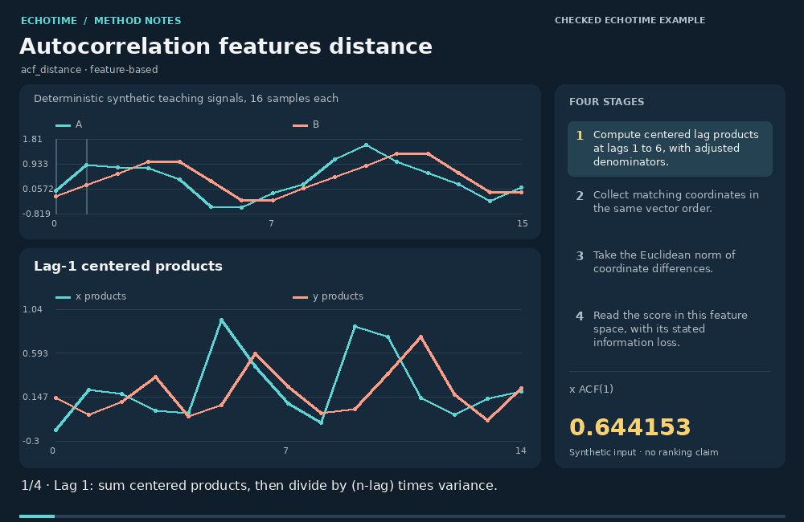

[Static image](../../src/echotime/data/method_animations/media/acf_distance.png) · [Inputs and full calculation trace](../../src/echotime/data/method_animations/traces/acf_distance.json) · [Open in the website](https://zipengwu.me/EchoTime/guide/methods.html#animation-acf_distance)

Center each series and compare it with delayed versions of itself. Six lag coordinates summarize repeated linear dependence. This example follows EchoTime's adjusted denominator, (n-lag) times the population variance, and omits the always-one lag-zero coordinate. Euclidean distance retains differences in both vector scale and coordinates.

先对序列去均值，再与自身的延迟版本比较。六个滞后坐标描述重复出现的线性依赖。本例采用 EchoTime 的调整分母，即 (n-lag) 乘总体方差，并省略恒为一的零滞后坐标。 欧氏距离同时保留向量尺度与坐标差异。

### Calculation / 计算

```text
d(x,y) = sqrt(sum_j (phi_j(x)-phi_j(y))^2)
```

1. At each lag, sum centered lagged products and divide by (n-lag) times variance.
   逐个滞后累加去均值后的乘积，除以 (n-lag) 乘方差。
2. Collect the computed coordinates in the same fixed order for both inputs.
   把计算得到的坐标按同一个固定顺序组成两个向量。
3. Take the Euclidean norm of the coordinate differences.
   对坐标差计算欧氏范数。
4. Interpret the score in this representation, accounting for the information it discards.
   结合表示所舍弃的信息，在该表示空间中解释分数。

**Example distance:** `0.36880413`. Computed from the explicitly defined illustrative encoder; no learned weights.

**Parameters:**

```json
{
  "max_lag": 6,
  "denominator": "(n-lag)*population_variance",
  "lag_zero": "omitted",
  "comparison": "euclidean"
}
```

### Interpretation and limits / 解释与边界

- Adjusted high-lag sample estimates need not remain inside [-1,1]; estimates are less reliable with fewer overlapping pairs. 经过样本数调整的高滞后估计不一定落在 [-1,1]，重叠点越少估计越不稳定。
- ACF drops the mean and amplitude scale and cannot fully identify nonlinear dependence or the original waveform. ACF 舍弃均值和振幅尺度，无法完整识别非线性依赖或恢复原波形。
- A metric on these feature vectors can be only a pseudometric on the original series when the representation loses information. 当表示损失信息时，特征空间中的度量在原序列空间上可能只是伪度量。

### Definition sources / 定义来源

- [EchoTime low-level implementation](https://github.com/ZipengWu365/EchoTime/blob/main/src/echotime/similarity_methods.py)
- [statsmodels: ACF denominator and adjusted convention](https://www.statsmodels.org/stable/generated/statsmodels.tsa.stattools.acf.html)
- [Exact illustrative inputs and encoder definitions](https://github.com/ZipengWu365/EchoTime/blob/main/tools/method_animation_data/feature_model_embedding.py)

<a id="spectral_cosine_similarity"></a>
## Fourier-magnitude cosine similarity · `spectral_cosine_similarity`

**Demonstration:** Reference-formula demonstration / 参考公式演示

**EchoTime coverage:** Conceptually covered · `spectral_similarity`

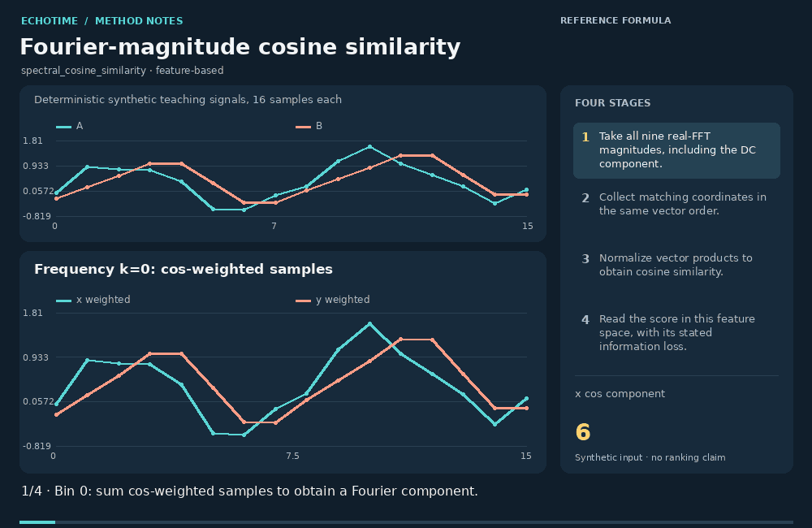

[Static image](../../src/echotime/data/method_animations/media/spectral_cosine_similarity.png) · [Inputs and full calculation trace](../../src/echotime/data/method_animations/traces/spectral_cosine_similarity.json) · [Open in the website](https://zipengwu.me/EchoTime/guide/methods.html#animation-spectral_cosine_similarity)

Project the series onto sine and cosine bases, combine the real and imaginary parts into magnitudes, and compare the resulting frequency bins. The example retains all nine nonnegative-frequency bins of a length-16 real transform, including the DC bin. Cosine compares vector direction and is defined here for nonzero feature vectors.

把序列投影到正弦、余弦基上，将实部和虚部合成为幅值，再比较频率坐标。本例保留长度 16 实数变换的全部九个非负频率坐标，包括直流分量。 余弦比较向量方向，本例特征向量均非零。

### Calculation / 计算

```text
s(x,y) = dot(phi(x),phi(y)) / (norm(phi(x))*norm(phi(y)))
```

1. Compute the unnormalized real FFT and retain the magnitude of each bin.
   计算未归一化的实数 FFT，保留各频率坐标的模。
2. Collect the computed coordinates in the same fixed order for both inputs.
   把计算得到的坐标按同一个固定顺序组成两个向量。
3. Normalize by both vector lengths and sum coordinate products to obtain cosine similarity.
   用两个向量的长度归一化坐标乘积之和，得到余弦相似度。
4. Interpret the score in this representation, accounting for the information it discards.
   结合表示所舍弃的信息，在该表示空间中解释分数。

**Example similarity:** `0.97817876`. Computed from the explicitly defined illustrative encoder; no learned weights.

**Parameters:**

```json
{
  "fft": "rfft",
  "normalization": "backward",
  "n_bins": 9,
  "include_DC": true,
  "comparison": "cosine"
}
```

### Interpretation and limits / 解释与边界

- Magnitude discards phase; a circular shift changes Fourier phase while preserving these magnitudes. 幅值表示舍弃相位；循环平移改变傅里叶相位，却保留这些幅值。
- The DC coordinate reflects the mean, and raw magnitudes depend on record length and amplitude. Matching sampling rates and frequency grids is required. 直流坐标反映均值，原始幅值依赖记录长度与振幅；比较时需要一致的采样率和频率网格。
- This example compares unweighted nonnegative-frequency rFFT magnitudes. Comparing a full FFT, or weighting interior rFFT magnitudes by sqrt(2), gives a different distance/cosine convention. 本例比较未加权的非负频率 rFFT 幅值。比较完整 FFT 或将内部 rFFT 幅值乘 sqrt(2)，对应不同的距离与余弦约定。
- Cosine ignores positive rescaling of the entire feature vector; 1-cosine is generally not a metric, and zero vectors require an explicit policy. 余弦忽略整个特征向量的正比例缩放；1-cosine 通常不满足度量公理，零向量还需明确处理规则。

### Definition sources / 定义来源

- [NumPy: real-input discrete Fourier transform](https://numpy.org/doc/stable/reference/generated/numpy.fft.rfft.html)
- [Imported registry: named feature and comparison conventions](https://github.com/ZipengWu365/EchoTime/blob/main/src/echotime/data/ts_similarity_package_v2_registry.csv)
- [Exact illustrative inputs and encoder definitions](https://github.com/ZipengWu365/EchoTime/blob/main/tools/method_animation_data/feature_model_embedding.py)

<a id="spectral_distance"></a>
## Fourier-magnitude cosine distance · `spectral_distance`

**Demonstration:** Reference-formula demonstration / 参考公式演示

**EchoTime coverage:** Possible addition

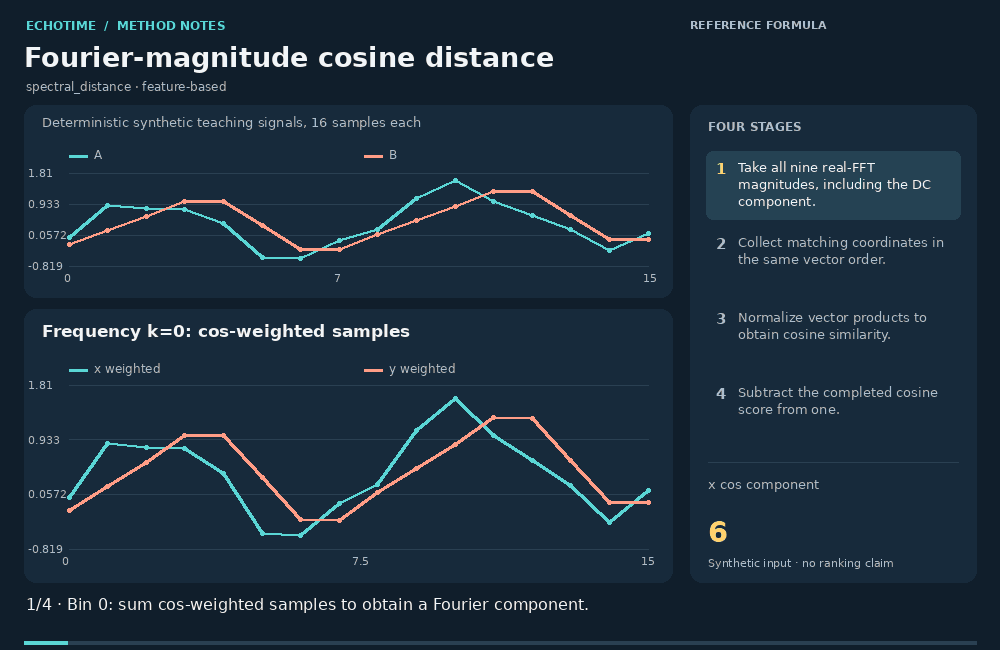

[Static image](../../src/echotime/data/method_animations/media/spectral_distance.png) · [Inputs and full calculation trace](../../src/echotime/data/method_animations/traces/spectral_distance.json) · [Open in the website](https://zipengwu.me/EchoTime/guide/methods.html#animation-spectral_distance)

Project the series onto sine and cosine bases, combine the real and imaginary parts into magnitudes, and compare the resulting frequency bins. The example retains all nine nonnegative-frequency bins of a length-16 real transform, including the DC bin. Cosine compares vector direction and is defined here for nonzero feature vectors.

把序列投影到正弦、余弦基上，将实部和虚部合成为幅值，再比较频率坐标。本例保留长度 16 实数变换的全部九个非负频率坐标，包括直流分量。 余弦比较向量方向，本例特征向量均非零。

### Calculation / 计算

```text
d(x,y) = 1 - dot(phi(x),phi(y)) / (norm(phi(x))*norm(phi(y)))
```

1. Compute the unnormalized real FFT and retain the magnitude of each bin.
   计算未归一化的实数 FFT，保留各频率坐标的模。
2. Collect the computed coordinates in the same fixed order for both inputs.
   把计算得到的坐标按同一个固定顺序组成两个向量。
3. Compute cosine similarity, then subtract it from one.
   计算余弦相似度，再用一减去该分数。
4. Interpret the score in this representation, accounting for the information it discards.
   结合表示所舍弃的信息，在该表示空间中解释分数。

**Example distance:** `0.021821236`. Computed from the explicitly defined illustrative encoder; no learned weights.

**Parameters:**

```json
{
  "fft": "rfft",
  "normalization": "backward",
  "n_bins": 9,
  "include_DC": true,
  "comparison": "one_minus_cosine"
}
```

### Interpretation and limits / 解释与边界

- Magnitude discards phase; a circular shift changes Fourier phase while preserving these magnitudes. 幅值表示舍弃相位；循环平移改变傅里叶相位，却保留这些幅值。
- The DC coordinate reflects the mean, and raw magnitudes depend on record length and amplitude. Matching sampling rates and frequency grids is required. 直流坐标反映均值，原始幅值依赖记录长度与振幅；比较时需要一致的采样率和频率网格。
- This example compares unweighted nonnegative-frequency rFFT magnitudes. Comparing a full FFT, or weighting interior rFFT magnitudes by sqrt(2), gives a different distance/cosine convention. 本例比较未加权的非负频率 rFFT 幅值。比较完整 FFT 或将内部 rFFT 幅值乘 sqrt(2)，对应不同的距离与余弦约定。
- Cosine ignores positive rescaling of the entire feature vector; 1-cosine is generally not a metric, and zero vectors require an explicit policy. 余弦忽略整个特征向量的正比例缩放；1-cosine 通常不满足度量公理，零向量还需明确处理规则。

### Definition sources / 定义来源

- [NumPy: real-input discrete Fourier transform](https://numpy.org/doc/stable/reference/generated/numpy.fft.rfft.html)
- [Imported registry: named feature and comparison conventions](https://github.com/ZipengWu365/EchoTime/blob/main/src/echotime/data/ts_similarity_package_v2_registry.csv)
- [Exact illustrative inputs and encoder definitions](https://github.com/ZipengWu365/EchoTime/blob/main/tools/method_animation_data/feature_model_embedding.py)

<a id="periodogram_distance"></a>
## Normalized FFT-bin powers distance · `periodogram_distance`

**Demonstration:** Checked against EchoTime / 已与 EchoTime 计算核对

**EchoTime coverage:** Implemented in EchoTime · `periodogram_distance`

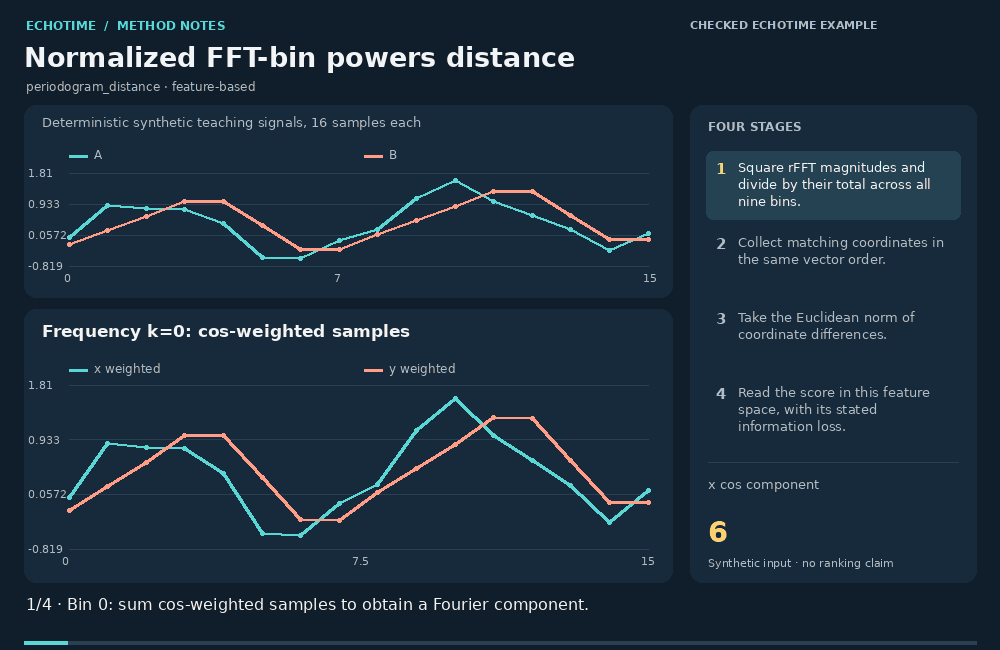

[Static image](../../src/echotime/data/method_animations/media/periodogram_distance.png) · [Inputs and full calculation trace](../../src/echotime/data/method_animations/traces/periodogram_distance.json) · [Open in the website](https://zipengwu.me/EchoTime/guide/methods.html#animation-periodogram_distance)

Square the real-FFT magnitudes and normalize their sum to one. EchoTime compares these power-share vectors with Euclidean distance. The example retains all nine bins and the mean-related DC component, so every coordinate represents a share of this particular discrete power convention. Euclidean distance retains differences in both vector scale and coordinates.

将实数 FFT 幅值平方，再除以总和得到功率占比向量。EchoTime 使用欧氏距离比较该向量。本例保留全部九个频点和与均值相关的直流项，因此每个坐标都是这一离散功率约定下的占比。 欧氏距离同时保留向量尺度与坐标差异。

### Calculation / 计算

```text
d(x,y) = sqrt(sum_j (phi_j(x)-phi_j(y))^2)
```

1. Square each rFFT magnitude, then divide by the sum over all retained nonnegative-frequency bins.
   对 rFFT 幅值逐点平方，再除以全部非负频点功率的总和。
2. Collect the computed coordinates in the same fixed order for both inputs.
   把计算得到的坐标按同一个固定顺序组成两个向量。
3. Take the Euclidean norm of the coordinate differences.
   对坐标差计算欧氏范数。
4. Interpret the score in this representation, accounting for the information it discards.
   结合表示所舍弃的信息，在该表示空间中解释分数。

**Example distance:** `0.13173288`. Computed from the explicitly defined illustrative encoder; no learned weights.

**Parameters:**

```json
{
  "n_coeffs": 9,
  "normalization": "divide rFFT squared magnitudes by their sum",
  "detrend": false,
  "one_sided_doubling": false,
  "comparison": "euclidean"
}
```

### Interpretation and limits / 解释与边界

- This is EchoTime's normalized rFFT-bin convention: no detrending, window, or one-sided interior-bin doubling. It is not a physical-density PSD estimate. 这是 EchoTime 的归一化 rFFT 频点约定：不去趋势、不加窗，也不把单边谱内部频点乘二；它不等于具有物理单位的功率谱密度估计。
- Normalization discards total power and phase; positive amplitude rescaling alone leaves this representation unchanged. 归一化舍弃总功率和相位；单纯的正振幅缩放不会改变此表示。
- A metric on these feature vectors can be only a pseudometric on the original series when the representation loses information. 当表示损失信息时，特征空间中的度量在原序列空间上可能只是伪度量。

### Definition sources / 定义来源

- [EchoTime low-level implementation](https://github.com/ZipengWu365/EchoTime/blob/main/src/echotime/similarity_methods.py)
- [NumPy: real-input discrete Fourier transform](https://numpy.org/doc/stable/reference/generated/numpy.fft.rfft.html)
- [Exact illustrative inputs and encoder definitions](https://github.com/ZipengWu365/EchoTime/blob/main/tools/method_animation_data/feature_model_embedding.py)

<a id="paa_distance"></a>
## PAA block means distance · `paa_distance`

**Demonstration:** Reference-formula demonstration / 参考公式演示

**EchoTime coverage:** Possible addition

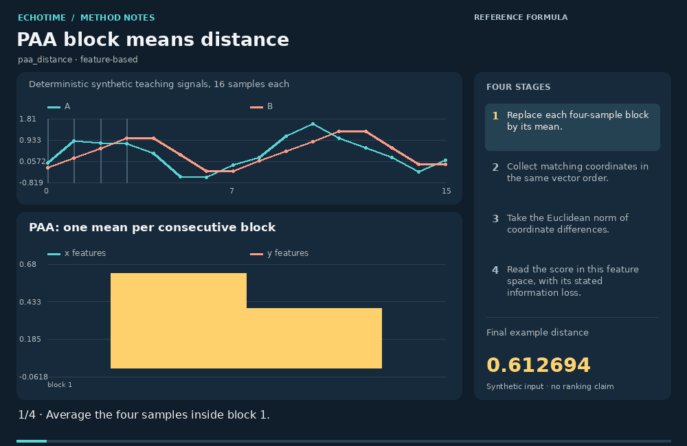

[Static image](../../src/echotime/data/method_animations/media/paa_distance.png) · [Inputs and full calculation trace](../../src/echotime/data/method_animations/traces/paa_distance.json) · [Open in the website](https://zipengwu.me/EchoTime/guide/methods.html#animation-paa_distance)

Split the 16 observations into four equal, consecutive blocks and replace each block by its mean. Comparing these ordered block averages emphasizes coarse temporal structure. The animation highlights the exact observations contributing to each coordinate. Euclidean distance retains differences in both vector scale and coordinates.

把 16 个观测分成四个连续等长区间，每个区间用均值表示。比较这些有序均值可突出较粗的时间结构；动图逐块高亮每个坐标所使用的观测。 欧氏距离同时保留向量尺度与坐标差异。

### Calculation / 计算

```text
d(x,y) = sqrt(sum_j (phi_j(x)-phi_j(y))^2)
```

1. Average each consecutive block of four observations to obtain four coordinates.
   每四个连续观测求一次均值，得到四个坐标。
2. Collect the computed coordinates in the same fixed order for both inputs.
   把计算得到的坐标按同一个固定顺序组成两个向量。
3. Take the Euclidean norm of the coordinate differences.
   对坐标差计算欧氏范数。
4. Interpret the score in this representation, accounting for the information it discards.
   结合表示所舍弃的信息，在该表示空间中解释分数。

**Example distance:** `0.61269408`. Computed from the explicitly defined illustrative encoder; no learned weights.

**Parameters:**

```json
{
  "n_segments": 4,
  "block_size": 4,
  "z_normalization": false,
  "distance_length_scaling": false,
  "comparison": "euclidean"
}
```

### Interpretation and limits / 解释与边界

- The displayed Euclidean feature distance is unscaled; the usual length-scaled PAA lower bound additionally multiplies it by sqrt(n/w). 图中欧氏特征距离未经长度缩放；常用 PAA 下界还需乘以 sqrt(n/w)。
- Short events within a block can cancel, and moving a block boundary can alter the representation. 区间内的短暂事件可能互相抵消，改变分段边界也会改变表示。
- A metric on these feature vectors can be only a pseudometric on the original series when the representation loses information. 当表示损失信息时，特征空间中的度量在原序列空间上可能只是伪度量。

### Definition sources / 定义来源

- [tslearn: piecewise aggregate approximation](https://tslearn.readthedocs.io/en/stable/gen_modules/piecewise/tslearn.piecewise.PiecewiseAggregateApproximation.html)
- [Imported registry: named feature and comparison conventions](https://github.com/ZipengWu365/EchoTime/blob/main/src/echotime/data/ts_similarity_package_v2_registry.csv)
- [Exact illustrative inputs and encoder definitions](https://github.com/ZipengWu365/EchoTime/blob/main/tools/method_animation_data/feature_model_embedding.py)

<a id="dwt_distance"></a>
## Full Haar coefficient distance · `dwt_distance`

**Demonstration:** Reference-formula demonstration / 参考公式演示

**EchoTime coverage:** Possible addition

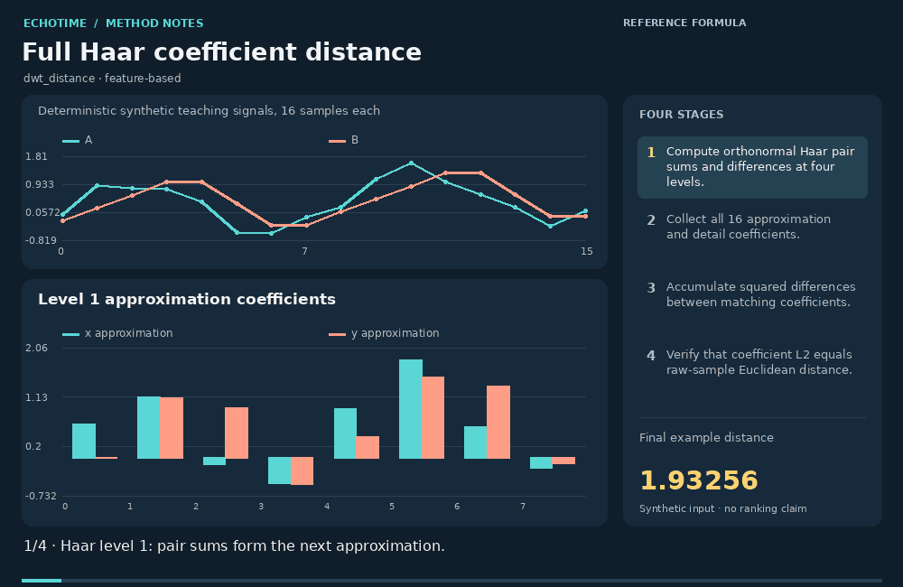

[Static image](../../src/echotime/data/method_animations/media/dwt_distance.png) · [Inputs and full calculation trace](../../src/echotime/data/method_animations/traces/dwt_distance.json) · [Open in the website](https://zipengwu.me/EchoTime/guide/methods.html#animation-dwt_distance)

Apply the complete orthonormal Haar transform and compare all coefficients. The animation separates pair averages and details across four levels. With every coefficient retained and no boundary padding, the resulting Euclidean distance equals the raw-sample Euclidean distance by norm preservation.

进行完整正交 Haar 变换并比较全部系数。动图展示四级相邻点和差分解。保留所有系数且不填充边界时，由范数保持性质，系数的欧氏距离等于原始样本的欧氏距离。

### Calculation / 计算

```text
d = ||W_Haar x - W_Haar y||_2 = ||x-y||_2 (complete orthonormal transform)
```

1. Use equal-length inputs of length 16, so Haar pairs need no padding.
   使用长度均为 16 的输入，因此相邻点分组无需填充。
2. Recursively form orthonormal pair sums and differences at four levels.
   递归进行四级正交归一化的相邻点和差分解。
3. Collect all 16 coefficients in [A4,D4,D3,D2,D1] order.
   按 [A4,D4,D3,D2,D1] 顺序保留全部 16 个系数。
4. Take their Euclidean distance and verify equality with raw Euclidean distance.
   计算系数欧氏距离，并核对其等于原始欧氏距离。

**Example distance:** `1.9325587`. Full-coefficient L2; raw Euclidean distance = 1.93255872199.

**Parameters:**

```json
{
  "wavelet": "orthonormal Haar",
  "length": 16,
  "retained": 16,
  "coefficient_order": "A4,D4,D3,D2,D1",
  "padding": false
}
```

### Interpretation and limits / 解释与边界

- Using all orthonormal coefficients does not by itself create a new Euclidean notion of similarity. 保留全部正交系数本身不会产生新的欧氏相似性定义。
- Truncating coefficients, weighting scales or changing boundary conventions changes this equivalence. 截断系数、对尺度加权或改变边界约定都会改变上述等价关系。

### Definition sources / 定义来源

- [PyWavelets: Haar approximation and detail coefficients](https://pywavelets.readthedocs.io/en/latest/ref/dwt-discrete-wavelet-transform.html)
- [Imported registry: named feature and comparison conventions](https://github.com/ZipengWu365/EchoTime/blob/main/src/echotime/data/ts_similarity_package_v2_registry.csv)
- [Exact illustrative inputs and encoder definitions](https://github.com/ZipengWu365/EchoTime/blob/main/tools/method_animation_data/feature_model_embedding.py)

<a id="histogram_distance"></a>
## Value histograms distance · `histogram_distance`

**Demonstration:** Reference-formula demonstration / 参考公式演示

**EchoTime coverage:** Possible addition

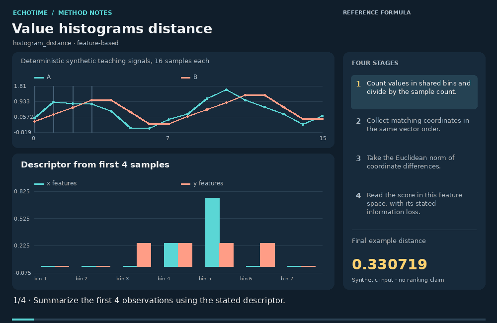

[Static image](../../src/echotime/data/method_animations/media/histogram_distance.png) · [Inputs and full calculation trace](../../src/echotime/data/method_animations/traces/histogram_distance.json) · [Open in the website](https://zipengwu.me/EchoTime/guide/methods.html#animation-histogram_distance)

Count observations in seven shared, fixed value intervals and divide by the sample count. The two probability vectors describe how often values occur. Shared edges make the coordinates comparable; all temporal ordering is intentionally removed. Euclidean distance retains differences in both vector scale and coordinates.

在七个共享、固定的数值区间中计数，再除以样本数。两个概率向量描述数值出现的频率。共享边界保证坐标可比较，同时有意舍弃全部时间顺序。 欧氏距离同时保留向量尺度与坐标差异。

### Calculation / 计算

```text
d(x,y) = sqrt(sum_j (phi_j(x)-phi_j(y))^2)
```

1. Use identical bin edges for both inputs and normalize counts into bin probabilities.
   对两条序列使用相同分箱边界，将计数归一化为概率。
2. Collect the computed coordinates in the same fixed order for both inputs.
   把计算得到的坐标按同一个固定顺序组成两个向量。
3. Take the Euclidean norm of the coordinate differences.
   对坐标差计算欧氏范数。
4. Interpret the score in this representation, accounting for the information it discards.
   结合表示所舍弃的信息，在该表示空间中解释分数。

**Example distance:** `0.33071891`. Computed from the explicitly defined illustrative encoder; no learned weights.

**Parameters:**

```json
{
  "edges": [
    -1.5,
    -1.0,
    -0.5,
    0.0,
    0.5,
    1.0,
    1.5,
    2.0
  ],
  "normalization": "probability mass, not density",
  "comparison": "euclidean"
}
```

### Interpretation and limits / 解释与边界

- Separate automatic binning can make coordinate-wise comparison invalid; the edges must be shared. 分别自动分箱可能导致坐标不可比，因此必须共享边界。
- Values within one bin are indistinguishable, and permuted sequences have identical histograms. 同一区间内的数值无法区分，重排序列也具有相同直方图。
- A metric on these feature vectors can be only a pseudometric on the original series when the representation loses information. 当表示损失信息时，特征空间中的度量在原序列空间上可能只是伪度量。

### Definition sources / 定义来源

- [NumPy: histogram bins and normalization](https://numpy.org/doc/stable/reference/generated/numpy.histogram.html)
- [Imported registry: named feature and comparison conventions](https://github.com/ZipengWu365/EchoTime/blob/main/src/echotime/data/ts_similarity_package_v2_registry.csv)
- [Exact illustrative inputs and encoder definitions](https://github.com/ZipengWu365/EchoTime/blob/main/tools/method_animation_data/feature_model_embedding.py)

<a id="permutation_entropy_distance"></a>
## Permutation-entropy distance · `permutation_entropy_distance`

**Demonstration:** Reference-formula demonstration / 参考公式演示

**EchoTime coverage:** Possible addition

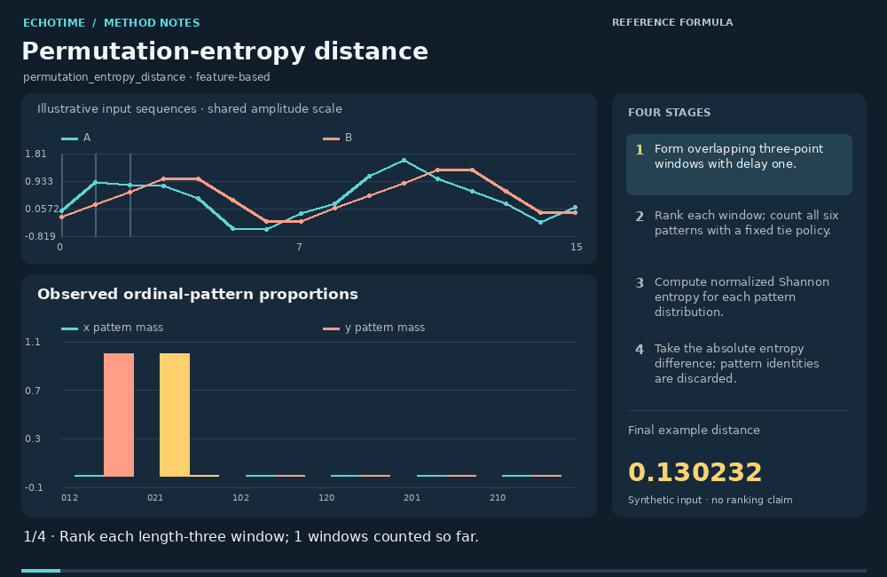

[Static image](../../src/echotime/data/method_animations/media/permutation_entropy_distance.png) · [Inputs and full calculation trace](../../src/echotime/data/method_animations/traces/permutation_entropy_distance.json) · [Open in the website](https://zipengwu.me/EchoTime/guide/methods.html#animation-permutation_entropy_distance)

Turn length-three windows into ordering patterns and compute each distribution's normalized Shannon entropy. Compare the two scalar entropies with an absolute difference. The score measures equality of this particular summary, so distinct pattern distributions can still have zero distance.

把三点窗口转换成排序模式，分别计算模式分布的归一化 Shannon 熵，再取两标量之差的绝对值。该分数比较这一特定摘要，因而不同模式分布仍可能得到零距离。

### Calculation / 计算

```text
d = |H(p)-H(q)|; H(p)=-sum(p log p)/log(3!)
```

1. Form overlapping windows with order 3 and delay 1.
   使用阶数 3、延迟 1 构造重叠窗口。
2. Stably rank each window and count all six possible permutations.
   稳定排序各窗口，并统计全部六种排列。
3. Compute H=-sum(p log p)/log(6) for each distribution.
   对各分布计算 H=-sum(p log p)/log(6)。
4. Take |H(x)-H(y)| and remember that entropy discards pattern identities.
   计算 |H(x)-H(y)|，同时注意熵舍弃具体模式身份。

**Example distance:** `0.13023244`. Normalized entropies H(x)=0.79848069, H(y)=0.66824825

**Parameters:**

```json
{
  "order": 3,
  "delay": 1,
  "tie_policy": "stable by index",
  "log_base": "e",
  "entropy_normalized": true
}
```

### Interpretation and limits / 解释与边界

- Order 3, delay 1 and stable tie-breaking by earlier position are explicit choices; frequent ties can change the interpretation. 阶数 3、延迟 1，以及按较早位置优先的稳定并列处理都是明确选择；大量并列值会改变解释。
- Short sequences provide sparse pattern counts; overlapping windows are not independent samples. 短序列的模式统计稀疏，重叠窗口也不是独立样本。
- Equal entropy does not imply equal ordinal distributions or similar dynamics. 相同的熵不意味着相同的模式分布或动力学。

### Definition sources / 定义来源

- [Bandt and Pompe (2002), permutation entropy](https://doi.org/10.1103/PhysRevLett.88.174102)
- [Exact illustrative inputs and encoder definitions](https://github.com/ZipengWu365/EchoTime/blob/main/tools/method_animation_data/feature_model_embedding.py)
- [EchoTime low-level implementation](https://github.com/ZipengWu365/EchoTime/blob/main/src/echotime/similarity_methods.py)

<a id="ordinal_pattern_js_distance"></a>
## Ordinal-pattern JS distance · `ordinal_pattern_js_distance`

**Demonstration:** Checked against EchoTime / 已与 EchoTime 计算核对

**EchoTime coverage:** Implemented in EchoTime · `ordinal_pattern_js_distance`

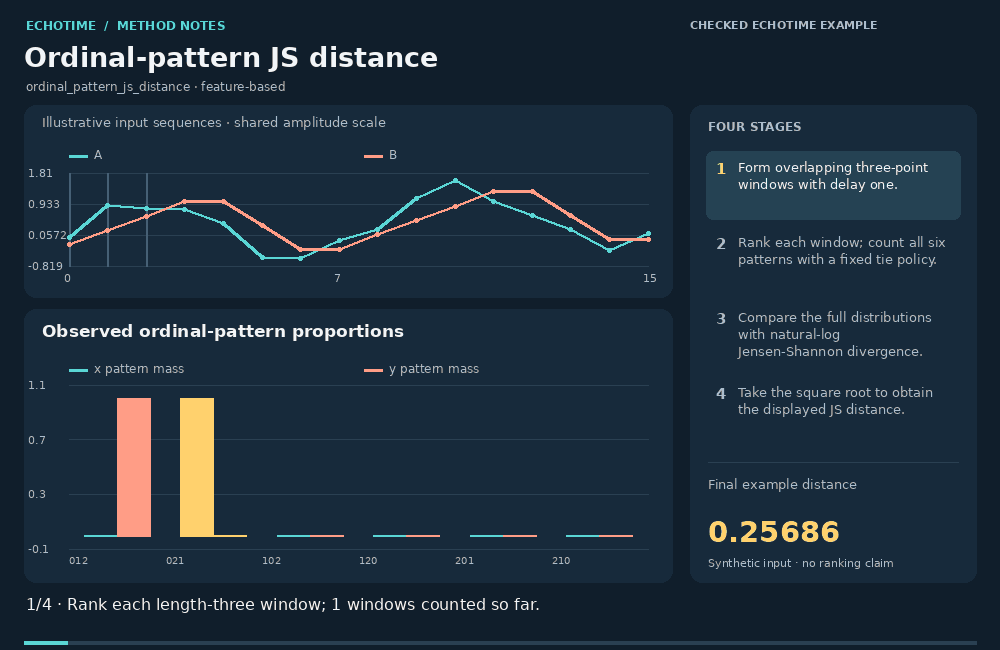

[Static image](../../src/echotime/data/method_animations/media/ordinal_pattern_js_distance.png) · [Inputs and full calculation trace](../../src/echotime/data/method_animations/traces/ordinal_pattern_js_distance.json) · [Open in the website](https://zipengwu.me/EchoTime/guide/methods.html#animation-ordinal_pattern_js_distance)

Turn every three-observation window into its ordering pattern, then compare the six-pattern probability vectors with square-root Jensen-Shannon divergence. This retains which patterns are frequent and follows EchoTime's natural-log definition.

把每个三点窗口转换成排序模式，再以 Jensen-Shannon 散度的平方根比较六种模式的概率向量。它保留具体哪些模式更常出现，并遵循 EchoTime 使用自然对数的定义。

### Calculation / 计算

```text
d = sqrt((KL(p||m)+KL(q||m))/2), m=(p+q)/2
```

1. Form overlapping windows with order 3 and delay 1.
   使用阶数 3、延迟 1 构造重叠窗口。
2. Stably rank each window and count all six possible permutations.
   稳定排序各窗口，并统计全部六种排列。
3. Compute square-root Jensen-Shannon divergence with natural logarithms.
   使用自然对数计算 Jensen-Shannon 散度的平方根。
4. Read a distribution distance and check the chosen order/delay.
   读取分布距离，并检查所选阶数与延迟。

**Example distance:** `0.25686047`. Natural-log JS distance

**Parameters:**

```json
{
  "order": 3,
  "delay": 1,
  "tie_policy": "stable by index",
  "log_base": "e",
  "entropy_normalized": false
}
```

### Interpretation and limits / 解释与边界

- Order 3, delay 1 and stable tie-breaking by earlier position are explicit choices; frequent ties can change the interpretation. 阶数 3、延迟 1，以及按较早位置优先的稳定并列处理都是明确选择；大量并列值会改变解释。
- Short sequences provide sparse pattern counts; overlapping windows are not independent samples. 短序列的模式统计稀疏，重叠窗口也不是独立样本。
- Pattern frequencies discard when patterns occur. 模式频率舍弃模式出现的具体时刻。

### Definition sources / 定义来源

- [Bandt and Pompe (2002), permutation entropy](https://doi.org/10.1103/PhysRevLett.88.174102)
- [SciPy: square-root Jensen-Shannon divergence](https://docs.scipy.org/doc/scipy/reference/generated/scipy.spatial.distance.jensenshannon.html)
- [EchoTime low-level implementation](https://github.com/ZipengWu365/EchoTime/blob/main/src/echotime/similarity_methods.py)

<a id="trend_distance"></a>
## Linear trend features distance · `trend_distance`

**Demonstration:** Checked against EchoTime / 已与 EchoTime 计算核对

**EchoTime coverage:** Implemented in EchoTime · `trend_distance`

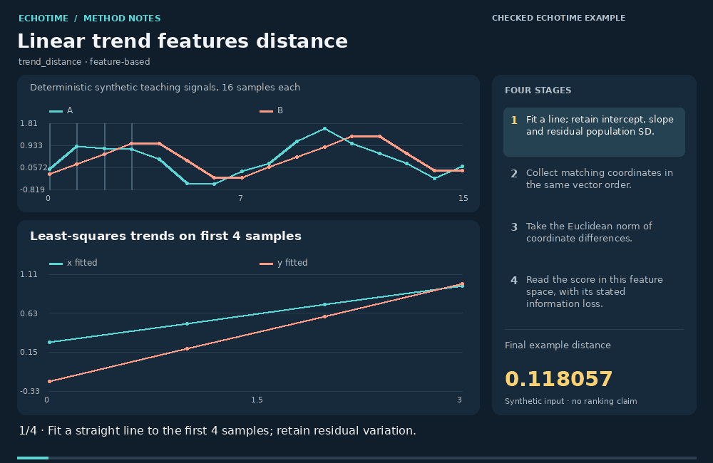

[Static image](../../src/echotime/data/method_animations/media/trend_distance.png) · [Inputs and full calculation trace](../../src/echotime/data/method_animations/traces/trend_distance.json) · [Open in the website](https://zipengwu.me/EchoTime/guide/methods.html#animation-trend_distance)

Fit an ordinary least-squares line to each series on the sample-index axis. Compare the intercept, slope and population standard deviation of residuals. This is EchoTime's three-coordinate trend description; it retains overall direction and unexplained variation while compressing local structure. Euclidean distance retains differences in both vector scale and coordinates.

以样本索引为时间轴，对每条序列拟合普通最小二乘直线，再比较截距、斜率和残差的总体标准差。这是 EchoTime 的三坐标趋势描述，保留总体方向与未解释波动，同时压缩局部结构。 欧氏距离同时保留向量尺度与坐标差异。

### Calculation / 计算

```text
d(x,y) = sqrt(sum_j (phi_j(x)-phi_j(y))^2)
```

1. Fit x_t = intercept + slope*t and append the residual population SD.
   拟合 x_t = 截距 + 斜率*t，并加入残差总体标准差。
2. Collect the computed coordinates in the same fixed order for both inputs.
   把计算得到的坐标按同一个固定顺序组成两个向量。
3. Take the Euclidean norm of the coordinate differences.
   对坐标差计算欧氏范数。
4. Interpret the score in this representation, accounting for the information it discards.
   结合表示所舍弃的信息，在该表示空间中解释分数。

**Example distance:** `0.11805668`. Computed from the explicitly defined illustrative encoder; no learned weights.

**Parameters:**

```json
{
  "time_axis": "sample index 0..15",
  "fit": "ordinary least squares",
  "residual_std_ddof": 0,
  "features": [
    "intercept",
    "slope",
    "residual_std"
  ],
  "comparison": "euclidean"
}
```

### Interpretation and limits / 解释与边界

- The slope uses sample index, so changing the sampling interval changes its interpretation; physical-time comparisons require consistent units. 斜率使用样本索引，改变采样间隔会改变其含义；按物理时间比较需要统一单位。
- Intercept, slope and residual SD have different scales. Curved trends and different residual patterns can share the same vector. 截距、斜率与残差标准差尺度不同；弯曲趋势或不同残差结构可能共享同一向量。
- A metric on these feature vectors can be only a pseudometric on the original series when the representation loses information. 当表示损失信息时，特征空间中的度量在原序列空间上可能只是伪度量。

### Definition sources / 定义来源

- [EchoTime low-level implementation](https://github.com/ZipengWu365/EchoTime/blob/main/src/echotime/similarity_methods.py)
- [Exact illustrative inputs and encoder definitions](https://github.com/ZipengWu365/EchoTime/blob/main/tools/method_animation_data/feature_model_embedding.py)

<a id="sax_hamming_distance"></a>
## SAX Hamming distance · `sax_hamming_distance`

**Demonstration:** Reference-formula demonstration / 参考公式演示

**EchoTime coverage:** Possible addition

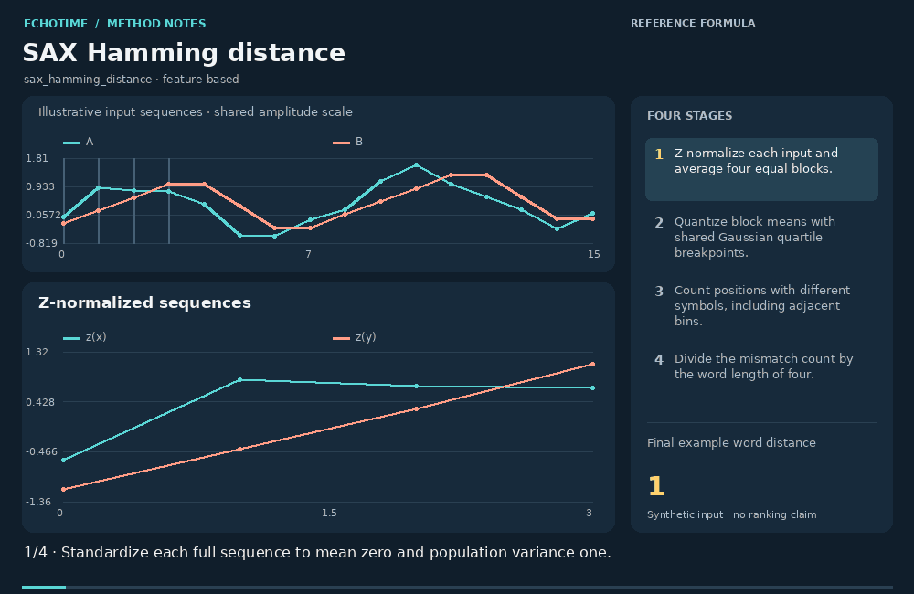

[Static image](../../src/echotime/data/method_animations/media/sax_hamming_distance.png) · [Inputs and full calculation trace](../../src/echotime/data/method_animations/traces/sax_hamming_distance.json) · [Open in the website](https://zipengwu.me/EchoTime/guide/methods.html#animation-sax_hamming_distance)

Convert each standardized series to a four-symbol SAX word, then count the fraction of positions with different symbols. This treats every mismatch equally, including adjacent bins; it is a distance between words, with information lost during aggregation and quantization.

把每条标准化序列转换为四符号 SAX 单词，再统计对应位置符号不同的比例。所有不匹配均等计数，包括相邻区间；它比较符号单词，聚合和量化已经损失信息。

### Calculation / 计算

```text
d = sum_i [SAX_i(x) != SAX_i(y)] / 4
```

1. Z-normalize each complete series and use four equal PAA blocks.
   对各完整序列做 z 标准化，并计算四个等长 PAA 区间。
2. Quantize each mean with shared standard-normal quartile breakpoints.
   使用共享标准正态四分位断点量化各区间均值。
3. Count mismatching symbols.
   统计符号不匹配数。
4. Divide the mismatch count by four.
   将不匹配数除以四。

**Example word distance:** `1`. Normalized symbol mismatch rate

**Parameters:**

```json
{
  "length": 16,
  "word_length": 4,
  "alphabet_size": 4,
  "breakpoints": [
    -0.6744897501960817,
    0.0,
    0.6744897501960817
  ],
  "z_normalization_ddof": 0,
  "x_word": "cadb",
  "y_word": "bbcc"
}
```

### Interpretation and limits / 解释与边界

- Gaussian breakpoints are a coding convention; they do not make arbitrary observed signals normally distributed. 高斯断点是一种编码约定，不会使任意观测信号变成正态分布。
- Hamming on words does not have the SAX Euclidean lower-bound interpretation. 单词上的 Hamming 距离不具有 SAX 欧氏下界的含义。
- Both PAA aggregation and quantization can map distinct signals to the same code. PAA 聚合和量化都可能把不同信号映射为相同代码。

### Definition sources / 定义来源

- [Lin et al. (2007), Experiencing SAX, author copy](https://www.cs.ucr.edu/~stelo/papers/DMKD07b.pdf)
- [Exact illustrative inputs and encoder definitions](https://github.com/ZipengWu365/EchoTime/blob/main/tools/method_animation_data/feature_model_embedding.py)

<a id="sax_mindist"></a>
## SAX MINDIST lower bound · `sax_mindist`

**Demonstration:** Reference-formula demonstration / 参考公式演示

**EchoTime coverage:** Possible addition

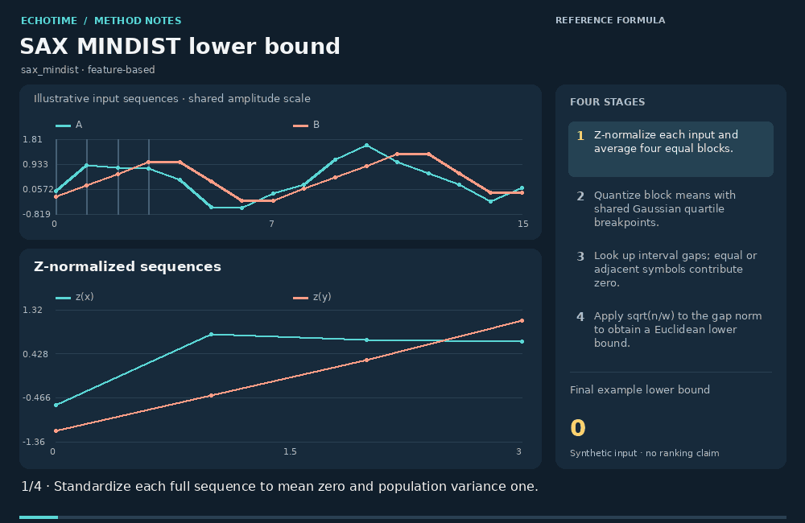

[Static image](../../src/echotime/data/method_animations/media/sax_mindist.png) · [Inputs and full calculation trace](../../src/echotime/data/method_animations/traces/sax_mindist.json) · [Open in the website](https://zipengwu.me/EchoTime/guide/methods.html#animation-sax_mindist)

Compare SAX words using the minimum gap between their symbol intervals, sum squared gaps and multiply by the PAA length factor. Equal or adjacent symbols contribute zero. In this example all paired symbols are adjacent, demonstrating why a valid lower bound can be zero for distinct series.

以 SAX 符号区间之间的最小间隔比较两个单词，累加间隔平方后加入 PAA 长度系数。相同或相邻符号贡献为零。本例各对应符号都相邻，展示了有效下界为何可对不同序列返回零。

### Calculation / 计算

```text
MINDIST = sqrt(16/4)*sqrt(sum_i interval_gap(SAX_i(x),SAX_i(y))^2)
```

1. Z-normalize each complete series and use four equal PAA blocks.
   对各完整序列做 z 标准化，并计算四个等长 PAA 区间。
2. Quantize each mean with shared standard-normal quartile breakpoints.
   使用共享标准正态四分位断点量化各区间均值。
3. Look up the minimum gap between the two symbol intervals.
   查找两个符号区间之间的最小间隔。
4. Take sqrt(n/w)*sqrt(sum(gap^2)); this is a lower-bound calculation.
   计算 sqrt(n/w)*sqrt(sum(gap^2))，得到下界。

**Example lower bound:** `0`. Compare with actual z-normalized Euclidean distance 3.3214665.

**Parameters:**

```json
{
  "length": 16,
  "word_length": 4,
  "alphabet_size": 4,
  "breakpoints": [
    -0.6744897501960817,
    0.0,
    0.6744897501960817
  ],
  "z_normalization_ddof": 0,
  "x_word": "cadb",
  "y_word": "bbcc"
}
```

### Interpretation and limits / 解释与边界

- Gaussian breakpoints are a coding convention; they do not make arbitrary observed signals normally distributed. 高斯断点是一种编码约定，不会使任意观测信号变成正态分布。
- The Euclidean lower-bound interpretation requires the same normalized length, partitions and ordered breakpoints; lower-bounding does not imply metric axioms. 欧氏下界解释要求相同的标准化长度、分段和有序断点；具有下界性质不等于满足度量公理。
- Both PAA aggregation and quantization can map distinct signals to the same code. PAA 聚合和量化都可能把不同信号映射为相同代码。

### Definition sources / 定义来源

- [Lin et al. (2007), Experiencing SAX, author copy](https://www.cs.ucr.edu/~stelo/papers/DMKD07b.pdf)
- [Exact illustrative inputs and encoder definitions](https://github.com/ZipengWu365/EchoTime/blob/main/tools/method_animation_data/feature_model_embedding.py)

<a id="bag_of_patterns_cosine_similarity"></a>
## Bag-of-patterns cosine similarity · `bag_of_patterns_cosine_similarity`

**Demonstration:** Reference-formula demonstration / 参考公式演示

**EchoTime coverage:** Possible addition

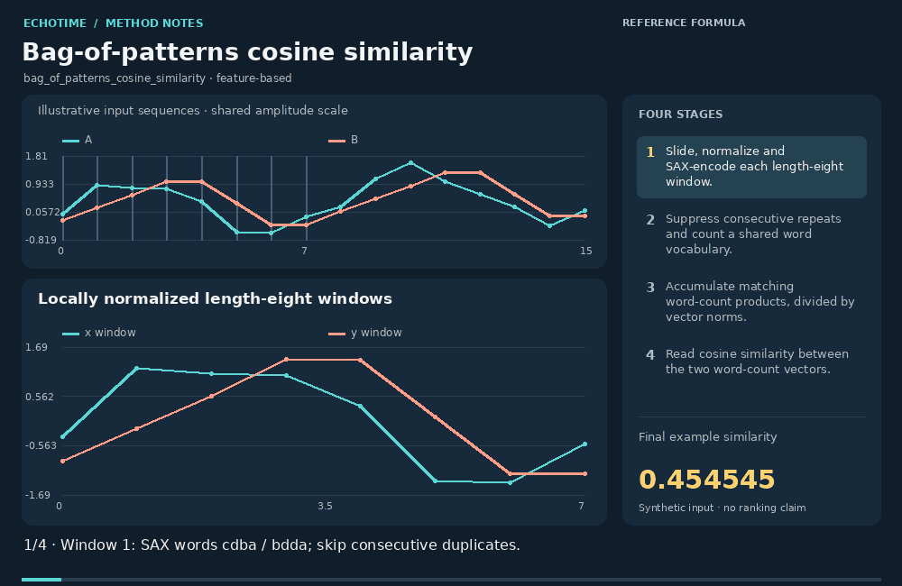

[Static image](../../src/echotime/data/method_animations/media/bag_of_patterns_cosine_similarity.png) · [Inputs and full calculation trace](../../src/echotime/data/method_animations/traces/bag_of_patterns_cosine_similarity.json) · [Open in the website](https://zipengwu.me/EchoTime/guide/methods.html#animation-bag_of_patterns_cosine_similarity)

Slide an eight-sample window, normalize each window, encode it as a four-letter SAX word and count the words. Consecutive duplicate words are suppressed in this example. The resulting bag is compared by cosine, so local motifs contribute through their frequencies while their global order is discarded.

滑动八点窗口，对每个窗口单独标准化，编码为四字母 SAX 单词并计数。本例抑制连续重复单词，再用余弦比较词袋。局部模式通过出现频率参与比较，其全局顺序被舍弃。

### Calculation / 计算

```text
s = cosine(counts(SAX_windows(x)), counts(SAX_windows(y)))
```

1. Slide a length-eight window, normalize it, then encode four PAA means with the shared SAX alphabet.
   滑动八点窗口并标准化，再用共享 SAX 字母表编码四个 PAA 均值。
2. Suppress consecutive duplicate words and count both series in one shared vocabulary.
   抑制连续重复词，在一个共享词表中对两条序列计数。
3. Accumulate matching word-count products divided by both vector norms.
   累加对应词频的乘积，并除以两个向量的范数乘积。
4. Read cosine similarity between count vectors.
   读取词频向量的余弦相似度。

**Example similarity:** `0.45454545`. Explicit BoP + cosine composition; shared vocabulary.

**Parameters:**

```json
{
  "window": 8,
  "stride": 1,
  "word_length": 4,
  "alphabet_size": 4,
  "local_z_normalization": true,
  "numerosity_reduction": "consecutive exact duplicate words",
  "vocabulary": [
    "aacd",
    "abdc",
    "abdd",
    "acdb",
    "adca",
    "bacd",
    "bdda",
    "cabd",
    "cdba",
    "daac",
    "dbac",
    "dcab"
  ],
  "comparison": "cosine"
}
```

### Interpretation and limits / 解释与边界

- Window length, word length, alphabet and numerosity reduction define the comparison; the original BoP representation does not mandate this exact cosine adapter. 窗口长度、词长、字母表与重复抑制规则共同定义比较；原 BoP 表示并未要求必须使用本例余弦适配器。
- Global motif order and absolute window level/scale are discarded; a similar bag need not imply aligned events. 全局模式顺序和窗口的绝对水平、尺度被舍弃；词袋相似并不意味着事件对齐。
- A zero count vector needs an explicit policy. This example has nonempty bags. 零计数向量需要明确处理规则，本例两个词袋均非空。

### Definition sources / 定义来源

- [Lin, Khade and Li (2012), bag-of-patterns representation](https://link.springer.com/article/10.1007/s10844-012-0196-5)
- [Lin et al. (2007), Experiencing SAX, author copy](https://www.cs.ucr.edu/~stelo/papers/DMKD07b.pdf)
- [Exact illustrative inputs and encoder definitions](https://github.com/ZipengWu365/EchoTime/blob/main/tools/method_animation_data/feature_model_embedding.py)

<a id="bag_of_patterns_distance"></a>
## Bag-of-patterns cosine distance · `bag_of_patterns_distance`

**Demonstration:** Reference-formula demonstration / 参考公式演示

**EchoTime coverage:** Possible addition

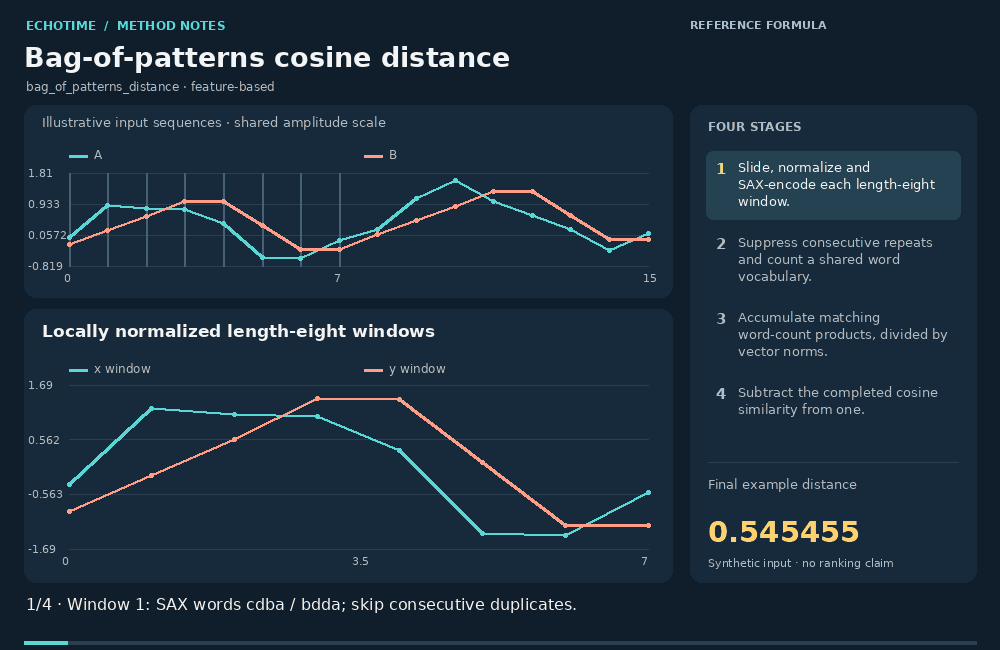

[Static image](../../src/echotime/data/method_animations/media/bag_of_patterns_distance.png) · [Inputs and full calculation trace](../../src/echotime/data/method_animations/traces/bag_of_patterns_distance.json) · [Open in the website](https://zipengwu.me/EchoTime/guide/methods.html#animation-bag_of_patterns_distance)

Slide an eight-sample window, normalize each window, encode it as a four-letter SAX word and count the words. Consecutive duplicate words are suppressed in this example. The resulting bag is compared by cosine, so local motifs contribute through their frequencies while their global order is discarded.

滑动八点窗口，对每个窗口单独标准化，编码为四字母 SAX 单词并计数。本例抑制连续重复单词，再用余弦比较词袋。局部模式通过出现频率参与比较，其全局顺序被舍弃。

### Calculation / 计算

```text
d = 1 - cosine(counts(SAX_windows(x)), counts(SAX_windows(y)))
```

1. Slide a length-eight window, normalize it, then encode four PAA means with the shared SAX alphabet.
   滑动八点窗口并标准化，再用共享 SAX 字母表编码四个 PAA 均值。
2. Suppress consecutive duplicate words and count both series in one shared vocabulary.
   抑制连续重复词，在一个共享词表中对两条序列计数。
3. Accumulate matching word-count products divided by both vector norms.
   累加对应词频的乘积，并除以两个向量的范数乘积。
4. Subtract the completed cosine similarity from one.
   用一减去完整的余弦相似度。

**Example distance:** `0.54545455`. Explicit BoP + cosine composition; shared vocabulary.

**Parameters:**

```json
{
  "window": 8,
  "stride": 1,
  "word_length": 4,
  "alphabet_size": 4,
  "local_z_normalization": true,
  "numerosity_reduction": "consecutive exact duplicate words",
  "vocabulary": [
    "aacd",
    "abdc",
    "abdd",
    "acdb",
    "adca",
    "bacd",
    "bdda",
    "cabd",
    "cdba",
    "daac",
    "dbac",
    "dcab"
  ],
  "comparison": "one_minus_cosine"
}
```

### Interpretation and limits / 解释与边界

- Window length, word length, alphabet and numerosity reduction define the comparison; the original BoP representation does not mandate this exact cosine adapter. 窗口长度、词长、字母表与重复抑制规则共同定义比较；原 BoP 表示并未要求必须使用本例余弦适配器。
- Global motif order and absolute window level/scale are discarded; a similar bag need not imply aligned events. 全局模式顺序和窗口的绝对水平、尺度被舍弃；词袋相似并不意味着事件对齐。
- A zero count vector needs an explicit policy. This example has nonempty bags. 零计数向量需要明确处理规则，本例两个词袋均非空。

### Definition sources / 定义来源

- [Lin, Khade and Li (2012), bag-of-patterns representation](https://link.springer.com/article/10.1007/s10844-012-0196-5)
- [Lin et al. (2007), Experiencing SAX, author copy](https://www.cs.ucr.edu/~stelo/papers/DMKD07b.pdf)
- [Exact illustrative inputs and encoder definitions](https://github.com/ZipengWu365/EchoTime/blob/main/tools/method_animation_data/feature_model_embedding.py)

<a id="independent_stats_distance"></a>
## Independent-channel basic statistics distance · `independent_stats_distance`

**Demonstration:** Reference-formula demonstration / 参考公式演示

**EchoTime coverage:** Possible addition

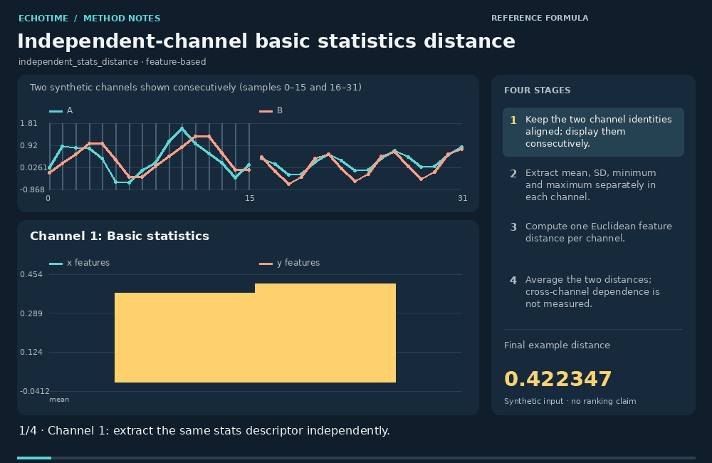

[Static image](../../src/echotime/data/method_animations/media/independent_stats_distance.png) · [Inputs and full calculation trace](../../src/echotime/data/method_animations/traces/independent_stats_distance.json) · [Open in the website](https://zipengwu.me/EchoTime/guide/methods.html#animation-independent_stats_distance)

Extract basic statistics separately in each of two channels, compute one Euclidean distance per channel, then take their arithmetic mean. The displayed input concatenates channels only for visualization; the computation preserves channel boundaries and has no cross-channel dependence term.

分别从两个通道提取基础统计量，各自计算一个欧氏距离，再取算术平均。图中的输入仅为展示而按通道拼接；计算始终保留通道边界，不包含跨通道依赖项。

### Calculation / 计算

```text
d(X,Y) = mean_c ||phi(X[:,c])-phi(Y[:,c])||_2
```

1. Keep corresponding channel identities and units aligned.
   保持对应通道身份与单位一致。
2. Extract basic statistics independently from each channel.
   逐通道独立提取基础统计量。
3. Compute the Euclidean feature distance inside each channel.
   分别计算每个通道内部的欧氏特征距离。
4. Average the two channel distances with equal weights.
   对两个通道距离等权平均。

**Example distance:** `0.42234674`. Channel distances 0.3997628 and 0.44493067; arithmetic mean.

**Parameters:**

```json
{
  "features": [
    "mean",
    "std_ddof0",
    "min",
    "max"
  ],
  "coordinate_scaling": "none",
  "channels": 2,
  "channel_weights": [
    0.5,
    0.5
  ],
  "raw_X": [
    [
      0.0,
      0.4
    ],
    [
      0.8769216919004693,
      0.15360679774997898
    ],
    [
      0.8094744111674236,
      -0.26360679774997897
    ],
    [
      0.7863961030678929,
      -0.23360679774997903
    ],
    [
      0.3905255888325767,
      0.2436067977499789
    ],
    [
      -0.5769216919004693,
      0.55
    ],
    [
      -0.6000000000000001,
      0.3036067977499791
    ],
    [
      -0.09587051423531628,
      -0.11360679774997892
    ],
    [
      0.2094744111674235,
      -0.08360679774997909
    ],
    [
      1.0863961030678926,
      0.3936067977499788
    ],
    [
      1.5905255888325764,
      0.7
    ],
    [
      0.9958705142353173,
      0.4536067977499798
    ],
    [
      0.6000000000000002,
      0.03639320225002113
    ],
    [
      0.20412948576468337,
      0.06639320225002088
    ],
    [
      -0.39052558883257615,
      0.5436067977499787
    ],
    [
      0.11360389693210537,
      0.85
    ]
  ],
  "raw_Y": [
    [
      -0.2003300858899106,
      0.45263659640173104
    ],
    [
      0.185,
      -0.13144121120883534
    ],
    [
      0.5703300858899106,
      -0.6444290133512534
    ],
    [
      1.005,
      -0.34975578305380517
    ],
    [
      1.0003300858899107,
      0.3729894112121631
    ],
    [
      0.3250000000000002,
      0.552636596401731
    ],
    [
      -0.35033008588991066,
      -0.03144121120883547
    ],
    [
      -0.3550000000000001,
      -0.5444290133512534
    ],
    [
      0.07966991411008931,
      -0.2497557830538053
    ],
    [
      0.46499999999999997,
      0.472989411212163
    ],
    [
      0.8503300858899105,
      0.652636596401731
    ],
    [
      1.2849999999999995,
      0.06855878879116573
    ],
    [
      1.2803300858899114,
      -0.4444290133512534
    ],
    [
      0.6050000000000002,
      -0.1497557830538063
    ],
    [
      -0.07033008588991083,
      0.5729894112121622
    ],
    [
      -0.07500000000000043,
      0.7526365964017315
    ]
  ],
  "display_layout": "channel-major flattening only"
}
```

### Interpretation and limits / 解释与边界

- Permuting observations leaves this vector unchanged, even when temporal behavior changes completely. 任意重排序列不会改变该向量，即使时间行为发生显著变化。
- Features have different scales; this example uses no coordinate weighting. A production scaler must be fitted without test-data leakage. 各坐标尺度不同；本例不加权。实际使用的缩放器应避免测试数据泄漏。
- A metric on these feature vectors can be only a pseudometric on the original series when the representation loses information. 当表示损失信息时，特征空间中的度量在原序列空间上可能只是伪度量。
- Averaging independent channel distances cannot detect cross-channel timing or dependence changes that preserve each marginal descriptor. 独立通道距离的平均无法识别保持各通道边缘描述不变的跨通道时序或依赖变化。

### Definition sources / 定义来源

- [NumPy: summary-statistic definitions](https://numpy.org/doc/stable/reference/routines.statistics.html)
- [Imported registry: named feature and comparison conventions](https://github.com/ZipengWu365/EchoTime/blob/main/src/echotime/data/ts_similarity_package_v2_registry.csv)
- [Exact illustrative inputs and encoder definitions](https://github.com/ZipengWu365/EchoTime/blob/main/tools/method_animation_data/feature_model_embedding.py)

<a id="independent_paa_distance"></a>
## Independent-channel paa block means distance · `independent_paa_distance`

**Demonstration:** Reference-formula demonstration / 参考公式演示

**EchoTime coverage:** Possible addition

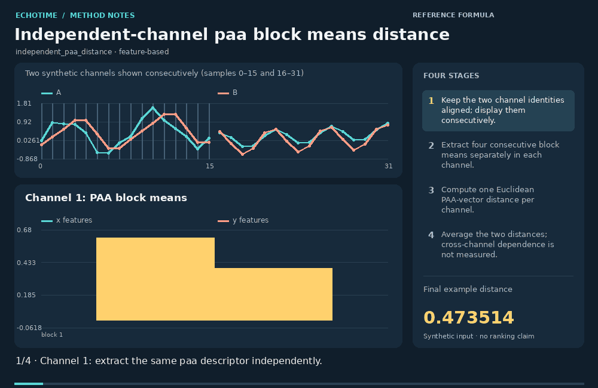

[Static image](../../src/echotime/data/method_animations/media/independent_paa_distance.png) · [Inputs and full calculation trace](../../src/echotime/data/method_animations/traces/independent_paa_distance.json) · [Open in the website](https://zipengwu.me/EchoTime/guide/methods.html#animation-independent_paa_distance)

Extract paa block means separately in each of two channels, compute one Euclidean distance per channel, then take their arithmetic mean. The displayed input concatenates channels only for visualization; the computation preserves channel boundaries and has no cross-channel dependence term.

分别从两个通道提取PAA 分段均值，各自计算一个欧氏距离，再取算术平均。图中的输入仅为展示而按通道拼接；计算始终保留通道边界，不包含跨通道依赖项。

### Calculation / 计算

```text
d(X,Y) = mean_c ||phi(X[:,c])-phi(Y[:,c])||_2
```

1. Keep corresponding channel identities and units aligned.
   保持对应通道身份与单位一致。
2. Extract paa block means independently from each channel.
   逐通道独立提取PAA 分段均值。
3. Compute the Euclidean feature distance inside each channel.
   分别计算每个通道内部的欧氏特征距离。
4. Average the two channel distances with equal weights.
   对两个通道距离等权平均。

**Example distance:** `0.47351384`. Channel distances 0.61269408 and 0.33433359; arithmetic mean.

**Parameters:**

```json
{
  "n_segments": 4,
  "block_size": 4,
  "z_normalization": false,
  "distance_length_scaling": false,
  "channels": 2,
  "channel_weights": [
    0.5,
    0.5
  ],
  "raw_X": [
    [
      0.0,
      0.4
    ],
    [
      0.8769216919004693,
      0.15360679774997898
    ],
    [
      0.8094744111674236,
      -0.26360679774997897
    ],
    [
      0.7863961030678929,
      -0.23360679774997903
    ],
    [
      0.3905255888325767,
      0.2436067977499789
    ],
    [
      -0.5769216919004693,
      0.55
    ],
    [
      -0.6000000000000001,
      0.3036067977499791
    ],
    [
      -0.09587051423531628,
      -0.11360679774997892
    ],
    [
      0.2094744111674235,
      -0.08360679774997909
    ],
    [
      1.0863961030678926,
      0.3936067977499788
    ],
    [
      1.5905255888325764,
      0.7
    ],
    [
      0.9958705142353173,
      0.4536067977499798
    ],
    [
      0.6000000000000002,
      0.03639320225002113
    ],
    [
      0.20412948576468337,
      0.06639320225002088
    ],
    [
      -0.39052558883257615,
      0.5436067977499787
    ],
    [
      0.11360389693210537,
      0.85
    ]
  ],
  "raw_Y": [
    [
      -0.2003300858899106,
      0.45263659640173104
    ],
    [
      0.185,
      -0.13144121120883534
    ],
    [
      0.5703300858899106,
      -0.6444290133512534
    ],
    [
      1.005,
      -0.34975578305380517
    ],
    [
      1.0003300858899107,
      0.3729894112121631
    ],
    [
      0.3250000000000002,
      0.552636596401731
    ],
    [
      -0.35033008588991066,
      -0.03144121120883547
    ],
    [
      -0.3550000000000001,
      -0.5444290133512534
    ],
    [
      0.07966991411008931,
      -0.2497557830538053
    ],
    [
      0.46499999999999997,
      0.472989411212163
    ],
    [
      0.8503300858899105,
      0.652636596401731
    ],
    [
      1.2849999999999995,
      0.06855878879116573
    ],
    [
      1.2803300858899114,
      -0.4444290133512534
    ],
    [
      0.6050000000000002,
      -0.1497557830538063
    ],
    [
      -0.07033008588991083,
      0.5729894112121622
    ],
    [
      -0.07500000000000043,
      0.7526365964017315
    ]
  ],
  "display_layout": "channel-major flattening only"
}
```

### Interpretation and limits / 解释与边界

- The displayed Euclidean feature distance is unscaled; the usual length-scaled PAA lower bound additionally multiplies it by sqrt(n/w). 图中欧氏特征距离未经长度缩放；常用 PAA 下界还需乘以 sqrt(n/w)。
- Short events within a block can cancel, and moving a block boundary can alter the representation. 区间内的短暂事件可能互相抵消，改变分段边界也会改变表示。
- A metric on these feature vectors can be only a pseudometric on the original series when the representation loses information. 当表示损失信息时，特征空间中的度量在原序列空间上可能只是伪度量。
- Averaging independent channel distances cannot detect cross-channel timing or dependence changes that preserve each marginal descriptor. 独立通道距离的平均无法识别保持各通道边缘描述不变的跨通道时序或依赖变化。

### Definition sources / 定义来源

- [tslearn: piecewise aggregate approximation](https://tslearn.readthedocs.io/en/stable/gen_modules/piecewise/tslearn.piecewise.PiecewiseAggregateApproximation.html)
- [Imported registry: named feature and comparison conventions](https://github.com/ZipengWu365/EchoTime/blob/main/src/echotime/data/ts_similarity_package_v2_registry.csv)
- [Exact illustrative inputs and encoder definitions](https://github.com/ZipengWu365/EchoTime/blob/main/tools/method_animation_data/feature_model_embedding.py)
