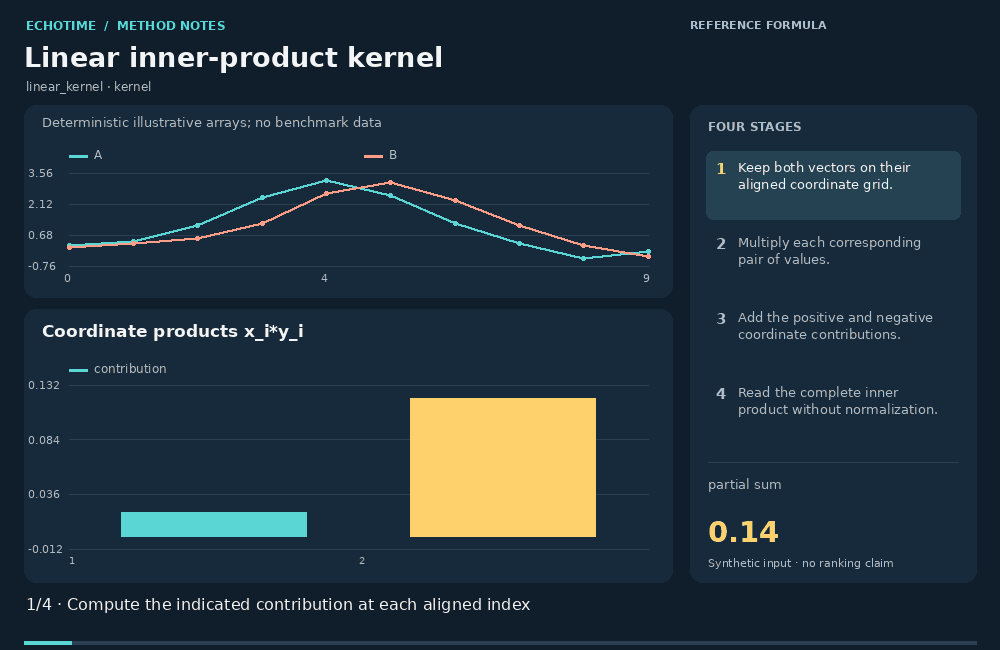
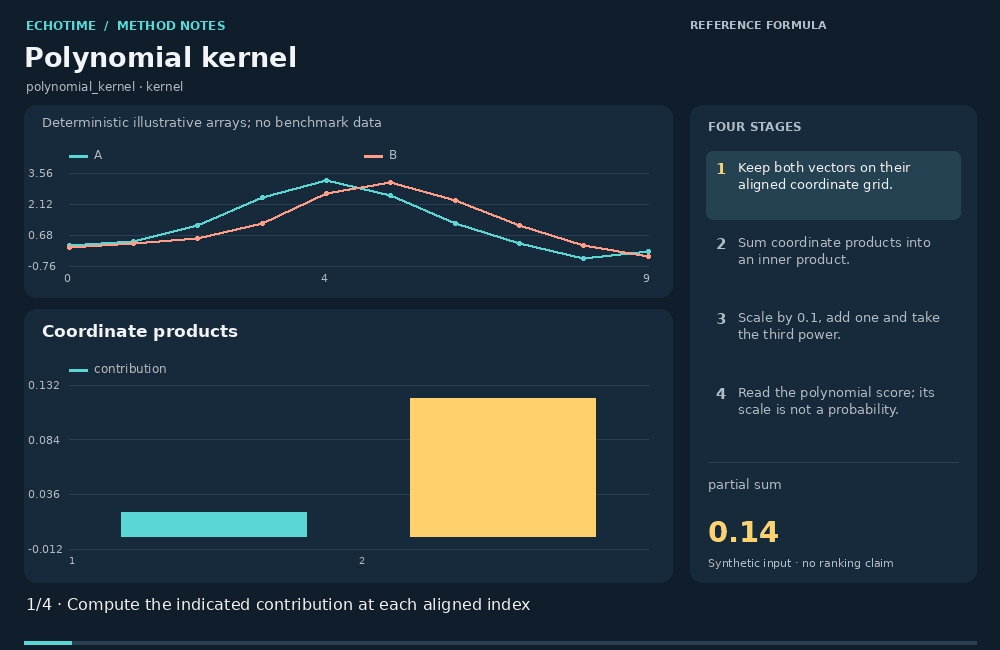
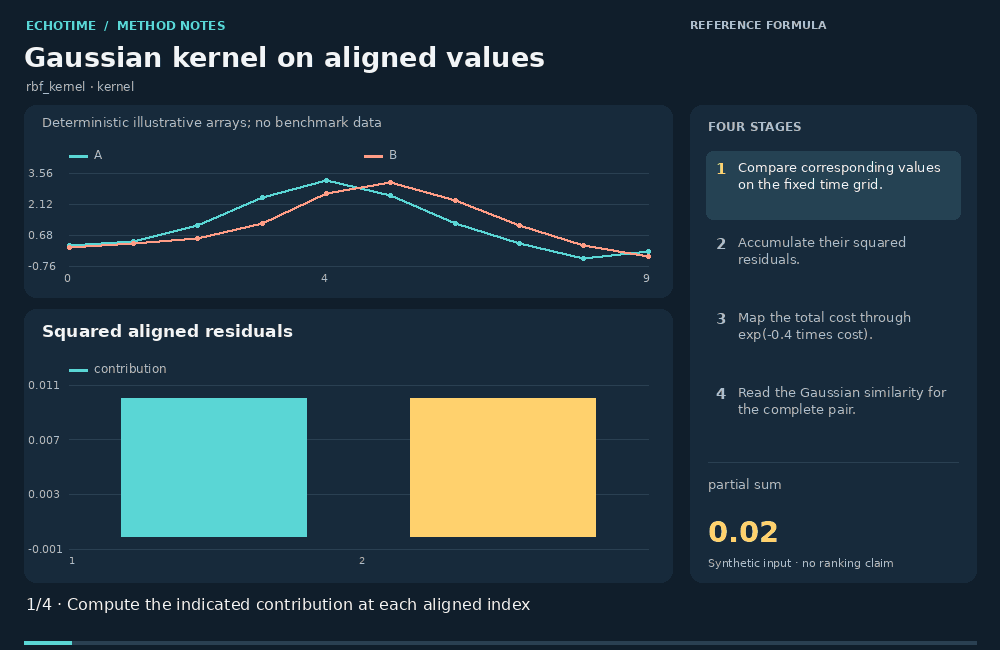
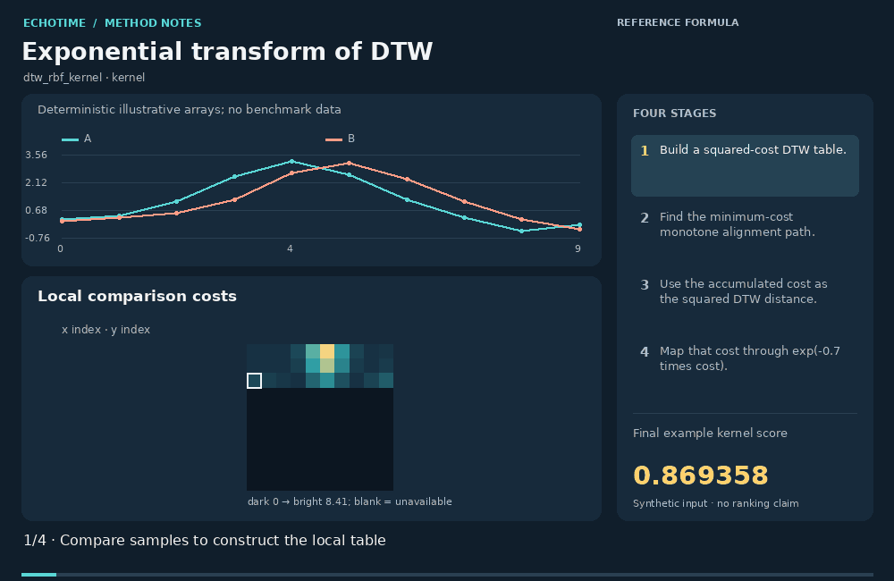
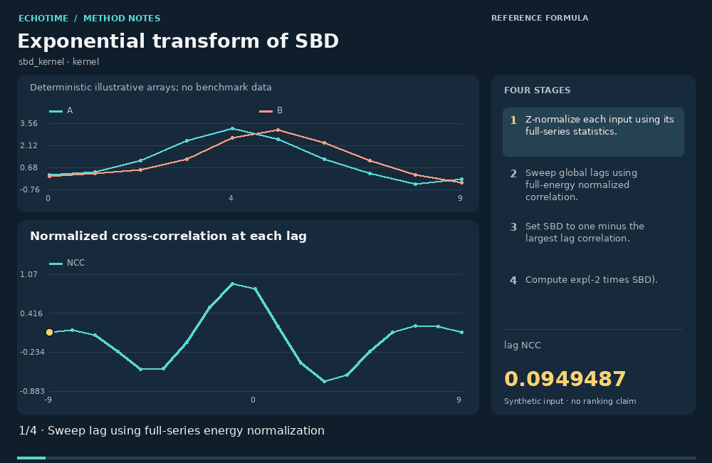
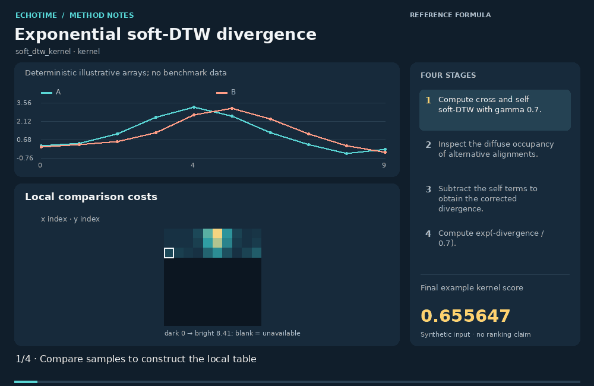
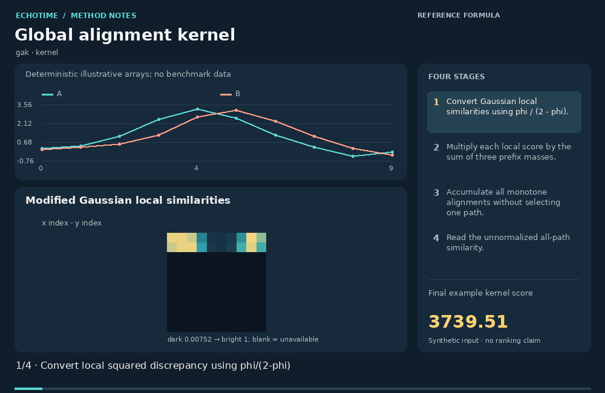
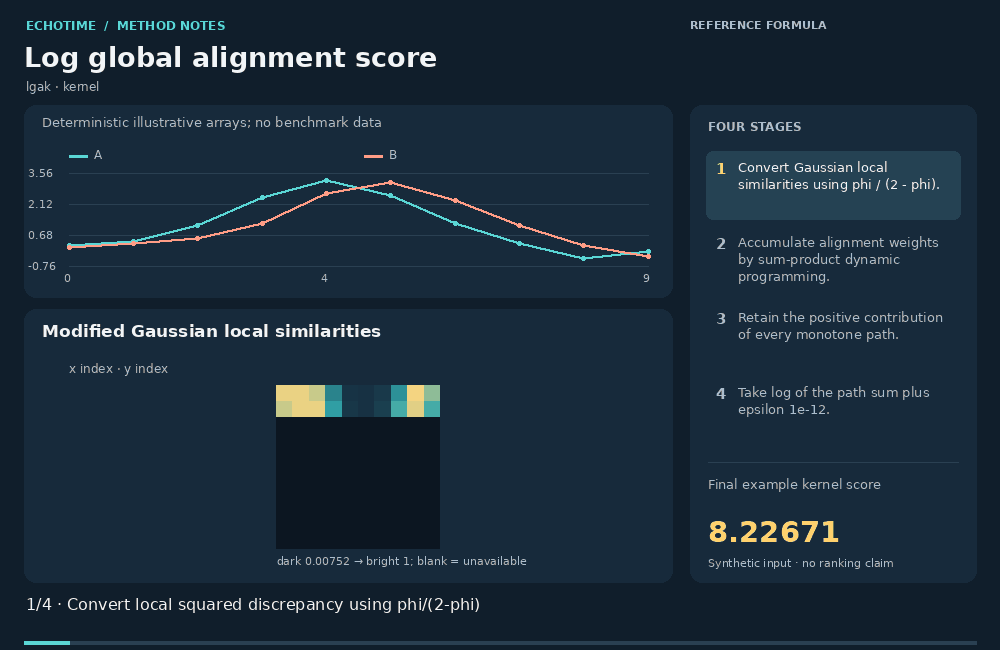
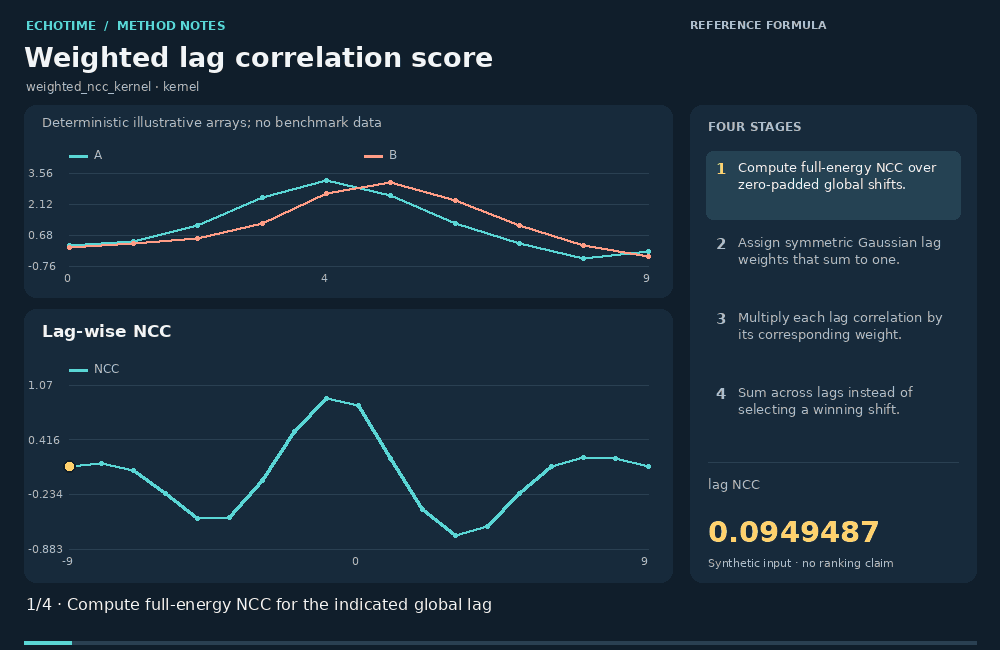

# Kernel constructions / 核函数构造

[All animation families](README.md) · [Existing web Methods Atlas](https://zipengwu.me/EchoTime/guide/methods.html#method-animations)

The values below belong to the documented synthetic example. Animation coverage and EchoTime API coverage are separate.

- [Linear inner-product kernel](#linear_kernel)
- [Polynomial kernel](#polynomial_kernel)
- [Sigmoid similarity transform](#sigmoid_kernel)
- [Gaussian kernel on aligned values](#rbf_kernel)
- [Exponential transform of DTW](#dtw_rbf_kernel)
- [Exponential transform of SBD](#sbd_kernel)
- [Exponential soft-DTW divergence](#soft_dtw_kernel)
- [Global alignment kernel](#gak)
- [Log global alignment score](#lgak)
- [Weighted lag correlation score](#weighted_ncc_kernel)

<a id="linear_kernel"></a>
## Linear inner-product kernel · `linear_kernel`

**Demonstration:** Reference-formula demonstration / 参考公式演示

**EchoTime coverage:** Low-priority addition



[Static image](../../src/echotime/data/method_animations/media/linear_kernel.png) · [Inputs and full calculation trace](../../src/echotime/data/method_animations/traces/linear_kernel.json) · [Open in the website](https://zipengwu.me/EchoTime/guide/methods.html#animation-linear_kernel)

The linear kernel adds products of corresponding coordinates. Its animation shows which indices contribute positively or negatively before adding them into the inner product. It preserves amplitude and offset effects unless preprocessing removes them, and its scale grows with vector energy.

线性核将对应坐标的乘积相加。动图先展示各位置的正负贡献，再累加成内积。若预处理没有消除幅度与偏移，它们会保留在结果中；分数量级随向量能量变化。

### Calculation / 计算

```text
K(x,y)=sum_i x_i*y_i
```

1. Use the same aligned coordinate system for both vectors.
   对两个向量使用同一个已对齐坐标系。
2. Compute and sum the coordinatewise contributions shown in the plot.
   计算图示逐坐标贡献并求和。
3. Apply the specified scalar kernel transformation to that complete sum.
   对完整求和结果施加指定的标量核变换。
4. Read the pair score; kernel magnitude is not a calibrated similarity probability.
   读取成对分数；核函数量级不是校准后的相似概率。

**Example kernel score:** `22.68`. The explicit definition and parameters shown on this card.

**Parameters:**

```json
{
  "preprocessing": "none"
}
```

### Interpretation and limits / 解释与边界

- An inner product is not bounded by one and can be negative; normalization would produce a different kernel or cosine score. 内积没有一的上界，也可以为负；归一化会产生不同的核或余弦分数。
- No local time warping is performed by this aligned-vector construction. 此已对齐向量构造不执行局部时间扭曲。

### Definition sources / 定义来源

- [scikit-learn: pairwise kernels and their formulas](https://scikit-learn.org/stable/modules/metrics.html)

<a id="polynomial_kernel"></a>
## Polynomial kernel · `polynomial_kernel`

**Demonstration:** Reference-formula demonstration / 参考公式演示

**EchoTime coverage:** Low-priority addition



[Static image](../../src/echotime/data/method_animations/media/polynomial_kernel.png) · [Inputs and full calculation trace](../../src/echotime/data/method_animations/traces/polynomial_kernel.json) · [Open in the website](https://zipengwu.me/EchoTime/guide/methods.html#animation-polynomial_kernel)

The polynomial kernel first computes an inner product, then applies a shifted integer power. Here degree three creates nonlinear interactions implicitly without constructing every product feature. The animation separates the coordinate sum from its nonlinear expansion, so the large final magnitude is not mistaken for a probability.

多项式核先计算内积，再对平移后的结果取整数次幂。本例次数为三，隐式表示非线性交互而不逐一构造乘积特征。动图分开显示坐标求和与非线性展开，最终大数值不能解释为概率。

### Calculation / 计算

```text
K(x,y)=(0.1*dot(x,y)+1)^3
```

1. Use the same aligned coordinate system for both vectors.
   对两个向量使用同一个已对齐坐标系。
2. Compute and sum the coordinatewise contributions shown in the plot.
   计算图示逐坐标贡献并求和。
3. Apply the specified scalar kernel transformation to that complete sum.
   对完整求和结果施加指定的标量核变换。
4. Read the pair score; kernel magnitude is not a calibrated similarity probability.
   读取成对分数；核函数量级不是校准后的相似概率。

**Example kernel score:** `34.901665`. The explicit definition and parameters shown on this card.

**Parameters:**

```json
{
  "preprocessing": "none",
  "gamma": 0.1,
  "coef0": 1.0,
  "degree": 3
}
```

### Interpretation and limits / 解释与边界

- The usual positive-semidefinite guarantee uses a nonnegative scale/offset and integer degree. Large norms or degrees can dominate numerically. 通常的半正定保证使用非负尺度、非负偏置和整数次数；较大范数或次数可能在数值上主导结果。
- No local time warping is performed by this aligned-vector construction. 此已对齐向量构造不执行局部时间扭曲。

### Definition sources / 定义来源

- [scikit-learn: pairwise kernels and their formulas](https://scikit-learn.org/stable/modules/metrics.html)

<a id="sigmoid_kernel"></a>
## Sigmoid similarity transform · `sigmoid_kernel`

**Demonstration:** Reference-formula demonstration / 参考公式演示

**EchoTime coverage:** Low-priority addition


[Static image](../../src/echotime/data/method_animations/media/sigmoid_kernel.png) · [Inputs and full calculation trace](../../src/echotime/data/method_animations/traces/sigmoid_kernel.json) · [Open in the website](https://zipengwu.me/EchoTime/guide/methods.html#animation-sigmoid_kernel)

This sigmoid score maps an affine inner product through tanh. The animation shows saturation: sufficiently large input scores compress into a narrow output range. The formula is commonly called a sigmoid kernel, but arbitrary scale and offset choices do not guarantee a positive-semidefinite Gram matrix.

该 sigmoid 分数将内积的仿射变换送入 tanh。动图展示饱和现象：较大输入分数被压缩到很窄的输出范围。该公式常称为 sigmoid 核，但任意尺度与偏置选择不保证 Gram 矩阵半正定。

### Calculation / 计算

```text
K(x,y)=tanh(0.1*dot(x,y)-0.5)
```

1. Use the same aligned coordinate system for both vectors.
   对两个向量使用同一个已对齐坐标系。
2. Compute and sum the coordinatewise contributions shown in the plot.
   计算图示逐坐标贡献并求和。
3. Apply the specified scalar kernel transformation to that complete sum.
   对完整求和结果施加指定的标量核变换。
4. Read the pair score; kernel magnitude is not a calibrated similarity probability.
   读取成对分数；核函数量级不是校准后的相似概率。

**Example kernel score:** `0.94338981`. The explicit definition and parameters shown on this card.

**Parameters:**

```json
{
  "preprocessing": "none",
  "gamma": 0.1,
  "coef0": -0.5
}
```

### Interpretation and limits / 解释与边界

- A bounded output does not establish positive semidefiniteness or a probabilistic interpretation; saturation can hide changes in the input dot product. 输出有界不能证明半正定性或概率解释；饱和可能掩盖输入内积变化。
- No local time warping is performed by this aligned-vector construction. 此已对齐向量构造不执行局部时间扭曲。

### Definition sources / 定义来源

- [scikit-learn: pairwise kernels and their formulas](https://scikit-learn.org/stable/modules/metrics.html)

<a id="rbf_kernel"></a>
## Gaussian kernel on aligned values · `rbf_kernel`

**Demonstration:** Reference-formula demonstration / 参考公式演示

**EchoTime coverage:** Low-priority addition



[Static image](../../src/echotime/data/method_animations/media/rbf_kernel.png) · [Inputs and full calculation trace](../../src/echotime/data/method_animations/traces/rbf_kernel.json) · [Open in the website](https://zipengwu.me/EchoTime/guide/methods.html#animation-rbf_kernel)

The Gaussian RBF kernel converts squared Euclidean discrepancy between aligned vectors into an exponentially decreasing score. The animation first accumulates squared residuals, then locates that total on the exponential curve. Its bandwidth controls how quickly disagreement reduces the score, while time alignment remains fixed.

高斯 RBF 核将已对齐向量的平方欧氏差异转成指数递减分数。动图先累加平方残差，再把总量定位到指数曲线上。带宽控制分数随差异下降的速度，时间对齐保持固定。

### Calculation / 计算

```text
K(x,y)=exp(-0.4*sum_i (x_i-y_i)^2)
```

1. Use the same aligned coordinate system for both vectors.
   对两个向量使用同一个已对齐坐标系。
2. Compute and sum the coordinatewise contributions shown in the plot.
   计算图示逐坐标贡献并求和。
3. Apply the specified scalar kernel transformation to that complete sum.
   对完整求和结果施加指定的标量核变换。
4. Read the pair score; kernel magnitude is not a calibrated similarity probability.
   读取成对分数；核函数量级不是校准后的相似概率。

**Example kernel score:** `0.14719456`. The explicit definition and parameters shown on this card.

**Parameters:**

```json
{
  "preprocessing": "none",
  "gamma": 0.4
}
```

### Interpretation and limits / 解释与边界

- Signal scaling changes effective bandwidth. Equal dimensionality and aligned coordinates are required by this illustrated vector kernel. 信号缩放改变有效带宽；此向量核示例要求维度一致且坐标已对齐。
- No local time warping is performed by this aligned-vector construction. 此已对齐向量构造不执行局部时间扭曲。

### Definition sources / 定义来源

- [scikit-learn: pairwise kernels and their formulas](https://scikit-learn.org/stable/modules/metrics.html)

<a id="dtw_rbf_kernel"></a>
## Exponential transform of DTW · `dtw_rbf_kernel`

**Demonstration:** Reference-formula demonstration / 参考公式演示

**EchoTime coverage:** Low-priority addition



[Static image](../../src/echotime/data/method_animations/media/dtw_rbf_kernel.png) · [Inputs and full calculation trace](../../src/echotime/data/method_animations/traces/dtw_rbf_kernel.json) · [Open in the website](https://zipengwu.me/EchoTime/guide/methods.html#animation-dtw_rbf_kernel)

This construction first selects the minimum-cost DTW path and then exponentially transforms its squared distance. The animation shows the path calculation before the score conversion. Although the formula resembles a Gaussian kernel, replacing Euclidean distance by DTW does not automatically preserve positive semidefiniteness.

该构造先选择最低代价 DTW 路径，再对距离平方做指数变换。动图先展示路径计算，再展示分数转换。将欧氏距离替换成 DTW 不自动保留高斯核的半正定性。

### Calculation / 计算

```text
K=exp(-0.7*DTW(x,y)^2), DTW uses squared costs then square root
```

1. Build squared local costs and a monotone DTW recurrence.
   构造平方局部代价与单调 DTW 递推。
2. Select the path with the least accumulated discrepancy.
   选择累计差异最小的路径。
3. Use that accumulated cost as DTW squared in exp(-gamma*cost).
   把该累计代价作为 DTW 平方代入 exp(-gamma*cost)。
4. Interpret the decreasing score with gamma=0.7 and the stated local norm.
   结合 gamma=0.7 和明确的局部范数理解该递减分数。

**Example kernel score:** `0.86935824`. The explicit definition and parameters shown on this card.

**Parameters:**

```json
{
  "gamma": 0.7,
  "base_distance": 0.4472135954999581,
  "squared_distance": 0.20000000000000015
}
```

### Interpretation and limits / 解释与边界

- A DTW-based exponential may produce an indefinite Gram matrix. Do not infer kernel-method guarantees from its name. DTW 指数形式可能得到不定 Gram 矩阵；不能从名称推断核方法保证。
- The value changes with the path band, local cost and distance normalization. 路径窗口、局部代价和距离归一化都会改变结果。

### Definition sources / 定义来源

- [tslearn: DTW definitions and path constraints](https://tslearn.readthedocs.io/en/stable/user_guide/dtw.html)
- [Cuturi (2011): local-kernel conditions for global alignment](https://marcocuturi.net/Papers/cuturi11fast.pdf)

<a id="sbd_kernel"></a>
## Exponential transform of SBD · `sbd_kernel`

**Demonstration:** Reference-formula demonstration / 参考公式演示

**EchoTime coverage:** Low-priority addition



[Static image](../../src/echotime/data/method_animations/media/sbd_kernel.png) · [Inputs and full calculation trace](../../src/echotime/data/method_animations/traces/sbd_kernel.json) · [Open in the website](https://zipengwu.me/EchoTime/guide/methods.html#animation-sbd_kernel)

SBD selects the largest normalized cross-correlation over global shifts, then subtracts it from one. This atlas construction maps that SBD value through exp(-2*SBD). The lag sweep makes its shift tolerance visible, while its full-series normalization distinguishes it from overlap-normalized Pearson correlation.

SBD 在全局平移中选择最大的归一化互相关，再用一减去该值。本图谱构造进一步计算 exp(-2*SBD)。动图逐个扫描滞后，展示平移容忍性；采用完整序列能量归一化，与重叠区域 Pearson 相关不同。

### Calculation / 计算

```text
K=exp(-2*(1-max_lag NCC_lag(z(x),z(y))))
```

1. Z-normalize both series using their own full-series mean and standard deviation.
   用各自完整序列的均值和标准差进行 z 标准化。
2. Evaluate zero-padded cross-correlation at every global lag.
   在每个全局滞后处计算零填充互相关。
3. Set SBD to one minus the largest full-energy-normalized correlation.
   令 SBD 等于一减完整能量归一化相关的最大值。
4. Apply exp(-2*SBD) to obtain the stated kernel-like score.
   应用 exp(-2*SBD)，得到明确约定的核形式分数。

**Example kernel score:** `0.82362`. The explicit definition and parameters shown on this card.

**Parameters:**

```json
{
  "gamma": 2.0,
  "normalize": true,
  "NCC_normalization": "full-series L2 energies",
  "best_lag": -1,
  "sbd": 0.09702301325884444
}
```

### Interpretation and limits / 解释与边界

- Maximizing over shifts and exponentiating a distance-like score do not establish positive semidefiniteness. 对平移取最大值再指数化距离形式分数，不能证明半正定性。
- Only one global lag is chosen. Constant inputs have undefined statistical normalization and need an explicit software convention. 只选择一个全局滞后；常数输入的统计归一化未定义，需要明确的软件约定。

### Definition sources / 定义来源

- [EchoTime low-level similarity implementations](https://github.com/ZipengWu365/EchoTime/blob/main/src/echotime/similarity_methods.py)
- [EchoTime imported atlas: named formula conventions](https://github.com/ZipengWu365/EchoTime/blob/main/src/echotime/data/ts_similarity_package_v2_registry.csv)

<a id="soft_dtw_kernel"></a>
## Exponential soft-DTW divergence · `soft_dtw_kernel`

**Demonstration:** Reference-formula demonstration / 参考公式演示

**EchoTime coverage:** Low-priority addition



[Static image](../../src/echotime/data/method_animations/media/soft_dtw_kernel.png) · [Inputs and full calculation trace](../../src/echotime/data/method_animations/traces/soft_dtw_kernel.json) · [Open in the website](https://zipengwu.me/EchoTime/guide/methods.html#animation-soft_dtw_kernel)

This imported atlas name denotes an exponential of the self-corrected soft-DTW divergence. It first includes contributions from multiple alignments, subtracts both self terms, then applies exp(-D/gamma). This explicit construction is separate from directly exponentiating raw soft-DTW or choosing a modified local kernel for GAK.

本图谱名称对应自修正 soft-DTW 散度的指数形式。先综合多个对齐路径，减去两个自对齐项，再计算 exp(-D/gamma)。该明确构造区别于直接指数化原始 soft-DTW，也区别于为 GAK 选择修正局部核。

### Calculation / 计算

```text
K=exp(-D_gamma/gamma); D_gamma=sDTW(x,y)-0.5*sDTW(x,x)-0.5*sDTW(y,y)
```

1. Compute cross and self soft-DTW objectives with the same gamma and local cost.
   使用相同 gamma 和局部代价计算交叉及自对齐 soft-DTW。
2. Inspect the diffuse occupancy of alternative alignments.
   检查备选对齐的分散占据权重。
3. Subtract the self terms to obtain the corrected divergence D.
   扣除自对齐项得到修正散度 D。
4. Evaluate exp(-D/gamma) using gamma=0.7.
   使用 gamma=0.7 计算 exp(-D/gamma)。

**Example kernel score:** `0.65564656`. The explicit definition and parameters shown on this card.

**Parameters:**

```json
{
  "gamma": 0.7,
  "ground_cost": "squared Euclidean",
  "divergence": 0.2954933934215753
}
```

### Interpretation and limits / 解释与边界

- A corrected divergence does not by itself prove that its exponential is a positive-semidefinite kernel for an arbitrary ground cost. 修正散度本身不能证明对任意局部代价，其指数形式都是半正定核。
- This gamma is used for both soft alignment and the final exponential; a separate outer bandwidth would define another variant. 这里同一个 gamma 同时控制软对齐与最终指数变换；若另设外层带宽，则得到另一变体。

### Definition sources / 定义来源

- [Blondel, Mensch and Vert (2021): corrected divergences](https://proceedings.mlr.press/v130/blondel21a.html)
- [Cuturi and Blondel (2017): Soft-DTW](https://proceedings.mlr.press/v70/cuturi17a.html)
- [EchoTime imported atlas: named formula conventions](https://github.com/ZipengWu365/EchoTime/blob/main/src/echotime/data/ts_similarity_package_v2_registry.csv)

<a id="gak"></a>
## Global alignment kernel · `gak`

**Demonstration:** Reference-formula demonstration / 参考公式演示

**EchoTime coverage:** Low-priority addition



[Static image](../../src/echotime/data/method_animations/media/gak.png) · [Inputs and full calculation trace](../../src/echotime/data/method_animations/traces/gak.json) · [Open in the website](https://zipengwu.me/EchoTime/guide/methods.html#animation-gak)

The Global Alignment Kernel adds products of local similarities over all monotone alignment paths. The dynamic program uses a sum rather than choosing a minimum-cost predecessor. Here the local kernel is phi/(2-phi), with phi a Gaussian, following a sufficient positive-definiteness construction; the displayed result is unnormalized.

全局对齐核将所有单调对齐路径上的局部相似度乘积相加。动态规划对前驱求和，不选择最低代价前驱。本例局部核为 phi/(2-phi)，其中 phi 是高斯核，对应一个充分的正定性构造；输出未做自相似归一化。

### Calculation / 计算

```text
K_ij=kappa_ij*(K_(i-1,j)+K_(i,j-1)+K_(i-1,j-1)); kappa=phi/(2-phi), K_00=1
```

1. Build phi=exp(-squared_cost/(2*sigma^2)) with sigma=1, then kappa=phi/(2-phi).
   用 sigma=1 构造 phi=exp(-平方代价/(2*sigma^2))，再令 kappa=phi/(2-phi)。
2. Multiply each local kappa by the sum of its three predecessor path weights.
   每个局部 kappa 乘以三个前驱路径权重之和。
3. Accumulate every monotone alignment; do not replace the sum with a maximum or minimum.
   累加全部单调对齐，不能将求和换成最大或最小值。
4. Read the unnormalized path sum; optional self-normalization is a separate step.
   读取未归一化路径和；可选的自相似归一化是另一个步骤。

**Example kernel score:** `3739.5094`. The explicit definition and parameters shown on this card.

**Parameters:**

```json
{
  "sigma": 1.0,
  "local_kernel": "phi/(2-phi)",
  "normalization": "none",
  "hard_path_band": null,
  "epsilon": 0.0,
  "raw_gak": 3739.5094447576153
}
```

### Interpretation and limits / 解释与边界

- An arbitrary local similarity or hard path restriction does not inherit the stated positive-definiteness construction. 任意局部相似度或硬路径限制都不自动继承上述正定性构造。
- Raw path sums depend strongly on sequence length and can overflow for long inputs; log-domain computation and self-normalization are distinct remedies. 原始路径和强烈依赖长度，长输入可能溢出；对数域计算和自相似归一化是不同处理方式。

### Definition sources / 定义来源

- [Cuturi (2011): local-kernel conditions for global alignment](https://marcocuturi.net/Papers/cuturi11fast.pdf)
- [EchoTime imported atlas: named formula conventions](https://github.com/ZipengWu365/EchoTime/blob/main/src/echotime/data/ts_similarity_package_v2_registry.csv)

<a id="lgak"></a>
## Log global alignment score · `lgak`

**Demonstration:** Reference-formula demonstration / 参考公式演示

**EchoTime coverage:** Low-priority addition



[Static image](../../src/echotime/data/method_animations/media/lgak.png) · [Inputs and full calculation trace](../../src/echotime/data/method_animations/traces/lgak.json) · [Open in the website](https://zipengwu.me/EchoTime/guide/methods.html#animation-lgak)

Log GAK applies a logarithm to the positive sum of alignment weights. The underlying computation still uses sum-product dynamic programming, so all admissible paths contribute. This card uses Cuturi's modified Gaussian local kernel and reports log of the unnormalized path sum, with a stated tiny epsilon for numerical definition.

Log GAK 对正的对齐权重总和取对数。底层仍使用求和—乘积动态规划，因此全部允许路径共同贡献。本卡采用 Cuturi 的修正高斯局部核，报告未归一化路径和的对数，并明确微小 epsilon 的数值约定。

### Calculation / 计算

```text
log(K_GA+1e-12), K_GA=sum_paths product(phi/(2-phi)), phi=exp(-(x_i-y_j)^2/2)
```

1. Build phi=exp(-squared_cost/(2*sigma^2)) with sigma=1, then kappa=phi/(2-phi).
   用 sigma=1 构造 phi=exp(-平方代价/(2*sigma^2))，再令 kappa=phi/(2-phi)。
2. Multiply each local kappa by the sum of its three predecessor path weights.
   每个局部 kappa 乘以三个前驱路径权重之和。
3. Accumulate every monotone alignment; do not replace the sum with a maximum or minimum.
   累加全部单调对齐，不能将求和换成最大或最小值。
4. Apply log(K+epsilon) to compress the positive output scale.
   应用 log(K+epsilon) 压缩正输出的量级。

**Example kernel score:** `8.2267097`. The explicit definition and parameters shown on this card.

**Parameters:**

```json
{
  "sigma": 1.0,
  "local_kernel": "phi/(2-phi)",
  "normalization": "none",
  "hard_path_band": null,
  "epsilon": 1e-12,
  "raw_gak": 3739.5094447576153
}
```

### Interpretation and limits / 解释与边界

- The logarithm does not generally preserve positive semidefiniteness; log GAK is a score transformation, not an automatic Mercer kernel. 取对数一般不保留半正定性；log GAK 是分数变换，不自动成为 Mercer 核。
- Raw path sums depend strongly on sequence length and can overflow for long inputs; log-domain computation and self-normalization are distinct remedies. 原始路径和强烈依赖长度，长输入可能溢出；对数域计算和自相似归一化是不同处理方式。

### Definition sources / 定义来源

- [Cuturi (2011): local-kernel conditions for global alignment](https://marcocuturi.net/Papers/cuturi11fast.pdf)
- [EchoTime imported atlas: named formula conventions](https://github.com/ZipengWu365/EchoTime/blob/main/src/echotime/data/ts_similarity_package_v2_registry.csv)

<a id="weighted_ncc_kernel"></a>
## Weighted lag correlation score · `weighted_ncc_kernel`

**Demonstration:** Reference-formula demonstration / 参考公式演示

**EchoTime coverage:** Low-priority addition



[Static image](../../src/echotime/data/method_animations/media/weighted_ncc_kernel.png) · [Inputs and full calculation trace](../../src/echotime/data/method_animations/traces/weighted_ncc_kernel.json) · [Open in the website](https://zipengwu.me/EchoTime/guide/methods.html#animation-weighted_ncc_kernel)

This explicitly specified score averages normalized cross-correlations across lags using fixed symmetric weights. Nearby shifts receive more weight than large shifts; no winning lag is selected. The animation separates correlation, lag preference, multiplication and accumulation, making clear how the score differs from maximum NCC.

该明确指定的分数使用固定对称权重对各滞后的归一化互相关求加权平均。较小位移得到较大权重，不选择获胜滞后。动图分别展示相关、滞后偏好、乘法和累计过程，说明其与最大 NCC 的计算区别。

### Calculation / 计算

```text
K=sum_l w_l*NCC_l(z(x),z(y)); w_l proportional to exp(-l^2/(2*2^2))
```

1. Z-normalize the input and compute full-energy NCC for all zero-padded shifts.
   对输入 z 标准化，并计算所有零填充位移的完整能量 NCC。
2. Assign Gaussian lag weights with sigma=2 and normalize their sum to one.
   设置 sigma=2 的高斯滞后权重，并使权重总和为一。
3. Multiply every lag correlation by its corresponding weight.
   将每个滞后相关乘以对应权重。
4. Sum the contributions; this score averages lag evidence rather than selecting one lag.
   累计贡献；该分数平均滞后证据，不选取单个滞后。

**Example kernel score:** `0.28020318`. The explicit definition and parameters shown on this card.

**Parameters:**

```json
{
  "lag_sigma": 2.0,
  "weights": [
    7.991883346614543e-06,
    6.691521999827503e-05,
    0.00043634204600584767,
    0.0022159277531582037,
    0.008764164276189704,
    0.026995526470205037,
    0.06475890149700968,
    0.12098555592953981,
    0.17603294517029064,
    0.1994714595085123,
    0.17603294517029064,
    0.12098555592953981,
    0.06475890149700968,
    0.026995526470205037,
    0.008764164276189704,
    0.0022159277531582037,
    0.00043634204600584767,
    6.691521999827503e-05,
    7.991883346614543e-06
  ],
  "lags": [
    -9,
    -8,
    -7,
    -6,
    -5,
    -4,
    -3,
    -2,
    -1,
    0,
    1,
    2,
    3,
    4,
    5,
    6,
    7,
    8,
    9
  ],
  "normalization": "full-series energy; weights sum to one",
  "centered": true
}
```

### Interpretation and limits / 解释与边界

- Weighting rules are part of the definition. This generic atlas formula does not supply a positive-semidefinite guarantee for arbitrary lag weights. 权重规则是定义的一部分；通用图谱公式不为任意滞后权重提供半正定保证。
- Full-series normalization, zero padding and centering differ from overlap-specific correlations. Constant inputs need a separate convention. 完整序列归一化、零填充和中心化与重叠区域相关不同；常数输入需要另行约定。

### Definition sources / 定义来源

- [EchoTime low-level similarity implementations](https://github.com/ZipengWu365/EchoTime/blob/main/src/echotime/similarity_methods.py)
- [EchoTime imported atlas: named formula conventions](https://github.com/ZipengWu365/EchoTime/blob/main/src/echotime/data/ts_similarity_package_v2_registry.csv)
