# Aligned, pointwise comparison / 逐点比较

[All animation families](README.md) · [Existing web Methods Atlas](https://zipengwu.me/EchoTime/guide/methods.html#method-animations)

The values below belong to the documented synthetic example. Animation coverage and EchoTime API coverage are separate.

- [Euclidean distance](#euclidean)
- [Squared Euclidean](#squared_euclidean)
- [Root mean square error](#rmse_distance)
- [Manhattan distance](#manhattan)
- [Mean absolute error](#mae_distance)
- [Minkowski distance (p=3)](#minkowski)
- [Chebyshev distance](#chebyshev)
- [Canberra distance](#canberra)
- [Bray-Curtis dissimilarity](#bray_curtis)
- [Sorensen-style dissimilarity](#sorensen)
- [Soergel-style distance](#soergel)
- [Kulczynski-style ratio](#kulczynski)
- [Clark distance](#clark)
- [Wave-Hedges distance](#wave_hedges)
- [Lorentzian-style log distance](#lorentzian)
- [Cosine similarity](#cosine_similarity)
- [Cosine distance](#cosine_distance)
- [Angular distance](#angular_distance)
- [Pearson correlation](#pearson_similarity)
- [Pearson distance](#pearson_distance)
- [Spearman rank correlation](#spearman_similarity)
- [Spearman distance](#spearman_distance)
- [Kendall tau-b](#kendall_similarity)
- [Kendall distance](#kendall_distance)
- [Jensen-Shannon distance](#jensen_shannon)
- [Kullback-Leibler divergence](#kl_divergence)
- [Jeffreys divergence](#jeffreys_divergence)
- [Bhattacharyya distance](#bhattacharyya_distance)
- [Hellinger distance](#hellinger_distance)
- [Symmetric chi-square distance](#chi_square_distance)
- [Standardized Euclidean](#seuclidean_distance)
- [Z-normalized Euclidean](#znorm_euclidean)
- [Z-normalized Manhattan](#znorm_manhattan)
- [Complexity-invariant distance](#cid_distance)

<a id="euclidean"></a>
## Euclidean distance · `euclidean`

**Demonstration:** Reference-formula demonstration / 参考公式演示

**EchoTime coverage:** Low-priority addition

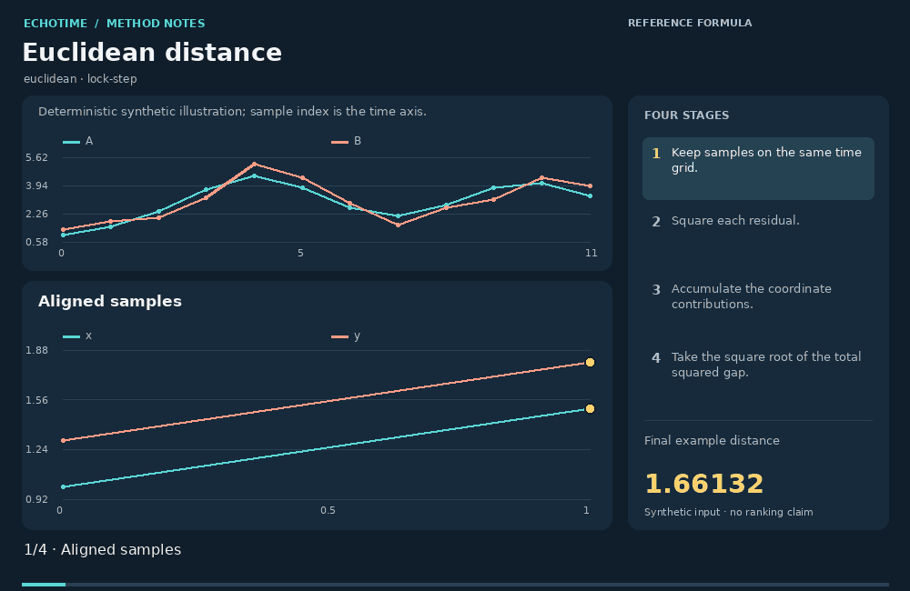

[Static image](../../src/echotime/data/method_animations/media/euclidean.png) · [Inputs and full calculation trace](../../src/echotime/data/method_animations/traces/euclidean.json) · [Open in the website](https://zipengwu.me/EchoTime/guide/methods.html#animation-euclidean)

Euclidean distance treats an aligned time series as one vector. Every vertical gap contributes a squared cost, and the final square root returns the result to the original amplitude units. The animation shows exactly which sample differences produce the final distance; no temporal realignment is performed.

欧氏距离把已经对齐的时间序列视为向量。每个时刻的垂直差先平方后累加，再开平方回到原始幅值单位。动图展示各时刻如何贡献最终距离，整个计算不重新对齐时间。

### Calculation / 计算

```text
sqrt(sum_i (x_i-y_i)^2)
```

1. Keep the two series on the same sample grid; no shift or warping is estimated.
   在同一采样网格上比较两条序列，不估计平移或时间规整。
2. Square each residual; the highlighted point supplies one coordinate contribution.
   计算各坐标残差的平方。
3. Accumulate the coordinate contributions in sample order.
   按采样顺序累积局部贡献。
4. Take the square root of the total squared gap.
   对平方差总和开平方。

**Example distance:** `1.6613248`. Exact formula evaluation on the displayed aligned vectors.

**Parameters:**

```json
{
  "samples": 12,
  "preprocessing": "none",
  "domain": "strictly positive illustration"
}
```

### Interpretation and limits / 解释与边界

- A single large residual can dominate the squared sum. 单个大误差可能主导平方和。
- Sample alignment and amplitude units are part of the comparison protocol. 采样对齐和幅值单位属于比较协议的一部分。

### Definition sources / 定义来源

- [SciPy: euclidean](https://docs.scipy.org/doc/scipy/reference/generated/scipy.spatial.distance.euclidean.html)

<a id="squared_euclidean"></a>
## Squared Euclidean · `squared_euclidean`

**Demonstration:** Reference-formula demonstration / 参考公式演示

**EchoTime coverage:** Low-priority addition

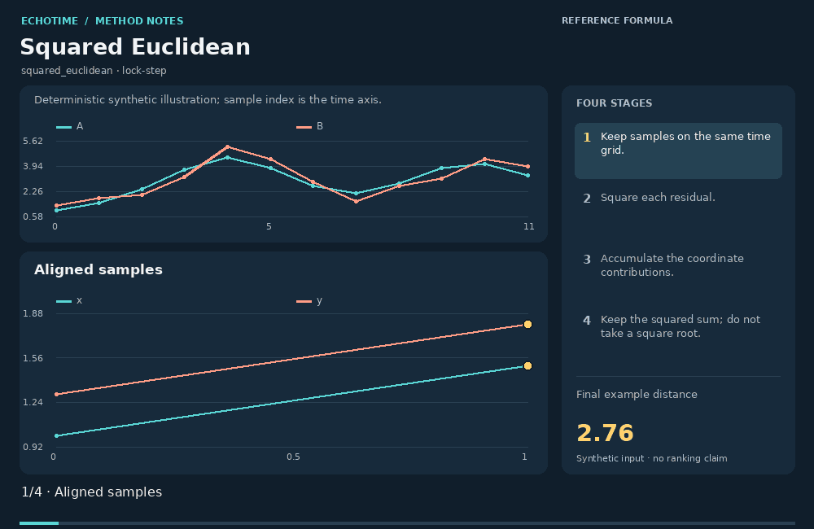

[Static image](../../src/echotime/data/method_animations/media/squared_euclidean.png) · [Inputs and full calculation trace](../../src/echotime/data/method_animations/traces/squared_euclidean.json) · [Open in the website](https://zipengwu.me/EchoTime/guide/methods.html#animation-squared_euclidean)

Squared Euclidean distance accumulates squared residuals without taking a square root. This makes coordinate contributions additive and keeps large errors prominent. It has the same nearest-neighbour ordering as Euclidean distance on the same vectors, but the output has squared amplitude units and is not a metric.

平方欧氏距离直接累加平方残差，不再开平方。因此各坐标贡献可相加，大误差受到更强惩罚。在同一组向量上，它与欧氏距离给出相同的近邻排序，但结果单位为幅值平方，也不满足一般的三角不等式。

### Calculation / 计算

```text
sum_i (x_i-y_i)^2
```

1. Keep the two series on the same sample grid; no shift or warping is estimated.
   在同一采样网格上比较两条序列，不估计平移或时间规整。
2. Square each residual; the highlighted point supplies one coordinate contribution.
   计算各坐标残差的平方。
3. Accumulate the coordinate contributions in sample order.
   按采样顺序累积局部贡献。
4. Keep the squared sum; do not take a square root.
   直接保留平方差总和，不开平方。

**Example distance:** `2.76`. Exact formula evaluation on the displayed aligned vectors.

**Parameters:**

```json
{
  "samples": 12,
  "preprocessing": "none",
  "domain": "strictly positive illustration"
}
```

### Interpretation and limits / 解释与边界

- Squaring a metric does not generally preserve the triangle inequality. 对度量取平方通常不保留三角不等式。
- Sample alignment and amplitude units are part of the comparison protocol. 采样对齐和幅值单位属于比较协议的一部分。

### Definition sources / 定义来源

- [SciPy: sqeuclidean](https://docs.scipy.org/doc/scipy/reference/generated/scipy.spatial.distance.sqeuclidean.html)

<a id="rmse_distance"></a>
## Root mean square error · `rmse_distance`

**Demonstration:** Reference-formula demonstration / 参考公式演示

**EchoTime coverage:** Low-priority addition

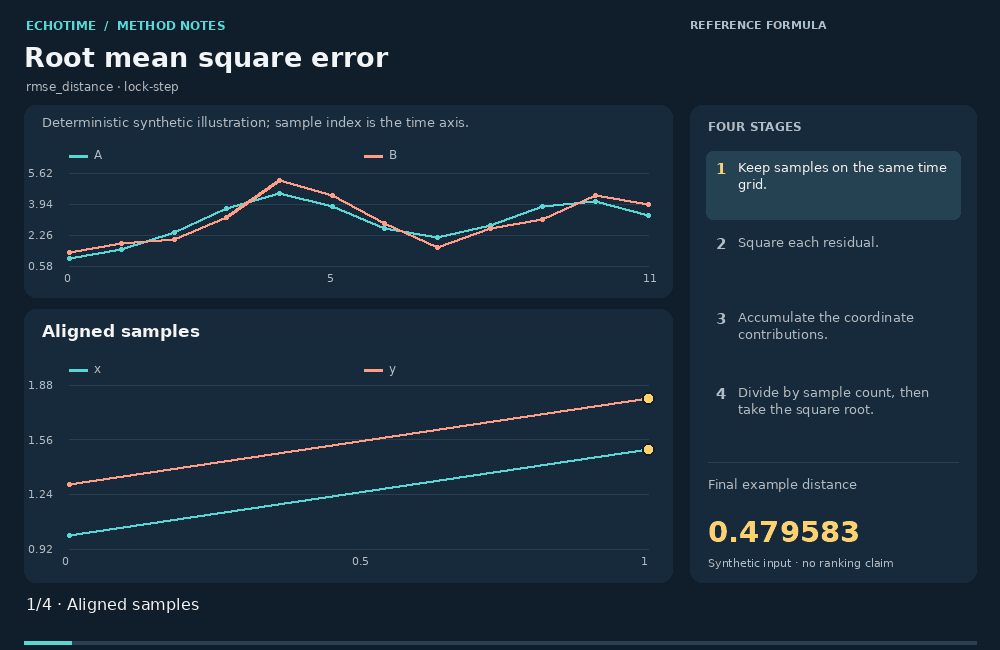

[Static image](../../src/echotime/data/method_animations/media/rmse_distance.png) · [Inputs and full calculation trace](../../src/echotime/data/method_animations/traces/rmse_distance.json) · [Open in the website](https://zipengwu.me/EchoTime/guide/methods.html#animation-rmse_distance)

RMSE averages squared residuals before taking a square root. For vectors of one fixed length it is Euclidean distance divided by the square root of that length. The animation separates the squared-error accumulation, averaging, and final root so its difference from a raw Euclidean total is visible.

RMSE 先对平方误差取平均，再开平方。向量长度固定时，它等于欧氏距离除以长度的平方根。动图将平方累加、求平均和开平方分开，说明它与未归一化欧氏距离的关系。

### Calculation / 计算

```text
sqrt(mean_i (x_i-y_i)^2)
```

1. Keep the two series on the same sample grid; no shift or warping is estimated.
   在同一采样网格上比较两条序列，不估计平移或时间规整。
2. Square each residual; the highlighted point supplies one coordinate contribution.
   计算各坐标残差的平方。
3. Accumulate the coordinate contributions in sample order.
   按采样顺序累积局部贡献。
4. Divide by sample count, then take the square root.
   平方差总和除以样本数后，再开平方。

**Example distance:** `0.47958315`. Exact formula evaluation on the displayed aligned vectors.

**Parameters:**

```json
{
  "samples": 12,
  "preprocessing": "none",
  "domain": "strictly positive illustration"
}
```

### Interpretation and limits / 解释与边界

- The fixed-length equivalence does not justify comparing different missing-data or alignment protocols. 固定长度下的等价关系不能代替缺失值和对齐协议的一致性。
- Sample alignment and amplitude units are part of the comparison protocol. 采样对齐和幅值单位属于比较协议的一部分。

### Definition sources / 定义来源

- [SciPy: euclidean](https://docs.scipy.org/doc/scipy/reference/generated/scipy.spatial.distance.euclidean.html)

<a id="manhattan"></a>
## Manhattan distance · `manhattan`

**Demonstration:** Reference-formula demonstration / 参考公式演示

**EchoTime coverage:** Low-priority addition

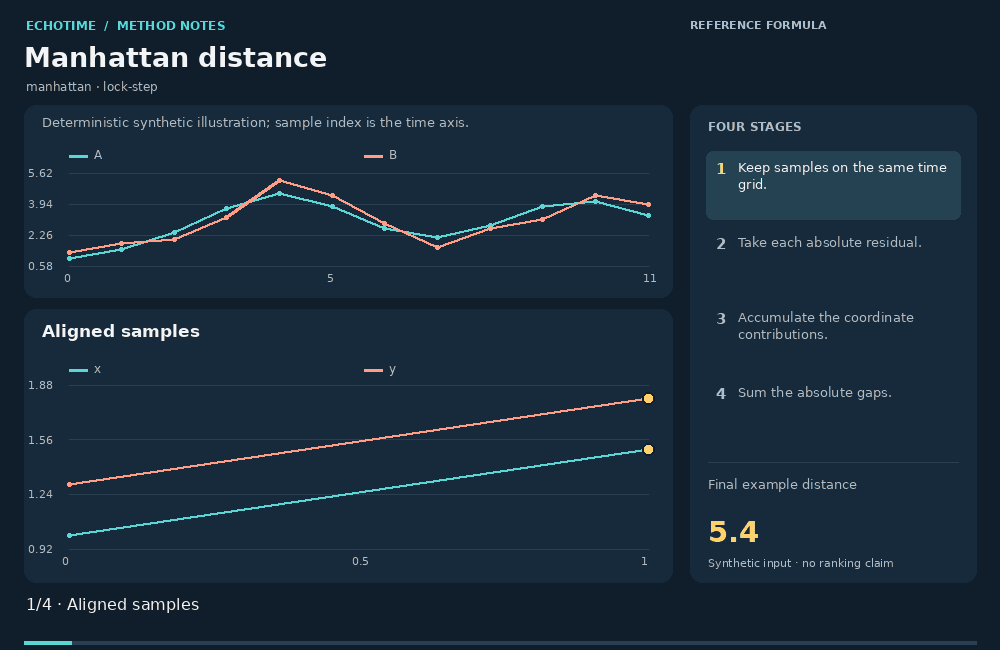

[Static image](../../src/echotime/data/method_animations/media/manhattan.png) · [Inputs and full calculation trace](../../src/echotime/data/method_animations/traces/manhattan.json) · [Open in the website](https://zipengwu.me/EchoTime/guide/methods.html#animation-manhattan)

Manhattan distance adds the absolute gap at every aligned time point. Positive and negative errors cannot cancel, and the penalty grows linearly with each residual. Its animation accumulates visible vertical discrepancies one by one. Longer vectors can produce larger totals even when their typical per-sample discrepancy is unchanged.

曼哈顿距离累加每个对齐时刻的绝对差。正负误差不会抵消，每个残差的惩罚线性增长。动图逐项累积垂直差；即使平均误差不变，序列更长也可能产生更大的总距离。

### Calculation / 计算

```text
sum_i abs(x_i-y_i)
```

1. Keep the two series on the same sample grid; no shift or warping is estimated.
   在同一采样网格上比较两条序列，不估计平移或时间规整。
2. Take each absolute residual; the highlighted point supplies one coordinate contribution.
   计算各坐标的绝对残差。
3. Accumulate the coordinate contributions in sample order.
   按采样顺序累积局部贡献。
4. Sum the absolute gaps.
   直接保留绝对差总和。

**Example distance:** `5.4`. Exact formula evaluation on the displayed aligned vectors.

**Parameters:**

```json
{
  "samples": 12,
  "preprocessing": "none",
  "domain": "strictly positive illustration"
}
```

### Interpretation and limits / 解释与边界

- The sum depends on the number of compared coordinates. 总和依赖比较的坐标数量。
- Sample alignment and amplitude units are part of the comparison protocol. 采样对齐和幅值单位属于比较协议的一部分。

### Definition sources / 定义来源

- [SciPy: cityblock](https://docs.scipy.org/doc/scipy/reference/generated/scipy.spatial.distance.cityblock.html)

<a id="mae_distance"></a>
## Mean absolute error · `mae_distance`

**Demonstration:** Reference-formula demonstration / 参考公式演示

**EchoTime coverage:** Low-priority addition

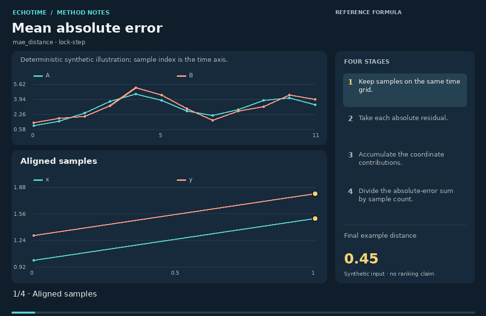

[Static image](../../src/echotime/data/method_animations/media/mae_distance.png) · [Inputs and full calculation trace](../../src/echotime/data/method_animations/traces/mae_distance.json) · [Open in the website](https://zipengwu.me/EchoTime/guide/methods.html#animation-mae_distance)

MAE reports the average absolute discrepancy on an aligned time axis. It divides the Manhattan total by the number of compared coordinates, retaining the original amplitude units. The animation shows both the individual absolute gaps and the average, making clear why the same total can imply different typical errors at different lengths.

MAE 表示对齐时间轴上的平均绝对差。它将曼哈顿总距离除以比较坐标数，仍使用原始幅值单位。动图同时展示各点绝对误差和最终平均值，帮助区分总误差与典型逐点误差。

### Calculation / 计算

```text
mean_i abs(x_i-y_i)
```

1. Keep the two series on the same sample grid; no shift or warping is estimated.
   在同一采样网格上比较两条序列，不估计平移或时间规整。
2. Take each absolute residual; the highlighted point supplies one coordinate contribution.
   计算各坐标的绝对残差。
3. Accumulate the coordinate contributions in sample order.
   按采样顺序累积局部贡献。
4. Divide the absolute-error sum by sample count.
   绝对差总和除以样本数。

**Example distance:** `0.45`. Exact formula evaluation on the displayed aligned vectors.

**Parameters:**

```json
{
  "samples": 12,
  "preprocessing": "none",
  "domain": "strictly positive illustration"
}
```

### Interpretation and limits / 解释与边界

- Averaging does not remove sensitivity to a systematic time shift. 求平均不能消除系统性的时间偏移影响。
- Sample alignment and amplitude units are part of the comparison protocol. 采样对齐和幅值单位属于比较协议的一部分。

### Definition sources / 定义来源

- [SciPy: cityblock](https://docs.scipy.org/doc/scipy/reference/generated/scipy.spatial.distance.cityblock.html)

<a id="minkowski"></a>
## Minkowski distance (p=3) · `minkowski`

**Demonstration:** Reference-formula demonstration / 参考公式演示

**EchoTime coverage:** Low-priority addition

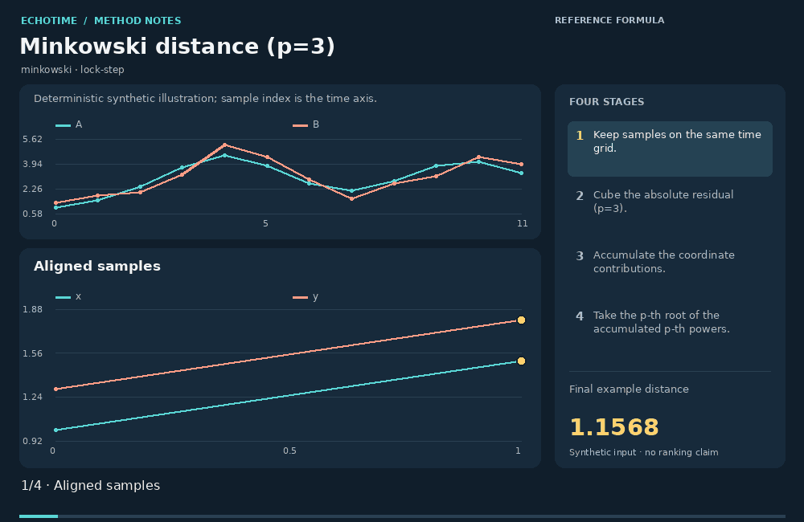

[Static image](../../src/echotime/data/method_animations/media/minkowski.png) · [Inputs and full calculation trace](../../src/echotime/data/method_animations/traces/minkowski.json) · [Open in the website](https://zipengwu.me/EchoTime/guide/methods.html#animation-minkowski)

Minkowski distance controls how strongly larger coordinate errors dominate through an exponent p. This illustration fixes p to three: absolute residuals are cubed, added, and then transformed by a cube root. Choosing another p changes the definition; p equals one and two recover Manhattan and Euclidean distances.

Minkowski 距离用指数 p 控制大误差的影响。本例固定 p=3：绝对残差立方后相加，再开立方。p 的选择属于方法定义；p=1 与 p=2 分别对应曼哈顿和欧氏距离。

### Calculation / 计算

```text
(sum_i abs(x_i-y_i)^p)^(1/p); p=3
```

1. Keep the two series on the same sample grid; no shift or warping is estimated.
   在同一采样网格上比较两条序列，不估计平移或时间规整。
2. Cube the absolute residual (p=3); the highlighted point supplies one coordinate contribution.
   对各坐标绝对残差取三次方，本例 p=3。
3. Accumulate the coordinate contributions in sample order.
   按采样顺序累积局部贡献。
4. Take the p-th root of the accumulated p-th powers.
   对三次方总和开立方。

**Example distance:** `1.1567966`. Exact formula evaluation on the displayed aligned vectors.

**Parameters:**

```json
{
  "samples": 12,
  "preprocessing": "none",
  "domain": "strictly positive illustration",
  "p": 3
}
```

### Interpretation and limits / 解释与边界

- The norm/metric property requires p >= 1; p < 1 defines a different quasi-distance. 范数和度量性质要求 p≥1；p<1 时属于不同的拟距离。
- Sample alignment and amplitude units are part of the comparison protocol. 采样对齐和幅值单位属于比较协议的一部分。

### Definition sources / 定义来源

- [SciPy: minkowski](https://docs.scipy.org/doc/scipy/reference/generated/scipy.spatial.distance.minkowski.html)

<a id="chebyshev"></a>
## Chebyshev distance · `chebyshev`

**Demonstration:** Reference-formula demonstration / 参考公式演示

**EchoTime coverage:** Low-priority addition

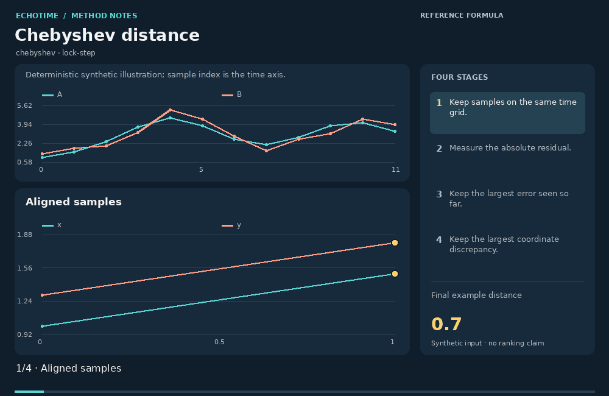

[Static image](../../src/echotime/data/method_animations/media/chebyshev.png) · [Inputs and full calculation trace](../../src/echotime/data/method_animations/traces/chebyshev.json) · [Open in the website](https://zipengwu.me/EchoTime/guide/methods.html#animation-chebyshev)

Chebyshev distance keeps only the largest aligned absolute error. A running maximum identifies the worst discrepancy as the animation scans the sequence. It answers a maximum-deviation question, so a small improvement at the worst point matters while changes below the current maximum may leave the result unchanged.

Chebyshev 距离只保留最大的逐点绝对误差。动图扫描序列并更新当前最大值，回答最坏偏差有多大的问题。因此最大误差位置的变化很重要，其他位置的小幅变化可能完全不改变结果。

### Calculation / 计算

```text
max_i abs(x_i-y_i)
```

1. Keep the two series on the same sample grid; no shift or warping is estimated.
   在同一采样网格上比较两条序列，不估计平移或时间规整。
2. Measure the absolute residual; the highlighted point supplies one coordinate contribution.
   计算各坐标的绝对残差。
3. Update the running maximum.
   更新当前最大误差。
4. Keep the largest coordinate discrepancy.
   以所有坐标中的最大绝对差作为结果。

**Example distance:** `0.7`. Exact formula evaluation on the displayed aligned vectors.

**Parameters:**

```json
{
  "samples": 12,
  "preprocessing": "none",
  "domain": "strictly positive illustration"
}
```

### Interpretation and limits / 解释与边界

- One isolated spike may determine the entire result. 一个孤立尖峰就可能决定全部结果。
- Sample alignment and amplitude units are part of the comparison protocol. 采样对齐和幅值单位属于比较协议的一部分。

### Definition sources / 定义来源

- [SciPy: chebyshev](https://docs.scipy.org/doc/scipy/reference/generated/scipy.spatial.distance.chebyshev.html)

<a id="canberra"></a>
## Canberra distance · `canberra`

**Demonstration:** Reference-formula demonstration / 参考公式演示

**EchoTime coverage:** Low-priority addition

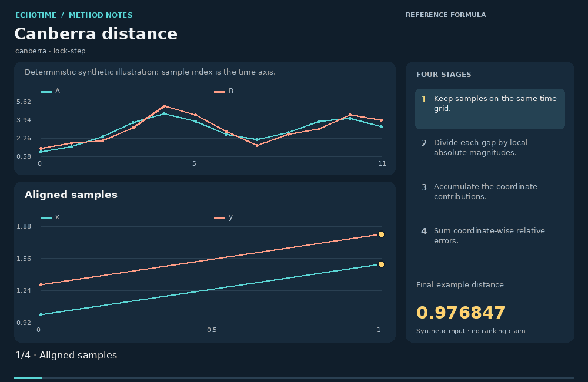

[Static image](../../src/echotime/data/method_animations/media/canberra.png) · [Inputs and full calculation trace](../../src/echotime/data/method_animations/traces/canberra.json) · [Open in the website](https://zipengwu.me/EchoTime/guide/methods.html#animation-canberra)

Canberra distance normalizes each coordinate error by the magnitudes at that same coordinate before adding the ratios. This gives small-amplitude positions a potentially large influence compared with an unscaled absolute error. The example uses positive values so the animation can expose the local denominator without an undefined zero-over-zero term.

Canberra 距离先用每个坐标两侧幅值之和归一化该点误差，再累加比值。相较未缩放的绝对误差，低幅值位置可能获得较大影响。本例使用正值，明确展示逐点分母并避免 0/0。

### Calculation / 计算

```text
sum_i abs(x_i-y_i)/(abs(x_i)+abs(y_i))
```

1. Keep the two series on the same sample grid; no shift or warping is estimated.
   在同一采样网格上比较两条序列，不估计平移或时间规整。
2. Divide each gap by local absolute magnitudes; the highlighted point supplies one coordinate contribution.
   逐坐标以两侧绝对幅值之和归一化绝对差。
3. Accumulate the coordinate contributions in sample order.
   按采样顺序累积局部贡献。
4. Sum coordinate-wise relative errors.
   累加所有逐坐标相对误差。

**Example distance:** `0.97684677`. Exact formula evaluation on the displayed aligned vectors.

**Parameters:**

```json
{
  "samples": 12,
  "preprocessing": "none",
  "domain": "strictly positive illustration"
}
```

### Interpretation and limits / 解释与边界

- Near-zero coordinates can be influential; a zero-over-zero convention must be stated. 接近零的坐标可能影响很大；必须声明 0/0 的处理约定。
- Sample alignment and amplitude units are part of the comparison protocol. 采样对齐和幅值单位属于比较协议的一部分。

### Definition sources / 定义来源

- [SciPy: canberra](https://docs.scipy.org/doc/scipy/reference/generated/scipy.spatial.distance.canberra.html)

<a id="bray_curtis"></a>
## Bray-Curtis dissimilarity · `bray_curtis`

**Demonstration:** Reference-formula demonstration / 参考公式演示

**EchoTime coverage:** Low-priority addition

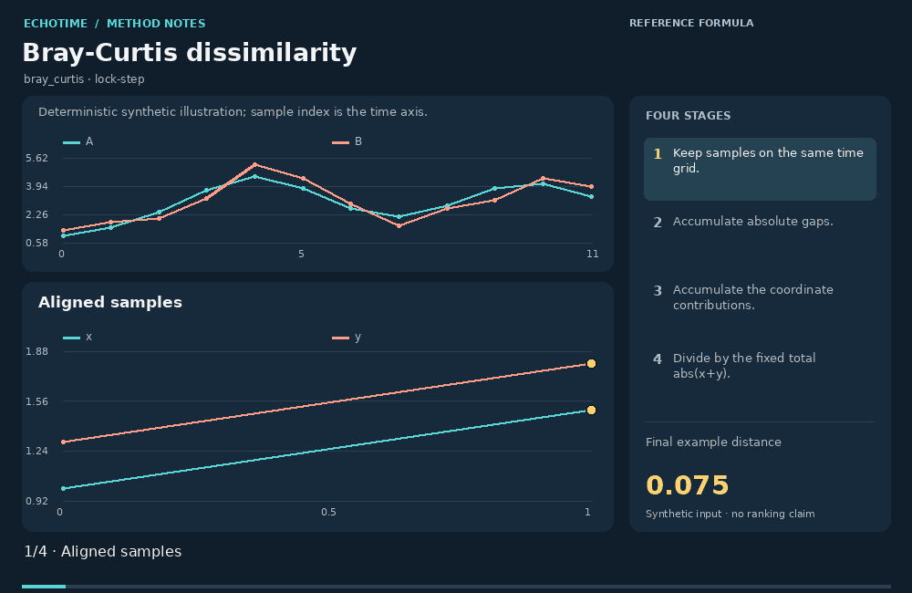

[Static image](../../src/echotime/data/method_animations/media/bray_curtis.png) · [Inputs and full calculation trace](../../src/echotime/data/method_animations/traces/bray_curtis.json) · [Open in the website](https://zipengwu.me/EchoTime/guide/methods.html#animation-bray_curtis)

Bray-Curtis divides a total absolute discrepancy by a total combined magnitude. The denominator is global, unlike Canberra's coordinate-specific denominators. On the positive illustration it measures discrepancy relative to the combined mass. The displayed calculation uses the exact absolute-sum denominator in the imported registry and SciPy definition.

Bray-Curtis 用总绝对差除以整体合并幅值。其分母是全局的，与 Canberra 逐坐标归一化不同。本例输入为正值，结果表示相对合并总量的差异；所示公式采用导入登记表及 SciPy 的绝对和分母。

### Calculation / 计算

```text
sum_i abs(x_i-y_i) / sum_i abs(x_i+y_i)
```

1. Keep the two series on the same sample grid; no shift or warping is estimated.
   在同一采样网格上比较两条序列，不估计平移或时间规整。
2. Accumulate absolute gaps; the highlighted point supplies one coordinate contribution.
   计算各坐标的绝对残差。
3. Accumulate the coordinate contributions in sample order.
   按采样顺序累积局部贡献。
4. Divide by the fixed total abs(x+y).
   用绝对差总和除以固定的 sum(abs(x+y))。

**Example distance:** `0.075`. Exact formula evaluation on the displayed aligned vectors.

**Parameters:**

```json
{
  "samples": 12,
  "preprocessing": "none",
  "domain": "strictly positive illustration",
  "global_denominator": 72.0
}
```

### Interpretation and limits / 解释与边界

- Signed data can cause a zero or small denominator; the usual bounded interpretation assumes nonnegative data. 带符号数据可能使分母为零或很小；通常的有界解释依赖非负输入。
- Sample alignment and amplitude units are part of the comparison protocol. 采样对齐和幅值单位属于比较协议的一部分。

### Definition sources / 定义来源

- [SciPy: braycurtis](https://docs.scipy.org/doc/scipy/reference/generated/scipy.spatial.distance.braycurtis.html)

<a id="sorensen"></a>
## Sorensen-style dissimilarity · `sorensen`

**Demonstration:** Reference-formula demonstration / 参考公式演示

**EchoTime coverage:** Low-priority addition

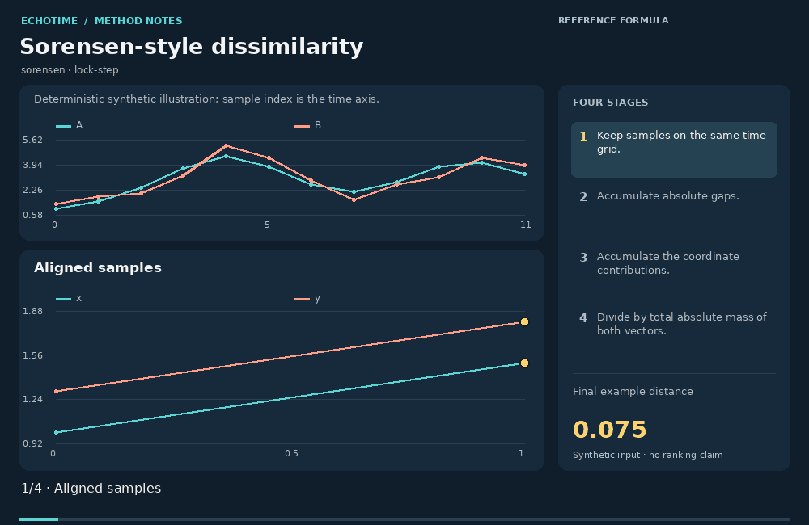

[Static image](../../src/echotime/data/method_animations/media/sorensen.png) · [Inputs and full calculation trace](../../src/echotime/data/method_animations/traces/sorensen.json) · [Open in the website](https://zipengwu.me/EchoTime/guide/methods.html#animation-sorensen)

This registry entry normalizes the absolute-error total by the sum of both vectors' absolute magnitudes. On nonnegative data it agrees with Bray-Curtis; signed data distinguish their denominators. The animation states the formula explicitly because the Sorensen name is also used for set-based coefficients with a different input object.

此登记条目用两侧绝对幅值的总和归一化绝对误差总量。非负输入时它与 Bray-Curtis 相同，带符号输入时两者分母不同。Sorensen 也用于集合系数，因此本动图直接声明所演示的数值向量公式。

### Calculation / 计算

```text
sum_i abs(x_i-y_i) / sum_i (abs(x_i)+abs(y_i))
```

1. Keep the two series on the same sample grid; no shift or warping is estimated.
   在同一采样网格上比较两条序列，不估计平移或时间规整。
2. Accumulate absolute gaps; the highlighted point supplies one coordinate contribution.
   计算各坐标的绝对残差。
3. Accumulate the coordinate contributions in sample order.
   按采样顺序累积局部贡献。
4. Divide by total absolute mass of both vectors.
   用绝对差总和除以两向量绝对幅值的总和。

**Example distance:** `0.075`. Exact formula evaluation on the displayed aligned vectors.

**Parameters:**

```json
{
  "samples": 12,
  "preprocessing": "none",
  "domain": "strictly positive illustration",
  "global_denominator": 72.0
}
```

### Interpretation and limits / 解释与边界

- This is the registry's numerical-vector convention, not the binary set Dice coefficient. 这里使用登记表的数值向量约定，与二元集合 Dice 系数的输入对象不同。
- Sample alignment and amplitude units are part of the comparison protocol. 采样对齐和幅值单位属于比较协议的一部分。

### Definition sources / 定义来源

- [Imported registry: explicit formula convention](https://github.com/ZipengWu365/EchoTime/blob/main/src/echotime/data/ts_similarity_package_v2_registry.csv)

<a id="soergel"></a>
## Soergel-style distance · `soergel`

**Demonstration:** Reference-formula demonstration / 参考公式演示

**EchoTime coverage:** Low-priority addition

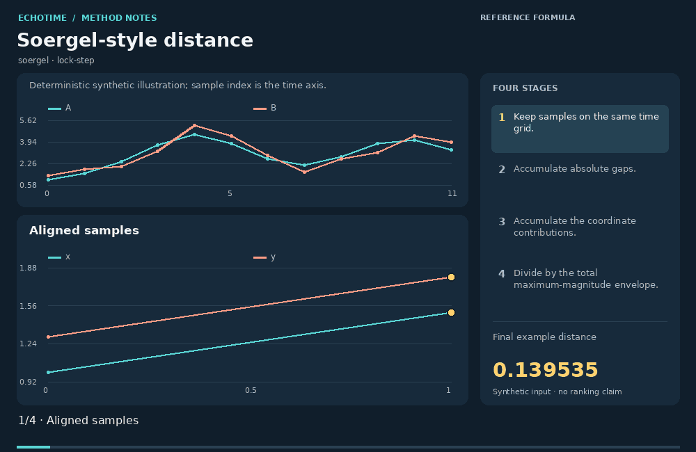

[Static image](../../src/echotime/data/method_animations/media/soergel.png) · [Inputs and full calculation trace](../../src/echotime/data/method_animations/traces/soergel.json) · [Open in the website](https://zipengwu.me/EchoTime/guide/methods.html#animation-soergel)

The Soergel-style entry divides total absolute discrepancy by the sum of the larger magnitudes at each coordinate. The animation contrasts its fixed maximum-envelope denominator with the residual sum. Nonnegative vectors provide the standard overlap interpretation; the absolute-magnitude extension shown in the registry needs its signed-data convention kept explicit.

Soergel 型条目用各坐标较大幅值的总和归一化绝对误差。动图展示最大幅值包络分母与误差总和的关系。非负向量具有通常的重叠解释；登记表对带符号输入采用绝对幅值扩展，需要明确这一约定。

### Calculation / 计算

```text
sum_i abs(x_i-y_i) / sum_i max(abs(x_i),abs(y_i))
```

1. Keep the two series on the same sample grid; no shift or warping is estimated.
   在同一采样网格上比较两条序列，不估计平移或时间规整。
2. Accumulate absolute gaps; the highlighted point supplies one coordinate contribution.
   计算各坐标的绝对残差。
3. Accumulate the coordinate contributions in sample order.
   按采样顺序累积局部贡献。
4. Divide by the total maximum-magnitude envelope.
   用绝对差总和除以各坐标较大绝对幅值的总和。

**Example distance:** `0.13953488`. Exact formula evaluation on the displayed aligned vectors.

**Parameters:**

```json
{
  "samples": 12,
  "preprocessing": "none",
  "domain": "strictly positive illustration",
  "global_denominator": 38.7
}
```

### Interpretation and limits / 解释与边界

- The example uses nonnegative values; signed extensions need separate property checks. 本例使用非负值；带符号扩展的性质需要另行检查。
- Sample alignment and amplitude units are part of the comparison protocol. 采样对齐和幅值单位属于比较协议的一部分。

### Definition sources / 定义来源

- [Imported registry: explicit formula convention](https://github.com/ZipengWu365/EchoTime/blob/main/src/echotime/data/ts_similarity_package_v2_registry.csv)

<a id="kulczynski"></a>
## Kulczynski-style ratio · `kulczynski`

**Demonstration:** Reference-formula demonstration / 参考公式演示

**EchoTime coverage:** Low-priority addition

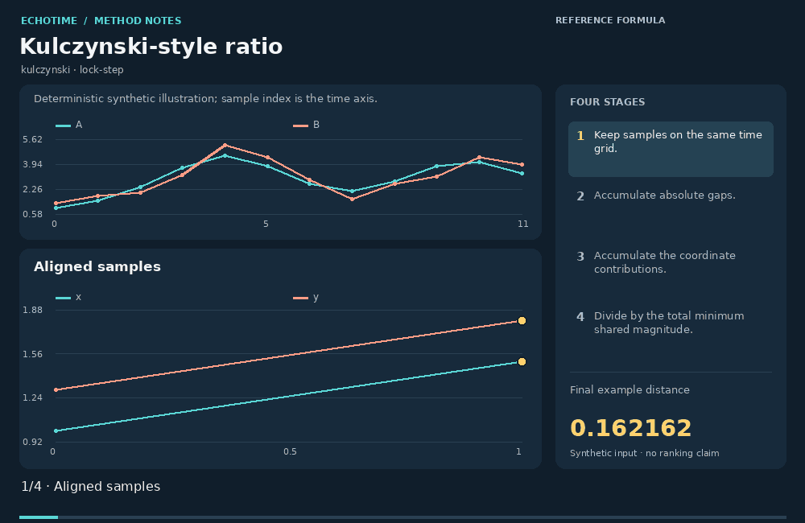

[Static image](../../src/echotime/data/method_animations/media/kulczynski.png) · [Inputs and full calculation trace](../../src/echotime/data/method_animations/traces/kulczynski.json) · [Open in the website](https://zipengwu.me/EchoTime/guide/methods.html#animation-kulczynski)

This registry convention compares total discrepancy with the smaller magnitude available at each coordinate. A small shared-magnitude denominator can amplify the result sharply. The animation exposes this denominator rather than hiding it in a generic distance score. Several different association coefficients share the Kulczynski name, so this particular formula is recorded explicitly.

此登记约定用各坐标较小幅值的总和作为分母。共享幅值较小时，比值会显著放大。动图显式展示分母。Kulczynski 名称也用于其他关联系数，因此这里记录的只是所列的特定公式。

### Calculation / 计算

```text
sum_i abs(x_i-y_i) / sum_i min(abs(x_i),abs(y_i))
```

1. Keep the two series on the same sample grid; no shift or warping is estimated.
   在同一采样网格上比较两条序列，不估计平移或时间规整。
2. Accumulate absolute gaps; the highlighted point supplies one coordinate contribution.
   计算各坐标的绝对残差。
3. Accumulate the coordinate contributions in sample order.
   按采样顺序累积局部贡献。
4. Divide by the total minimum shared magnitude.
   用绝对差总和除以各坐标较小绝对幅值的总和。

**Example distance:** `0.16216216`. Exact formula evaluation on the displayed aligned vectors.

**Parameters:**

```json
{
  "samples": 12,
  "preprocessing": "none",
  "domain": "strictly positive illustration",
  "global_denominator": 33.3
}
```

### Interpretation and limits / 解释与边界

- The ratio is undefined at zero shared mass and is not bounded by one. 共享总量为零时比值未定义，结果也不以 1 为上界。
- Sample alignment and amplitude units are part of the comparison protocol. 采样对齐和幅值单位属于比较协议的一部分。

### Definition sources / 定义来源

- [Imported registry: explicit formula convention](https://github.com/ZipengWu365/EchoTime/blob/main/src/echotime/data/ts_similarity_package_v2_registry.csv)

<a id="clark"></a>
## Clark distance · `clark`

**Demonstration:** Reference-formula demonstration / 参考公式演示

**EchoTime coverage:** Low-priority addition

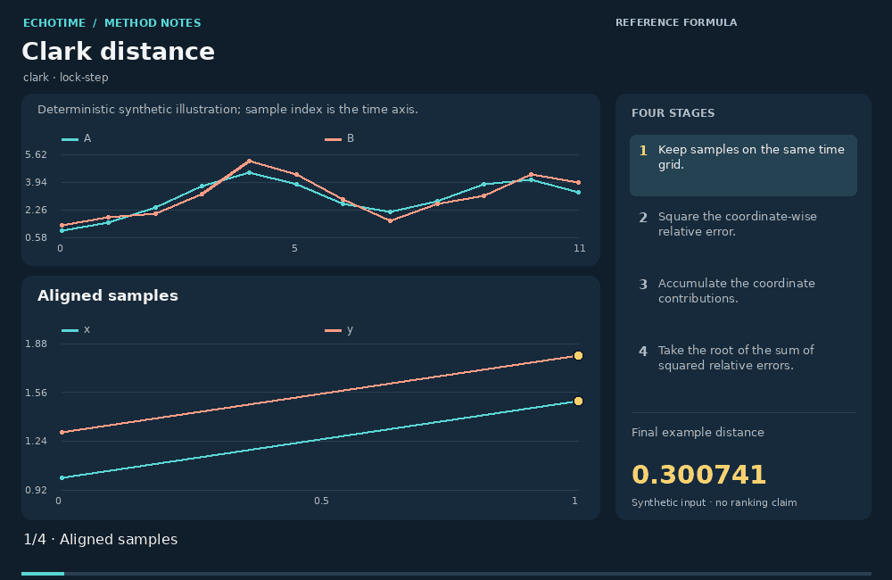

[Static image](../../src/echotime/data/method_animations/media/clark.png) · [Inputs and full calculation trace](../../src/echotime/data/method_animations/traces/clark.json) · [Open in the website](https://zipengwu.me/EchoTime/guide/methods.html#animation-clark)

Clark distance forms a relative error at each coordinate, then takes an Euclidean norm of those ratios. It therefore differs from Canberra's straight sum of relative errors. The animation first exposes the local ratios and then squares and aggregates them, showing how one relatively discordant coordinate can dominate the combined score.

Clark 距离先形成逐坐标相对误差，再对这些比值求欧氏范数。它与直接累加相对误差的 Canberra 不同。动图先计算局部比值，再平方聚合，展示相对差异较大的位置如何影响总体结果。

### Calculation / 计算

```text
sqrt(sum_i (abs(x_i-y_i)/(abs(x_i)+abs(y_i)))^2)
```

1. Keep the two series on the same sample grid; no shift or warping is estimated.
   在同一采样网格上比较两条序列，不估计平移或时间规整。
2. Square the coordinate-wise relative error; the highlighted point supplies one coordinate contribution.
   逐坐标计算相对绝对误差，再将比值平方。
3. Accumulate the coordinate contributions in sample order.
   按采样顺序累积局部贡献。
4. Take the root of the sum of squared relative errors.
   对相对误差平方和开平方。

**Example distance:** `0.30074145`. Exact formula evaluation on the displayed aligned vectors.

**Parameters:**

```json
{
  "samples": 12,
  "preprocessing": "none",
  "domain": "strictly positive illustration"
}
```

### Interpretation and limits / 解释与边界

- The local zero-over-zero convention matters, especially for sparse signals. 稀疏信号尤其需要明确局部 0/0 的处理约定。
- Sample alignment and amplitude units are part of the comparison protocol. 采样对齐和幅值单位属于比较协议的一部分。

### Definition sources / 定义来源

- [Imported registry: explicit formula convention](https://github.com/ZipengWu365/EchoTime/blob/main/src/echotime/data/ts_similarity_package_v2_registry.csv)

<a id="wave_hedges"></a>
## Wave-Hedges distance · `wave_hedges`

**Demonstration:** Reference-formula demonstration / 参考公式演示

**EchoTime coverage:** Low-priority addition

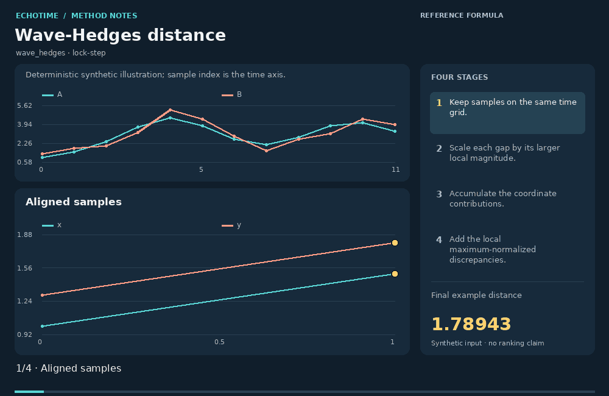

[Static image](../../src/echotime/data/method_animations/media/wave_hedges.png) · [Inputs and full calculation trace](../../src/echotime/data/method_animations/traces/wave_hedges.json) · [Open in the website](https://zipengwu.me/EchoTime/guide/methods.html#animation-wave_hedges)

Wave-Hedges normalizes each coordinate's absolute discrepancy by its larger magnitude and then adds the ratios. In contrast to a single global normalization, every active coordinate can contribute substantially regardless of its absolute scale. The animation illustrates the local maximum denominator on strictly positive data, avoiding an unstated zero-over-zero rule.

Wave-Hedges 用每个坐标较大的幅值归一化该点误差，再求和。与全局归一化相比，每个非零坐标都可能产生明显贡献，不取决于其绝对规模。本例使用严格正值，避免未声明的 0/0 规则。

### Calculation / 计算

```text
sum_i abs(x_i-y_i)/max(abs(x_i),abs(y_i))
```

1. Keep the two series on the same sample grid; no shift or warping is estimated.
   在同一采样网格上比较两条序列，不估计平移或时间规整。
2. Scale each gap by its larger local magnitude; the highlighted point supplies one coordinate contribution.
   逐坐标以较大绝对幅值归一化绝对差。
3. Accumulate the coordinate contributions in sample order.
   按采样顺序累积局部贡献。
4. Add the local maximum-normalized discrepancies.
   累加各坐标归一化后的误差。

**Example distance:** `1.7894273`. Exact formula evaluation on the displayed aligned vectors.

**Parameters:**

```json
{
  "samples": 12,
  "preprocessing": "none",
  "domain": "strictly positive illustration"
}
```

### Interpretation and limits / 解释与边界

- Sparse near-zero coordinates require a declared convention; signed inputs change the usual range. 稀疏近零坐标需要声明约定；带符号输入会改变通常的取值范围。
- Sample alignment and amplitude units are part of the comparison protocol. 采样对齐和幅值单位属于比较协议的一部分。

### Definition sources / 定义来源

- [Imported registry: explicit formula convention](https://github.com/ZipengWu365/EchoTime/blob/main/src/echotime/data/ts_similarity_package_v2_registry.csv)

<a id="lorentzian"></a>
## Lorentzian-style log distance · `lorentzian`

**Demonstration:** Reference-formula demonstration / 参考公式演示

**EchoTime coverage:** Low-priority addition

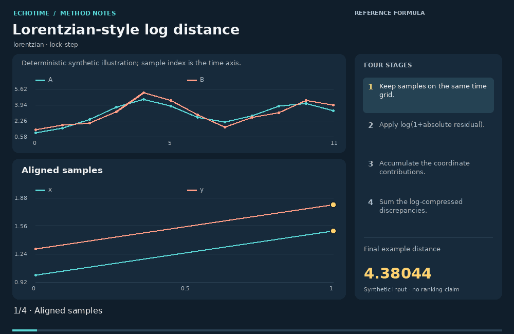

[Static image](../../src/echotime/data/method_animations/media/lorentzian.png) · [Inputs and full calculation trace](../../src/echotime/data/method_animations/traces/lorentzian.json) · [Open in the website](https://zipengwu.me/EchoTime/guide/methods.html#animation-lorentzian)

This Lorentzian-style entry applies a logarithm to each absolute residual before summing. The transformation compresses large residuals relative to a linear or squared penalty. Its animation compares raw residuals with the log-transformed contributions. The added constant one fixes an implicit amplitude scale, which must be meaningful for the data units.

此 Lorentzian 型条目先对每个绝对残差进行 log(1+误差) 变换，再累加。相较线性或平方惩罚，对数会压缩大误差。加数 1 隐含了幅值尺度，因此使用时必须考虑数据单位。

### Calculation / 计算

```text
sum_i log(1+abs(x_i-y_i))
```

1. Keep the two series on the same sample grid; no shift or warping is estimated.
   在同一采样网格上比较两条序列，不估计平移或时间规整。
2. Apply log(1+absolute residual); the highlighted point supplies one coordinate contribution.
   逐坐标计算 log(1+绝对残差)。
3. Accumulate the coordinate contributions in sample order.
   按采样顺序累积局部贡献。
4. Sum the log-compressed discrepancies.
   直接累加对数压缩后的局部贡献。

**Example distance:** `4.3804448`. Exact formula evaluation on the displayed aligned vectors.

**Parameters:**

```json
{
  "samples": 12,
  "preprocessing": "none",
  "domain": "strictly positive illustration"
}
```

### Interpretation and limits / 解释与边界

- Changing measurement units changes the balance introduced by the constant one. 改变测量单位会改变常数 1 所引入的尺度关系。
- Sample alignment and amplitude units are part of the comparison protocol. 采样对齐和幅值单位属于比较协议的一部分。

### Definition sources / 定义来源

- [Imported registry: explicit formula convention](https://github.com/ZipengWu365/EchoTime/blob/main/src/echotime/data/ts_similarity_package_v2_registry.csv)

<a id="cosine_similarity"></a>
## Cosine similarity · `cosine_similarity`

**Demonstration:** Reference-formula demonstration / 参考公式演示

**EchoTime coverage:** Low-priority addition


[Static image](../../src/echotime/data/method_animations/media/cosine_similarity.png) · [Inputs and full calculation trace](../../src/echotime/data/method_animations/traces/cosine_similarity.json) · [Open in the website](https://zipengwu.me/EchoTime/guide/methods.html#animation-cosine_similarity)

Cosine comparison uses the angle between two complete sample vectors. It divides their dot product by both vector norms and leaves the mean level intact. The animation shows the signed coordinate products and their norm-scaled accumulation, then applies the selected angular or one-minus transform when this card reports a distance.

余弦比较使用完整采样向量之间的夹角，以两向量范数乘积归一化点积，并保留均值水平。动图展示带符号坐标乘积及归一化累加；距离型条目随后应用反余弦或 1 减相似度变换。

### Calculation / 计算

```text
dot(x,y)/(||x||_2 ||y||_2)
```

1. Keep each full sample vector without mean subtraction.
   保留完整采样向量，不去均值。
2. Compute vector norms and coordinate-wise products.
   计算向量范数和逐坐标乘积。
3. Divide the product sum by the product of the two norms.
   以范数乘积归一化点积。
4. Read the signed agreement coefficient.
   应用所示最终变换得到分数。

**Example similarity:** `0.9975587`.

**Parameters:**

```json
{
  "centering": false,
  "ranking": false,
  "tie_rule": "not applicable"
}
```

### Interpretation and limits / 解释与边界

- Zero-norm vectors have no defined angle; this example excludes them. 零范数向量的夹角未定义，本例不包含此情形。
- Positive scaling is removed but an additive offset changes the direction. 正缩放被消除，但加性偏移会改变方向。
- The normalized angular form is a metric on unit directions; 1-cosine generally fails the triangle inequality. 归一化角距离在单位方向上是度量；1−余弦一般不满足三角不等式。

### Definition sources / 定义来源

- [SciPy: cosine](https://docs.scipy.org/doc/scipy/reference/generated/scipy.spatial.distance.cosine.html)

<a id="cosine_distance"></a>
## Cosine distance · `cosine_distance`

**Demonstration:** Reference-formula demonstration / 参考公式演示

**EchoTime coverage:** Low-priority addition

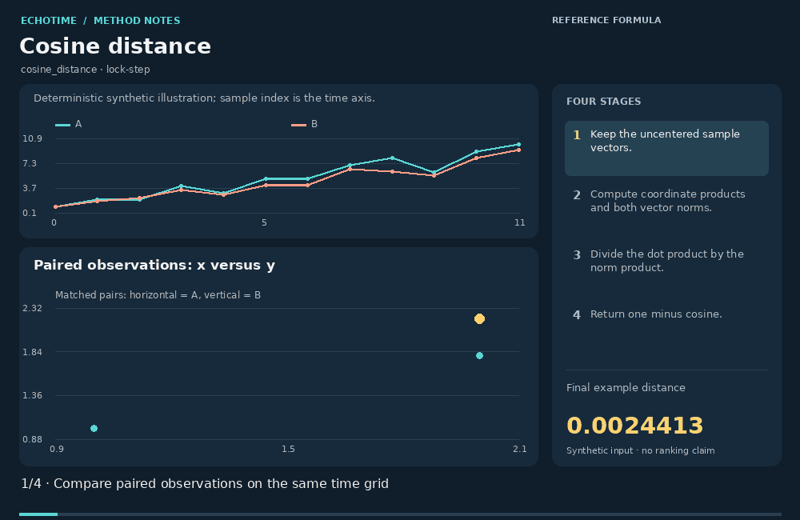

[Static image](../../src/echotime/data/method_animations/media/cosine_distance.png) · [Inputs and full calculation trace](../../src/echotime/data/method_animations/traces/cosine_distance.json) · [Open in the website](https://zipengwu.me/EchoTime/guide/methods.html#animation-cosine_distance)

Cosine comparison uses the angle between two complete sample vectors. It divides their dot product by both vector norms and leaves the mean level intact. The animation shows the signed coordinate products and their norm-scaled accumulation, then applies the selected angular or one-minus transform when this card reports a distance.

余弦比较使用完整采样向量之间的夹角，以两向量范数乘积归一化点积，并保留均值水平。动图展示带符号坐标乘积及归一化累加；距离型条目随后应用反余弦或 1 减相似度变换。

### Calculation / 计算

```text
1 - dot(x,y)/(||x||_2 ||y||_2)
```

1. Keep each full sample vector without mean subtraction.
   保留完整采样向量，不去均值。
2. Compute vector norms and coordinate-wise products.
   计算向量范数和逐坐标乘积。
3. Divide the product sum by the product of the two norms.
   以范数乘积归一化点积。
4. Subtract similarity from one.
   应用所示最终变换得到分数。

**Example distance:** `0.0024412963`.

**Parameters:**

```json
{
  "centering": false,
  "ranking": false,
  "tie_rule": "not applicable"
}
```

### Interpretation and limits / 解释与边界

- Zero-norm vectors have no defined angle; this example excludes them. 零范数向量的夹角未定义，本例不包含此情形。
- Positive scaling is removed but an additive offset changes the direction. 正缩放被消除，但加性偏移会改变方向。
- The normalized angular form is a metric on unit directions; 1-cosine generally fails the triangle inequality. 归一化角距离在单位方向上是度量；1−余弦一般不满足三角不等式。

### Definition sources / 定义来源

- [SciPy: cosine](https://docs.scipy.org/doc/scipy/reference/generated/scipy.spatial.distance.cosine.html)

<a id="angular_distance"></a>
## Angular distance · `angular_distance`

**Demonstration:** Reference-formula demonstration / 参考公式演示

**EchoTime coverage:** Low-priority addition

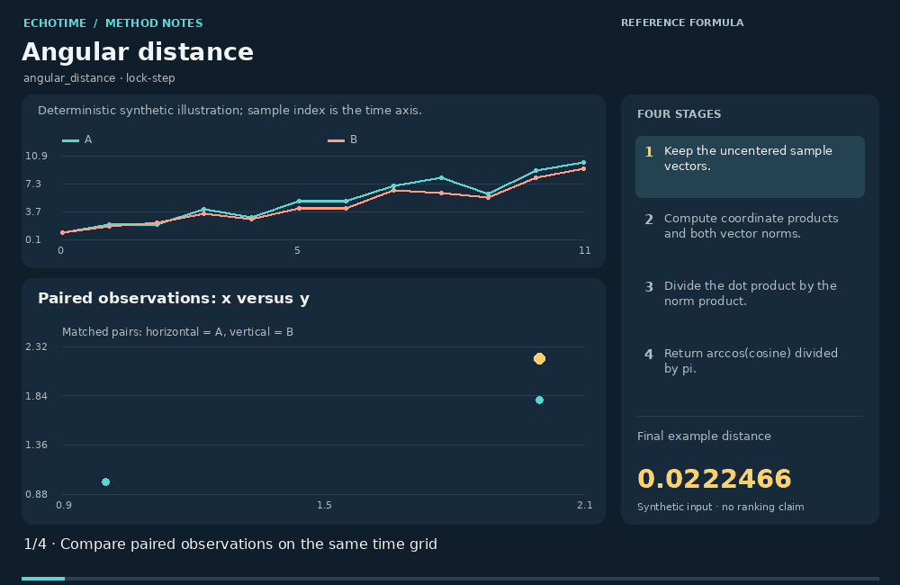

[Static image](../../src/echotime/data/method_animations/media/angular_distance.png) · [Inputs and full calculation trace](../../src/echotime/data/method_animations/traces/angular_distance.json) · [Open in the website](https://zipengwu.me/EchoTime/guide/methods.html#animation-angular_distance)

Cosine comparison uses the angle between two complete sample vectors. It divides their dot product by both vector norms and leaves the mean level intact. The animation shows the signed coordinate products and their norm-scaled accumulation, then applies the selected angular or one-minus transform when this card reports a distance.

余弦比较使用完整采样向量之间的夹角，以两向量范数乘积归一化点积，并保留均值水平。动图展示带符号坐标乘积及归一化累加；距离型条目随后应用反余弦或 1 减相似度变换。

### Calculation / 计算

```text
acos(cos(x,y))/pi
```

1. Keep each full sample vector without mean subtraction.
   保留完整采样向量，不去均值。
2. Compute vector norms and coordinate-wise products.
   计算向量范数和逐坐标乘积。
3. Divide the product sum by the product of the two norms.
   以范数乘积归一化点积。
4. Apply arccos and divide by pi.
   应用所示最终变换得到分数。

**Example distance:** `0.022246606`.

**Parameters:**

```json
{
  "centering": false,
  "ranking": false,
  "tie_rule": "not applicable"
}
```

### Interpretation and limits / 解释与边界

- Zero-norm vectors have no defined angle; this example excludes them. 零范数向量的夹角未定义，本例不包含此情形。
- Positive scaling is removed but an additive offset changes the direction. 正缩放被消除，但加性偏移会改变方向。
- The normalized angular form is a metric on unit directions; 1-cosine generally fails the triangle inequality. 归一化角距离在单位方向上是度量；1−余弦一般不满足三角不等式。

### Definition sources / 定义来源

- [SciPy: cosine](https://docs.scipy.org/doc/scipy/reference/generated/scipy.spatial.distance.cosine.html)

<a id="pearson_similarity"></a>
## Pearson correlation · `pearson_similarity`

**Demonstration:** Reference-formula demonstration / 参考公式演示

**EchoTime coverage:** Conceptually covered · `pearson_r`

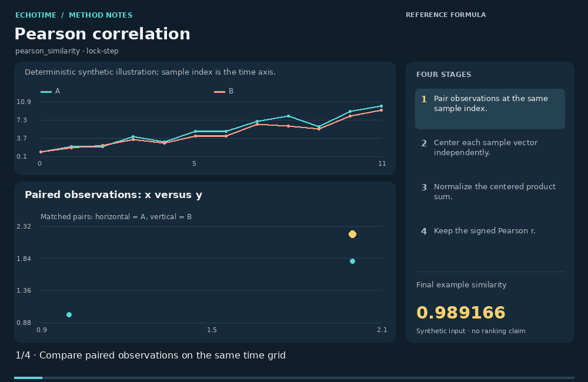

[Static image](../../src/echotime/data/method_animations/media/pearson_similarity.png) · [Inputs and full calculation trace](../../src/echotime/data/method_animations/traces/pearson_similarity.json) · [Open in the website](https://zipengwu.me/EchoTime/guide/methods.html#animation-pearson_similarity)

Pearson correlation measures linear co-variation of aligned observations after centering both vectors. The animation reveals each centered-product contribution and normalizes by the full centered norms. Positive correlation, anticorrelation and weak linear association remain different outcomes; a distance card applies the explicit one-minus transform to the same coefficient.

Pearson 相关衡量对齐观测去均值后的线性协同变化。动图逐项展示中心化乘积，再用完整中心化向量的范数归一化。正相关、负相关和弱线性关系具有不同含义；距离条目显式使用 1 减相关系数。

### Calculation / 计算

```text
corr(x,y)
```

1. Pair observations at the same sample index.
   按相同采样位置配对观测。
2. Subtract the mean from each series independently.
   分别减去各自均值。
3. Sum centered products and divide by centered vector norms.
   累加中心化乘积并按范数归一化。
4. Read the signed agreement coefficient.
   读取相关系数或其 1 减变换。

**Example similarity:** `0.98916553`.

**Parameters:**

```json
{
  "centering": true,
  "ranking": false,
  "tie_rule": "not applicable"
}
```

### Interpretation and limits / 解释与边界

- Constant inputs have undefined statistical correlation; zero-return conventions are software-specific. 常量输入的统计相关未定义；返回零属于软件约定。
- Correlation describes linear dependence, not matching units or causal influence. 相关描述线性依赖，不代表单位相同或因果作用。
- 1-r is a dissimilarity and generally fails the triangle inequality. 1−r 属于差异量，一般不满足三角不等式。

### Definition sources / 定义来源

- [SciPy: correlation](https://docs.scipy.org/doc/scipy/reference/generated/scipy.spatial.distance.correlation.html)

<a id="pearson_distance"></a>
## Pearson distance · `pearson_distance`

**Demonstration:** Reference-formula demonstration / 参考公式演示

**EchoTime coverage:** Conceptually covered · `pearson_r`

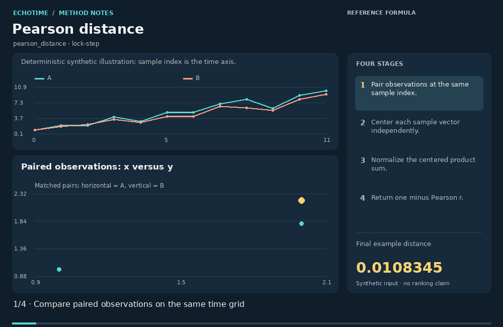

[Static image](../../src/echotime/data/method_animations/media/pearson_distance.png) · [Inputs and full calculation trace](../../src/echotime/data/method_animations/traces/pearson_distance.json) · [Open in the website](https://zipengwu.me/EchoTime/guide/methods.html#animation-pearson_distance)

Pearson correlation measures linear co-variation of aligned observations after centering both vectors. The animation reveals each centered-product contribution and normalizes by the full centered norms. Positive correlation, anticorrelation and weak linear association remain different outcomes; a distance card applies the explicit one-minus transform to the same coefficient.

Pearson 相关衡量对齐观测去均值后的线性协同变化。动图逐项展示中心化乘积，再用完整中心化向量的范数归一化。正相关、负相关和弱线性关系具有不同含义；距离条目显式使用 1 减相关系数。

### Calculation / 计算

```text
1 - corr(x,y)
```

1. Pair observations at the same sample index.
   按相同采样位置配对观测。
2. Subtract the mean from each series independently.
   分别减去各自均值。
3. Sum centered products and divide by centered vector norms.
   累加中心化乘积并按范数归一化。
4. Subtract similarity from one.
   读取相关系数或其 1 减变换。

**Example distance:** `0.010834469`.

**Parameters:**

```json
{
  "centering": true,
  "ranking": false,
  "tie_rule": "not applicable"
}
```

### Interpretation and limits / 解释与边界

- Constant inputs have undefined statistical correlation; zero-return conventions are software-specific. 常量输入的统计相关未定义；返回零属于软件约定。
- Correlation describes linear dependence, not matching units or causal influence. 相关描述线性依赖，不代表单位相同或因果作用。
- 1-r is a dissimilarity and generally fails the triangle inequality. 1−r 属于差异量，一般不满足三角不等式。

### Definition sources / 定义来源

- [SciPy: correlation](https://docs.scipy.org/doc/scipy/reference/generated/scipy.spatial.distance.correlation.html)

<a id="spearman_similarity"></a>
## Spearman rank correlation · `spearman_similarity`

**Demonstration:** Reference-formula demonstration / 参考公式演示

**EchoTime coverage:** Conceptually covered · `spearman_rho`

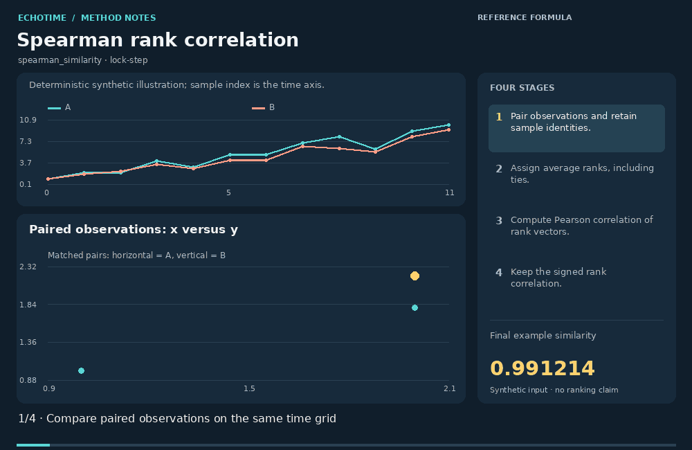

[Static image](../../src/echotime/data/method_animations/media/spearman_similarity.png) · [Inputs and full calculation trace](../../src/echotime/data/method_animations/traces/spearman_similarity.json) · [Open in the website](https://zipengwu.me/EchoTime/guide/methods.html#animation-spearman_similarity)

Spearman correlation replaces amplitudes by their ranks and then computes Pearson correlation of those ranks. Tied observations receive average ranks in this example. The animation makes this change of representation explicit: a monotone nonlinear amplitude transformation can retain rank agreement even when the raw scatter is not a straight line.

Spearman 相关先把幅值转换成排名，再计算排名的 Pearson 相关。本例对并列值使用平均排名。动图显式展示表示变换：单调非线性幅值变换即使改变原始散点的线性关系，仍可能保留排名一致性。

### Calculation / 计算

```text
corr(rank_average(x),rank_average(y))
```

1. Pair observations and retain their original sample identities.
   配对观测并保留原始采样身份。
2. Replace amplitudes with average ranks, including ties.
   将幅值替换为含并列处理的平均排名。
3. Compute Pearson correlation of the two rank vectors.
   计算两组排名的 Pearson 相关。
4. Read the signed agreement coefficient.
   读取排名相关或其 1 减变换。

**Example similarity:** `0.99121418`.

**Parameters:**

```json
{
  "centering": true,
  "ranking": true,
  "tie_rule": "average rank or tau-b correction"
}
```

### Interpretation and limits / 解释与边界

- Amplitude differences are intentionally discarded by ranking. 排名主动舍弃幅值差异。
- A nonmonotone dependence may be strong while Spearman correlation is weak. 强非单调依赖也可能具有很弱的 Spearman 相关。
- The chosen tie rule and missing-value handling belong to the definition. 并列排名和缺失值处理属于定义的一部分。

### Definition sources / 定义来源

- [SciPy: spearmanr](https://docs.scipy.org/doc/scipy/reference/generated/scipy.stats.spearmanr.html)

<a id="spearman_distance"></a>
## Spearman distance · `spearman_distance`

**Demonstration:** Reference-formula demonstration / 参考公式演示

**EchoTime coverage:** Conceptually covered · `spearman_rho`

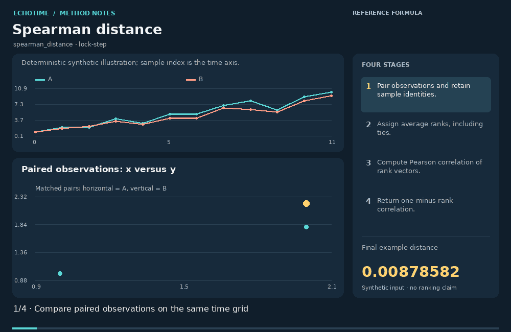

[Static image](../../src/echotime/data/method_animations/media/spearman_distance.png) · [Inputs and full calculation trace](../../src/echotime/data/method_animations/traces/spearman_distance.json) · [Open in the website](https://zipengwu.me/EchoTime/guide/methods.html#animation-spearman_distance)

Spearman correlation replaces amplitudes by their ranks and then computes Pearson correlation of those ranks. Tied observations receive average ranks in this example. The animation makes this change of representation explicit: a monotone nonlinear amplitude transformation can retain rank agreement even when the raw scatter is not a straight line.

Spearman 相关先把幅值转换成排名，再计算排名的 Pearson 相关。本例对并列值使用平均排名。动图显式展示表示变换：单调非线性幅值变换即使改变原始散点的线性关系，仍可能保留排名一致性。

### Calculation / 计算

```text
1 - corr(rank_average(x),rank_average(y))
```

1. Pair observations and retain their original sample identities.
   配对观测并保留原始采样身份。
2. Replace amplitudes with average ranks, including ties.
   将幅值替换为含并列处理的平均排名。
3. Compute Pearson correlation of the two rank vectors.
   计算两组排名的 Pearson 相关。
4. Subtract similarity from one.
   读取排名相关或其 1 减变换。

**Example distance:** `0.0087858154`.

**Parameters:**

```json
{
  "centering": true,
  "ranking": true,
  "tie_rule": "average rank or tau-b correction"
}
```

### Interpretation and limits / 解释与边界

- Amplitude differences are intentionally discarded by ranking. 排名主动舍弃幅值差异。
- A nonmonotone dependence may be strong while Spearman correlation is weak. 强非单调依赖也可能具有很弱的 Spearman 相关。
- The chosen tie rule and missing-value handling belong to the definition. 并列排名和缺失值处理属于定义的一部分。

### Definition sources / 定义来源

- [SciPy: spearmanr](https://docs.scipy.org/doc/scipy/reference/generated/scipy.stats.spearmanr.html)

<a id="kendall_similarity"></a>
## Kendall tau-b · `kendall_similarity`

**Demonstration:** Reference-formula demonstration / 参考公式演示

**EchoTime coverage:** Conceptually covered · `kendall_tau`

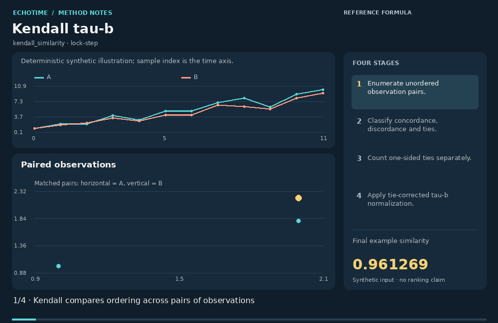

[Static image](../../src/echotime/data/method_animations/media/kendall_similarity.png) · [Inputs and full calculation trace](../../src/echotime/data/method_animations/traces/kendall_similarity.json) · [Open in the website](https://zipengwu.me/EchoTime/guide/methods.html#animation-kendall_similarity)

Kendall tau-b compares the ordering of every pair of aligned observations. Concordant and discordant pairs contribute with opposite signs, while one-sided ties alter the normalization. The animation exposes the pairwise sign matrix and count table. This implementation uses tau-b, so its treatment of ties is not replaced by a no-ties shortcut.

Kendall tau-b 比较每对对齐观测的顺序关系。同序和逆序配对贡献相反符号，单侧并列值改变归一化。动图展示配对符号矩阵与计数表，使用含并列校正的 tau-b，不用无并列情形的简化公式替代。

### Calculation / 计算

```text
(C-D)/sqrt((C+D+T_x)*(C+D+T_y))
```

1. Enumerate unordered observation pairs.
   枚举无序观测配对。
2. Classify each pair as concordant, discordant or tied.
   判断同序、逆序或并列。
3. Count one-sided ties separately; joint ties enter neither tie term.
   分别统计单侧并列；双侧并列不进入单侧并列项。
4. Apply tau-b normalization, then 1-tau if this is the distance variant.
   应用 tau-b 归一化；距离型再取 1−tau。

**Example similarity:** `0.96126919`.

**Parameters:**

```json
{
  "centering": true,
  "ranking": true,
  "tie_rule": "average rank or tau-b correction"
}
```

### Interpretation and limits / 解释与边界

- Ordering does not preserve the magnitude of differences. 顺序关系不保留差异幅度。
- A zero normalization denominator leaves tau undefined; the illustration avoids this case. 归一化分母为零时 tau 未定义，本例避开此情形。
- The animated pair enumeration is educational; optimized software need not enumerate all pairs explicitly. 动画显式枚举配对用于教学；优化软件无需逐对枚举。

### Definition sources / 定义来源

- [SciPy: kendalltau](https://docs.scipy.org/doc/scipy/reference/generated/scipy.stats.kendalltau.html)

<a id="kendall_distance"></a>
## Kendall distance · `kendall_distance`

**Demonstration:** Reference-formula demonstration / 参考公式演示

**EchoTime coverage:** Conceptually covered · `kendall_tau`

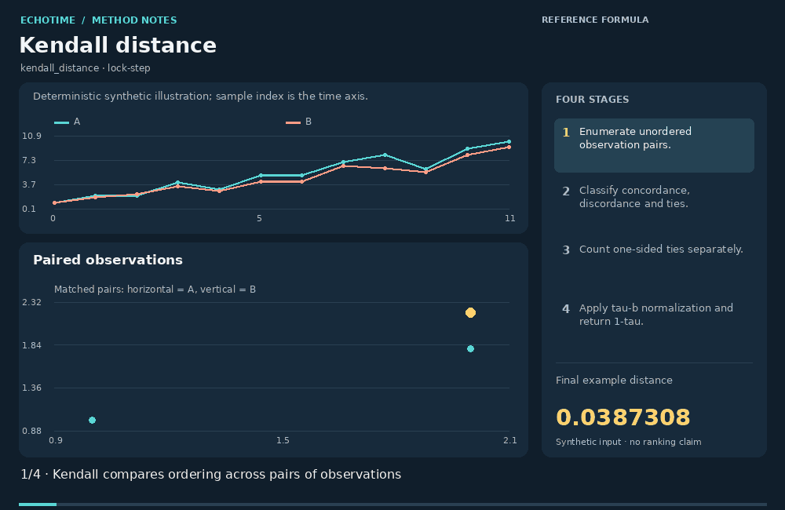

[Static image](../../src/echotime/data/method_animations/media/kendall_distance.png) · [Inputs and full calculation trace](../../src/echotime/data/method_animations/traces/kendall_distance.json) · [Open in the website](https://zipengwu.me/EchoTime/guide/methods.html#animation-kendall_distance)

Kendall tau-b compares the ordering of every pair of aligned observations. Concordant and discordant pairs contribute with opposite signs, while one-sided ties alter the normalization. The animation exposes the pairwise sign matrix and count table. This implementation uses tau-b, so its treatment of ties is not replaced by a no-ties shortcut.

Kendall tau-b 比较每对对齐观测的顺序关系。同序和逆序配对贡献相反符号，单侧并列值改变归一化。动图展示配对符号矩阵与计数表，使用含并列校正的 tau-b，不用无并列情形的简化公式替代。

### Calculation / 计算

```text
1 - (C-D)/sqrt((C+D+T_x)*(C+D+T_y))
```

1. Enumerate unordered observation pairs.
   枚举无序观测配对。
2. Classify each pair as concordant, discordant or tied.
   判断同序、逆序或并列。
3. Count one-sided ties separately; joint ties enter neither tie term.
   分别统计单侧并列；双侧并列不进入单侧并列项。
4. Apply tau-b normalization, then 1-tau if this is the distance variant.
   应用 tau-b 归一化；距离型再取 1−tau。

**Example distance:** `0.038730807`.

**Parameters:**

```json
{
  "centering": true,
  "ranking": true,
  "tie_rule": "average rank or tau-b correction"
}
```

### Interpretation and limits / 解释与边界

- Ordering does not preserve the magnitude of differences. 顺序关系不保留差异幅度。
- A zero normalization denominator leaves tau undefined; the illustration avoids this case. 归一化分母为零时 tau 未定义，本例避开此情形。
- The animated pair enumeration is educational; optimized software need not enumerate all pairs explicitly. 动画显式枚举配对用于教学；优化软件无需逐对枚举。

### Definition sources / 定义来源

- [SciPy: kendalltau](https://docs.scipy.org/doc/scipy/reference/generated/scipy.stats.kendalltau.html)

<a id="jensen_shannon"></a>
## Jensen-Shannon distance · `jensen_shannon`

**Demonstration:** Reference-formula demonstration / 参考公式演示

**EchoTime coverage:** Conceptually covered · `spectral_similarity`

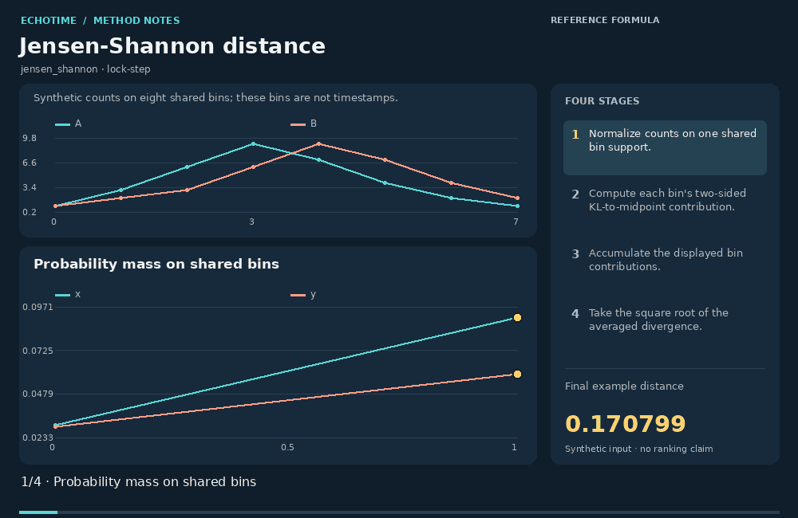

[Static image](../../src/echotime/data/method_animations/media/jensen_shannon.png) · [Inputs and full calculation trace](../../src/echotime/data/method_animations/traces/jensen_shannon.json) · [Open in the website](https://zipengwu.me/EchoTime/guide/methods.html#animation-jensen_shannon)

Jensen-Shannon distance compares two probability vectors through their midpoint distribution. Each side contributes a KL divergence to that midpoint, the two values are averaged, and the square root produces the distance shown here. The animated bins share a fixed support; their positions describe probability mass rather than a time-warping alignment.

Jensen-Shannon 距离以两概率向量的中点分布作为共同参照，平均两侧到中点的 KL 散度，再开平方。本动画使用固定共同支持集；横轴位置表示概率质量所在的箱，而不是时间规整的匹配位置。

### Calculation / 计算

```text
sqrt(0.5*KL(p||m)+0.5*KL(q||m)); m=(p+q)/2; natural logarithm
```

1. Declare one shared bin support and normalize nonnegative mass to sum to one.
   声明共同箱支持集，将非负质量归一化为概率。
2. Compute each bin's two-sided KL-to-midpoint contribution.
   按该方法公式计算逐箱贡献。
3. Accumulate the displayed bin contributions, retaining any signed terms.
   累加所示贡献，保留可能出现的符号。
4. Take the square root of the averaged divergence.
   应用所示最后的根号、对数或直接求和。

**Example distance:** `0.17079871`.

**Parameters:**

```json
{
  "probability_p": [
    0.030303030303030304,
    0.09090909090909091,
    0.18181818181818182,
    0.2727272727272727,
    0.21212121212121213,
    0.12121212121212122,
    0.06060606060606061,
    0.030303030303030304
  ],
  "probability_q": [
    0.029411764705882353,
    0.058823529411764705,
    0.08823529411764706,
    0.17647058823529413,
    0.2647058823529412,
    0.20588235294117646,
    0.11764705882352941,
    0.058823529411764705
  ],
  "log_base": "e",
  "smoothing": "none",
  "support": "eight shared illustrative bins"
}
```

### Interpretation and limits / 解释与边界

- This card shows the square root, not raw JS divergence. 本条目展示平方根形式，并非原始 JS 散度。
- Logarithm base changes the scale; natural logs are used here. 对数底改变数值尺度，本例使用自然对数。

### Definition sources / 定义来源

- [SciPy: jensenshannon](https://docs.scipy.org/doc/scipy/reference/generated/scipy.spatial.distance.jensenshannon.html)

<a id="kl_divergence"></a>
## Kullback-Leibler divergence · `kl_divergence`

**Demonstration:** Reference-formula demonstration / 参考公式演示

**EchoTime coverage:** Low-priority addition

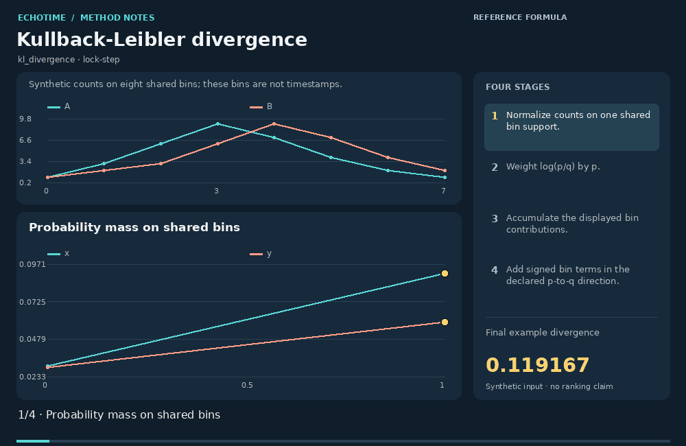

[Static image](../../src/echotime/data/method_animations/media/kl_divergence.png) · [Inputs and full calculation trace](../../src/echotime/data/method_animations/traces/kl_divergence.json) · [Open in the website](https://zipengwu.me/EchoTime/guide/methods.html#animation-kl_divergence)

KL divergence weights each log probability ratio by the mass of the first distribution. Individual bin contributions can be negative even though the complete divergence is nonnegative. The animation retains those signed contributions and a declared direction p to q. Changing the order of the distributions generally changes the answer.

KL 散度用第一个分布的概率质量加权对数概率比。单箱贡献可以为负，而完整散度非负。动画保留这些带符号贡献，并明确方向为 p 到 q；交换两分布通常改变结果。

### Calculation / 计算

```text
KL(p||q)=sum_i p_i*log(p_i/q_i); natural logarithm
```

1. Declare one shared bin support and normalize nonnegative mass to sum to one.
   声明共同箱支持集，将非负质量归一化为概率。
2. Weight log(p/q) by p.
   按该方法公式计算逐箱贡献。
3. Accumulate the displayed bin contributions, retaining any signed terms.
   累加所示贡献，保留可能出现的符号。
4. Add signed bin terms in the declared p-to-q direction.
   应用所示最后的根号、对数或直接求和。

**Example divergence:** `0.11916686`.

**Parameters:**

```json
{
  "probability_p": [
    0.030303030303030304,
    0.09090909090909091,
    0.18181818181818182,
    0.2727272727272727,
    0.21212121212121213,
    0.12121212121212122,
    0.06060606060606061,
    0.030303030303030304
  ],
  "probability_q": [
    0.029411764705882353,
    0.058823529411764705,
    0.08823529411764706,
    0.17647058823529413,
    0.2647058823529412,
    0.20588235294117646,
    0.11764705882352941,
    0.058823529411764705
  ],
  "log_base": "e",
  "smoothing": "none",
  "support": "eight shared illustrative bins"
}
```

### Interpretation and limits / 解释与边界

- If p is positive where q is zero, KL is infinite; both vectors here are strictly positive. 若 p 在 q 为零处为正，KL 为无穷；本例两侧均严格为正。
- KL is asymmetric and does not obey the metric triangle inequality. KL 不对称，也不满足度量三角不等式。

### Definition sources / 定义来源

- [SciPy: entropy](https://docs.scipy.org/doc/scipy/reference/generated/scipy.stats.entropy.html)

<a id="jeffreys_divergence"></a>
## Jeffreys divergence · `jeffreys_divergence`

**Demonstration:** Reference-formula demonstration / 参考公式演示

**EchoTime coverage:** Low-priority addition

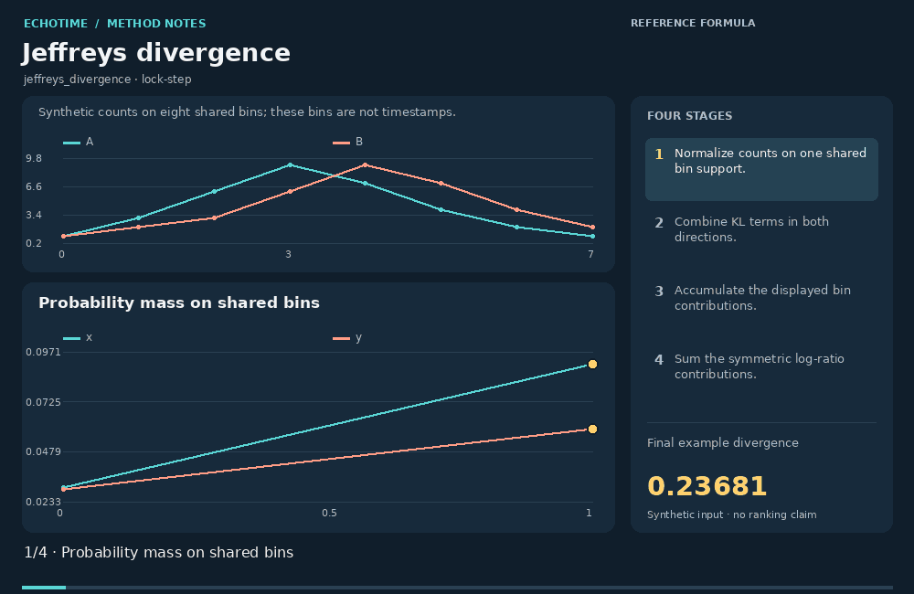

[Static image](../../src/echotime/data/method_animations/media/jeffreys_divergence.png) · [Inputs and full calculation trace](../../src/echotime/data/method_animations/traces/jeffreys_divergence.json) · [Open in the website](https://zipengwu.me/EchoTime/guide/methods.html#animation-jeffreys_divergence)

Jeffreys divergence adds KL divergences in both directions. On strictly positive probabilities the two terms combine into a per-bin product of the probability difference and its log ratio. The animation shows this symmetric contribution directly. Symmetrizing KL removes its directional asymmetry while leaving a divergence whose metric properties need separate analysis.

Jeffreys 散度相加两个方向的 KL 散度。概率严格为正时，可逐箱写成概率差与对数比的乘积。动图直接展示该对称贡献；对称化消除了方向不对称，但不能自动赋予其度量性质。

### Calculation / 计算

```text
KL(p||q)+KL(q||p)=sum_i (p_i-q_i)*log(p_i/q_i)
```

1. Declare one shared bin support and normalize nonnegative mass to sum to one.
   声明共同箱支持集，将非负质量归一化为概率。
2. Combine KL terms in both directions.
   按该方法公式计算逐箱贡献。
3. Accumulate the displayed bin contributions, retaining any signed terms.
   累加所示贡献，保留可能出现的符号。
4. Sum the symmetric log-ratio contributions.
   应用所示最后的根号、对数或直接求和。

**Example divergence:** `0.23680981`.

**Parameters:**

```json
{
  "probability_p": [
    0.030303030303030304,
    0.09090909090909091,
    0.18181818181818182,
    0.2727272727272727,
    0.21212121212121213,
    0.12121212121212122,
    0.06060606060606061,
    0.030303030303030304
  ],
  "probability_q": [
    0.029411764705882353,
    0.058823529411764705,
    0.08823529411764706,
    0.17647058823529413,
    0.2647058823529412,
    0.20588235294117646,
    0.11764705882352941,
    0.058823529411764705
  ],
  "log_base": "e",
  "smoothing": "none",
  "support": "eight shared illustrative bins"
}
```

### Interpretation and limits / 解释与边界

- Symmetry alone does not establish a metric. 对称性本身不能证明度量性质。
- A support mismatch can make the result infinite; no smoothing is hidden in this illustration. 支持集不匹配可能使结果无穷；本例没有隐藏平滑。

### Definition sources / 定义来源

- [SciPy: entropy](https://docs.scipy.org/doc/scipy/reference/generated/scipy.stats.entropy.html)
- [Imported registry: two-sided KL convention](https://github.com/ZipengWu365/EchoTime/blob/main/src/echotime/data/ts_similarity_package_v2_registry.csv)

<a id="bhattacharyya_distance"></a>
## Bhattacharyya distance · `bhattacharyya_distance`

**Demonstration:** Reference-formula demonstration / 参考公式演示

**EchoTime coverage:** Low-priority addition

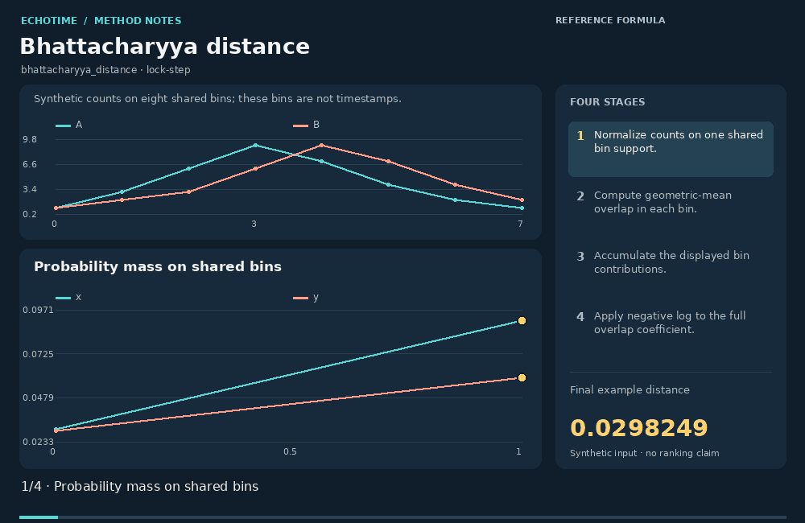

[Static image](../../src/echotime/data/method_animations/media/bhattacharyya_distance.png) · [Inputs and full calculation trace](../../src/echotime/data/method_animations/traces/bhattacharyya_distance.json) · [Open in the website](https://zipengwu.me/EchoTime/guide/methods.html#animation-bhattacharyya_distance)

Bhattacharyya distance first adds the geometric-mean overlap of corresponding probability masses. It then applies a negative logarithm, so greater overlap gives a smaller distance. The animation separates the overlap coefficient from the final transformed score. The supplied positive distributions overlap everywhere, making the logarithm finite without a numerical floor.

Bhattacharyya 距离先累加对应概率质量的几何平均重叠，再取负对数，使更大重叠对应更小距离。动画区分重叠系数和最终变换结果。本例各箱概率为正，无需数值下限即可保证对数有限。

### Calculation / 计算

```text
-log(sum_i sqrt(p_i*q_i))
```

1. Declare one shared bin support and normalize nonnegative mass to sum to one.
   声明共同箱支持集，将非负质量归一化为概率。
2. Compute geometric-mean overlap in each bin.
   按该方法公式计算逐箱贡献。
3. Accumulate the displayed bin contributions, retaining any signed terms.
   累加所示贡献，保留可能出现的符号。
4. Apply negative log to the full overlap coefficient.
   应用所示最后的根号、对数或直接求和。

**Example distance:** `0.029824886`.

**Parameters:**

```json
{
  "probability_p": [
    0.030303030303030304,
    0.09090909090909091,
    0.18181818181818182,
    0.2727272727272727,
    0.21212121212121213,
    0.12121212121212122,
    0.06060606060606061,
    0.030303030303030304
  ],
  "probability_q": [
    0.029411764705882353,
    0.058823529411764705,
    0.08823529411764706,
    0.17647058823529413,
    0.2647058823529412,
    0.20588235294117646,
    0.11764705882352941,
    0.058823529411764705
  ],
  "log_base": "e",
  "smoothing": "none",
  "support": "eight shared illustrative bins"
}
```

### Interpretation and limits / 解释与边界

- Disjoint support gives zero overlap and infinite distance. 支持集不相交时重叠为零、距离为无穷。
- This log-overlap quantity generally lacks the triangle inequality. 该负对数重叠量一般不满足三角不等式。

### Definition sources / 定义来源

- [Imported registry: overlap definition](https://github.com/ZipengWu365/EchoTime/blob/main/src/echotime/data/ts_similarity_package_v2_registry.csv)

<a id="hellinger_distance"></a>
## Hellinger distance · `hellinger_distance`

**Demonstration:** Reference-formula demonstration / 参考公式演示

**EchoTime coverage:** Low-priority addition

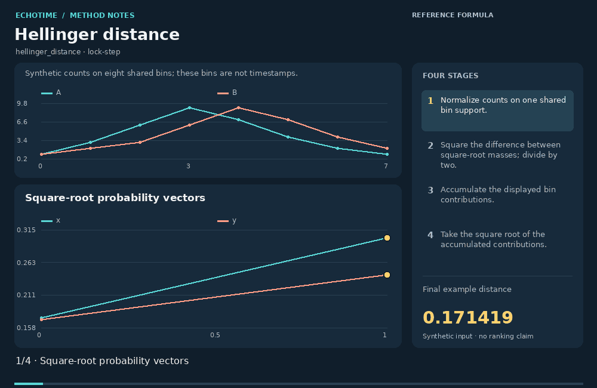

[Static image](../../src/echotime/data/method_animations/media/hellinger_distance.png) · [Inputs and full calculation trace](../../src/echotime/data/method_animations/traces/hellinger_distance.json) · [Open in the website](https://zipengwu.me/EchoTime/guide/methods.html#animation-hellinger_distance)

Hellinger distance compares square-root probability vectors using a scaled Euclidean distance. The animation shows how transforming probabilities changes the coordinate gaps before squaring and accumulation. The factor one half inside the root fixes the common zero-to-one normalization. Shared bin definitions are essential because each square-root mass is compared with its corresponding bin.

Hellinger 距离对概率开平方后，计算缩放的欧氏距离。动画展示变换如何改变坐标差，再平方累加。根号内的二分之一确定常见的 0 到 1 归一化。每个概率质量必须对应相同的箱定义。

### Calculation / 计算

```text
sqrt(0.5*sum_i (sqrt(p_i)-sqrt(q_i))^2)
```

1. Declare one shared bin support and normalize nonnegative mass to sum to one.
   声明共同箱支持集，将非负质量归一化为概率。
2. Square the difference between square-root masses; divide by two.
   按该方法公式计算逐箱贡献。
3. Accumulate the displayed bin contributions, retaining any signed terms.
   累加所示贡献，保留可能出现的符号。
4. Take the square root of the accumulated contributions.
   应用所示最后的根号、对数或直接求和。

**Example distance:** `0.17141912`.

**Parameters:**

```json
{
  "probability_p": [
    0.030303030303030304,
    0.09090909090909091,
    0.18181818181818182,
    0.2727272727272727,
    0.21212121212121213,
    0.12121212121212122,
    0.06060606060606061,
    0.030303030303030304
  ],
  "probability_q": [
    0.029411764705882353,
    0.058823529411764705,
    0.08823529411764706,
    0.17647058823529413,
    0.2647058823529412,
    0.20588235294117646,
    0.11764705882352941,
    0.058823529411764705
  ],
  "log_base": "e",
  "smoothing": "none",
  "support": "eight shared illustrative bins"
}
```

### Interpretation and limits / 解释与边界

- This convention includes the factor 1/sqrt(2); some sources omit it. 此约定包含 1/√2 因子，部分资料会省略。
- A distance between histograms does not preserve the temporal order that generated them. 直方图间距离不保留生成它们的原始时间顺序。

### Definition sources / 定义来源

- [Imported registry: normalized Hellinger formula](https://github.com/ZipengWu365/EchoTime/blob/main/src/echotime/data/ts_similarity_package_v2_registry.csv)

<a id="chi_square_distance"></a>
## Symmetric chi-square distance · `chi_square_distance`

**Demonstration:** Reference-formula demonstration / 参考公式演示

**EchoTime coverage:** Low-priority addition

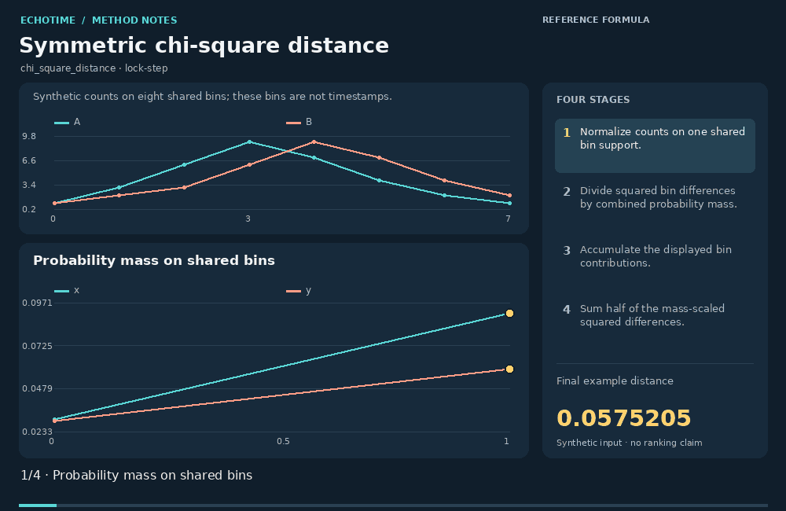

[Static image](../../src/echotime/data/method_animations/media/chi_square_distance.png) · [Inputs and full calculation trace](../../src/echotime/data/method_animations/traces/chi_square_distance.json) · [Open in the website](https://zipengwu.me/EchoTime/guide/methods.html#animation-chi_square_distance)

This symmetric chi-square histogram distance divides squared probability differences by the combined mass of each bin, then sums half of those ratios. Small-mass bins can matter disproportionately relative to unweighted squared error. The animation follows the exact symmetric convention in the registry; it does not perform a statistical chi-square hypothesis test.

此对称卡方直方图距离用每箱概率和归一化平方概率差，再累加其一半。低概率箱相较无权平方误差可能获得更高影响。动画遵循登记表的对称定义，不进行卡方假设检验。

### Calculation / 计算

```text
0.5*sum_i (p_i-q_i)^2/(p_i+q_i)
```

1. Declare one shared bin support and normalize nonnegative mass to sum to one.
   声明共同箱支持集，将非负质量归一化为概率。
2. Divide squared bin differences by combined probability mass.
   按该方法公式计算逐箱贡献。
3. Accumulate the displayed bin contributions, retaining any signed terms.
   累加所示贡献，保留可能出现的符号。
4. Sum half of the mass-scaled squared differences.
   应用所示最后的根号、对数或直接求和。

**Example distance:** `0.057520512`.

**Parameters:**

```json
{
  "probability_p": [
    0.030303030303030304,
    0.09090909090909091,
    0.18181818181818182,
    0.2727272727272727,
    0.21212121212121213,
    0.12121212121212122,
    0.06060606060606061,
    0.030303030303030304
  ],
  "probability_q": [
    0.029411764705882353,
    0.058823529411764705,
    0.08823529411764706,
    0.17647058823529413,
    0.2647058823529412,
    0.20588235294117646,
    0.11764705882352941,
    0.058823529411764705
  ],
  "log_base": "e",
  "smoothing": "none",
  "support": "eight shared illustrative bins"
}
```

### Interpretation and limits / 解释与边界

- The name also denotes other asymmetric distances and test statistics; use the displayed formula. 该名称还用于非对称距离和检验统计量，应以所示公式为准。
- A zero-over-zero bin needs an explicit zero contribution convention. 两侧均为零的箱需要显式约定贡献为零。

### Definition sources / 定义来源

- [Imported registry: symmetric chi-square convention](https://github.com/ZipengWu365/EchoTime/blob/main/src/echotime/data/ts_similarity_package_v2_registry.csv)

<a id="seuclidean_distance"></a>
## Standardized Euclidean · `seuclidean_distance`

**Demonstration:** Reference-formula demonstration / 参考公式演示

**EchoTime coverage:** Low-priority addition

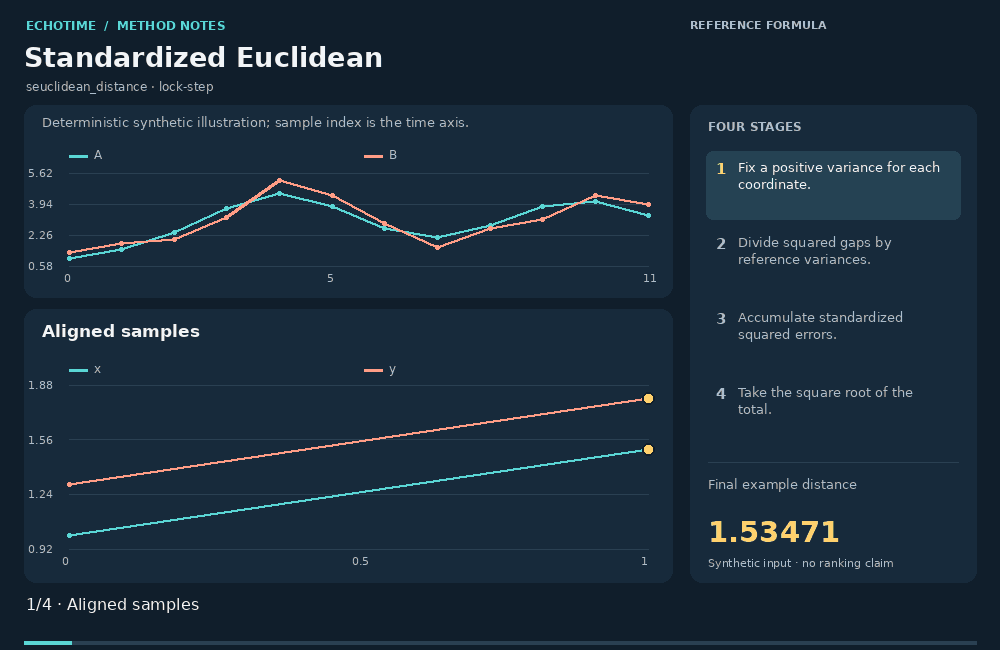

[Static image](../../src/echotime/data/method_animations/media/seuclidean_distance.png) · [Inputs and full calculation trace](../../src/echotime/data/method_animations/traces/seuclidean_distance.json) · [Open in the website](https://zipengwu.me/EchoTime/guide/methods.html#animation-seuclidean_distance)

Standardized Euclidean distance divides each squared coordinate residual by a supplied variance. Coordinates with greater reference variation receive less weight. This animation uses an explicit, fixed variance vector, so the comparison does not secretly estimate scale from the two sequences being scored. The final root gives a distance in variance-standardized coordinates.

标准化欧氏距离用给定方差缩放每个坐标的平方残差。参考变化更大的坐标权重较低。本动图使用显式固定的方差向量，不从待比较的两条序列暗中估计尺度，最后开平方得到标准化坐标空间中的距离。

### Calculation / 计算

```text
sqrt(sum_i (x_i-y_i)^2 / v_i), with fixed v_i > 0
```

1. Align samples and provide a positive reference variance for every coordinate.
   对齐采样点，为每个坐标提供正的参考方差。
2. Square each residual and divide it by that coordinate's variance.
   平方残差后除以对应坐标的方差。
3. Sum the standardized squared contributions.
   累加标准化平方项。
4. Take the square root; retain the same variance vector for future comparisons.
   开平方；后续比较保持同一参考方差。

**Example distance:** `1.5347089`.

**Parameters:**

```json
{
  "variance": [
    0.4,
    0.6,
    1.0,
    1.5,
    2.0,
    1.3,
    0.9,
    0.7,
    1.1,
    1.7,
    1.8,
    1.2
  ],
  "variance_source": "fixed illustrative vector"
}
```

### Interpretation and limits / 解释与边界

- Zero variances need an explicit exclusion or regularization policy. 零方差需要明确的剔除或正则化策略。
- Estimating variances using test data can leak information; use a declared reference fit. 用测试数据估计方差可能泄漏信息；应声明参考拟合来源。

### Definition sources / 定义来源

- [SciPy: seuclidean](https://docs.scipy.org/doc/scipy/reference/generated/scipy.spatial.distance.seuclidean.html)

<a id="znorm_euclidean"></a>
## Z-normalized Euclidean · `znorm_euclidean`

**Demonstration:** Reference-formula demonstration / 参考公式演示

**EchoTime coverage:** Low-priority addition

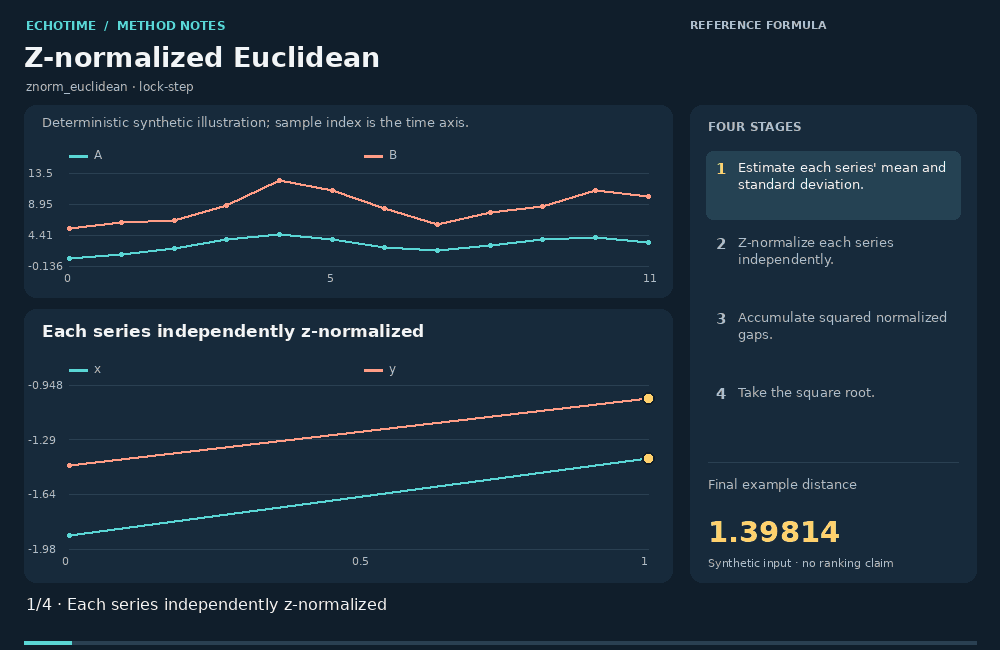

[Static image](../../src/echotime/data/method_animations/media/znorm_euclidean.png) · [Inputs and full calculation trace](../../src/echotime/data/method_animations/traces/znorm_euclidean.json) · [Open in the website](https://zipengwu.me/EchoTime/guide/methods.html#animation-znorm_euclidean)

Z-normalized Euclidean first removes each sequence's own mean and divides by its standard deviation. The final Euclidean comparison therefore emphasizes the shape remaining on a common time grid. The input illustration deliberately includes an offset and gain difference so the normalized traces visibly differ from the raw signals.

Z 标准化 Euclidean 比较先分别减去每条序列的均值，再除以各自标准差，随后在共同时间网格上比较标准化形状。本例刻意加入偏移和增益差，使原始信号与标准化后的曲线形成清晰对照。

### Calculation / 计算

```text
||z(x)-z(y)||_2; z(x)=(x-mean(x))/std(x, ddof=0)
```

1. Estimate each series' own mean and population standard deviation.
   分别估计每条序列的均值和总体标准差。
2. Subtract that mean and divide by that standard deviation.
   分别去均值并除以标准差。
3. Accumulate squared normalized gaps.
   累加标准化后的平方差。
4. Take the square root of the total.
   对总和开平方。

**Example distance:** `1.3981405`.

**Parameters:**

```json
{
  "ddof": 0,
  "norm": 2,
  "means": [
    2.966666666666667,
    8.46
  ],
  "standard_deviations": [
    1.0378931651293508,
    2.1466252583997987
  ]
}
```

### Interpretation and limits / 解释与边界

- Positive gain and offset information is deliberately removed; distinct raw series can have zero distance. 正增益和偏移信息被主动去除；不同原序列可能距离为零。
- Constant sequences need a separately declared convention; this illustration has positive variance. 常量序列必须另行规定处理方式；本例方差严格为正。

### Definition sources / 定义来源

- [Imported registry: normalization convention](https://github.com/ZipengWu365/EchoTime/blob/main/src/echotime/data/ts_similarity_package_v2_registry.csv)
- [SciPy: euclidean](https://docs.scipy.org/doc/scipy/reference/generated/scipy.spatial.distance.euclidean.html)

<a id="znorm_manhattan"></a>
## Z-normalized Manhattan · `znorm_manhattan`

**Demonstration:** Reference-formula demonstration / 参考公式演示

**EchoTime coverage:** Low-priority addition

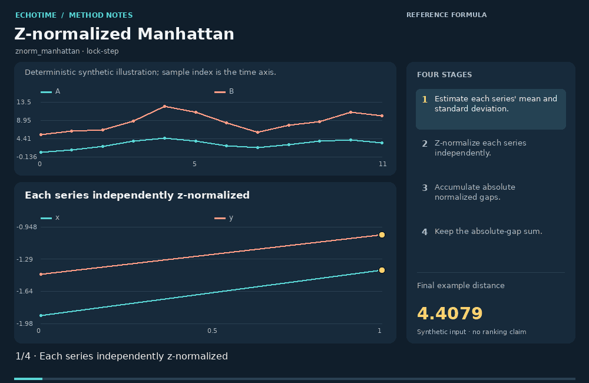

[Static image](../../src/echotime/data/method_animations/media/znorm_manhattan.png) · [Inputs and full calculation trace](../../src/echotime/data/method_animations/traces/znorm_manhattan.json) · [Open in the website](https://zipengwu.me/EchoTime/guide/methods.html#animation-znorm_manhattan)

Z-normalized Manhattan first removes each sequence's own mean and divides by its standard deviation. The final Manhattan comparison therefore emphasizes the shape remaining on a common time grid. The input illustration deliberately includes an offset and gain difference so the normalized traces visibly differ from the raw signals.

Z 标准化 Manhattan 比较先分别减去每条序列的均值，再除以各自标准差，随后在共同时间网格上比较标准化形状。本例刻意加入偏移和增益差，使原始信号与标准化后的曲线形成清晰对照。

### Calculation / 计算

```text
||z(x)-z(y)||_1; z(x)=(x-mean(x))/std(x, ddof=0)
```

1. Estimate each series' own mean and population standard deviation.
   分别估计每条序列的均值和总体标准差。
2. Subtract that mean and divide by that standard deviation.
   分别去均值并除以标准差。
3. Accumulate absolute normalized gaps.
   累加标准化后的绝对差。
4. Keep the absolute-gap total.
   保留绝对差总和。

**Example distance:** `4.4079033`.

**Parameters:**

```json
{
  "ddof": 0,
  "norm": 1,
  "means": [
    2.966666666666667,
    8.46
  ],
  "standard_deviations": [
    1.0378931651293508,
    2.1466252583997987
  ]
}
```

### Interpretation and limits / 解释与边界

- Positive gain and offset information is deliberately removed; distinct raw series can have zero distance. 正增益和偏移信息被主动去除；不同原序列可能距离为零。
- Constant sequences need a separately declared convention; this illustration has positive variance. 常量序列必须另行规定处理方式；本例方差严格为正。

### Definition sources / 定义来源

- [Imported registry: normalization convention](https://github.com/ZipengWu365/EchoTime/blob/main/src/echotime/data/ts_similarity_package_v2_registry.csv)
- [SciPy: cityblock](https://docs.scipy.org/doc/scipy/reference/generated/scipy.spatial.distance.cityblock.html)

<a id="cid_distance"></a>
## Complexity-invariant distance · `cid_distance`

**Demonstration:** Reference-formula demonstration / 参考公式演示

**EchoTime coverage:** Low-priority addition

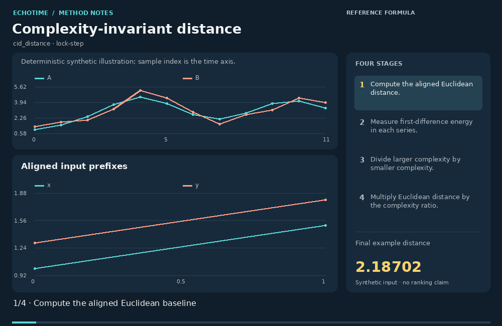

[Static image](../../src/echotime/data/method_animations/media/cid_distance.png) · [Inputs and full calculation trace](../../src/echotime/data/method_animations/traces/cid_distance.json) · [Open in the website](https://zipengwu.me/EchoTime/guide/methods.html#animation-cid_distance)

CID multiplies a base Euclidean distance by the ratio of the larger to the smaller series complexity. Here complexity is the Euclidean length of the first-difference vector. The animation separately computes the baseline mismatch, both complexity estimates and their correction factor; its name does not establish invariance to every possible change in complexity.

CID 用较大与较小复杂度之比修正欧氏距离。本例复杂度定义为一阶差分向量的欧氏长度。动图依次计算基准差异、两侧复杂度及修正因子；名称并不意味着对所有改变复杂度的操作都严格不变。

### Calculation / 计算

```text
CID=||x-y||_2 * max(CE(x),CE(y))/min(CE(x),CE(y)); CE(x)=||diff(x)||_2
```

1. Compute the ordinary Euclidean distance on aligned samples.
   计算对齐样本的欧氏距离。
2. Form first differences and sum their squared values for each series.
   分别计算一阶差分及平方和。
3. Take both roots and divide the larger complexity by the smaller.
   分别开平方，用较大复杂度除以较小复杂度。
4. Multiply the baseline distance by this complexity ratio.
   以复杂度比乘以基准距离。

**Example distance:** `2.1870197`.

**Parameters:**

```json
{
  "base_distance": "Euclidean",
  "complexity": "L2 norm of first differences",
  "CE_x": 2.791057147390572,
  "CE_y": 3.6742346141747673
}
```

### Interpretation and limits / 解释与边界

- A constant series has zero complexity; the correction needs an explicit boundary rule. 常量序列的复杂度为零，修正项需要明确的边界规则。
- The estimator depends on sampling and noise; this animation makes no accuracy or universal invariance claim. 估计值依赖采样和噪声；此动图不提供准确率或普遍不变性结论。

### Definition sources / 定义来源

- [Batista, Wang and Keogh: original CID paper](https://www.cs.ucr.edu/~eamonn/Complexity-Invariant%20Distance%20Measure.pdf)
