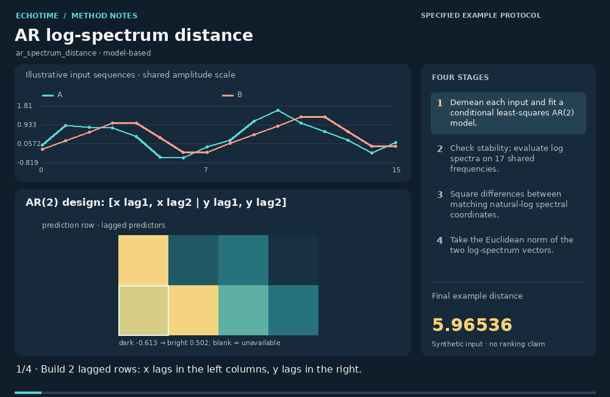
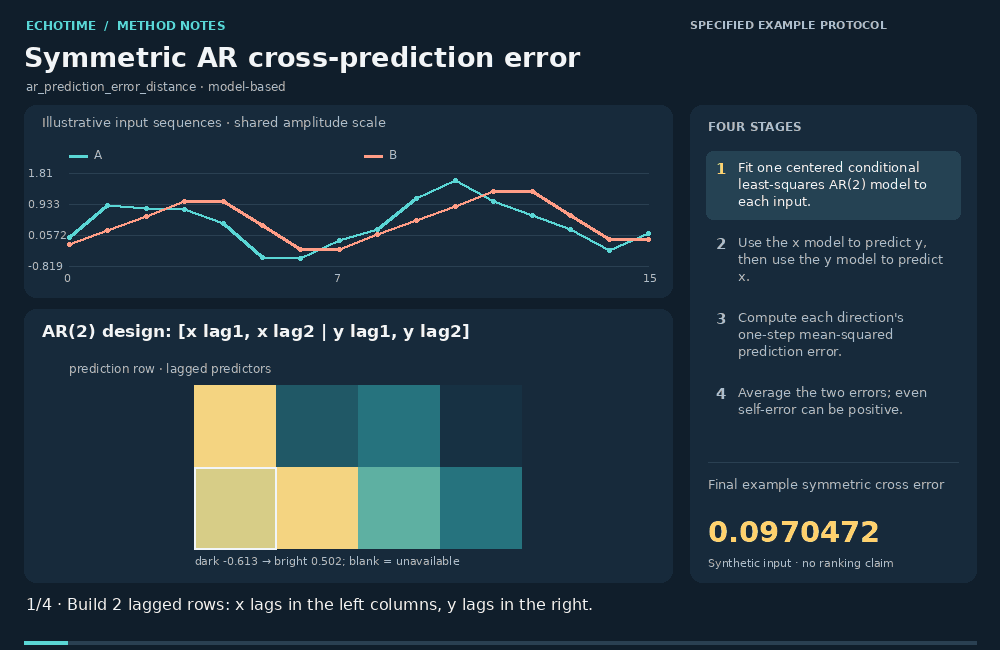
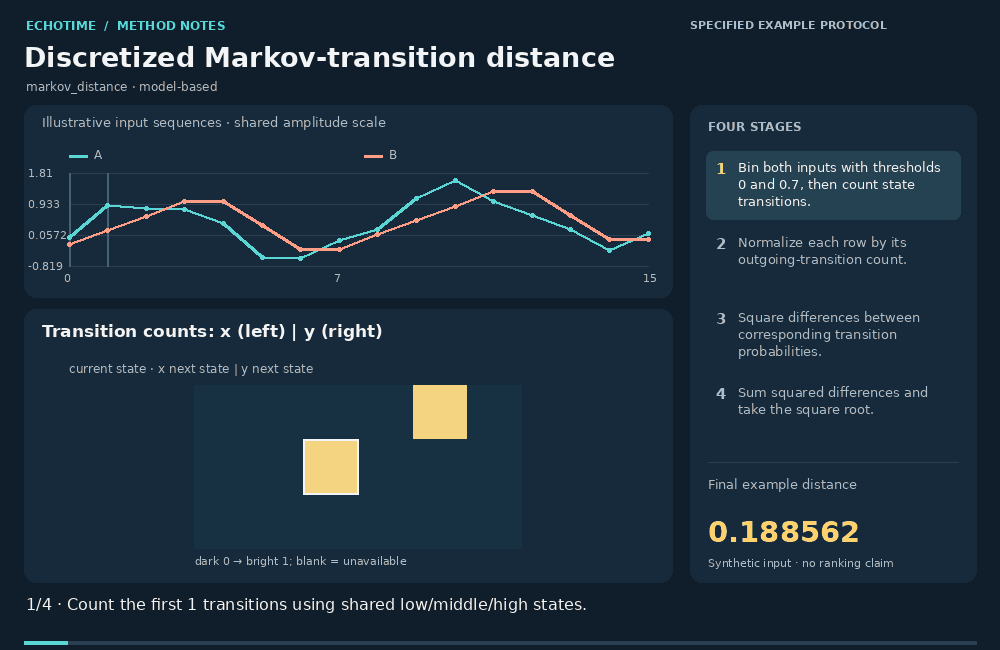
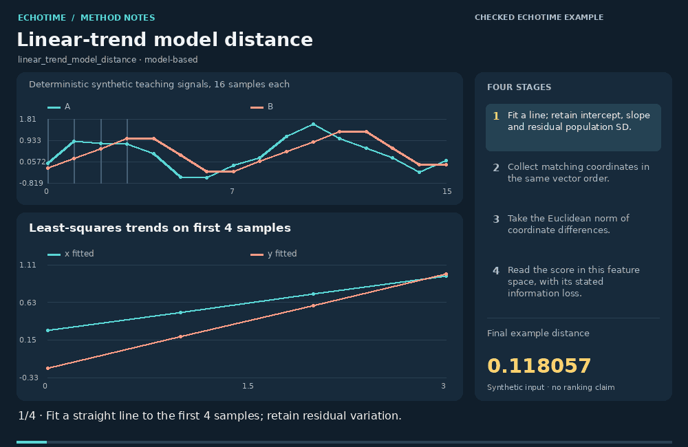

# Fitted dynamics and models / 动力学与模型

[All animation families](README.md) · [Existing web Methods Atlas](https://zipengwu.me/EchoTime/guide/methods.html#method-animations)

The values below belong to the documented synthetic example. Animation coverage and EchoTime API coverage are separate.

- [Autoregressive-coefficient distance](#ar_distance)
- [AR log-spectrum distance](#ar_spectrum_distance)
- [Symmetric AR cross-prediction error](#ar_prediction_error_distance)
- [Discretized Markov-transition distance](#markov_distance)
- [Linear-trend model distance](#linear_trend_model_distance)

<a id="ar_distance"></a>
## Autoregressive-coefficient distance · `ar_distance`

**Demonstration:** Specified illustrative protocol / 明确设定的流程示例

**EchoTime coverage:** Possible addition


[Static image](../../src/echotime/data/method_animations/media/ar_distance.png) · [Inputs and full calculation trace](../../src/echotime/data/method_animations/traces/ar_distance.json) · [Open in the website](https://zipengwu.me/EchoTime/guide/methods.html#animation-ar_distance)

Fit a separately centered AR(2) model by conditional least squares to each short input, then compare the two lag coefficients. The distance describes this specified fitted linear recurrence. Mean level and innovation variance are excluded from the coefficient vector in this example.

分别对两条短序列去均值，用条件最小二乘拟合 AR(2)，再比较两个滞后系数。距离描述这一明确指定的线性递推拟合；本例系数向量不包含均值水平和创新方差。

### Calculation / 计算

```text
z_t = phi_1*z_(t-1)+phi_2*z_(t-2)+e_t; d=||phi_x-phi_y||_2
```

1. Remove each series' sample mean and construct two lagged predictors.
   去除各序列样本均值，构造两个滞后预测量。
2. Fit the same AR(2) equation by ordinary least squares for each input.
   分别用普通最小二乘拟合相同形式的 AR(2) 方程。
3. Compare the corresponding lag-one and lag-two coefficients.
   比较对应的一阶和二阶滞后系数。
4. Take the Euclidean norm of the coefficient difference.
   计算系数差的欧氏范数。

**Example distance:** `0.33905042`. Distance between separately demeaned conditional-OLS AR(2) coefficients.

**Parameters:**

```json
{
  "order": 2,
  "demean": "separately using full series mean",
  "intercept": false,
  "estimator": "conditional OLS, no regularization",
  "residual_variance": "mean squared fitted residual",
  "beta_x": [
    1.0243090422834804,
    -0.6188171023843692
  ],
  "beta_y": [
    1.2418713737062936,
    -0.8788590636409944
  ],
  "ar_companion_root_radii_x": [
    0.7866492880466931,
    0.7866492880466931
  ],
  "ar_companion_root_radii_y": [
    0.9374748336040784,
    0.9374748336040784
  ]
}
```

### Interpretation and limits / 解释与边界

- The example fixes order two and demeans each series separately. Changing order, centering or estimator changes the fitted object. 本例固定二阶，并分别去均值；改变阶数、中心化或估计器都会改变拟合对象。
- Sixteen samples suffice only for an illustration, not a reliable claim about the generating process. 十六个样本仅用于解释过程，不能据此可靠推断生成机制。
- Coefficient similarity does not establish equal innovation noise, nonlinear dependence or causal dynamics. 系数相似不能证明创新噪声、非线性依赖或因果动力学相同。

### Definition sources / 定义来源

- [statsmodels: conditional least-squares autoregression](https://www.statsmodels.org/stable/generated/statsmodels.tsa.ar_model.AutoReg.html)
- [Exact illustrative inputs and encoder definitions](https://github.com/ZipengWu365/EchoTime/blob/main/tools/method_animation_data/feature_model_embedding.py)

<a id="ar_spectrum_distance"></a>
## AR log-spectrum distance · `ar_spectrum_distance`

**Demonstration:** Specified illustrative protocol / 明确设定的流程示例

**EchoTime coverage:** Possible addition



[Static image](../../src/echotime/data/method_animations/media/ar_spectrum_distance.png) · [Inputs and full calculation trace](../../src/echotime/data/method_animations/traces/ar_spectrum_distance.json) · [Open in the website](https://zipengwu.me/EchoTime/guide/methods.html#animation-ar_spectrum_distance)

Fit the same centered AR(2) model to each input and evaluate its implied spectrum on 17 shared frequencies. The animation compares natural-log spectra with Euclidean distance. The two final fits are stable; their fitted residual variances are included, so both spectral shape and power level affect the score.

对两条输入拟合相同的中心化 AR(2) 模型，并在 17 个共享频点上计算模型隐含谱。动图以欧氏距离比较自然对数谱。两个最终拟合均稳定，且纳入拟合残差方差，因此谱形状和功率水平都会影响分数。

### Calculation / 计算

```text
S(w)=sigma^2/|1-sum_(j=1)^2 phi_j exp(-ijw)|^2; d=||log S_x-log S_y||_2
```

1. Demean each input, build two lags and fit conditional-OLS AR(2) models.
   分别去均值，构造两个滞后量并拟合条件最小二乘 AR(2)。
2. Check stability and evaluate sigma^2 / |1-phi_1 exp(-iw)-phi_2 exp(-2iw)|^2.
   检查稳定性，计算 sigma^2 / |1-phi_1 exp(-iw)-phi_2 exp(-2iw)|^2。
3. Take natural logs on the same 17-point frequency grid.
   在相同的 17 点频率网格上取自然对数。
4. Take the Euclidean norm of the log-spectrum difference.
   计算对数谱差的欧氏范数。

**Example distance:** `5.9653596`. Unweighted L2 over 17 natural-log spectral coordinates; no integration weighting.

**Parameters:**

```json
{
  "order": 2,
  "demean": "separately using full series mean",
  "intercept": false,
  "estimator": "conditional OLS, no regularization",
  "residual_variance": "mean squared fitted residual",
  "beta_x": [
    1.0243090422834804,
    -0.6188171023843692
  ],
  "beta_y": [
    1.2418713737062936,
    -0.8788590636409944
  ],
  "ar_companion_root_radii_x": [
    0.7866492880466931,
    0.7866492880466931
  ],
  "ar_companion_root_radii_y": [
    0.9374748336040784,
    0.9374748336040784
  ],
  "omega": [
    0.0,
    0.19634954084936207,
    0.39269908169872414,
    0.5890486225480862,
    0.7853981633974483,
    0.9817477042468103,
    1.1780972450961724,
    1.3744467859455345,
    1.5707963267948966,
    1.7671458676442586,
    1.9634954084936207,
    2.1598449493429825,
    2.356194490192345,
    2.552544031041707,
    2.748893571891069,
    2.945243112740431,
    3.141592653589793
  ],
  "spectrum_convention": "sigma2/abs(AR polynomial)^2; common 1/(2pi) omitted",
  "log_base": "e"
}
```

### Interpretation and limits / 解释与边界

- The example fixes order two and demeans each series separately. Changing order, centering or estimator changes the fitted object. 本例固定二阶，并分别去均值；改变阶数、中心化或估计器都会改变拟合对象。
- Sixteen samples suffice only for an illustration, not a reliable claim about the generating process. 十六个样本仅用于解释过程，不能据此可靠推断生成机制。
- The spectrum is an AR model implication; stability and stationarity assumptions require scrutiny. Grid density and log conventions change the numeric distance. 该谱是 AR 模型的推论，需要检查稳定性和平稳性假设。网格密度及对数约定会改变数值距离。

### Definition sources / 定义来源

- [statsmodels: conditional least-squares autoregression](https://www.statsmodels.org/stable/generated/statsmodels.tsa.ar_model.AutoReg.html)
- [Exact illustrative inputs and encoder definitions](https://github.com/ZipengWu365/EchoTime/blob/main/tools/method_animation_data/feature_model_embedding.py)
- [statsmodels: ARMA lag-polynomial spectra](https://www.statsmodels.org/stable/generated/statsmodels.tsa.arima_process.arma_periodogram.html)

<a id="ar_prediction_error_distance"></a>
## Symmetric AR cross-prediction error · `ar_prediction_error_distance`

**Demonstration:** Specified illustrative protocol / 明确设定的流程示例

**EchoTime coverage:** Possible addition



[Static image](../../src/echotime/data/method_animations/media/ar_prediction_error_distance.png) · [Inputs and full calculation trace](../../src/echotime/data/method_animations/traces/ar_prediction_error_distance.json) · [Open in the website](https://zipengwu.me/EchoTime/guide/methods.html#animation-ar_prediction_error_distance)

Fit centered AR(2) models, apply the x model to y and the y model to x, then average their one-step mean-squared errors. This measures compatibility under a specified predictive model and centering convention. Even a self-comparison can remain positive because fitted innovations are not zero.

拟合中心化 AR(2) 模型，用 x 的模型预测 y，再用 y 的模型预测 x，最后平均两个一步预测均方误差。它度量指定预测模型和中心化约定下的兼容性；即使自比较，也可能因拟合创新不为零而得到正值。

### Calculation / 计算

```text
d = (mean((y_centered-A_y phi_x)^2)+mean((x_centered-A_x phi_y)^2))/2
```

1. Fit one centered conditional-OLS AR(2) model to each full input.
   分别对完整输入拟合中心化条件最小二乘 AR(2)。
2. Transfer the x coefficients to centered y, and transfer the y coefficients to centered x.
   将 x 的系数用于中心化 y，再将 y 的系数用于中心化 x。
3. Compute each direction's one-step squared residuals on the available 14 lagged targets.
   对各方向的 14 个可用滞后目标计算一步预测残差平方。
4. Average the two directional MSEs; interpret this as error rather than a mathematical metric.
   平均两个方向的 MSE，把结果解释为误差分数。

**Example symmetric cross error:** `0.097047155`. MSE(x model -> y)=0.047154603; MSE(y model -> x)=0.14693971.

**Parameters:**

```json
{
  "order": 2,
  "demean": "separately using full series mean",
  "intercept": false,
  "estimator": "conditional OLS, no regularization",
  "residual_variance": "mean squared fitted residual",
  "beta_x": [
    1.0243090422834804,
    -0.6188171023843692
  ],
  "beta_y": [
    1.2418713737062936,
    -0.8788590636409944
  ],
  "ar_companion_root_radii_x": [
    0.7866492880466931,
    0.7866492880466931
  ],
  "ar_companion_root_radii_y": [
    0.9374748336040784,
    0.9374748336040784
  ]
}
```

### Interpretation and limits / 解释与边界

- The example fixes order two and demeans each series separately. Changing order, centering or estimator changes the fitted object. 本例固定二阶，并分别去均值；改变阶数、中心化或估计器都会改变拟合对象。
- Sixteen samples suffice only for an illustration, not a reliable claim about the generating process. 十六个样本仅用于解释过程，不能据此可靠推断生成机制。
- This is not a held-out forecast evaluation: both models are fitted to the displayed records and only the comparison mechanism is illustrated. Self-error need not be zero. 这里并非留出预测评估：模型拟合于展示的记录，仅用于解释比较机制；自比较误差不必为零。

### Definition sources / 定义来源

- [statsmodels: conditional least-squares autoregression](https://www.statsmodels.org/stable/generated/statsmodels.tsa.ar_model.AutoReg.html)
- [Exact illustrative inputs and encoder definitions](https://github.com/ZipengWu365/EchoTime/blob/main/tools/method_animation_data/feature_model_embedding.py)

<a id="markov_distance"></a>
## Discretized Markov-transition distance · `markov_distance`

**Demonstration:** Specified illustrative protocol / 明确设定的流程示例

**EchoTime coverage:** Possible addition



[Static image](../../src/echotime/data/method_animations/media/markov_distance.png) · [Inputs and full calculation trace](../../src/echotime/data/method_animations/traces/markov_distance.json) · [Open in the website](https://zipengwu.me/EchoTime/guide/methods.html#animation-markov_distance)

Map observations to three shared value states and count consecutive state transitions. Row-normalized count matrices describe the next-state distribution conditional on the current state. Compare these matrices by Frobenius distance. This illustrates a specified first-order discretization, without establishing that either signal is generated by a Markov chain.

把观测映射到三个共享数值状态，统计连续状态转移。按行归一化的计数矩阵描述给定当前状态时的下一状态分布，再以 Frobenius 距离比较两个矩阵。这只是指定的一阶离散化示例，并未证明信号由 Markov 链生成。

### Calculation / 计算

```text
P_ij = count(s_t=i,s_(t+1)=j) / count(s_t=i); d=||P_x-P_y||_F
```

1. Use shared thresholds 0 and 0.7, then count consecutive transitions between the three states.
   用共享阈值 0 和 0.7 定义三个状态，再统计连续转移。
2. Divide each row by its outgoing-transition count; every row is observed in this example.
   用各行转出总数进行归一化；本例每行均有观测。
3. Square differences between corresponding conditional transition probabilities.
   对相对应的条件转移概率计算差的平方。
4. Sum these squared differences and take their square root, giving the Frobenius norm.
   累加这些平方差并开平方，得到 Frobenius 范数。

**Example distance:** `0.18856181`. Frobenius norm on conditional transition probabilities; rows unweighted.

**Parameters:**

```json
{
  "state_thresholds": [
    0.0,
    0.7
  ],
  "order": 1,
  "smoothing": 0,
  "unobserved_rows": "not present in this example",
  "P_x": [
    [
      0.5,
      0.5,
      0.0
    ],
    [
      0.4,
      0.2,
      0.4
    ],
    [
      0.0,
      0.3333333333333333,
      0.6666666666666666
    ]
  ],
  "P_y": [
    [
      0.5,
      0.5,
      0.0
    ],
    [
      0.3333333333333333,
      0.3333333333333333,
      0.3333333333333333
    ],
    [
      0.0,
      0.4,
      0.6
    ]
  ]
}
```

### Interpretation and limits / 解释与边界

- State boundaries and sampling interval define the estimated transitions; independently chosen bins would not have matching meanings. 状态边界和采样间隔决定转移估计；分别选取的分箱可能不具有对应含义。
- Unobserved rows need a documented smoothing or missing-row policy. No smoothing is used here because every row has observations. 未观测行需要明确平滑或缺失规则。本例每行均有观测，因此不平滑。
- First-order transition matrices discard longer history and do not prove causal equivalence or equal state occupancy. 一阶转移矩阵舍弃更长历史，也不能证明因果等价或状态占比相同。

### Definition sources / 定义来源

- [Imported registry: named feature and comparison conventions](https://github.com/ZipengWu365/EchoTime/blob/main/src/echotime/data/ts_similarity_package_v2_registry.csv)
- [Exact illustrative inputs and encoder definitions](https://github.com/ZipengWu365/EchoTime/blob/main/tools/method_animation_data/feature_model_embedding.py)

<a id="linear_trend_model_distance"></a>
## Linear-trend model distance · `linear_trend_model_distance`

**Demonstration:** Checked against EchoTime / 已与 EchoTime 计算核对

**EchoTime coverage:** Implemented in EchoTime · `linear_trend_model_distance`



[Static image](../../src/echotime/data/method_animations/media/linear_trend_model_distance.png) · [Inputs and full calculation trace](../../src/echotime/data/method_animations/traces/linear_trend_model_distance.json) · [Open in the website](https://zipengwu.me/EchoTime/guide/methods.html#animation-linear_trend_model_distance)

Fit an ordinary least-squares line to each series on the sample-index axis. Compare the intercept, slope and population standard deviation of residuals. This is EchoTime's three-coordinate trend description; it retains overall direction and unexplained variation while compressing local structure. Euclidean distance retains differences in both vector scale and coordinates.

以样本索引为时间轴，对每条序列拟合普通最小二乘直线，再比较截距、斜率和残差的总体标准差。这是 EchoTime 的三坐标趋势描述，保留总体方向与未解释波动，同时压缩局部结构。 欧氏距离同时保留向量尺度与坐标差异。

### Calculation / 计算

```text
d(x,y) = sqrt(sum_j (phi_j(x)-phi_j(y))^2)
```

1. Fit x_t = intercept + slope*t and append the residual population SD.
   拟合 x_t = 截距 + 斜率*t，并加入残差总体标准差。
2. Collect the computed coordinates in the same fixed order for both inputs.
   把计算得到的坐标按同一个固定顺序组成两个向量。
3. Take the Euclidean norm of the coordinate differences.
   对坐标差计算欧氏范数。
4. Interpret the score in this representation, accounting for the information it discards.
   结合表示所舍弃的信息，在该表示空间中解释分数。

**Example distance:** `0.11805668`. Computed from the explicitly defined illustrative encoder; no learned weights.

**Parameters:**

```json
{
  "time_axis": "sample index 0..15",
  "fit": "ordinary least squares",
  "residual_std_ddof": 0,
  "features": [
    "intercept",
    "slope",
    "residual_std"
  ],
  "comparison": "euclidean"
}
```

### Interpretation and limits / 解释与边界

- The slope uses sample index, so changing the sampling interval changes its interpretation; physical-time comparisons require consistent units. 斜率使用样本索引，改变采样间隔会改变其含义；按物理时间比较需要统一单位。
- Intercept, slope and residual SD have different scales. Curved trends and different residual patterns can share the same vector. 截距、斜率与残差标准差尺度不同；弯曲趋势或不同残差结构可能共享同一向量。
- A metric on these feature vectors can be only a pseudometric on the original series when the representation loses information. 当表示损失信息时，特征空间中的度量在原序列空间上可能只是伪度量。

### Definition sources / 定义来源

- [EchoTime low-level implementation](https://github.com/ZipengWu365/EchoTime/blob/main/src/echotime/similarity_methods.py)
- [Exact illustrative inputs and encoder definitions](https://github.com/ZipengWu365/EchoTime/blob/main/tools/method_animation_data/feature_model_embedding.py)
