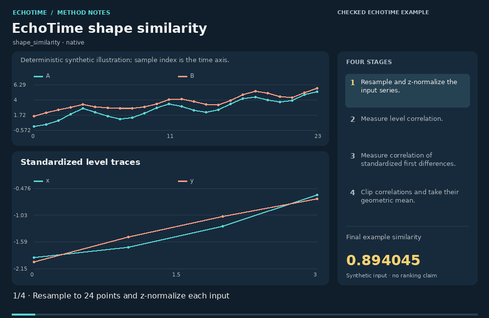
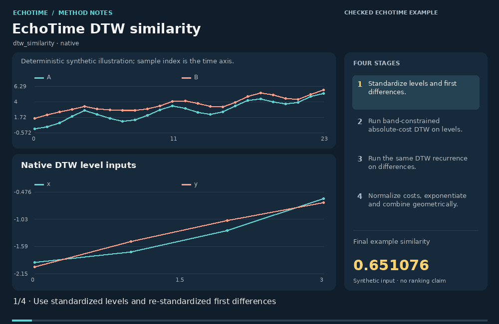
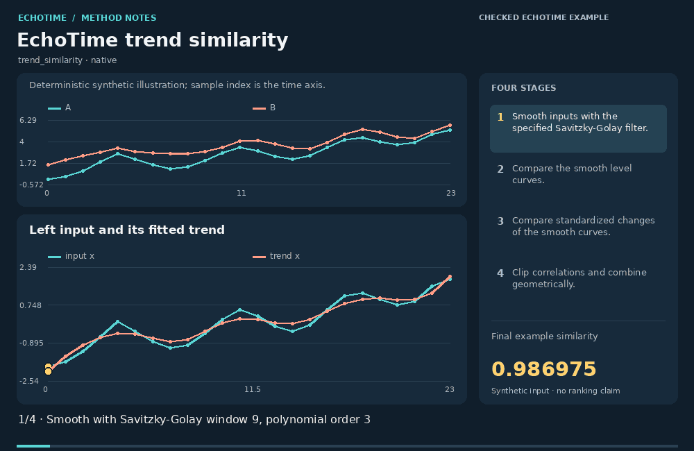
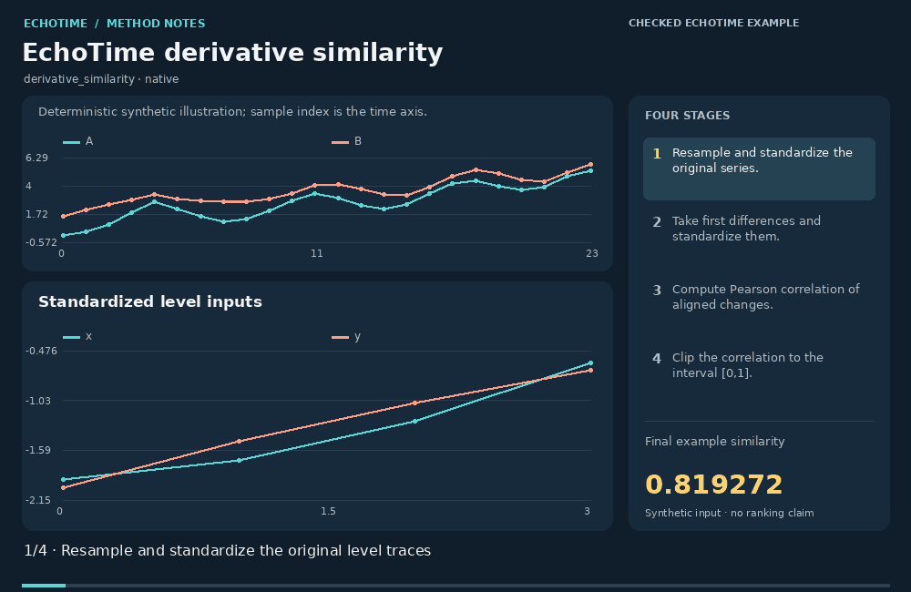
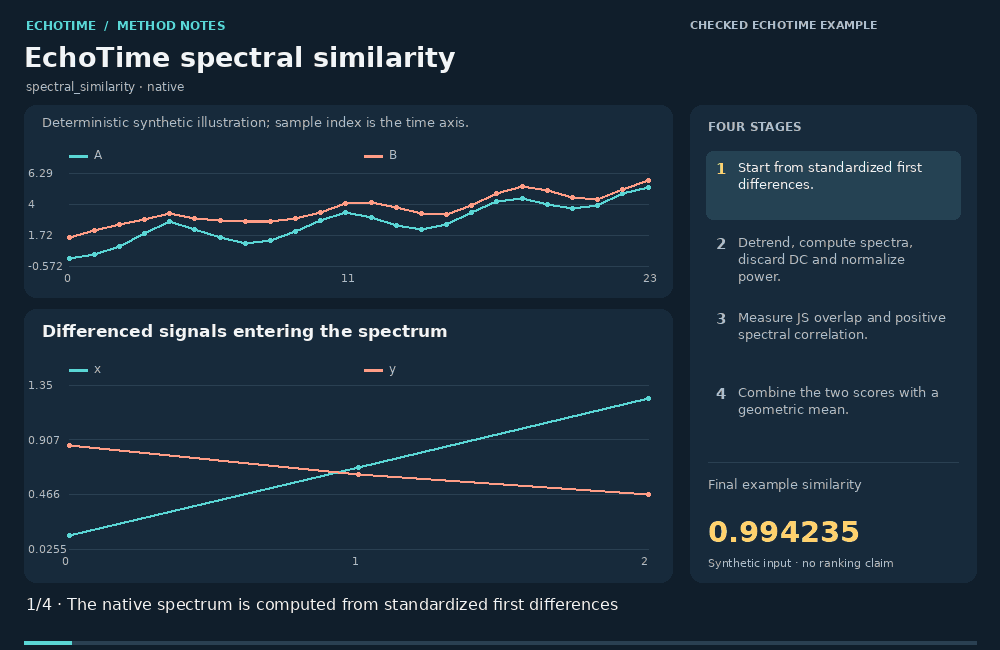
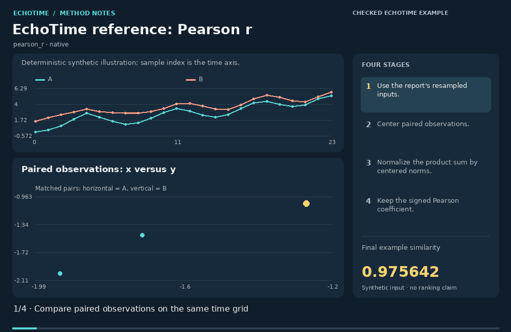
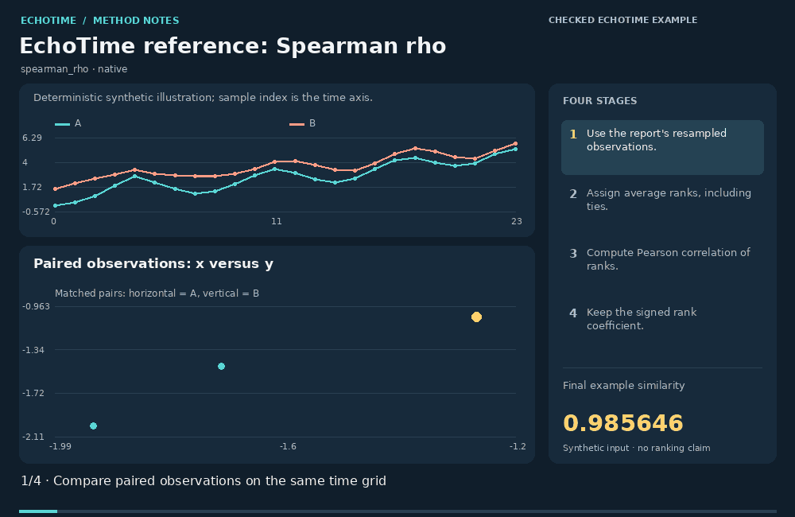
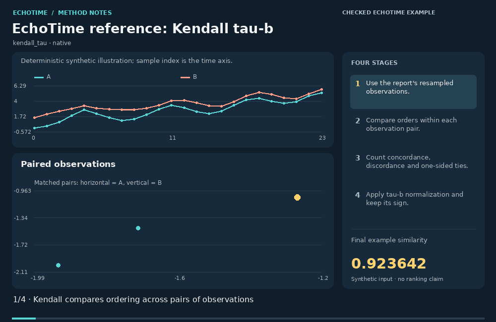
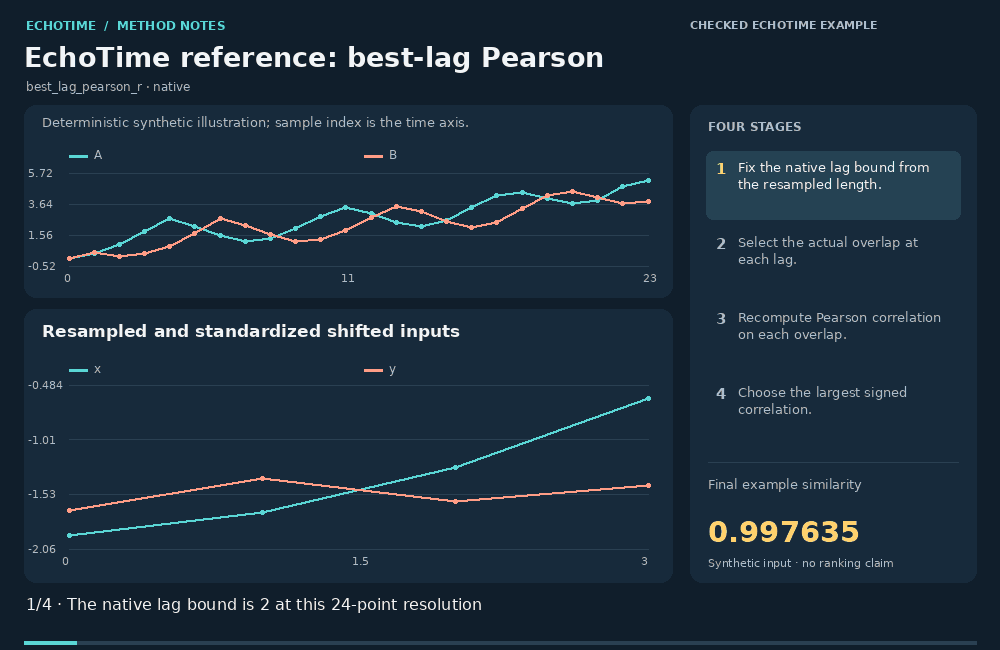
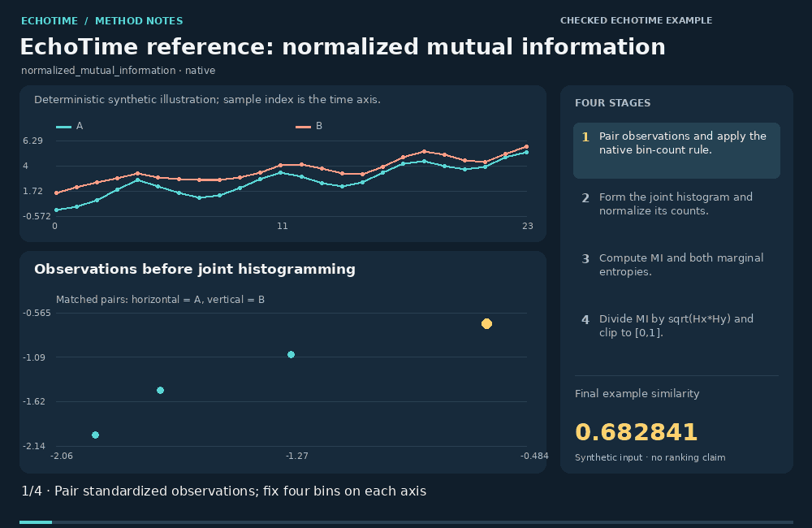

# EchoTime comparison layer / EchoTime 原生比较分项

[All animation families](README.md) · [Existing web Methods Atlas](https://zipengwu.me/EchoTime/guide/methods.html#method-animations)

The values below belong to the documented synthetic example. Animation coverage and EchoTime API coverage are separate.

- [EchoTime shape similarity](#shape_similarity)
- [EchoTime DTW similarity](#dtw_similarity)
- [EchoTime trend similarity](#trend_similarity)
- [EchoTime derivative similarity](#derivative_similarity)
- [EchoTime spectral similarity](#spectral_similarity)
- [EchoTime reference: Pearson r](#pearson_r)
- [EchoTime reference: Spearman rho](#spearman_rho)
- [EchoTime reference: Kendall tau-b](#kendall_tau)
- [EchoTime reference: best-lag Pearson](#best_lag_pearson_r)
- [EchoTime reference: normalized mutual information](#normalized_mutual_information)

<a id="shape_similarity"></a>
## EchoTime shape similarity · `shape_similarity`

**Demonstration:** Checked against EchoTime / 已与 EchoTime 计算核对

**EchoTime coverage:** EchoTime report component / reference metric · `shape_similarity`



[Static image](../../src/echotime/data/method_animations/media/shape_similarity.png) · [Inputs and full calculation trace](../../src/echotime/data/method_animations/traces/shape_similarity.json) · [Open in the website](https://zipengwu.me/EchoTime/guide/methods.html#animation-shape_similarity)

EchoTime's shape component combines agreement in standardized levels with agreement in their first differences. Negative correlations are clipped to zero, and a geometric mean requires both views to contribute positively. The animation reproduces these intermediate views and their actual component scores on a 24-point example, making the package-specific blend explicit.

EchoTime 的形状分项结合标准化水平值和一阶差分的一致性。负相关先截为零，几何平均要求两个视角都具有正贡献。动图使用 24 点示例复现各中间表示与真实分项数值，明确展示这个软件特有的组合。

### Calculation / 计算

```text
sqrt(max(r(x,y),0)*max(r(z(diff(x)),z(diff(y))),0))
```

1. Resample and standardize each channel with the same declared point count.
   按声明的点数重采样并分别标准化通道。
2. Compute Pearson correlation of aligned levels.
   计算对齐水平值的 Pearson 相关。
3. Compute Pearson correlation of standardized first differences.
   计算标准化一阶差分的 Pearson 相关。
4. Clip correlations to [0,1] and take their geometric mean.
   将相关截至 [0,1] 后取几何平均。

**Example similarity:** `0.89404489`.

**Parameters:**

```json
{
  "n_points": 24,
  "default_n_points": 256,
  "channels": 1,
  "preprocessing": "compare_series linear resampling followed by per-channel population z-score",
  "demonstration_note": "24 points expose the computation; production default is 256"
}
```

### Interpretation and limits / 解释与边界

- Clipping makes anticorrelation and zero correlation equally contribute zero. 截断使负相关和零相关都贡献零。
- This is a package-specific similarity component, not a calibrated probability. 这是软件特定的相似性分项，不是校准概率。
- The 24-point demonstration changes resolution from the default 256-point pipeline. 24 点演示采用的分辨率与默认 256 点流程不同。

### Definition sources / 定义来源

- [EchoTime comparison implementation](https://github.com/ZipengWu365/EchoTime/blob/main/src/echotime/similarity.py)

<a id="dtw_similarity"></a>
## EchoTime DTW similarity · `dtw_similarity`

**Demonstration:** Checked against EchoTime / 已与 EchoTime 计算核对

**EchoTime coverage:** EchoTime report component / reference metric · `dtw_similarity`



[Static image](../../src/echotime/data/method_animations/media/dtw_similarity.png) · [Inputs and full calculation trace](../../src/echotime/data/method_animations/traces/dtw_similarity.json) · [Open in the website](https://zipengwu.me/EchoTime/guide/methods.html#animation-dtw_similarity)

The native DTW component runs constrained alignments on both standardized levels and standardized first differences. Each local cost is an absolute gap; the accumulated path cost is divided by the sum of sequence lengths. Two different exponential scales convert those costs into scores, whose geometric mean is the reported component. The animation reconstructs both actual dynamic programs.

原生 DTW 分项对标准化水平值和标准化一阶差分分别执行有约束对齐。局部代价是绝对差，累计路径代价除以两序列长度之和，再通过不同尺度的指数函数转成分数，最终取几何平均。动图重建这两个实际动态规划。

### Calculation / 计算

```text
sqrt(exp(-aDTW_w(x,y)/0.45)*exp(-aDTW_v(z(diff(x)),z(diff(y)))/0.35)); aDTW=sum_path abs(gap)/(n+m)
```

1. Standardize levels and first differences separately.
   分别标准化水平值与一阶差分。
2. Accumulate absolute local costs within the level warping band.
   在水平值规整窗口内累加绝对局部代价。
3. Run the same recurrence on differences with their declared band.
   对差分按其窗口执行同样递推。
4. Normalize costs by n+m, use scales 0.45 and 0.35, and combine geometrically.
   按 n+m 归一化，以 0.45 和 0.35 指数映射后取几何平均。

**Example similarity:** `0.65107619`.

**Parameters:**

```json
{
  "n_points": 24,
  "default_n_points": 256,
  "channels": 1,
  "preprocessing": "compare_series linear resampling followed by per-channel population z-score",
  "demonstration_note": "24 points expose the computation; production default is 256",
  "level_band": 3,
  "difference_band": 3,
  "level_scale": 0.45,
  "difference_scale": 0.35,
  "level_cost": 0.09157025962848607,
  "difference_cost": 0.22916870927834282
}
```

### Interpretation and limits / 解释与边界

- This native score differs from square-root-of-squared-cost DTW distances in other libraries. 此原生分数与其他库常用的平方代价开根号 DTW 距离不同。
- The band, resampling resolution, derivative normalization and scales affect the value. 窗口、重采样分辨率、差分标准化和指数尺度都会影响数值。
- A high score does not imply causal correspondence or a probability of identity. 高分不表示因果对应或同一性的概率。

### Definition sources / 定义来源

- [EchoTime comparison implementation](https://github.com/ZipengWu365/EchoTime/blob/main/src/echotime/similarity.py)

<a id="trend_similarity"></a>
## EchoTime trend similarity · `trend_similarity`

**Demonstration:** Checked against EchoTime / 已与 EchoTime 计算核对

**EchoTime coverage:** EchoTime report component / reference metric · `trend_similarity`



[Static image](../../src/echotime/data/method_animations/media/trend_similarity.png) · [Inputs and full calculation trace](../../src/echotime/data/method_animations/traces/trend_similarity.json) · [Open in the website](https://zipengwu.me/EchoTime/guide/methods.html#animation-trend_similarity)

The trend component smooths each standardized input with the package's Savitzky-Golay settings. It compares both the smoothed levels and their standardized first differences, then combines clipped correlations geometrically. The animation reveals the fitted trend before comparison. This separates the declared smoothing scale from a claim that the observed signal has one uniquely identifiable trend.

趋势分项按软件的 Savitzky-Golay 设置平滑各标准化输入，分别比较平滑后的水平值和标准化一阶差分，再对截断相关取几何平均。动画先展示拟合趋势，再比较两侧；所声明的平滑尺度不意味着信号存在唯一可识别的趋势。

### Calculation / 计算

```text
sqrt(max(corr(T(x),T(y)),0)*max(corr(z(diff(T(x))),z(diff(T(y)))),0))
```

1. Apply the declared Savitzky-Golay smoother to both standardized inputs.
   按所声明参数对两侧标准化输入进行 Savitzky-Golay 平滑。
2. Measure correlation between the smooth level curves.
   比较平滑水平曲线的相关。
3. Measure correlation between standardized first differences of those curves.
   比较平滑曲线标准化一阶差分的相关。
4. Clip both correlations and take their geometric mean.
   截断两个相关并取几何平均。

**Example similarity:** `0.9869748`.

**Parameters:**

```json
{
  "n_points": 24,
  "default_n_points": 256,
  "channels": 1,
  "preprocessing": "compare_series linear resampling followed by per-channel population z-score",
  "demonstration_note": "24 points expose the computation; production default is 256",
  "window_length": 9,
  "polyorder": 3,
  "mode": "interp"
}
```

### Interpretation and limits / 解释与边界

- The window is length-dependent, so changing n_points changes the smoothing scale. 窗口随长度变化，改变 n_points 会改变平滑尺度。
- Smoothing can conceal short events that still matter for the application. 平滑可能掩盖应用中重要的短暂事件。
- Endpoint interpolation is part of the displayed Savitzky-Golay convention. 端点插值属于此 Savitzky-Golay 实现约定。

### Definition sources / 定义来源

- [EchoTime comparison implementation](https://github.com/ZipengWu365/EchoTime/blob/main/src/echotime/similarity.py)
- [SciPy: Savitzky-Golay filter](https://docs.scipy.org/doc/scipy/reference/generated/scipy.signal.savgol_filter.html)

<a id="derivative_similarity"></a>
## EchoTime derivative similarity · `derivative_similarity`

**Demonstration:** Checked against EchoTime / 已与 EchoTime 计算核对

**EchoTime coverage:** EchoTime report component / reference metric · `derivative_similarity`



[Static image](../../src/echotime/data/method_animations/media/derivative_similarity.png) · [Inputs and full calculation trace](../../src/echotime/data/method_animations/traces/derivative_similarity.json) · [Open in the website](https://zipengwu.me/EchoTime/guide/methods.html#animation-derivative_similarity)

The derivative component compares local increments after standardizing the input and then standardizing its first differences. It reports the positive part of their Pearson correlation. The animation follows the difference vectors and their normalized product terms, exposing why two signals can share a slow level pattern while differing substantially in their local changes.

差分分项先标准化输入，再标准化其一阶差分，以两组差分 Pearson 相关的正部分作为相似度。动画追踪差分向量及归一化乘积，说明两条序列即使共享缓慢变化的水平形状，局部变化仍可能不同。

### Calculation / 计算

```text
max(corr(z(diff(x)),z(diff(y))),0)
```

1. Resample and standardize each original series.
   重采样并标准化原序列。
2. Take first differences and standardize those differences separately.
   取一阶差分并分别标准化。
3. Compute Pearson correlation of the aligned change vectors.
   计算对齐变化向量的 Pearson 相关。
4. Clip the correlation to [0,1].
   将相关截至 [0,1]。

**Example similarity:** `0.81927245`.

**Parameters:**

```json
{
  "n_points": 24,
  "default_n_points": 256,
  "channels": 1,
  "preprocessing": "compare_series linear resampling followed by per-channel population z-score",
  "demonstration_note": "24 points expose the computation; production default is 256"
}
```

### Interpretation and limits / 解释与边界

- Differencing can amplify measurement noise and reduces the sample count by one. 差分可能放大测量噪声，并使样本数减少一个。
- Anticorrelated changes receive zero similarity after clipping. 反向相关的变化经截断后获得零相似度。
- Sampling resolution determines which changes are treated as local. 采样分辨率决定哪些变化被视为局部。

### Definition sources / 定义来源

- [EchoTime comparison implementation](https://github.com/ZipengWu365/EchoTime/blob/main/src/echotime/similarity.py)

<a id="spectral_similarity"></a>
## EchoTime spectral similarity · `spectral_similarity`

**Demonstration:** Checked against EchoTime / 已与 EchoTime 计算核对

**EchoTime coverage:** EchoTime report component / reference metric · `spectral_similarity`



[Static image](../../src/echotime/data/method_animations/media/spectral_similarity.png) · [Inputs and full calculation trace](../../src/echotime/data/method_animations/traces/spectral_similarity.json) · [Open in the website](https://zipengwu.me/EchoTime/guide/methods.html#animation-spectral_similarity)

EchoTime's spectral component works on standardized first differences. It linearly detrends the periodogram input, drops the zero-frequency bin, and normalizes the remaining power. One term measures one minus base-two JS divergence; another measures positive correlation of spectral structure. Their geometric mean produces the actual score shown by the animation.

EchoTime 的频谱分项作用于标准化一阶差分。周期图计算使用线性去趋势，去除零频箱并归一化其余功率。一个分项取 1 减二进制 JS 散度，另一个衡量频谱结构的正相关，动图展示两者几何平均得到的实际分数。

### Calculation / 计算

```text
sqrt(clip(1-JS_base2(Px,Py),0,1)*max(corr(Px-U,Py-U),0)); spectra of z(diff(x))
```

1. Use standardized first differences as spectral input.
   以标准化一阶差分作为频谱输入。
2. Compute linearly detrended periodograms, remove DC and normalize power.
   计算线性去趋势周期图，去除零频并归一化功率。
3. Calculate 1-JS divergence in bits and positive spectral correlation.
   计算二进制 1−JS 散度与频谱正相关。
4. Take the geometric mean of overlap and structure scores.
   对重叠和结构分数取几何平均。

**Example similarity:** `0.99423541`.

**Parameters:**

```json
{
  "n_points": 24,
  "default_n_points": 256,
  "channels": 1,
  "preprocessing": "compare_series linear resampling followed by per-channel population z-score",
  "demonstration_note": "24 points expose the computation; production default is 256",
  "periodogram_detrend": "linear",
  "drop_DC": true,
  "JS_log_base": 2,
  "frequency_grid": [
    0.043478260869565216,
    0.08695652173913043,
    0.13043478260869565,
    0.17391304347826086,
    0.21739130434782608,
    0.2608695652173913,
    0.30434782608695654,
    0.34782608695652173,
    0.3913043478260869,
    0.43478260869565216,
    0.4782608695652174
  ]
}
```

### Interpretation and limits / 解释与边界

- Power spectra discard phase; similar spectra do not ensure aligned waveforms. 功率谱舍弃相位，频谱相似不保证波形对齐。
- The JS term here is a divergence in bits, not the square-root JS distance in another atlas card. 这里的 JS 项是以比特为单位的散度，与另一条目的平方根 JS 距离不同。
- Resampling, differentiation and detrending all change the spectral object being compared. 重采样、差分和去趋势都会改变所比较的频谱对象。

### Definition sources / 定义来源

- [EchoTime comparison implementation](https://github.com/ZipengWu365/EchoTime/blob/main/src/echotime/similarity.py)
- [EchoTime spectral preprocessing and JS definition](https://github.com/ZipengWu365/EchoTime/blob/main/src/echotime/metrics.py)

<a id="pearson_r"></a>
## EchoTime reference: Pearson r · `pearson_r`

**Demonstration:** Checked against EchoTime / 已与 EchoTime 计算核对

**EchoTime coverage:** EchoTime report component / reference metric · `pearson_r`



[Static image](../../src/echotime/data/method_animations/media/pearson_r.png) · [Inputs and full calculation trace](../../src/echotime/data/method_animations/traces/pearson_r.json) · [Open in the website](https://zipengwu.me/EchoTime/guide/methods.html#animation-pearson_r)

The native report includes signed Pearson correlation as a familiar reference alongside its clipped component scores. It is evaluated after the same resampling and per-channel standardization as the other report terms. This animation reveals centered products on that actual comparison grid and retains negative values instead of interpreting them as positive shape agreement.

原生报告保留带符号 Pearson 相关作为参照，与截断后的分项并列。其输入经过相同的重采样和逐通道标准化。动画在实际比较网格上展示中心化乘积，并保留负值的含义。

### Calculation / 计算

```text
corr(x,y) after compare_series preprocessing
```

1. Use the report's resampled, standardized input arrays.
   使用报告经过重采样和标准化的输入。
2. Center the paired observations.
   对配对观测去均值。
3. Normalize their product sum by both centered norms.
   按中心化范数归一化点积。
4. Keep the signed coefficient in the reference-metric section.
   在参照指标中保留带符号系数。

**Example similarity:** `0.97564158`.

**Parameters:**

```json
{
  "n_points": 24,
  "default_n_points": 256,
  "channels": 1,
  "preprocessing": "compare_series linear resampling followed by per-channel population z-score",
  "demonstration_note": "24 points expose the computation; production default is 256"
}
```

### Interpretation and limits / 解释与边界

- EchoTime assigns zero for constant inputs; statistical correlation is undefined in that case. EchoTime 对常量输入赋零；此时统计相关本身未定义。
- These are dependence summaries, not causal tests or identity probabilities. 这些是依赖关系摘要，不是因果检验或同一性概率。
- The illustrative report explicitly uses n_points=24; the default is 256. 演示报告显式使用 n_points=24，默认值为 256。

### Definition sources / 定义来源

- [EchoTime comparison implementation](https://github.com/ZipengWu365/EchoTime/blob/main/src/echotime/similarity.py)
- [SciPy: correlation](https://docs.scipy.org/doc/scipy/reference/generated/scipy.spatial.distance.correlation.html)

<a id="spearman_rho"></a>
## EchoTime reference: Spearman rho · `spearman_rho`

**Demonstration:** Checked against EchoTime / 已与 EchoTime 计算核对

**EchoTime coverage:** EchoTime report component / reference metric · `spearman_rho`



[Static image](../../src/echotime/data/method_animations/media/spearman_rho.png) · [Inputs and full calculation trace](../../src/echotime/data/method_animations/traces/spearman_rho.json) · [Open in the website](https://zipengwu.me/EchoTime/guide/methods.html#animation-spearman_rho)

The native Spearman reference converts the report's resampled observations to average ranks and correlates those ranks. It complements amplitude-based comparisons by exposing monotone agreement on the same grid. The animation makes the ranking operation visible, including ties, and retains a signed coefficient; its value depends on the observations created by the chosen interpolation resolution.

原生 Spearman 参照把报告重采样后的观测转换为平均排名，再计算相关。它在相同网格上展示单调一致性，补充幅值比较。动画显示含并列处理的排名操作并保留符号；结果依赖所选插值分辨率产生的观测。

### Calculation / 计算

```text
corr(rank_average(x),rank_average(y)) after compare_series preprocessing
```

1. Use the same resampled observations as the native report.
   使用原生报告相同的重采样观测。
2. Assign average ranks independently, retaining paired sample identities.
   独立赋予平均排名，保留配对身份。
3. Center ranks and normalize their product sum.
   对排名去均值并归一化乘积。
4. Report the signed rank coefficient.
   报告带符号排名系数。

**Example similarity:** `0.98564603`.

**Parameters:**

```json
{
  "n_points": 24,
  "default_n_points": 256,
  "channels": 1,
  "preprocessing": "compare_series linear resampling followed by per-channel population z-score",
  "demonstration_note": "24 points expose the computation; production default is 256"
}
```

### Interpretation and limits / 解释与边界

- EchoTime assigns zero for constant inputs; statistical correlation is undefined in that case. EchoTime 对常量输入赋零；此时统计相关本身未定义。
- These are dependence summaries, not causal tests or identity probabilities. 这些是依赖关系摘要，不是因果检验或同一性概率。
- The illustrative report explicitly uses n_points=24; the default is 256. 演示报告显式使用 n_points=24，默认值为 256。

### Definition sources / 定义来源

- [EchoTime comparison implementation](https://github.com/ZipengWu365/EchoTime/blob/main/src/echotime/similarity.py)
- [SciPy: spearmanr](https://docs.scipy.org/doc/scipy/reference/generated/scipy.stats.spearmanr.html)

<a id="kendall_tau"></a>
## EchoTime reference: Kendall tau-b · `kendall_tau`

**Demonstration:** Checked against EchoTime / 已与 EchoTime 计算核对

**EchoTime coverage:** EchoTime report component / reference metric · `kendall_tau`



[Static image](../../src/echotime/data/method_animations/media/kendall_tau.png) · [Inputs and full calculation trace](../../src/echotime/data/method_animations/traces/kendall_tau.json) · [Open in the website](https://zipengwu.me/EchoTime/guide/methods.html#animation-kendall_tau)

The native Kendall reference uses tau-b, including corrections for one-sided ties, on the resampled input grid. It counts ordering agreements and disagreements rather than amplitude gaps. The animation reconstructs its pair classifications and normalization. This explanatory enumeration matches the score while leaving the numerical library free to use a more efficient algorithm internally.

原生 Kendall 参照在重采样网格上使用包含单侧并列校正的 tau-b，统计顺序同向与反向关系，不比较幅值差。动画重建配对分类和归一化；这种教学枚举与实际分数一致，数值库内部可以使用更高效算法。

### Calculation / 计算

```text
(C-D)/sqrt((C+D+T_x)*(C+D+T_y)) on resampled observations
```

1. Use the native report's resampled observations.
   使用原生报告重采样后的观测。
2. Compare relative orders for observation pairs.
   比较观测对的相对顺序。
3. Count concordance, discordance and one-sided ties.
   统计同序、逆序和单侧并列。
4. Apply tau-b normalization and keep its sign.
   应用 tau-b 归一化并保留符号。

**Example similarity:** `0.92364247`.

**Parameters:**

```json
{
  "n_points": 24,
  "default_n_points": 256,
  "channels": 1,
  "preprocessing": "compare_series linear resampling followed by per-channel population z-score",
  "demonstration_note": "24 points expose the computation; production default is 256"
}
```

### Interpretation and limits / 解释与边界

- EchoTime assigns zero for constant inputs; statistical correlation is undefined in that case. EchoTime 对常量输入赋零；此时统计相关本身未定义。
- These are dependence summaries, not causal tests or identity probabilities. 这些是依赖关系摘要，不是因果检验或同一性概率。
- The illustrative report explicitly uses n_points=24; the default is 256. 演示报告显式使用 n_points=24，默认值为 256。

### Definition sources / 定义来源

- [EchoTime comparison implementation](https://github.com/ZipengWu365/EchoTime/blob/main/src/echotime/similarity.py)
- [SciPy: kendalltau](https://docs.scipy.org/doc/scipy/reference/generated/scipy.stats.kendalltau.html)

<a id="best_lag_pearson_r"></a>
## EchoTime reference: best-lag Pearson · `best_lag_pearson_r`

**Demonstration:** Checked against EchoTime / 已与 EchoTime 计算核对

**EchoTime coverage:** EchoTime report component / reference metric · `best_lag_pearson_r`



[Static image](../../src/echotime/data/method_animations/media/best_lag_pearson_r.png) · [Inputs and full calculation trace](../../src/echotime/data/method_animations/traces/best_lag_pearson_r.json) · [Open in the website](https://zipengwu.me/EchoTime/guide/methods.html#animation-best_lag_pearson_r)

The native best-lag reference scans a bounded set of shifts on the report's resampled grid. Pearson correlation is recomputed on each actual overlap, including a separate overlap mean and norm. The animation uses a delayed illustrative series to show the improvement from lag zero to the selected lag while keeping the finite search window explicit.

原生最佳滞后参照在报告重采样网格上扫描有限平移。每个实际重叠片段重新计算 Pearson 相关，使用各自均值和范数。动画以延迟序列展示零滞后到最佳滞后的变化，并明确有限搜索窗口。

### Calculation / 计算

```text
max_{|lag|<=max(1,min(24,n//10))} corr(x_overlap,y_overlap)
```

1. Resample both inputs; derive the native maximum lag from n_points.
   重采样两侧输入，按 n_points 得到原生最大滞后。
2. At every admitted lag, take the actual overlap.
   对每个允许滞后取实际重叠。
3. Recompute centered Pearson correlation on each overlap.
   在各重叠片段重新计算中心化 Pearson 相关。
4. Return the maximum signed coefficient and interpret its lag in resampled points.
   返回最大带符号系数，滞后单位为重采样点。

**Example similarity:** `0.99763515`.

**Parameters:**

```json
{
  "n_points": 24,
  "default_n_points": 256,
  "channels": 1,
  "preprocessing": "compare_series linear resampling followed by per-channel population z-score",
  "demonstration_note": "24 points expose the computation; production default is 256",
  "max_lag": 2,
  "selected_lag": -2
}
```

### Interpretation and limits / 解释与边界

- The selected lag is measured on the normalized/resampled axis, not automatically in physical time. 所选滞后以归一化重采样轴为单位，不能自动解释为实际时间。
- Searching several lags changes the interpretation from a prespecified single correlation. 搜索多个滞后与事先指定单个相关的统计解释不同。
- Overlap-specific centering differs from full-norm normalized cross-correlation. 逐重叠去均值与全范数归一化互相关不同。

### Definition sources / 定义来源

- [EchoTime comparison implementation](https://github.com/ZipengWu365/EchoTime/blob/main/src/echotime/similarity.py)

<a id="normalized_mutual_information"></a>
## EchoTime reference: normalized mutual information · `normalized_mutual_information`

**Demonstration:** Checked against EchoTime / 已与 EchoTime 计算核对

**EchoTime coverage:** EchoTime report component / reference metric · `normalized_mutual_information`



[Static image](../../src/echotime/data/method_animations/media/normalized_mutual_information.png) · [Inputs and full calculation trace](../../src/echotime/data/method_animations/traces/normalized_mutual_information.json) · [Open in the website](https://zipengwu.me/EchoTime/guide/methods.html#animation-normalized_mutual_information)

EchoTime estimates mutual information from a joint histogram of aligned, resampled observations. It compares observed joint mass with the product of marginal masses, then divides by the geometric mean of marginal entropies. The animation shows the actual bin counts and information terms. The resulting finite-sample dependence estimate is sensitive to the declared binning rule.

EchoTime 通过对齐且重采样观测的联合直方图估计互信息，比较联合概率与边缘概率乘积，再除以两侧熵的几何平均。动画显示真实箱计数及信息贡献项。有限样本依赖估计对所声明的分箱规则敏感。

### Calculation / 计算

```text
I(X;Y)/sqrt(H(X)*H(Y)); bins=clip(round(sqrt(n/4)),4,20); natural logarithms
```

1. Use the aligned resampled observations and the native bin-count rule.
   使用对齐的重采样观测和原生分箱数规则。
2. Count their joint histogram and normalize it to probability mass.
   计算联合直方图并归一化为概率。
3. Compute MI from joint-versus-independent mass and both marginal entropies.
   由联合质量与独立质量比较得到 MI，同时计算边缘熵。
4. Divide MI by sqrt(Hx*Hy) and clip to [0,1].
   以 sqrt(Hx*Hy) 归一化 MI 并截至 [0,1]。

**Example similarity:** `0.68284131`.

**Parameters:**

```json
{
  "n_points": 24,
  "default_n_points": 256,
  "channels": 1,
  "preprocessing": "compare_series linear resampling followed by per-channel population z-score",
  "demonstration_note": "24 points expose the computation; production default is 256",
  "bins_per_axis": 4,
  "x_bin_edges": [
    -1.9249938311141905,
    -0.9791700904722576,
    -0.033346349830324584,
    0.9124773908116084,
    1.8583011314535414
  ],
  "y_bin_edges": [
    -2.010364037206175,
    -1.0094117352307777,
    -0.008459433255380233,
    0.9924928687200172,
    1.9934451706954148
  ],
  "log_base": "e"
}
```

### Interpretation and limits / 解释与边界

- Binning and finite sample size introduce estimation bias; a nonzero score is not a significance test. 分箱和有限样本引入估计偏差；非零分数不是显著性检验。
- The native function needs at least twelve finite paired observations and gives constant inputs a zero convention. 原生函数要求至少十二对有限观测，并对常量输入约定为零。
- Dependence does not establish causality, waveform equality or temporal forecasting ability. 依赖关系不证明因果、波形相等或时间预测能力。

### Definition sources / 定义来源

- [EchoTime comparison implementation](https://github.com/ZipengWu365/EchoTime/blob/main/src/echotime/similarity.py)
