# Shifts and lead–lag relationships / 平移与领先滞后

[All animation families](README.md) · [Existing web Methods Atlas](https://zipengwu.me/EchoTime/guide/methods.html#method-animations)

The values below belong to the documented synthetic example. Animation coverage and EchoTime API coverage are separate.

- [Maximum normalized cross-correlation](#max_normalized_cross_correlation)
- [Shape-based distance (SBD)](#sbd)
- [Shifted Euclidean](#shift_euclidean_distance)
- [Shifted RMSE](#shift_rmse_distance)
- [Shifted Manhattan](#shift_manhattan_distance)
- [Shifted MAE](#shift_mae_distance)
- [Shifted cosine similarity](#shift_cosine_similarity)
- [Shifted cosine distance](#shift_cosine_distance)
- [Shifted Pearson correlation](#shift_pearson_similarity)
- [Shifted Pearson distance](#shift_pearson_distance)
- [Independent channel SBD](#independent_sbd)
- [Independent channel maximum NCC](#independent_max_ncc)

<a id="max_normalized_cross_correlation"></a>
## Maximum normalized cross-correlation · `max_normalized_cross_correlation`

**Demonstration:** Checked against EchoTime / 已与 EchoTime 计算核对

**EchoTime coverage:** Implemented in EchoTime · `max_ncc`

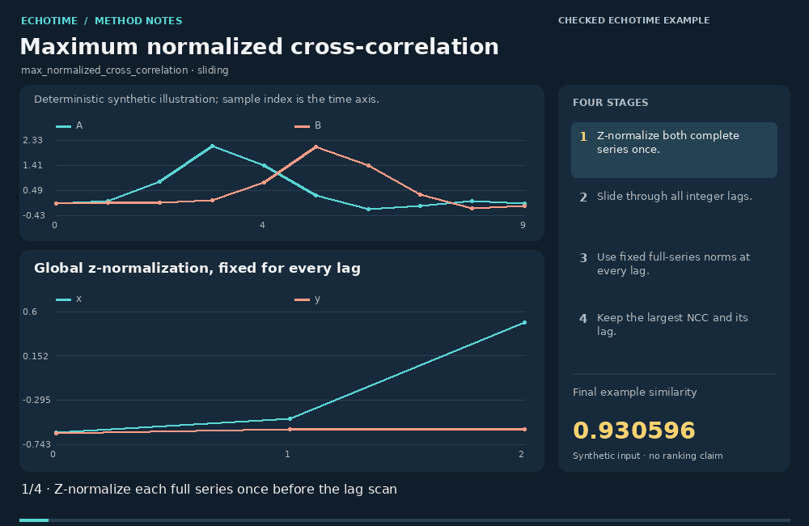

[Static image](../../src/echotime/data/method_animations/media/max_normalized_cross_correlation.png) · [Inputs and full calculation trace](../../src/echotime/data/method_animations/traces/max_normalized_cross_correlation.json) · [Open in the website](https://zipengwu.me/EchoTime/guide/methods.html#animation-max_normalized_cross_correlation)

Maximum NCC finds the global integer shift with the largest normalized cross-correlation. EchoTime first z-normalizes each full series, then uses full-series norms at every lag. The animation shows overlap pairs and the complete lag profile, including the reduced overlap near the boundaries.

最大 NCC 寻找归一化互相关最大的全局整数平移。EchoTime 先对完整序列分别进行 Z 标准化，再在每个滞后位置使用固定的完整序列范数。动画显示重叠配对与完整滞后曲线，包括边界附近的较短重叠。

### Calculation / 计算

```text
max_lag sum_overlap z(x)[i]*z(y)[i-lag] / (||z(x)||_2*||z(y)||_2)
```

1. Z-normalize both complete series once.
   对两条完整序列分别进行 Z 标准化。
2. Slide through all integer lags and match only overlapping samples.
   遍历整数滞后，仅匹配重叠样本。
3. Divide each overlap dot product by the same full-series norm product.
   以固定的完整序列范数乘积归一化各重叠点积。
4. Select the largest NCC and record its lag.
   选取最大 NCC 并记录滞后。

**Example similarity:** `0.93059631`.

**Parameters:**

```json
{
  "normalize": true,
  "padding": "zero outside overlap",
  "normalization": "full-series norm product",
  "lags": [
    -9,
    -8,
    -7,
    -6,
    -5,
    -4,
    -3,
    -2,
    -1,
    0,
    1,
    2,
    3,
    4,
    5,
    6,
    7,
    8,
    9
  ],
  "selected_lag": -2
}
```

### Interpretation and limits / 解释与边界

- This is a global shift, not local time warping. 这里估计全局平移，不进行局部时间规整。
- Full-norm zero-padding NCC differs from Pearson or cosine re-normalized on each overlap. 固定全范数的补零 NCC 与在各重叠片段重新归一化的 Pearson 或余弦不同。
- Constant series have undefined statistical correlation; EchoTime retains a zero-NCC convention for zero energy. 常量信号的统计相关未定义；EchoTime 对零能量保留零 NCC 的约定。

### Definition sources / 定义来源

- [EchoTime: ncc_sequence, max_ncc and sbd](https://github.com/ZipengWu365/EchoTime/blob/main/src/echotime/similarity_methods.py)
- [k-Shape original paper: shape-based cross-correlation](https://www.paparrizos.org/papers/PaparrizosSIGMOD15.pdf)

<a id="sbd"></a>
## Shape-based distance (SBD) · `sbd`

**Demonstration:** Checked against EchoTime / 已与 EchoTime 计算核对

**EchoTime coverage:** Implemented in EchoTime · `sbd`

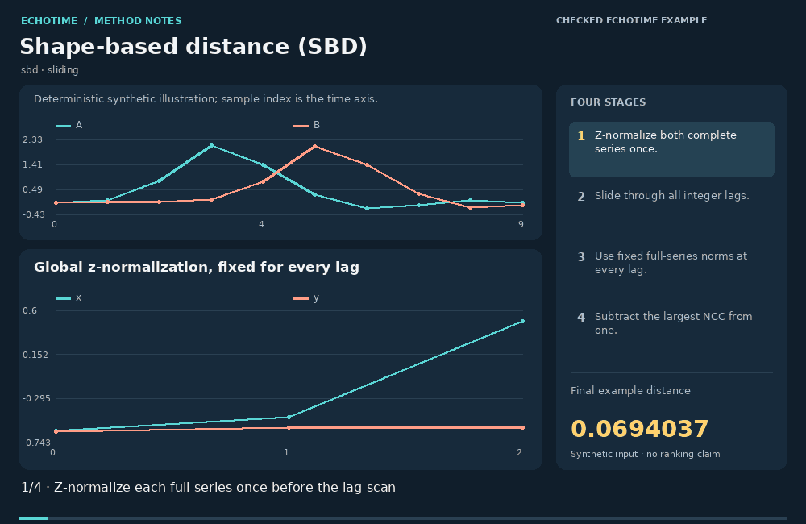

[Static image](../../src/echotime/data/method_animations/media/sbd.png) · [Inputs and full calculation trace](../../src/echotime/data/method_animations/traces/sbd.json) · [Open in the website](https://zipengwu.me/EchoTime/guide/methods.html#animation-sbd)

SBD transforms the best normalized cross-correlation into a dissimilarity by subtracting it from one. EchoTime first z-normalizes each full series, then uses full-series norms at every lag. The animation shows overlap pairs and the complete lag profile, including the reduced overlap near the boundaries.

SBD 将最大的归一化互相关从 1 中减去，形成差异量。EchoTime 先对完整序列分别进行 Z 标准化，再在每个滞后位置使用固定的完整序列范数。动画显示重叠配对与完整滞后曲线，包括边界附近的较短重叠。

### Calculation / 计算

```text
1 - max_lag sum_overlap z(x)[i]*z(y)[i-lag] / (||z(x)||_2*||z(y)||_2)
```

1. Z-normalize both complete series once.
   对两条完整序列分别进行 Z 标准化。
2. Slide through all integer lags and match only overlapping samples.
   遍历整数滞后，仅匹配重叠样本。
3. Divide each overlap dot product by the same full-series norm product.
   以固定的完整序列范数乘积归一化各重叠点积。
4. Subtract the best NCC from one.
   用 1 减去最大 NCC。

**Example distance:** `0.06940369`.

**Parameters:**

```json
{
  "normalize": true,
  "padding": "zero outside overlap",
  "normalization": "full-series norm product",
  "lags": [
    -9,
    -8,
    -7,
    -6,
    -5,
    -4,
    -3,
    -2,
    -1,
    0,
    1,
    2,
    3,
    4,
    5,
    6,
    7,
    8,
    9
  ],
  "selected_lag": -2
}
```

### Interpretation and limits / 解释与边界

- This is a global shift, not local time warping. 这里估计全局平移，不进行局部时间规整。
- Full-norm zero-padding NCC differs from Pearson or cosine re-normalized on each overlap. 固定全范数的补零 NCC 与在各重叠片段重新归一化的 Pearson 或余弦不同。
- Constant series have undefined statistical correlation; EchoTime retains a zero-NCC convention for zero energy. 常量信号的统计相关未定义；EchoTime 对零能量保留零 NCC 的约定。

### Definition sources / 定义来源

- [EchoTime: ncc_sequence, max_ncc and sbd](https://github.com/ZipengWu365/EchoTime/blob/main/src/echotime/similarity_methods.py)
- [k-Shape original paper: shape-based cross-correlation](https://www.paparrizos.org/papers/PaparrizosSIGMOD15.pdf)

<a id="shift_euclidean_distance"></a>
## Shifted Euclidean · `shift_euclidean_distance`

**Demonstration:** Reference-formula demonstration / 参考公式演示

**EchoTime coverage:** Possible addition

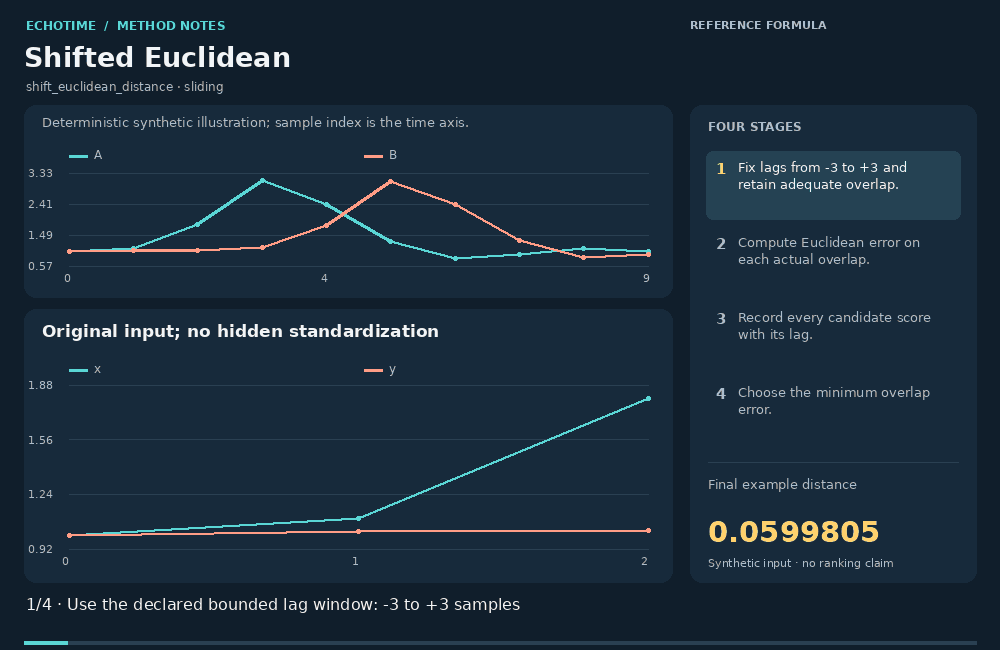

[Static image](../../src/echotime/data/method_animations/media/shift_euclidean_distance.png) · [Inputs and full calculation trace](../../src/echotime/data/method_animations/traces/shift_euclidean_distance.json) · [Open in the website](https://zipengwu.me/EchoTime/guide/methods.html#animation-shift_euclidean_distance)

Shifted Euclidean evaluates sqrt(sum of squared overlap errors) after each permitted integer shift, using only samples that overlap. This example admits lags from minus three to plus three samples, leaving at least seven paired observations. The animation shows the actual overlap pairs and candidate scores before selecting their minimum.

Shifted Euclidean 在每个允许的整数平移后，仅对重叠样本计算对应分数。本例滞后范围为 −3 至 +3 个采样点，始终保留至少七对观测。动图展示实际配对和候选分数，再选择最小值。

### Calculation / 计算

```text
min_{lag=-3,...,3} ||x_overlap-y_overlap||_2
```

1. Fix the permitted lags and minimum acceptable overlap before scoring.
   先固定允许滞后与最小可接受重叠长度。
2. At each lag, compute sqrt(sum of squared overlap errors) on the actual paired samples.
   对每个滞后的实际配对样本计算对应分数。
3. Record every candidate score together with its lag.
   记录所有候选分数及其滞后。
4. Choose the minimum overlap score.
   选取最小重叠分数。

**Example distance:** `0.059980484`.

**Parameters:**

```json
{
  "lags": [
    -3,
    -2,
    -1,
    0,
    1,
    2,
    3
  ],
  "minimum_overlap": 7,
  "normalization": "none beyond stated mean/root",
  "selected_lag": -2
}
```

### Interpretation and limits / 解释与边界

- The unnormalized total can favour lags with fewer overlapping points. 未归一化总量可能偏向重叠点较少的滞后。
- The bounded window is an explicit demonstration choice; allowing every possible lag changes the problem. 有界窗口是明确的演示选择；允许所有滞后会改变问题。
- Overlap cropping removes unmatched endpoints from this score. 重叠裁剪会从分数中排除未匹配的两端。

### Definition sources / 定义来源

- [Imported registry: overlap-based shift definitions](https://github.com/ZipengWu365/EchoTime/blob/main/src/echotime/data/ts_similarity_package_v2_registry.csv)
- [SciPy: euclidean](https://docs.scipy.org/doc/scipy/reference/generated/scipy.spatial.distance.euclidean.html)

<a id="shift_rmse_distance"></a>
## Shifted RMSE · `shift_rmse_distance`

**Demonstration:** Reference-formula demonstration / 参考公式演示

**EchoTime coverage:** Possible addition

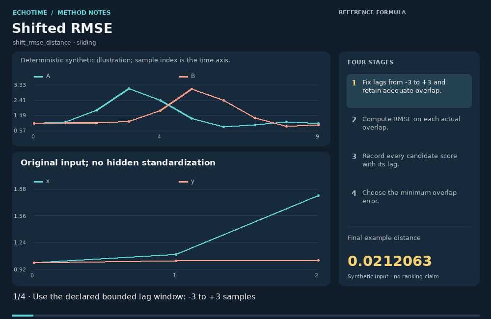

[Static image](../../src/echotime/data/method_animations/media/shift_rmse_distance.png) · [Inputs and full calculation trace](../../src/echotime/data/method_animations/traces/shift_rmse_distance.json) · [Open in the website](https://zipengwu.me/EchoTime/guide/methods.html#animation-shift_rmse_distance)

Shifted RMSE evaluates sqrt(mean of squared overlap errors) after each permitted integer shift, using only samples that overlap. This example admits lags from minus three to plus three samples, leaving at least seven paired observations. The animation shows the actual overlap pairs and candidate scores before selecting their minimum.

Shifted RMSE 在每个允许的整数平移后，仅对重叠样本计算对应分数。本例滞后范围为 −3 至 +3 个采样点，始终保留至少七对观测。动图展示实际配对和候选分数，再选择最小值。

### Calculation / 计算

```text
min_{lag=-3,...,3} sqrt(mean((x_overlap-y_overlap)^2))
```

1. Fix the permitted lags and minimum acceptable overlap before scoring.
   先固定允许滞后与最小可接受重叠长度。
2. At each lag, compute sqrt(mean of squared overlap errors) on the actual paired samples.
   对每个滞后的实际配对样本计算对应分数。
3. Record every candidate score together with its lag.
   记录所有候选分数及其滞后。
4. Choose the minimum overlap score.
   选取最小重叠分数。

**Example distance:** `0.021206303`.

**Parameters:**

```json
{
  "lags": [
    -3,
    -2,
    -1,
    0,
    1,
    2,
    3
  ],
  "minimum_overlap": 7,
  "normalization": "none beyond stated mean/root",
  "selected_lag": -2
}
```

### Interpretation and limits / 解释与边界

- Averaging adjusts for overlap length but a tiny overlap can still give an unstable optimum. 平均化调整了重叠长度影响，但很短的重叠仍可能产生不稳定最优点。
- The bounded window is an explicit demonstration choice; allowing every possible lag changes the problem. 有界窗口是明确的演示选择；允许所有滞后会改变问题。
- Overlap cropping removes unmatched endpoints from this score. 重叠裁剪会从分数中排除未匹配的两端。

### Definition sources / 定义来源

- [Imported registry: overlap-based shift definitions](https://github.com/ZipengWu365/EchoTime/blob/main/src/echotime/data/ts_similarity_package_v2_registry.csv)
- [SciPy: euclidean](https://docs.scipy.org/doc/scipy/reference/generated/scipy.spatial.distance.euclidean.html)

<a id="shift_manhattan_distance"></a>
## Shifted Manhattan · `shift_manhattan_distance`

**Demonstration:** Reference-formula demonstration / 参考公式演示

**EchoTime coverage:** Possible addition

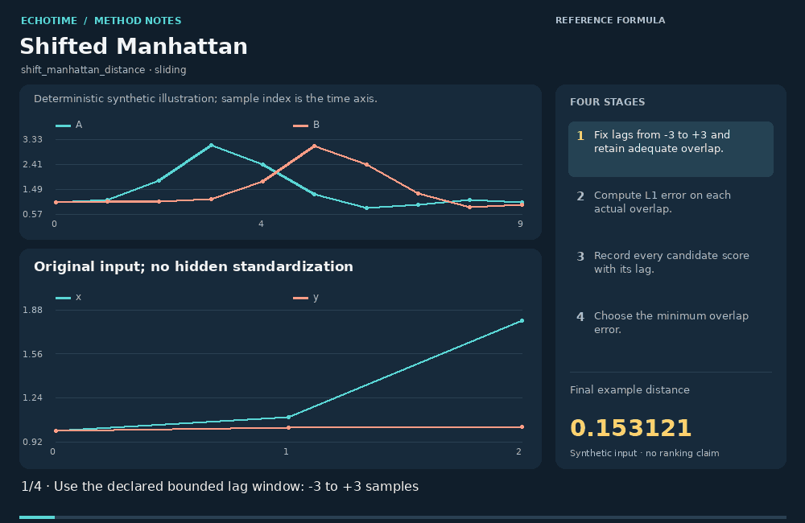

[Static image](../../src/echotime/data/method_animations/media/shift_manhattan_distance.png) · [Inputs and full calculation trace](../../src/echotime/data/method_animations/traces/shift_manhattan_distance.json) · [Open in the website](https://zipengwu.me/EchoTime/guide/methods.html#animation-shift_manhattan_distance)

Shifted Manhattan evaluates sum of absolute overlap errors after each permitted integer shift, using only samples that overlap. This example admits lags from minus three to plus three samples, leaving at least seven paired observations. The animation shows the actual overlap pairs and candidate scores before selecting their minimum.

Shifted Manhattan 在每个允许的整数平移后，仅对重叠样本计算对应分数。本例滞后范围为 −3 至 +3 个采样点，始终保留至少七对观测。动图展示实际配对和候选分数，再选择最小值。

### Calculation / 计算

```text
min_{lag=-3,...,3} ||x_overlap-y_overlap||_1
```

1. Fix the permitted lags and minimum acceptable overlap before scoring.
   先固定允许滞后与最小可接受重叠长度。
2. At each lag, compute sum of absolute overlap errors on the actual paired samples.
   对每个滞后的实际配对样本计算对应分数。
3. Record every candidate score together with its lag.
   记录所有候选分数及其滞后。
4. Choose the minimum overlap score.
   选取最小重叠分数。

**Example distance:** `0.15312069`.

**Parameters:**

```json
{
  "lags": [
    -3,
    -2,
    -1,
    0,
    1,
    2,
    3
  ],
  "minimum_overlap": 7,
  "normalization": "none beyond stated mean/root",
  "selected_lag": -2
}
```

### Interpretation and limits / 解释与边界

- The unnormalized L1 total changes with overlap size; restrict admissible lags. 未归一化 L1 总量随重叠数量变化，应限制允许的滞后。
- The bounded window is an explicit demonstration choice; allowing every possible lag changes the problem. 有界窗口是明确的演示选择；允许所有滞后会改变问题。
- Overlap cropping removes unmatched endpoints from this score. 重叠裁剪会从分数中排除未匹配的两端。

### Definition sources / 定义来源

- [Imported registry: overlap-based shift definitions](https://github.com/ZipengWu365/EchoTime/blob/main/src/echotime/data/ts_similarity_package_v2_registry.csv)
- [SciPy: cityblock](https://docs.scipy.org/doc/scipy/reference/generated/scipy.spatial.distance.cityblock.html)

<a id="shift_mae_distance"></a>
## Shifted MAE · `shift_mae_distance`

**Demonstration:** Reference-formula demonstration / 参考公式演示

**EchoTime coverage:** Possible addition

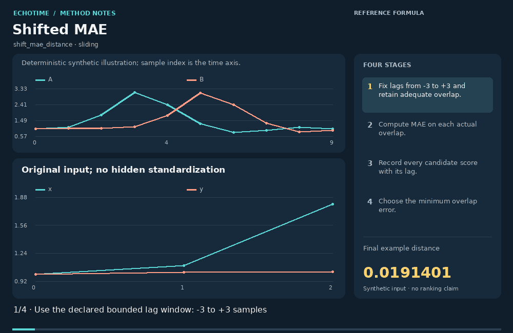

[Static image](../../src/echotime/data/method_animations/media/shift_mae_distance.png) · [Inputs and full calculation trace](../../src/echotime/data/method_animations/traces/shift_mae_distance.json) · [Open in the website](https://zipengwu.me/EchoTime/guide/methods.html#animation-shift_mae_distance)

Shifted MAE evaluates mean absolute overlap error after each permitted integer shift, using only samples that overlap. This example admits lags from minus three to plus three samples, leaving at least seven paired observations. The animation shows the actual overlap pairs and candidate scores before selecting their minimum.

Shifted MAE 在每个允许的整数平移后，仅对重叠样本计算对应分数。本例滞后范围为 −3 至 +3 个采样点，始终保留至少七对观测。动图展示实际配对和候选分数，再选择最小值。

### Calculation / 计算

```text
min_{lag=-3,...,3} mean(abs(x_overlap-y_overlap))
```

1. Fix the permitted lags and minimum acceptable overlap before scoring.
   先固定允许滞后与最小可接受重叠长度。
2. At each lag, compute mean absolute overlap error on the actual paired samples.
   对每个滞后的实际配对样本计算对应分数。
3. Record every candidate score together with its lag.
   记录所有候选分数及其滞后。
4. Choose the minimum overlap score.
   选取最小重叠分数。

**Example distance:** `0.019140086`.

**Parameters:**

```json
{
  "lags": [
    -3,
    -2,
    -1,
    0,
    1,
    2,
    3
  ],
  "minimum_overlap": 7,
  "normalization": "none beyond stated mean/root",
  "selected_lag": -2
}
```

### Interpretation and limits / 解释与边界

- Per-overlap averaging does not guarantee a stable estimate on very short overlaps. 对重叠片段求平均不能保证短片段上的估计稳定。
- The bounded window is an explicit demonstration choice; allowing every possible lag changes the problem. 有界窗口是明确的演示选择；允许所有滞后会改变问题。
- Overlap cropping removes unmatched endpoints from this score. 重叠裁剪会从分数中排除未匹配的两端。

### Definition sources / 定义来源

- [Imported registry: overlap-based shift definitions](https://github.com/ZipengWu365/EchoTime/blob/main/src/echotime/data/ts_similarity_package_v2_registry.csv)
- [SciPy: cityblock](https://docs.scipy.org/doc/scipy/reference/generated/scipy.spatial.distance.cityblock.html)

<a id="shift_cosine_similarity"></a>
## Shifted cosine similarity · `shift_cosine_similarity`

**Demonstration:** Reference-formula demonstration / 参考公式演示

**EchoTime coverage:** Possible addition

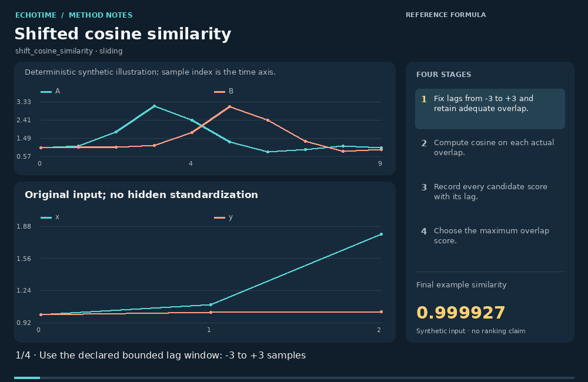

[Static image](../../src/echotime/data/method_animations/media/shift_cosine_similarity.png) · [Inputs and full calculation trace](../../src/echotime/data/method_animations/traces/shift_cosine_similarity.json) · [Open in the website](https://zipengwu.me/EchoTime/guide/methods.html#animation-shift_cosine_similarity)

Shifted cosine similarity evaluates cosine on the current overlap after each permitted integer shift, using only samples that overlap. This example admits lags from minus three to plus three samples, leaving at least seven paired observations. The animation shows the actual overlap pairs and candidate scores before selecting their maximum.

Shifted cosine similarity 在每个允许的整数平移后，仅对重叠样本计算对应分数。本例滞后范围为 −3 至 +3 个采样点，始终保留至少七对观测。动图展示实际配对和候选分数，再选择最大值。

### Calculation / 计算

```text
max_{lag=-3,...,3} cosine(x_overlap,y_overlap)
```

1. Fix the permitted lags and minimum acceptable overlap before scoring.
   先固定允许滞后与最小可接受重叠长度。
2. At each lag, compute cosine on the current overlap on the actual paired samples.
   对每个滞后的实际配对样本计算对应分数。
3. Record every candidate score together with its lag.
   记录所有候选分数及其滞后。
4. Choose the maximum overlap score.
   选取最大重叠分数。

**Example similarity:** `0.99992749`.

**Parameters:**

```json
{
  "lags": [
    -3,
    -2,
    -1,
    0,
    1,
    2,
    3
  ],
  "minimum_overlap": 7,
  "normalization": "per overlap",
  "selected_lag": -2
}
```

### Interpretation and limits / 解释与边界

- Every overlap has its own norm; this is different from full-norm NCC. 每个重叠片段使用自己的范数，与全范数 NCC 不同。
- The bounded window is an explicit demonstration choice; allowing every possible lag changes the problem. 有界窗口是明确的演示选择；允许所有滞后会改变问题。
- Overlap cropping removes unmatched endpoints from this score. 重叠裁剪会从分数中排除未匹配的两端。

### Definition sources / 定义来源

- [Imported registry: overlap-based shift definitions](https://github.com/ZipengWu365/EchoTime/blob/main/src/echotime/data/ts_similarity_package_v2_registry.csv)
- [SciPy: cosine](https://docs.scipy.org/doc/scipy/reference/generated/scipy.spatial.distance.cosine.html)

<a id="shift_cosine_distance"></a>
## Shifted cosine distance · `shift_cosine_distance`

**Demonstration:** Reference-formula demonstration / 参考公式演示

**EchoTime coverage:** Possible addition

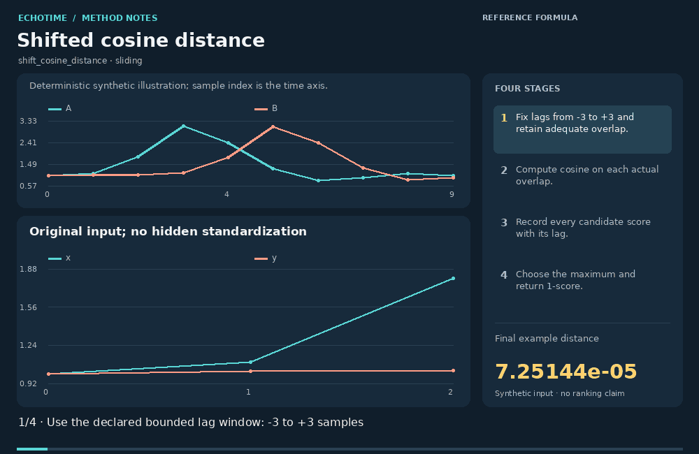

[Static image](../../src/echotime/data/method_animations/media/shift_cosine_distance.png) · [Inputs and full calculation trace](../../src/echotime/data/method_animations/traces/shift_cosine_distance.json) · [Open in the website](https://zipengwu.me/EchoTime/guide/methods.html#animation-shift_cosine_distance)

Shifted cosine distance evaluates cosine on the current overlap after each permitted integer shift, using only samples that overlap. This example admits lags from minus three to plus three samples, leaving at least seven paired observations. The animation shows the actual overlap pairs and candidate scores before selecting their maximum. The final one-minus transform produces the displayed dissimilarity.

Shifted cosine distance 在每个允许的整数平移后，仅对重叠样本计算对应分数。本例滞后范围为 −3 至 +3 个采样点，始终保留至少七对观测。动图展示实际配对和候选分数，再选择最大值。最后取 1 减分数得到差异量。

### Calculation / 计算

```text
1 - max_{lag=-3,...,3} cosine(x_overlap,y_overlap)
```

1. Fix the permitted lags and minimum acceptable overlap before scoring.
   先固定允许滞后与最小可接受重叠长度。
2. At each lag, compute cosine on the current overlap on the actual paired samples.
   对每个滞后的实际配对样本计算对应分数。
3. Record every candidate score together with its lag.
   记录所有候选分数及其滞后。
4. Choose the maximum and apply 1-score.
   选择最大分数后取 1 减。

**Example distance:** `7.251435e-05`.

**Parameters:**

```json
{
  "lags": [
    -3,
    -2,
    -1,
    0,
    1,
    2,
    3
  ],
  "minimum_overlap": 7,
  "normalization": "per overlap",
  "selected_lag": -2
}
```

### Interpretation and limits / 解释与边界

- The one-minus transform does not establish a metric on raw time series. 1 减变换不能自动证明原时间序列上的度量性质。
- The bounded window is an explicit demonstration choice; allowing every possible lag changes the problem. 有界窗口是明确的演示选择；允许所有滞后会改变问题。
- Overlap cropping removes unmatched endpoints from this score. 重叠裁剪会从分数中排除未匹配的两端。

### Definition sources / 定义来源

- [Imported registry: overlap-based shift definitions](https://github.com/ZipengWu365/EchoTime/blob/main/src/echotime/data/ts_similarity_package_v2_registry.csv)
- [SciPy: cosine](https://docs.scipy.org/doc/scipy/reference/generated/scipy.spatial.distance.cosine.html)

<a id="shift_pearson_similarity"></a>
## Shifted Pearson correlation · `shift_pearson_similarity`

**Demonstration:** Reference-formula demonstration / 参考公式演示

**EchoTime coverage:** Conceptually covered · `best_lag_pearson_r`

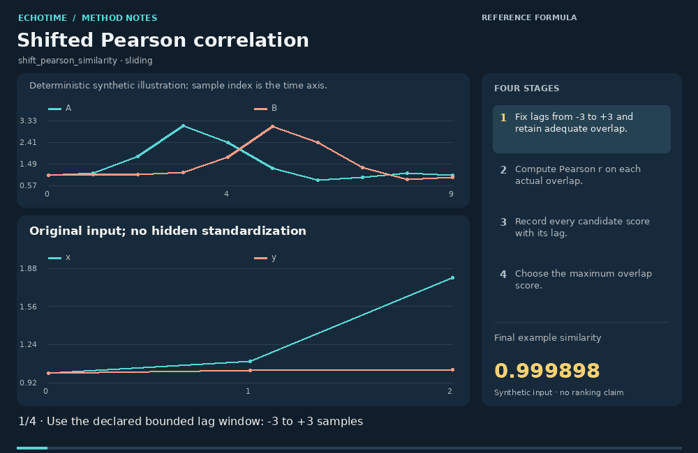

[Static image](../../src/echotime/data/method_animations/media/shift_pearson_similarity.png) · [Inputs and full calculation trace](../../src/echotime/data/method_animations/traces/shift_pearson_similarity.json) · [Open in the website](https://zipengwu.me/EchoTime/guide/methods.html#animation-shift_pearson_similarity)

Shifted Pearson correlation evaluates Pearson r on the current overlap after each permitted integer shift, using only samples that overlap. This example admits lags from minus three to plus three samples, leaving at least seven paired observations. The animation shows the actual overlap pairs and candidate scores before selecting their maximum.

Shifted Pearson correlation 在每个允许的整数平移后，仅对重叠样本计算对应分数。本例滞后范围为 −3 至 +3 个采样点，始终保留至少七对观测。动图展示实际配对和候选分数，再选择最大值。

### Calculation / 计算

```text
max_{lag=-3,...,3} corr(x_overlap,y_overlap)
```

1. Fix the permitted lags and minimum acceptable overlap before scoring.
   先固定允许滞后与最小可接受重叠长度。
2. At each lag, compute Pearson r on the current overlap on the actual paired samples.
   对每个滞后的实际配对样本计算对应分数。
3. Record every candidate score together with its lag.
   记录所有候选分数及其滞后。
4. Choose the maximum overlap score.
   选取最大重叠分数。

**Example similarity:** `0.9998975`.

**Parameters:**

```json
{
  "lags": [
    -3,
    -2,
    -1,
    0,
    1,
    2,
    3
  ],
  "minimum_overlap": 7,
  "normalization": "per overlap",
  "selected_lag": -2
}
```

### Interpretation and limits / 解释与边界

- Each overlap is independently centered; selecting the best lag also selects among several correlations. 每个重叠片段分别去均值；选取最佳滞后同时也是在多个相关结果中选择。
- The bounded window is an explicit demonstration choice; allowing every possible lag changes the problem. 有界窗口是明确的演示选择；允许所有滞后会改变问题。
- Overlap cropping removes unmatched endpoints from this score. 重叠裁剪会从分数中排除未匹配的两端。

### Definition sources / 定义来源

- [Imported registry: overlap-based shift definitions](https://github.com/ZipengWu365/EchoTime/blob/main/src/echotime/data/ts_similarity_package_v2_registry.csv)
- [SciPy: correlation](https://docs.scipy.org/doc/scipy/reference/generated/scipy.spatial.distance.correlation.html)

<a id="shift_pearson_distance"></a>
## Shifted Pearson distance · `shift_pearson_distance`

**Demonstration:** Reference-formula demonstration / 参考公式演示

**EchoTime coverage:** Conceptually covered · `best_lag_pearson_r`

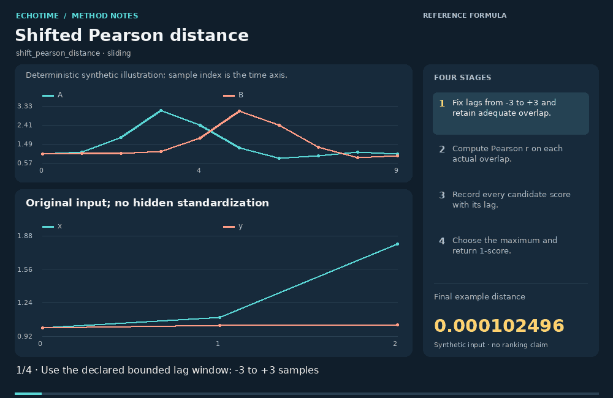

[Static image](../../src/echotime/data/method_animations/media/shift_pearson_distance.png) · [Inputs and full calculation trace](../../src/echotime/data/method_animations/traces/shift_pearson_distance.json) · [Open in the website](https://zipengwu.me/EchoTime/guide/methods.html#animation-shift_pearson_distance)

Shifted Pearson distance evaluates Pearson r on the current overlap after each permitted integer shift, using only samples that overlap. This example admits lags from minus three to plus three samples, leaving at least seven paired observations. The animation shows the actual overlap pairs and candidate scores before selecting their maximum. The final one-minus transform produces the displayed dissimilarity.

Shifted Pearson distance 在每个允许的整数平移后，仅对重叠样本计算对应分数。本例滞后范围为 −3 至 +3 个采样点，始终保留至少七对观测。动图展示实际配对和候选分数，再选择最大值。最后取 1 减分数得到差异量。

### Calculation / 计算

```text
1 - max_{lag=-3,...,3} corr(x_overlap,y_overlap)
```

1. Fix the permitted lags and minimum acceptable overlap before scoring.
   先固定允许滞后与最小可接受重叠长度。
2. At each lag, compute Pearson r on the current overlap on the actual paired samples.
   对每个滞后的实际配对样本计算对应分数。
3. Record every candidate score together with its lag.
   记录所有候选分数及其滞后。
4. Choose the maximum and apply 1-score.
   选择最大分数后取 1 减。

**Example distance:** `0.00010249589`.

**Parameters:**

```json
{
  "lags": [
    -3,
    -2,
    -1,
    0,
    1,
    2,
    3
  ],
  "minimum_overlap": 7,
  "normalization": "per overlap",
  "selected_lag": -2
}
```

### Interpretation and limits / 解释与边界

- One minus the selected correlation is an explicit dissimilarity, not a probability or significance test. 1 减选定相关是明确的差异量，并非概率或显著性检验。
- The bounded window is an explicit demonstration choice; allowing every possible lag changes the problem. 有界窗口是明确的演示选择；允许所有滞后会改变问题。
- Overlap cropping removes unmatched endpoints from this score. 重叠裁剪会从分数中排除未匹配的两端。

### Definition sources / 定义来源

- [Imported registry: overlap-based shift definitions](https://github.com/ZipengWu365/EchoTime/blob/main/src/echotime/data/ts_similarity_package_v2_registry.csv)
- [SciPy: correlation](https://docs.scipy.org/doc/scipy/reference/generated/scipy.spatial.distance.correlation.html)

<a id="independent_sbd"></a>
## Independent channel SBD · `independent_sbd`

**Demonstration:** Checked against EchoTime / 已与 EchoTime 计算核对

**EchoTime coverage:** Implemented in EchoTime · `independent_sbd`

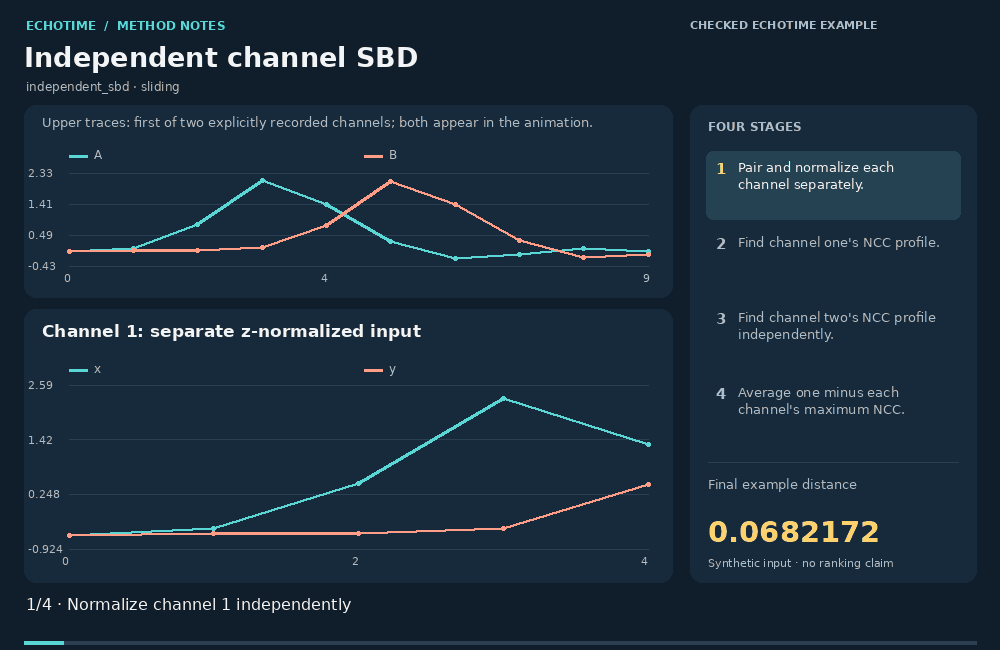

[Static image](../../src/echotime/data/method_animations/media/independent_sbd.png) · [Inputs and full calculation trace](../../src/echotime/data/method_animations/traces/independent_sbd.json) · [Open in the website](https://zipengwu.me/EchoTime/guide/methods.html#animation-independent_sbd)

Independent channel comparison permits each paired channel to choose a different global lag. The illustration uses two channels with peaks shifted in opposite directions, then averages their individually optimized scores. For SBD it averages one minus each channel's maximum NCC. The upper input plot shows channel one; both channels are displayed in the computational frames.

独立通道比较允许每对通道选择不同的全局滞后。本例使用两组峰值向相反方向偏移的通道，再平均各自优化后的分数。SBD 型平均每个通道的 1 减最大 NCC。上方输入图显示第一通道，计算帧依次展示两个通道。

### Calculation / 计算

```text
mean_c (1-max_lag NCC_c(lag))
```

1. Match channels explicitly and normalize each series within each channel.
   明确通道配对，并在每个通道内分别标准化。
2. Compute the full-norm NCC lag profile for channel one.
   计算第一通道的全范数 NCC 滞后曲线。
3. Repeat the lag scan independently for channel two.
   独立计算第二通道的滞后曲线。
4. Average channel-wise dissimilarities.
   平均通道差异量。

**Example distance:** `0.068217211`.

**Parameters:**

```json
{
  "channels_x": [
    [
      0.0,
      0.2
    ],
    [
      0.1,
      0.9
    ],
    [
      0.8,
      1.8
    ],
    [
      2.1,
      1.2
    ],
    [
      1.4,
      0.1
    ],
    [
      0.3,
      -0.6
    ],
    [
      -0.2,
      -0.3
    ],
    [
      -0.1,
      0.4
    ],
    [
      0.1,
      0.8
    ],
    [
      0.0,
      0.2
    ]
  ],
  "channels_y": [
    [
      0.0,
      1.82
    ],
    [
      0.025244129544236896,
      1.2108060461173626
    ],
    [
      0.02727892280477045,
      0.09167706326905715
    ],
    [
      0.10423360024179602,
      -0.6197998499320089
    ],
    [
      0.7772959251407622,
      -0.3130728724172722
    ],
    [
      2.071232271760106,
      0.40567324370926455
    ],
    [
      1.391617535054032,
      0.8192034057330073
    ],
    [
      0.3197095979615637,
      0.2150780450868661
    ],
    [
      -0.17031925260129854,
      -0.0029100006761722708
    ],
    [
      -0.0876364454427473,
      -0.018222605237693538
    ]
  ],
  "upper_plot_channel": 0,
  "channel_best_lags": [
    -2,
    2
  ],
  "aggregation": "equal channel mean"
}
```

### Interpretation and limits / 解释与边界

- Independent lags discard cross-channel timing consistency; choose a joint-lag method if synchrony matters. 独立滞后舍弃跨通道时序一致性；同步关系重要时应使用共同滞后的方法。
- Channels are averaged equally here; this is not a learned weighting. 本例对通道等权平均，不学习权重。
- The channel pairing must have a scientific meaning. 通道配对必须有科学意义。

### Definition sources / 定义来源

- [EchoTime: independent_max_ncc and independent_sbd](https://github.com/ZipengWu365/EchoTime/blob/main/src/echotime/similarity_methods.py)

<a id="independent_max_ncc"></a>
## Independent channel maximum NCC · `independent_max_ncc`

**Demonstration:** Checked against EchoTime / 已与 EchoTime 计算核对

**EchoTime coverage:** Implemented in EchoTime · `independent_max_ncc`

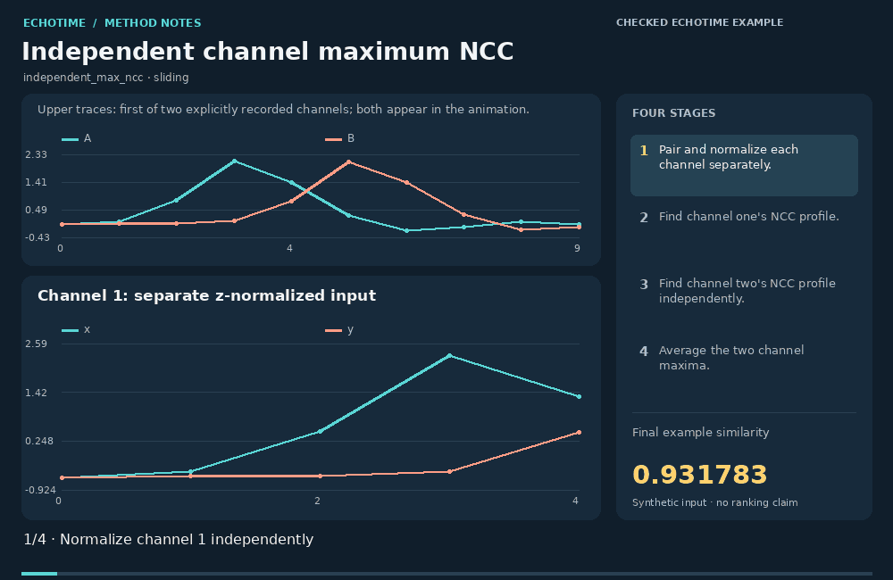

[Static image](../../src/echotime/data/method_animations/media/independent_max_ncc.png) · [Inputs and full calculation trace](../../src/echotime/data/method_animations/traces/independent_max_ncc.json) · [Open in the website](https://zipengwu.me/EchoTime/guide/methods.html#animation-independent_max_ncc)

Independent channel comparison permits each paired channel to choose a different global lag. The illustration uses two channels with peaks shifted in opposite directions, then averages their individually optimized scores. For independent maximum NCC it averages the channel maxima. The upper input plot shows channel one; both channels are displayed in the computational frames.

独立通道比较允许每对通道选择不同的全局滞后。本例使用两组峰值向相反方向偏移的通道，再平均各自优化后的分数。最大 NCC 型直接平均各通道最大值。上方输入图显示第一通道，计算帧依次展示两个通道。

### Calculation / 计算

```text
mean_c max_lag NCC_c(lag)
```

1. Match channels explicitly and normalize each series within each channel.
   明确通道配对，并在每个通道内分别标准化。
2. Compute the full-norm NCC lag profile for channel one.
   计算第一通道的全范数 NCC 滞后曲线。
3. Repeat the lag scan independently for channel two.
   独立计算第二通道的滞后曲线。
4. Average the maxima; no common lag is required.
   平均各通道最大值，不要求共同滞后。

**Example similarity:** `0.93178279`.

**Parameters:**

```json
{
  "channels_x": [
    [
      0.0,
      0.2
    ],
    [
      0.1,
      0.9
    ],
    [
      0.8,
      1.8
    ],
    [
      2.1,
      1.2
    ],
    [
      1.4,
      0.1
    ],
    [
      0.3,
      -0.6
    ],
    [
      -0.2,
      -0.3
    ],
    [
      -0.1,
      0.4
    ],
    [
      0.1,
      0.8
    ],
    [
      0.0,
      0.2
    ]
  ],
  "channels_y": [
    [
      0.0,
      1.82
    ],
    [
      0.025244129544236896,
      1.2108060461173626
    ],
    [
      0.02727892280477045,
      0.09167706326905715
    ],
    [
      0.10423360024179602,
      -0.6197998499320089
    ],
    [
      0.7772959251407622,
      -0.3130728724172722
    ],
    [
      2.071232271760106,
      0.40567324370926455
    ],
    [
      1.391617535054032,
      0.8192034057330073
    ],
    [
      0.3197095979615637,
      0.2150780450868661
    ],
    [
      -0.17031925260129854,
      -0.0029100006761722708
    ],
    [
      -0.0876364454427473,
      -0.018222605237693538
    ]
  ],
  "upper_plot_channel": 0,
  "channel_best_lags": [
    -2,
    2
  ],
  "aggregation": "equal channel mean"
}
```

### Interpretation and limits / 解释与边界

- Independent lags discard cross-channel timing consistency; choose a joint-lag method if synchrony matters. 独立滞后舍弃跨通道时序一致性；同步关系重要时应使用共同滞后的方法。
- Channels are averaged equally here; this is not a learned weighting. 本例对通道等权平均，不学习权重。
- The channel pairing must have a scientific meaning. 通道配对必须有科学意义。

### Definition sources / 定义来源

- [EchoTime: independent_max_ncc and independent_sbd](https://github.com/ZipengWu365/EchoTime/blob/main/src/echotime/similarity_methods.py)
